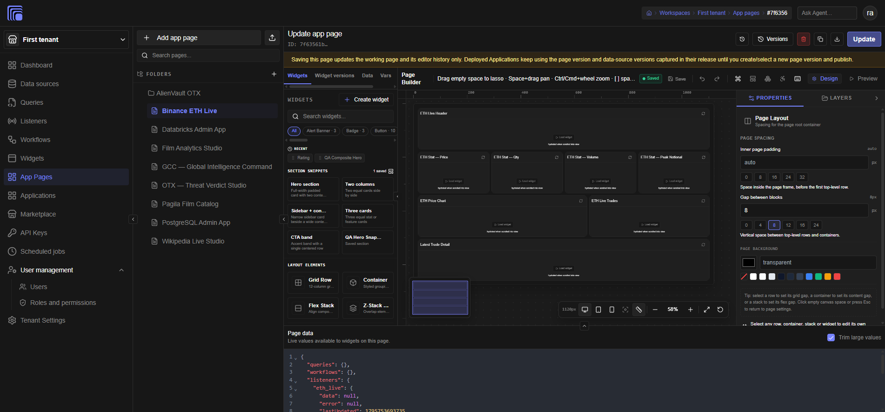
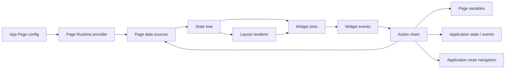
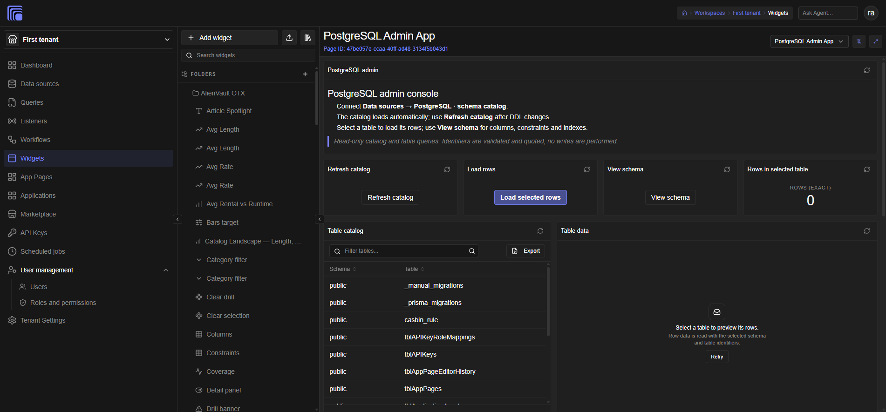
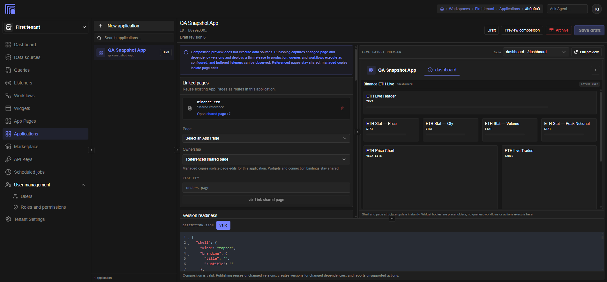
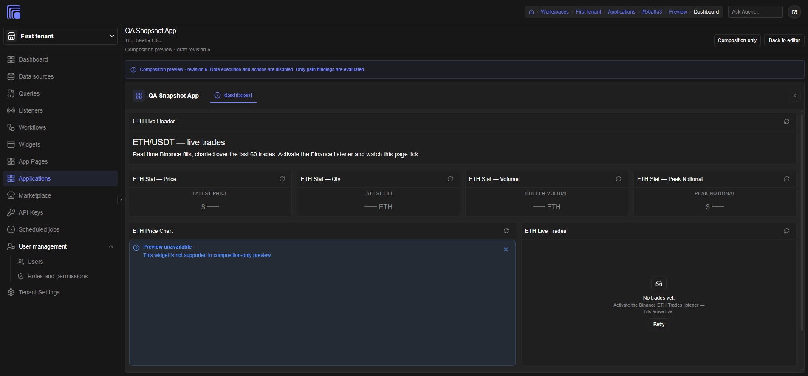

# App Pages & Widgets

<a id="table-of-contents"></a>

# Table of Contents

1. [Overview](#overview)
2. [Key Concepts](#key-concepts)
3. [How It Works — End-to-End Lifecycle](#how-it-works)
4. [App Pages](#app-pages)
  - [App Page Configuration Fields](#app-page-configuration-fields)
  - [Page Data Sources](#page-data-sources)
  - [Page Variables](#page-variables)
  - [Layout System](#layout-system)
  - [Scrolling, Responsive Layout, Conditions & Repeats](#scrolling-responsive-layout-conditions-repeats)
5. [Widgets](#widgets)
  - [Widget Configuration Fields](#widget-configuration-fields)
  - [Widget Types Reference](#widget-types-reference)
  - [Composite Runtime](#composite-runtime)
  - [Widget Properties (Styling)](#widget-properties-styling)
  - [Widget Events System](#widget-events-system)
  - [Widget Methods](#widget-methods)
6. [JavaScript Expression Engine & Data Binding](#expression-engine-data-binding)
7. [Applications & App Studio Integration](#applications-app-studio-integration)
8. [Real-Time & Async Behaviour](#real-time-async-behaviour)
9. [Integration Points](#integration-points)
10. [Access Control](#access-control)
11. [Error States & Edge Cases](#error-states-edge-cases)
12. [Best Practices](#best-practices)
13. [Common Use Cases](#common-use-cases)
14. [Limitations & Constraints](#limitations-constraints)
15. [Related Modules](#related-modules)

* * *

<a id="overview"></a>

## Overview

**App Pages** are the primary end-user-facing interface layer in Jet Admin. An App Page is a configurable canvas onto which **Widgets** are placed, data sources are wired, and interactive behaviours are defined — all without writing application code.

A completed App Page acts as a dashboard, data entry form, report viewer, or operational tool depending on how it is configured. Pages are presented to users in **View mode** (read-only rendering) or opened in an **Editor** (where the layout, data sources, variables, and widget configurations can be modified).

**Widgets** are the individual visual components that appear on a page — charts, tables, forms, text blocks, KPI cards, and so on. Each widget is a reusable, independently configurable unit that can be placed on multiple pages. Widgets receive their data reactively through the page's runtime state tree.

Together, App Pages and Widgets implement the **Apps → Pages → Widgets** canvas model that forms the user-facing product surface of Jet Admin.

A page can be used in two ways:

- **Standalone** at its App Page route, with live widget definitions and the page's own Socket.IO subscription path.
- **Composed into an Application** as a linked, routed page. The Application supplies the shell, route context, application state/events, and release-scoped runtime. Application release behavior is documented in [Applications](../applications/applications.md).



* * *

<a id="key-concepts"></a>

## Key Concepts

| Term | Definition |
| --- | --- |
| **App Page** | A named, configurable canvas consisting of a layout, data sources, variables, and a set of placed widget instances. |
| **Widget** | A reusable visual component (chart, table, form, etc.) with its own configuration, stored independently and referenced by pages. |
| **Widget Instance** (Widget Key) | A unique placement of a widget on a specific page. Represented as `widget_{widgetID}_{instanceIndex}`. The same widget definition can appear multiple times on the same or different pages. |
| **Page Config** | The JSON object stored with an App Page that defines its layout tree, data source bindings, variable definitions, and widget placement keys. |
| **Widget Config** | The JSON object stored with a Widget that defines its visual properties, data binding expressions, and event handlers. |
| **State Tree** | The live, in-memory reactive data object maintained by the Page Runtime. It holds the current values of all data sources (queries, workflows, listeners), page variables, widget states, and globally accessible items. |
| **Expression** | A JavaScript expression inside `{{ }}` delimiters that resolves a value from the state tree at render time. Expressions may be simple path lookups or full JavaScript expressions. |
| **Data Source** | A binding from the page to a Data Query, Workflow, or Listener. Each data source is given an alias through which its result is accessible in expressions. |
| **Page Variable** | A typed, named local state value (string, number, boolean, object, array) whose value can be updated at runtime by widget events. |
| **Layout Tree** | The hierarchical node structure (column → row → widget/container/stack/z-stack) that defines where and how widgets are arranged on the page canvas. |
| **Event Handler** | A named sequence of one or more actions attached to a widget event (e.g., `onRowSelect`) that execute when the event fires. |
| **Action** | A single step in an event handler, such as setting a variable, executing a data source, triggering a workflow, or showing a toast. |
| **Trigger Mode** | A per-data-source setting that controls when a data source is executed: `auto` and `reactive` run on page load, `reactive` also re-runs on tracked state changes, and `manual` only runs when an event fires. |
| **Application** | A routed composition of linked App Pages with a shell, routes, shared state, releases, and environments. Pages receive route/application context when rendered inside one. |
| **Application Variable** | A release-scoped, declared variable shared by every route in an Application. Read as `state.application.variables.{key}`. |
| **Application Event** | A transient, in-memory broadcast between mounted widgets/pages in an Application runtime. Not persisted and not replayed. |
| **Section Snippet** | A saved `layout-snippet` widget containing a captured layout tree. Inserting it copies the structure and remaps widget instance keys. |
| **Composite Widget** | A `composite` widget containing a captured layout with inlined child widget definitions, typed inputs, and declared outputs/events. |

* * *

<a id="how-it-works-end-to-end-lifecycle"></a>

## How It Works — End-to-End Lifecycle {#how-it-works}



<a id="creating-and-editing-an-app-page"></a>

### Creating and Editing an App Page


The Page Builder uses a compact **48px editor top bar**: page name, save state, versions, duplicate/export/delete, design/preview toggle, and the primary **Update** action. Focus mode hides the global navigation and tenant drawer so the canvas gets the full viewport; the focus control in the top bar restores them, and the preference is remembered. The **Page data** console collapses to a status strip and expands on demand.

A user opens the App Page editor, which presents a split-panel interface: a left sidebar (Widgets tab, Data tab, Variables tab, Settings tab) and a right canvas (the layout editor).

The user gives the page a title and description in the Settings tab. They then configure data sources in the Data tab — selecting queries, workflows, or listeners, assigning each an alias, and optionally setting input arguments from page variables or other state. They define page variables in the Variables tab to hold local reactive state (selected row IDs, filter values, modal visibility, etc.).

In the Widgets tab, widgets can be created inline (the Widget IDE opens in a modal), or existing widgets can be dragged from the list onto the canvas. When a widget is placed, a unique **widget instance key** is generated and recorded in the page config.

The canvas itself is the **Layout Editor** — a visual drag-and-drop system where rows, columns, containers, stacks, and widget slots can be rearranged, resized, wrapped, and styled. Layout changes are immediately reflected in the page config's layout tree.

The user saves the page when ready.

<a id="viewing-an-app-page"></a>

### Viewing an App Page

When a user opens a page in **View mode**, the system loads the page configuration and renders the **Page Runtime** — an invisible provider that:

1. Reads the page config's `dataSources` list.
2. For each data source with `triggerMode: "auto"` or `"reactive"`, executes the underlying query or workflow on mount and places the result in the state tree under `state.queries.{alias}` or `state.workflows.{alias}`.
3. For data sources with `triggerMode: "reactive"` and one or more `refreshOn` paths, re-executes when a tracked page state path changes.
4. For data sources with `triggerMode: "manual"`, does nothing until an event handler explicitly triggers them.
5. For listeners, subscribes through the standalone page runtime's Socket.IO path or, inside an Application, observes the deployed release's saved buffer. Incoming events are pushed into `state.listeners.{alias}`.

Each widget on the canvas is rendered inside a **Widget Slot**, which fetches the widget's stored configuration, resolves all `{{ }}` expressions against the current state tree, and passes the resolved values to the widget component. Widget components re-render reactively whenever the relevant parts of the state tree change.

When a widget fires an event (a row is clicked, a form is submitted, a button is pressed), the registered event handler runs its action sequence — updating variables, re-fetching data sources, triggering workflows, or showing notifications.

<a id="running-inside-an-application"></a>

### Running Inside an Application

When the same page is opened through an Application route, the page runtime receives additional context:

- the application shell (sidebar/top bar/bottom bar/hamburger) and route matching;
- `state.application.variables` and optional reset actions;
- `state.route` containing the matched route ID, path params, and typed query;
- `state.composite` when the page contains a composite widget;
- application event emit/subscribe functions;
- release-scoped runtime services: page manifest resolution, pinned query execution, workflow observation, and buffered listener observation.

Page variables, layout, widgets, and page data sources are otherwise the same. Application releases restrict which widget types and action types survive compilation, and strip widget-level data sources. See [Applications](../applications/applications.md) and [Application State](../applications/application-state.md).

<a id="cloning-and-deleting"></a>

### Cloning and Deleting

App Pages and Widgets each support clone operations. Cloning creates a new record with `(Copy)` appended to the title and transfers the full configuration. The cloning user receives creator-level access to the cloned resource. Deletion removes the record and cleans up all access policies associated with it.

* * *

<a id="app-pages"></a>

## App Pages

<a id="app-page-configuration-fields"></a>

### App Page Configuration Fields

These are the fields a user configures when creating or updating an App Page.

| Field | Description | Type | Required |
| --- | --- | --- | --- |
| **App Page Title** | The display name of the page, shown in headers and the pages list. | Text (max 255 chars) | Yes |
| **App Page Description** | An optional text description of the page's purpose. | Text | No  |
| **App Page Config** | The structured configuration object containing the layout tree, widget placements, data sources, and variables. Managed visually through the editor. | JSON Object | Yes (auto-generated) |

The **App Page Config** object contains the following sub-fields:

| Sub-Field | Description |
| --- | --- |
| `widgets` | An ordered array of widget instance keys placed on this page (e.g. `["widget_6f1c2b3a-..._1"]`). Keys have the form `widget_<widgetID>_<instanceIndex>`; the suffix keeps multiple placements of the same definition independent. |
| `layout` | The V2 layout tree (a column node at the root, containing row and widget/container/stack/z-stack nodes). |
| `layoutVersion` | Set to `2` for the current layout system. Pages with `layoutVersion` not set or set to `1` are automatically migrated to V2 on first load. |
| `dataSources` | An array of data source binding objects (see Page Data Sources section). |
| `variables` | An array of page variable definitions (see Page Variables section). |
| `widgetVersionSelections` | Optional map of widget ID to `{ versionMode: "latest-at-capture" \| "specific", widgetVersionID }`. Used when a page version is captured for an Application release. |
| `_legacyLayouts` | Migration backup for pages converted from the V1 layout format. Preserved, not rendered. |

* * *

<a id="page-data-sources"></a>

### Page Data Sources

Each entry in the `dataSources` array defines one binding from the page to an external data provider.

| Field | Description | Type | Required | Default |
| --- | --- | --- | --- | --- |
| **Alias** | The key by which this data source's result is accessed in expressions. Must be unique on the page. | Text | Yes | —   |
| **Source Type** | Whether this data source is a Data Query, Workflow, or Listener. | `query` / `workflow` / `listener` | Yes | `query` |
| **Query / Workflow / Listener** | The specific Query, Workflow, or Listener to bind. | Reference | Yes | —   |
| **Version Mode** | Whether a page version captures the latest published version of the bound asset or a specific version. | `latest-at-capture` / `specific` | No  | `latest-at-capture` |
| **Query / Workflow / Listener Version** | (Specific mode only) The exact published version ID captured when a page version is created. | Reference | No  | —   |
| **Trigger Mode** | Controls when this data source is executed. `auto` and `reactive` both run on mount; only `reactive` reacts to `refreshOn` changes. | `auto` / `reactive` / `manual` | No  | `auto` |
| **Refresh When Variable Changes** | (Reactive mode only) A list of page state paths that trigger a re-fetch when their value changes, e.g. `variables.selectedID` or `application.variables.selectedID`. | Array of paths | No  | —   |
| **Refetch Interval (ms)** | If set, the data source is re-executed automatically at this interval. 0 or empty disables polling. Hidden tabs do not poll. | Number | No  | None |
| **Input Arguments** | Key-value pairs passed as inputs when the data source is executed. Values support `{{ }}` expressions referencing page state, application state, and event context. | Key-Value Map | No  | —   |
| **Runtime Buffer** | (Listener type only) The saved listener buffer that a deployed Application observes. Add a matching enabled **Save to buffer** action to the listener before publishing. | Text | No  | `default` |
| **Channel Name** | (Listener type only) The channel used by the standalone page runtime. Defaults to `listener:{listenerID}` if left blank. Application runtimes observe the saved buffer instead of joining this channel directly. | Text | No  | `listener:{listenerID}` |

**Accessing data source results in expressions:**

- Query results: `{{ state.queries.{alias}.data }}`
- Query loading state: `{{ state.queries.{alias}.isLoading }}`
- Query error: `{{ state.queries.{alias}.error }}`
- Workflow results: `{{ state.workflows.{alias}.data }}`
- Listener payloads: `{{ state.listeners.{alias}.data }}`

**Version capture.** When a page version is created for an Application (at publish or when a page version is captured explicitly), each source is resolved using its version mode:

- `latest-at-capture` captures the current query/workflow/listener, reusing the latest published version when the content hash is unchanged.
- `specific` uses the selected published version ID.

Changing the bound asset resets the selection to latest-at-capture. A specific version must be published and belong to the same tenant asset; otherwise page capture fails with `APP_PAGE_SOURCE_VERSION_NOT_FOUND` (or `APP_PAGE_SOURCE_VERSION_REQUIRED` when no version ID was selected).

**Reactive refresh and application variables.** The editor lists both page variables and declared application variables as refresh triggers. The runtime's change detector currently compares the `queries`, `workflows`, `widgets`, `variables`, `listeners`, and `globals` namespaces; it does not include `application`. A page-variable change can therefore trigger a reactive refetch, while an application-variable-only change may not. For a guaranteed refetch, chain an `EXECUTE_QUERY` action after `SET_APPLICATION_VARIABLE`, or mirror the value into a page variable used by `refreshOn`.

* * *

<a id="page-variables"></a>

### Page Variables

Page Variables hold reactive local state for the page. Their values can be read in expressions and updated by widget event handlers.

| Field | Description | Type | Required |
| --- | --- | --- | --- |
| **Variable Key** | The identifier used to reference this variable. Alphanumeric and underscore only. | Text | Yes |
| **Variable Type** | The data type of the variable, which determines the default value input UI. | `string` / `number` / `boolean` / `object` / `array` | Yes |
| **Default Value** | The value the variable holds at page load before any event updates it. | Matches type | No  |
| **Description** | An optional note explaining the variable's purpose. | Text | No  |

**Accessing page variables in expressions:**

`{{ state.variables.{key} }}`

Page variables are local to one page runtime and are lost when the page unmounts unless an Application route uses `keepAlive` (which caches a bounded snapshot). For values that must be shared across routes, declare them in application state and read `{{ state.application.variables.{key} }}`; see [Application State](../applications/application-state.md).

Application route query synchronization (`syncPageVariables` / `syncAllPageVariables`) can seed these variables from the URL and write non-default values back. See [Applications — Routes](../applications/applications.md#routes).

* * *

<a id="layout-system"></a>

### Layout System

The **Layout System** (V2) organises widgets on the canvas using a tree of nodes. The editor provides drag-and-drop tools for all layout operations.

<a id="node-types"></a>

#### Node Types

| Node Type | Description | Children |
| --- | --- | --- |
| **Column** | The root node. A vertical stack of rows. | Rows, Containers |
| **Row** | A horizontal 12-column grid. Contains widget slots or containers side by side. | Widget Slots, Containers, Stacks |
| **Widget Slot** | A single placed widget instance within a row. | None (renders a widget) |
| **Container** | A nestable box with its own inner column, allowing grouped widget layouts. | Column (which contains rows) |
| **Stack** | A flex container for placing widgets either vertically or horizontally with configurable gap and alignment. | Widget Slots, Containers |
| **Z-Stack** | A layered container that overlaps its children in the same grid cell, with optional per-layer opacity. | Widget Slots, Containers, Stacks |

<a id="layout-node-properties"></a>

#### Layout Node Properties

| Property | Description | Options |
| --- | --- | --- |
| **Span** | How many of the 12 grid columns this node occupies within its parent row. | 1–12 |
| **Sizing** | How the node determines its height. | `auto` (content-driven), `fill` (stretch to parent), `fixed` (explicit pixel height) |
| **Fixed Height** | The height in pixels when `sizing` is set to `fixed`. | Any positive integer |
| **Width / Height** | Optional explicit sizing for a widget slot. Outside a row, `width` may be `grow`, a percentage, or pixels; inside a row the grid span controls the width. | CSS size, percentage, pixels, or `grow` |
| **Direction** | Stack orientation. | `vertical` / `horizontal` |
| **Gap / Alignment / Wrap** | Flex gap, cross-axis alignment, and wrapping for stacks and rows. | Style-dependent |
| **Style** | Optional inline style overrides: padding, margin, gap, border radius, alignment, background, border. | See Style Settings |
| **Condition** | A `{{ }}` visibility expression evaluated in view mode. | Boolean expression |
| **Hide Mode** | What happens when the condition is false: `collapse` (unmount) or `preserve-space` (stay in layout but visually hidden). With `keepMounted`, collapse hides via CSS instead of unmounting. | `collapse` / `preserve-space` |
| **Keep Mounted** | Keeps a conditionally hidden widget mounted so its local state survives. | Boolean |
| **Repeat** | Iterates a node over an array expression, binding item/index aliases into scoped page variables. | `{ collection, itemAlias, indexAlias }` |
| **Responsive** | Per-breakpoint overrides for span, direction, and visibility. | `{ tablet: {...}, mobile: {...} }` |

<a id="layout-editor-controls"></a>

#### Layout Editor Controls

From the **node toolbar** (appears when a layout node is selected on the canvas), a user can:

- Toggle **sizing** between Auto, Fill, and Fixed
- Adjust **span** with + and − buttons
- Open the **Style panel** to set padding, margin, gap, border-radius, and alignment
- **Wrap** a node inside a new Container
- **Unwrap** a Container to place its children back in the parent row
- **Delete** the node (and its children)
- **Lock** a widget slot (prevents accidental moves and allows direct interaction with the widget during editing)
- **Edit Widget** (opens the Widget IDE for the placed widget)

A **resize handle** on the right edge of any widget slot or container allows dragging to change its span within its parent row. Rows can be reordered by dragging the grip handle in the top-left corner of each row.

#### Scrolling, Responsive Layout, Conditions & Repeats {#scrolling-responsive-layout-conditions-repeats}

**Scrolling.** `AppPageView` is the single view-mode renderer. It owns the page's scroll container and defaults to:

```text
w-full flex-1 min-h-0 overflow-y-auto bg-muted p-2
```

The parent must constrain height for `flex-1 min-h-0` to work. In standalone view mode the page fills the available content area; in an Application the page sits inside `ApplicationShellFrame`'s `min-h-0` content column and the same scroller handles page scrolling. Shell navigation and tables may have their own scroll regions. Avoid wrapping the page in an unbounded-height container or adding a second vertical scroller around it.

`fill` sizing stretches a node to its parent only when the parent has a constrained height. `auto` lets content determine height. `fixed` uses the configured pixel height. A widget slot's explicit `height` overrides its `sizing` class.

**Responsive layout.** Each node may carry per-breakpoint overrides:

```json
{
  "responsive": {
    "tablet": { "span": 6, "direction": "vertical" },
    "mobile": { "span": 12, "hidden": false }
  }
}
```

- Breakpoints: mobile ≤ 640 px, tablet 641–1023 px, desktop > 1023 px.
- Desktop always uses the node's base properties.
- Tablet inherits the base span/direction unless an override is present.
- Mobile defaults to a full-width span (12), so legacy layouts stack without explicit overrides.
- `hidden: true` removes the node at that breakpoint.
- Stacks can switch `direction` per breakpoint.

The shell's own breakpoint (768 px for sidebar-to-mobile layout) is independent of these page-layout tiers.

**Conditions.** A condition is evaluated only in view mode. In the default expression mode the result is truthy/falsy; in `safe-path` mode only a literal `true` is visible. Evaluation errors hide the node (fail closed) and log a warning. `hideMode` controls whether a false node unmounts or reserves space, and `keepMounted` lets a widget preserve local state while hidden.

**Repeats.** A node with `repeat` resolves `collection` to an array, renders the node once per item, and injects `itemAlias` (and optional `indexAlias`) into scoped page `variables` for that iteration. At most 1,000 items are rendered. Repeat-qualified widget instances get isolated state and methods per iteration. A missing or non-array collection renders nothing.

* * *

<a id="widgets"></a>

## Widgets

<a id="widget-configuration-fields"></a>

### Widget Configuration Fields

These fields are set when creating or updating a standalone Widget.

| Field | Description | Type | Required |
| --- | --- | --- | --- |
| **Widget Title** | The display name shown in the widget header and the widget list. | Text (max 255 chars) | Yes |
| **Widget Description** | An optional description of the widget's purpose. | Text | No  |
| **Widget Type** | The visual component type that renders this widget. | See Widget Types Reference | Yes |
| **Widget Config** | The structured configuration object containing `properties` and `events`. | JSON Object | Yes (auto-generated) |

* * *

<a id="widget-types-reference"></a>

### Widget Types Reference

Each widget type has its own configuration fields, accessible in the **Properties** tab of the Widget IDE or editor.



* * *

<a id="vega-lite-chart"></a>

#### Vega-Lite Chart

A declarative chart type using the Vega-Lite grammar. Supports a **Visual Builder** (shelf-based drag-and-drop field mapping) and a **Raw JSON editor** for direct spec authoring.

**Visual Builder fields:**

| Field | Description |
| --- | --- |
| **Data Source** | A `{{ }}` expression pointing to an array in the state tree to use as chart data. |
| **Mark Type** | The chart geometry: Auto (inferred), Bar, Line, Area, Scatter, Pie, Donut, Heatmap, Tick, or Bubble. |
| **Encoding Channels** | X axis, Y axis, Color, Size, Shape, Opacity, Row facet, Column facet, Detail, Text, Stroke Dash. Each channel accepts a field name, data type, optional aggregate, and sort direction. |
| **Title** | Chart title displayed above the visualisation. |
| **Color Scheme** | The palette applied to color-encoded fields. Choose from standard Vega color schemes. |
| **Width** | `Fill` (expands to container width) or `Fixed` (explicit pixel width). |
| **Height** | Chart height in pixels. |

**Encoding channel options:**

| Setting | Options |
| --- | --- |
| **Data Type** | Nominal, Ordinal, Quantitative, Temporal |
| **Aggregate** | count, sum, mean, median, min, max, variance, stdev, distinct, valid, missing |
| **Sort** | Default (none), Ascending, Descending |

**Raw editor:** Full Vega-Lite JSON spec can be authored directly. Template expressions (`{{ }}`) can be used within the spec, including inside `data.values`, to bind chart data dynamically.

**Advanced Options:**

| Option | Description | Default |
| --- | --- | --- |
| Show Actions | Display Vega embed action buttons (export, source view) on the chart. | Off |
| Renderer | `svg` or `canvas` rendering engine. | `svg` |

* * *

<a id="vega-chart"></a>

#### Vega Chart

Identical to Vega-Lite Chart but accepts full **Vega** grammar (lower-level, more expressive). Only the Raw JSON editor is available; the Visual Builder is not supported for Vega specs.

* * *

<a id="data-table"></a>

#### Data Table

A full-featured tabular display with support for pagination, search, export, inline editing, multi-row selection, and bulk operations.

**JavaScript data binding:**

| Field | Description |
| --- | --- |
| **Data Array Template** | A `{{ }}` expression that resolves to the array of row objects to display. |
| **Total Count Template** | A `{{ }}` expression that resolves to the total number of rows (used for server-side pagination). If empty, the array length is used. |
| **Is Loading Template** | A `{{ }}` expression that resolves to a boolean indicating whether data is loading. When true, an overlay is shown. |

**Column configuration:**

| Field | Description |
| --- | --- |
| **Header Label** | The column heading displayed to the user. |
| **Data Key** | The field name in each row object to display in this column. |
| **Editable Column** | Whether this column's cells can be edited in edit mode. |

Columns can be reordered using up/down arrows and auto-detected from loaded data using the **Auto-detect** button (when a data array has been resolved).

**Feature toggles:**

| Feature | Description |
| --- | --- |
| **Pagination** | Enables page navigation controls. Server-side pagination is driven by the `onPageChange` event. |
| **Search Box** | Adds a search input above the table. Can be client-side (filters the loaded array) or server-side (fires an `onSearch` event with the debounced search term). |
| **Export Data** | Adds an Export button. Can export the current filtered data as CSV or JSON, or fire an `onExport` event for server-side handling. |
| **Inline Row Editing** | Adds an Edit button per row. Fires `onRowSave` with original and updated row data when saved. Mutually exclusive with Bulk Edit. |
| **Excel-Style Bulk Edit** | Allows double-clicking cells to edit values. Accumulates changes and fires `onBulkEdit` when the Save bar is confirmed. Mutually exclusive with Inline Row Editing. |
| **Multi-Row Selection** | Adds checkboxes to each row. Optionally shows a Select All checkbox. Supports configurable bulk action buttons that fire `onBulkAction`, `onBulkDelete`, or `onBulkExport`. |

* * *

<a id="button"></a>

#### Button

A clickable button that triggers event handlers.

| Field | Description | Default |
| --- | --- | --- |
| **Button Text** | The label shown on the button. Supports `{{ }}` expressions. | `Click Me` |
| **Variant** | Visual style: Default, Destructive, Outline, Secondary, Ghost, Link. | `default` |
| **Size** | Button size: Default, Small, Large, Icon. | `default` |
| **Is Loading Template** | Expression resolving to boolean. Shows a loading spinner when true. | —   |

* * *

<a id="text-markdown"></a>

#### Text / Markdown

Renders text content with optional Markdown formatting.

| Field | Description | Default |
| --- | --- | --- |
| **Content** | The text or Markdown to display. Supports `{{ }}` expressions for dynamic values. | —   |
| **Format** | `Markdown` (renders headings, bold, lists, code, links, images) or `Plain Text`. | `Markdown` |
| **Align** | Text alignment: Left, Center, Right. | `left` |
| **Size** | Font size: Extra Small, Small, Medium, Large, Extra Large. | `sm` |
| **Is Loading Template** | Expression resolving to boolean. Shows a loading overlay when true. | —   |

* * *

<a id="stat-kpi"></a>

#### Stat / KPI

Displays a single metric value with an optional trend indicator.

| Field | Description | Default |
| --- | --- | --- |
| **Label** | The metric label shown above the value. | `Metric` |
| **Value** | A `{{ }}` expression resolving to the primary metric value. | —   |
| **Prefix** | A string prepended to the value (e.g. `$`). | —   |
| **Suffix** | A string appended to the value (e.g. `users`). | —   |
| **Trend Value** | A `{{ }}` expression resolving to a numeric percentage change. Positive shows an up trend; negative shows a down trend. | —   |
| **Trend Semantics** | Controls whether an upward trend is shown as good (green) or bad (red). | `up-is-good` |
| **Align** | Alignment of all text: Left, Center, Right. | `center` |
| **Is Loading Template** | Expression resolving to boolean. | —   |

* * *

<a id="alert-banner"></a>

#### Alert Banner

Displays a styled informational banner.

| Field | Description | Default |
| --- | --- | --- |
| **Type / Variant** | The banner colour and icon: Info (blue), Success (green), Warning (amber), Error (red). | `info` |
| **Title** | Optional bold heading. Supports `{{ }}` expressions. | —   |
| **Message** | The main banner text. Supports `{{ }}` expressions. | —   |
| **Allow Dismiss** | When enabled, a close button lets the user dismiss the banner. Fires `onDismiss`. | On  |
| **Is Loading Template** | Expression resolving to boolean. | —   |

* * *

<a id="form"></a>

#### Form

A dynamic form that renders configured fields and fires an `onSubmit` event with collected values.

**Global form settings:**

| Field | Description | Default |
| --- | --- | --- |
| **Submit Button Text** | Label on the submit button. | `Submit` |
| **Size / Spacing** | Layout density: Compact (Small), Normal (Default), Spacious (Large). | `default` |
| **Show Reset Button** | Adds a Reset button alongside Submit that resets all fields to their default values. | Off |

**Per-field configuration:**

| Field | Description | Default |
| --- | --- | --- |
| **Label** | The field label shown above the input. | —   |
| **Key (Unique ID)** | The field identifier in the submitted form data object. | —   |
| **Input Type** | Text, Email, Password, Number, Checkbox, or Select/Dropdown. | `text` |
| **Placeholder** | Hint text shown inside the input (not for Checkbox). | —   |
| **Options** | Comma-separated list of values for Select type fields. | —   |
| **Required** | Whether the field must be filled before the form can be submitted. | Off |
| **Default Value** | The value pre-populated in the field at render time. Supports `{{ }}` expressions. | —   |

* * *

<a id="image"></a>

#### Image

Displays an image from a URL.

| Field | Description | Default |
| --- | --- | --- |
| **Image URL / Source** | URL of the image. Supports `{{ }}` expressions. Can also be populated by uploading a file. | —   |
| **Alt Text** | Accessibility description of the image. | `Image content` |
| **Object Fit** | How the image fills its container: Cover (crop), Contain (letterbox), Fill (stretch), Original Size. | `cover` |
| **Corner Radius** | Rounding of image corners: Square (none), Small, Medium, Large, Circle (pill). | `none` |
| **Is Loading Template** | Expression resolving to boolean. | —   |

* * *

<a id="iframe-embed"></a>

#### IFrame Embed

Embeds an external webpage in a sandboxed iframe.

| Field | Description | Default |
| --- | --- | --- |
| **Embed URL** | The URL to embed. Supports `{{ }}` expressions. | —   |
| **Allow JavaScript** | Grants the embedded page permission to run scripts (`allow-scripts`). | On  |
| **Allow Form Submission** | Grants the embedded page permission to submit forms (`allow-forms`). | On  |
| **Allow Popups** | Allows the embedded page to open new tabs or windows. | Off |
| **Allow Same Origin** | Grants the embedded page access to the host origin's storage and cookies. Use with caution. | Off |
| **Is Loading Template** | Expression resolving to boolean. | —   |

* * *

<a id="html-widget"></a>

#### HTML Widget

Renders custom HTML and CSS inside a securely sandboxed iframe. Supports sending events back to the page runtime via a `postMessage` protocol.

| Field | Description |
| --- | --- |
| **HTML Markup** | HTML source. Supports `{{ }}` expressions for dynamic content insertion. |
| **CSS Stylesheet** | CSS rules scoped to the iframe. |
| **Is Loading Template** | Expression resolving to boolean. Shows a loading overlay. |

**Sandbox Security options:**

| Option | Description | Default |
| --- | --- | --- |
| Execute JavaScript | Allow `<script>` tags within the iframe sandbox. | Off |
| Submit Forms | Allow form submissions from within the iframe. | Off |
| Allow Popups | Allow links to open new tabs or windows. | Off |

> The HTML Widget does not grant `allow-same-origin` regardless of settings, providing strong XSS isolation.

To send an event from inside the custom HTML to the page runtime, the embedded script dispatches a `postMessage` with the shape `{ type: "jet-html-message", widgetID: "{widgetID}", payload: { ... } }`. This fires the widget's `onMessage` event.

* * *

<a id="date-picker"></a>

#### Date Picker

A popover calendar for selecting a single date or datetime.

| Field | Description | Default |
| --- | --- | --- |
| **Label** | Field label shown above the picker. | —   |
| **Placeholder** | Text shown when no date is selected. | `Select date...` |
| **Enable Time Picking** | Adds hour, minute, and second inputs below the calendar. | Off |
| **Default Value** | A `{{ }}` expression resolving to an ISO date string pre-selected at load. | —   |
| **Is Loading Template** | Expression resolving to boolean. | —   |

The selected value is accessible in the widget's state as: `{{ state.widgets.{widgetKey}.value }}` (ISO string), `.date` (date only), and `.time` (time portion when time is enabled).

* * *

<a id="date-range-picker"></a>

#### Date Range Picker

A dual-calendar popover for selecting a start and end date or datetime range.

| Field | Description | Default |
| --- | --- | --- |
| **Label** | Field label. | —   |
| **Start Placeholder** | Placeholder for the start input. | `Start date` |
| **End Placeholder** | Placeholder for the end input. | `End date` |
| **Enable Time Picking** | Adds time inputs for both start and end dates. | Off |
| **Default Start** | Expression resolving to an ISO date string. | —   |
| **Default End** | Expression resolving to an ISO date string. | —   |
| **Presets** | Configurable quick-select buttons (e.g. Today, Last 7 days, This month). Each preset has a label, start offset, and end offset. | 3 default presets |
| **Is Loading Template** | Expression resolving to boolean. | —   |

The selected range is accessible as `.start`, `.end`, `.startDate`, `.endDate` under the widget's state.

* * *

#### Composite Widget {#composite-runtime}

A **Composite Widget** (`composite`) packages a captured page section and its child widget definitions into one reusable widget.

The Widget IDE exposes a **Composite Config** editor with the captured layout node count, typed **Inputs**, and **Outputs / events**. The captured layout itself is immutable in that editor; recreate the composite from a canvas selection to change its structure.

```json
{
  "widgetType": "composite",
  "widgetConfig": {
    "composite": {
      "schemaVersion": 1,
      "layout": {
        "type": "column",
        "id": "root",
        "children": [
          {
            "type": "inline-widget",
            "id": "slot_1",
            "inlineWidget": {
              "widgetType": "text",
              "widgetTitle": "Heading",
              "widgetConfig": {
                "content": "{{ state.composite.inputs.title }}"
              }
            }
          }
        ]
      },
      "inputs": [
        { "key": "title", "type": "string", "default": "Customer summary" }
      ],
      "outputs": [
        { "key": "changed", "description": "Customer context changed" }
      ],
      "values": {}
    }
  }
}
```

| Composite field | Description |
| --- | --- |
| `schemaVersion` | `1`. |
| `layout` | Canonical layout with widget nodes converted to `inline-widget` nodes carrying the widget type, title, and full child config. |
| `inputs` | `{ key, type, default }`; types are `string`, `number`, `boolean`, `object`, `array`. |
| `outputs` | `{ key, description }` declarations. Metadata only; no automatic emission. |
| `values` | Optional per-input overrides. Resolved before render and take precedence over defaults. |

Runtime behavior:

- The page widget slot renders `CompositeWidgetBody`, which exposes `state.composite.inputs` and `state.composite.outputs` and renders the captured layout.
- Inputs resolve from `values` first, then the declared default. Numbers/booleans coerce, objects/arrays parse JSON, and invalid values fall back to `null`, `{}`, or `[]` according to type. `values` may contain `{{ }}` expressions.
- Child widgets receive the page state tree, page query results, their own widget-local state, and application event emit/subscribe props. Child events run through the page action chain.
- Inline child widget-level data sources are not executed; child data binding resolves against the page's data-source results.
- Child state is keyed by the captured node ID (`composite:<nodeId>`); duplicate placements of the same composite on one page share that child state.
- Composition preview substitutes composites (and other preview-unsupported types) with an informational alert. Deployed Application runtimes render them if they pass the release allowlist.
- Unsupported inline child types are removed at publish with `COMPOSITE_WIDGET_UNAVAILABLE`. Nested composites are rejected at capture.
- Composite outputs are not automatic event emitters. Use an **Emit Application Event** action in a child and a subscriber on the page.

For capture workflow, typed inputs, versioning, library publishing, and limitations, see [Snippets & Composites](../applications/snippets-and-composites.md).

**Section snippets** are a separate editing feature: `layout-snippet` widgets store a captured layout tree and appear under **Section snippets** in the Widgets palette. Inserting one copies the structure and remaps widget instance keys; it does not mount as a regular page widget.

* * *

<a id="widget-properties-styling"></a>

### Widget Properties (Styling)

All widget types share a set of **Custom Properties** available under the Properties tab:

| Property | Description |
| --- | --- |
| **Show Widget Header** | Toggles the header bar that shows the widget title and a manual refresh button. |
| **Container CSS Classes** | Tailwind CSS utility classes applied to the widget's outer card container. |
| **Widget CSS Classes** | Tailwind CSS utility classes applied to the widget's inner content area. |
| **Auto-refresh Interval (ms)** | If set to a value greater than 0, the widget's data is refreshed at this interval. 0 disables auto-refresh. |
| **Show Border & Shadow** | Toggles the card border and drop shadow. |
| **Border Radius** | Custom border radius value (e.g. `8px`). |
| **Padding** | Custom padding inside the card. |
| **Border Width** | Custom border thickness. |
| **Border Color** | Custom border colour (any valid CSS colour). |
| **Background Color** | Custom card background colour. |
| **Text Color** | Custom text colour override. |
| **Custom CSS** | Raw CSS properties scoped to this specific widget instance only. |

* * *

<a id="widget-events-system"></a>

### Widget Events System

Widgets emit **events** that can trigger one or more sequenced **actions**. Events are configured in the **Events** tab of the Widget IDE or editor.

<a id="supported-events-by-widget-type"></a>

#### Supported Events by Widget Type

**Common events** (available on all widget types):

| Event | Description | Available Context |
| --- | --- | --- |
| `onClick` | Fires when the widget is clicked. | Native click event |
| `onRefresh` | Fires when the widget's refresh button is pressed. | —   |
| `onLoad` | Fires once when the widget finishes mounting. | —   |

**Table-specific events:**

| Event | Description | Available Context |
| --- | --- | --- |
| `onRowSelect` | Fires when a table row is selected. | `event.row` (row object), `event.rowIndex` |
| `onPageChange` | Fires when the table page changes (server-side pagination). | `event.page`, `event.pageSize`, `event.offset` |
| `onSearch` | Fires when the search term changes (server-side search, debounced). | `event.searchTerm` |
| `onExport` | Fires when server-side export is triggered. | `event.format`, `event.rowCount` |
| `onRowSave` | Fires when an inline-edited row is saved. | `event.rowIndex`, `event.originalRow`, `event.updatedRow`, `event.changes` |
| `onBulkDelete` | Fires when bulk delete is triggered. | `event.selectedRows`, `event.selectedRowIndices` |
| `onBulkExport` | Fires when bulk export is triggered. | `event.selectedRows`, `event.format` |
| `onBulkAction` | Fires for custom bulk action buttons. | `event.actionKey`, `event.selectedRows` |
| `onBulkEdit` | Fires when bulk edits are confirmed. | `event.edits` (array of `{rowIndex, originalRow, changes}`) |

**Button-specific events:**

| Event | Description | Available Context |
| --- | --- | --- |
| `onSubmit` | Fires when the button is clicked. | Button submit payload |

**Form-specific events:**

| Event | Description | Available Context |
| --- | --- | --- |
| `onSubmit` | Fires when the form is submitted. | `event.formData` (all field values) |
| `onFieldChange` | Fires when any field value changes. | `event.field`, `event.value`, `event.formData` |

**Alert-specific events:**

| Event | Description |
| --- | --- |
| `onDismiss` | Fires when the user clicks the dismiss button. |

**Date Picker events:**

| Event | Description | Available Context |
| --- | --- | --- |
| `onChange` | Fires when the selected date changes. | `event.value` (ISO string), `event.date`, `event.time` |
| `onOpen` | Fires when the calendar popover opens. | —   |
| `onClose` | Fires when the calendar popover closes. | —   |
| `onClear` | Fires when the selected value is cleared. | `event.value` (empty string) |

**Date Range Picker events:**

| Event | Description | Available Context |
| --- | --- | --- |
| `onChange` | Fires when the selected range changes. | `event.start`, `event.end`, `event.startDate`, `event.endDate` |
| `onOpen` / `onClose` / `onClear` | Same as Date Picker. | —   |

**HTML Widget events:**

| Event | Description | Available Context |
| --- | --- | --- |
| `onMessage` | Fires when the embedded HTML dispatches a `jet-html-message` postMessage. | `event.data` (the payload object) |

<a id="action-types"></a>

#### Action Types

Each event can have one or more actions executed in sequence:

| Action Type | Editor label | Description | Configuration |
| --- | --- | --- | --- |
| `SET_VARIABLE` | **Set Page Variable** | Updates a page variable. | **Variable Key**: bare key or expression (e.g. `{{ state.variables.selectedId }}`). **Value Expression**: new value. |
| `SET_APPLICATION_VARIABLE` | **Set Application Variable** | Updates a declared release-scoped application variable. Only runs inside an Application. | **Application Variable Key**: bare declared key. **Value Expression**. The key must exist in `state.application` at publish time. |
| `RESET_APPLICATION_STATE` | **Reset Application State** | Restores every application variable to its declared default and clears the current persisted snapshot. Only runs inside an Application. | No configuration. |
| `EMIT_APPLICATION_EVENT` | **Emit Application Event** | Broadcasts a transient event to mounted widgets/pages. Only runs inside an Application. | **Event Name** and optional safe-JSON **Payload** (max 64 KiB). |
| `EXECUTE_QUERY` | **Execute Data Source** | Re-executes a page-level data source by alias (query, workflow, or listener). | **Data Source** alias; optional input-value overrides. This is the safe execution primitive in a deployed Application. |
| `TRIGGER_WORKFLOW` | **Trigger Workflow** | Directly triggers a workflow that may not be bound as a page data source. | **Workflow** plus optional inputs and success/error toasts. Page capture rewrites it to a page data-source alias when possible. |
| `TRIGGER_QUERY` | **Trigger Query** | Directly triggers a data query that may not be bound as a page data source. | **Data Query** plus optional inputs. Page capture rewrites it to a page data-source alias when possible. |
| `NAVIGATE` | **Navigate** | Navigates to another Application route. Only runs inside an Application. | **Route ID**, path **params**, **query**, and optional **replace**. The route and params are validated against the release. |
| `SHOW_TOAST` | **Show Toast** | Displays a brief notification. | **Message** (text/expression) and **Variant**: Success or Error. |
| `CALL_WIDGET_METHOD` | *not selectable in the editor* | Invokes a registered method on another widget instance. Defined in the runtime contract but commented out of the action dropdown. | Target widget/instance, method name, arguments. |

Event context values (e.g. `event.row`, `event.formData`, `event.value`) are accessible inside action expressions using `{{ event.{key} }}`. `state.event.*` is normalized to `event.*` for older saved pages.

A typical Application action chain:

```json
{
  "events": {
    "onRowSelect": [
      {
        "actionType": "SET_VARIABLE",
        "config": {
          "key": "selectedOrderID",
          "value": "{{ event.row.id }}"
        }
      },
      {
        "actionType": "SET_APPLICATION_VARIABLE",
        "config": {
          "key": "selectedCustomerID",
          "value": "{{ event.row.customer_id }}"
        }
      },
      {
        "actionType": "EMIT_APPLICATION_EVENT",
        "config": {
          "name": "customer:selected",
          "payload": { "customerID": "{{ event.row.customer_id }}" }
        }
      },
      {
        "actionType": "NAVIGATE",
        "config": {
          "routeID": "order-detail",
          "params": { "orderID": "{{ event.row.id }}" },
          "query": { "tab": "items" },
          "replace": false
        }
      }
    ]
  }
}
```

A `NAVIGATE` action ends the chain; later actions would belong to the page being left. Failed actions are reported individually and do not automatically stop the remaining steps.

**Availability differs by host.** Standalone App Pages can execute direct triggers and page-variable actions, but have no application state bus. Deployed Applications admit only `SET_VARIABLE`, `SET_APPLICATION_VARIABLE`, `RESET_APPLICATION_STATE`, `EMIT_APPLICATION_EVENT`, `NAVIGATE`, `SHOW_TOAST`, `CALL_WIDGET_METHOD`, and `EXECUTE_QUERY`. Unsupported actions are removed at publish with a warning. See [Applications — Publish](../applications/applications.md#publish-and-the-release-compiler).

* * *

<a id="widget-methods"></a>

### Widget Methods

Some widget types expose programmatic methods that can be called from another widget's event handler via the **Call Widget Method** action. The action type remains part of the runtime contract and the deployed Application action allowlist, but it is not currently shown in the event editor dropdown.

| Widget Type | Method | Description |
| --- | --- | --- |
| Data Table | `refresh` | Reloads the table's data. |
| Data Table | `setSelectedRow` | Selects a row by zero-based index. |
| Data Table | `clearSelection` | Clears all row selections. |
| Vega-Lite / Vega | `refresh` | Redraws the chart. |
| Vega-Lite / Vega | `resize` | Resizes the chart to fit its container. |
| Button | `click` | Triggers the button's click action. |
| HTML Widget | `refresh` | Reloads the iframe content. |

* * *

<a id="expression-engine-data-binding"></a>

## JavaScript Expression Engine & Data Binding {#expression-engine-data-binding}

Widgets and data source inputs use `{{ }}` **JavaScript expressions** to bind dynamic values from the page state tree. The engine evaluates full JavaScript within the template delimiters.

<a id="accessing-state"></a>

### Accessing State

| Path | Description |
| --- | --- |
| `{{ state.queries.{alias}.data }}` | The result data from a query data source. |
| `{{ state.queries.{alias}.isLoading }}` | Boolean — true while the query is executing. |
| `{{ state.queries.{alias}.error }}` | The error from the last failed query execution. |
| `{{ state.workflows.{alias}.data }}` | The result data from a workflow data source. |
| `{{ state.workflows.{alias}.isLoading }}` | Boolean — true while the workflow is running. |
| `{{ state.listeners.{alias}.data }}` | The latest payload received from a listener. |
| `{{ state.variables.{key} }}` | The current value of a page variable. |
| `{{ state.application.variables.{key} }}` | A declared application variable (Application runtime only). |
| `{{ state.route.id }}` / `.path` | The active Application route ID and path. |
| `{{ state.route.params.{name} }}` | Path parameters for the matched route. |
| `{{ state.route.query.{name} }}` | Typed query values for the matched route. |
| `{{ state.composite.inputs.{key} }}` | A resolved composite input inside a composite widget. |
| `{{ state.composite.outputs }}` | Declared composite output metadata. |
| `{{ state.widgets.{widgetKey}.selectedRow }}` | The currently selected row object in a Table widget. |
| `{{ state.widgets.{widgetKey}.selectedRowIndex }}` | The index of the selected row. |
| `{{ state.widgets.{widgetKey}.value }}` | The current value in a Date Picker or other input widget. |

Widget state is keyed by the runtime **instance key** (the placement key; repeat-qualified inside repeats). A legacy resource-ID alias is exposed only when exactly one instance of that widget resource is live; ambiguous resources are listed under `state.widgetDiagnostics.ambiguousWidgetResources` instead of resolving to an arbitrary placement.

When an Application uses `expressionMode: "safe-path"`, widget config/value bindings and visibility use the path-only resolver: only `state.*` path traversal is supported, JavaScript is not evaluated, and visibility fails closed. The default `trusted-js` mode supports the JavaScript expressions below. See [Navigation & Shell](../applications/navigation-and-shell.md#home-not-found-and-expression-mode).

<a id="expression-syntax"></a>

### Expression Syntax

Expressions can contain any valid JavaScript that does not reference browser globals. Supported constructs include:

| Category | Examples |
| --- | --- |
| Path traversal | `{{ state.queries.users.data[0].name }}` |
| Ternary | `{{ state.queries.users.data.length > 0 ? "Has data" : "Empty" }}` |
| Array methods | `{{ state.queries.users.data.filter(u => u.active).length }}` |
| JSON | `{{ JSON.stringify(state.variables.filters) }}` |
| Math | `{{ Math.round(state.queries.stats.data[0].avg * 100) / 100 }}` |
| Nullish coalescing | `{{ state.queries.user.data[0]?.name ?? "Unknown" }}` |
| String methods | `{{ state.variables.query.toUpperCase() }}` |

<a id="autocomplete-support"></a>

### Autocomplete Support

The expression editor provides live autocomplete when typing inside `{{ }}`. Suggestions are drawn from the current page state tree and include all reachable paths, array methods, string methods, JSON/Math utilities, and common JavaScript operators.

* * *

## Applications & App Studio Integration {#applications-app-studio-integration}

An Application composes existing App Pages into a routed, versioned surface. The page builder remains the place where layout, widgets, variables, and page data sources are authored; Application Studio owns routing, the shell, application state, releases, and deployment.



### Page linking and ownership

In **Applications → Application Studio → Linked pages**, a page is linked under an `assetKey`:

| Mode | Behavior |
| --- | --- |
| **Referenced shared page** | The route points at the shared App Page. Page edits affect every application that references it. |
| **Managed copy** | The application receives a copied page (`Title · assetKey`) whose page edits are isolated. Widgets, queries, listeners, and datasource bindings remain shared. |

A managed copy is retained once it has asset versions, even if unlinked, so release history stays inspectable. A page used by a route cannot be unlinked.

### Page versions and widget versions

Publishing an Application captures immutable page versions. Each page version stores:

- the page layout/config;
- `sourceVersions` for each page data source (query/workflow/listener);
- `widgetVersions` for every placed widget;
- trigger bindings for direct query/workflow actions.

Application Studio can pin a page version or use **Capture latest at publish**. Within the page editor, the **Widget versions** tab can set each widget to **Latest at capture** or a **Specific version** (`widgetVersionSelections`). The page editor's data-source cards expose the equivalent latest/specific choice for query, workflow, and listener versions.

Application releases keep those exact version IDs. Editing a page or widget later does not change an existing release; publish a new page/release to capture it.

### What changes at runtime

When the page is reached through an Application route:

| Area | Standalone App Page | Application runtime |
| --- | --- | --- |
| Shell/navigation | Page header only (or embedding host) | Shared application shell with routes |
| Page data sources | Live queries/workflows/listeners | Captured versions only, executed through release-scoped endpoints |
| Widget-level data sources | Captured in the widget definition; page widgets bind through page data-source results | Stripped by the release compiler; only page data sources execute |
| Direct `TRIGGER_QUERY` / `TRIGGER_WORKFLOW` | Executes directly | Resolved to a page data-source alias at page capture; unbound actions are removed |
| HTML / iframe widgets | Render in the standalone page | Excluded from deployed applications; publishing fails with `UNSUPPORTED_WIDGET_TYPE` |
| Listeners | Socket channel subscription | Saved-buffer observation with an HMAC cursor; the integration is never started by the runtime |
| Workflows | Socket streaming in the standalone page | Release-scoped start + 2-second status observation |
| Application state/events | Not available | `state.application.variables`, set/reset actions, and the transient event bus |
| URL/state | Page-variable URL sync | Route query/param validation, optional page-variable sync, typed `state.route`, keep-alive |
| Actions | Full editor action set | Release allowlist only |

A page placed inside an Application also receives the route's `state.route` and the application's `state.application.variables`. Input arguments can bind to both. Page variables remain page-scoped; application variables are shared across routes.

### Composition preview

Application Studio's **Preview composition** renders the saved draft's real shell, routes, guards, page layout, and application variable values. It is intentionally limited:

- data sources are stripped;
- widget events are removed and actions are disabled;
- widget bindings are resolved with a path-only resolver, not JavaScript;
- only a safe widget subset is rendered; unsupported types become an informational alert;
- application state persistence is disabled;
- the artifact is capped at 2 MiB and 500 widgets per page/application.



Use the deployed runtime (not preview) to test real queries, workflows, buffered listeners, action chains, and permissions. Full details: [Applications](../applications/applications.md).

### Page-editor context from Studio

Opening a linked page from Studio appends an `applicationId` query parameter. The page editor uses that context to:

- list declared application variables in the reactive **Refresh When Variable Changes** picker;
- keep page editing scoped to the application you came from.

The application context is not a security boundary; server permissions still apply. Reactive refresh caveats for application variables are described in [Page Data Sources](#page-data-sources).

### Keep-alive and URL state

Routes can retain a bounded page snapshot (`keepAlive`) of page variables, query results, and widget state, up to 20 snapshots per runtime session. Path-parameter changes still reset the page. Routes can also sync selected or all page variables to the URL; declared route query parameters are typed and validated, while undeclared query keys remain strings. See [Applications — Routes](../applications/applications.md#routes).

### Release constraints that affect page design

Design pages with the deployed contract in mind:

- Keep executable work in **page data sources**, not widget-level data sources.
- Bind direct query/workflow buttons to a page data source alias, or ensure the same asset is a page data source so capture can rewrite the action.
- Avoid HTML/iframe widgets on pages that will be routed through an Application.
- Declare every application variable before referencing it in `SET_APPLICATION_VARIABLE`.
- Use supported action types; unsupported actions are removed with release warnings.
- Prefer composites for self-contained reusable sections; snippets reference live widget definitions and are tenant-bound.
- Check release warnings after publishing; stale page/dependency versions are warnings, not automatic upgrades.

* * *

## Real-Time & Async Behaviour {#real-time-async-behaviour}

<a id="listener-data-sources"></a>

### Listener Data Sources

In a **standalone App Page**, a Listener data source subscribes to the specified socket channel at mount time. Incoming events are pushed into `state.listeners.{alias}`. The widget that consumes this state updates reactively each time a new event arrives. The editor's **Refresh** button re-subscribes after a connection disruption.

In a **deployed Application**, listeners do not start integrations or join the live channel. The runtime observes the listener's saved buffer through a cursor-based endpoint, polling every 2 seconds:

- the initial read returns the latest retained 100 events, then advances strictly by HMAC cursor;
- events are scoped to the tenant, application, environment, release, page, alias, and caller;
- the listener must still be active and its definition hash must match the captured version;
- `mode` and `limit` come from the listener's `push_to_app_page` action;
- an evicted cursor returns `APPLICATION_CURSOR_EXPIRED` (410), and the subscription must reopen.

The release compiler requires an enabled **Save to buffer** action with the configured buffer name. Without it, publishing fails with `APPLICATION_LISTENER_BUFFER_REQUIRED`.

<a id="workflow-streaming"></a>

### Workflow Streaming

When a **Workflow** data source is triggered in a standalone page — automatically, reactively, or from an event — the runtime starts it and observes live workflow context updates over Socket.IO. The state tree is updated incrementally, so widgets bound to intermediate workflow outputs update as each node completes.

In a **deployed Application**, the runtime starts the captured workflow version through release-scoped endpoints and observes status by polling every 2 seconds. It exposes declared workflow outputs, the final output, and pending data-collection requests; raw logs, SQL, internal context, and input values are not sent to the client. A running workflow data source shows a **Stop** button in the editor's Data panel, which terminates the editor's execution/stream. The Studio run-history dialog is read-only; cancellation is available through the runtime workflow-cancel API, not from that dialog.

<a id="auto-refresh"></a>

### Auto-Refresh

Both page-level data sources and individual widgets support an **Auto-refresh / Refetch Interval** setting. Page data-source polling uses milliseconds; set 0 or leave it empty to disable it. Widget auto-refresh uses the interval configured in the widget's display properties and shows that interval in the widget header. Page data-source polling skips ticks while the document is hidden.

<a id="layout-state-persistence"></a>

### Layout State Persistence

The layout editor automatically saves layout changes into the page config form. The page config is only persisted to the database when the user explicitly clicks **Save**. An **unsaved changes counter** and **Undo** button appear when there are pending changes, allowing the user to step back through layout modifications within the current editing session.

* * *

<a id="integration-points"></a>

## Integration Points

| Module | Relationship |
| --- | --- |
| **Data Queries** | Pages bind to Data Queries via data sources. Query results populate the state tree and feed table, chart, and stat widgets. |
| **Workflows** | Pages bind to Workflows via data sources. Workflow results stream into the state tree in real time. Event handlers can also trigger workflows directly without a pre-configured data source binding. |
| **Listeners** | Standalone pages subscribe over WebSockets; deployed Applications observe a saved listener buffer by cursor without starting the integration. |
| **Applications** | Applications link pages, add routes/shell/state, pin page and widget versions, publish immutable releases, and deploy environments. See [Applications](../applications/applications.md). |
| **Application State & Events** | Application runtimes add cross-route state and a transient event bus to the page runtime. See [Application State](../applications/application-state.md) and [Application Events](../applications/application-events.md). |
| **File Storage** | Image widgets and the HTML widget support file uploads. Uploaded files are stored via the platform's file storage service and referenced by URL. |
| **Access Control (Casbin)** | When an App Page or Widget is created, the creator is automatically granted full creator-level access. This determines who can read, update, delete, or clone the resource. Page-level data source binding also checks that the user has execute permission on each referenced Query, Workflow, Listener, and Widget. Application runtime additionally requires `appPage.execute` and the captured source's execute/observe permission. |
| **WebSocket / Socket.IO** | The standalone Page Runtime uses the platform's Socket.IO connection for listener subscriptions and workflow streaming. Application runtimes use release-scoped polling for workflows and buffered listeners instead. The same socket connection is used by the widget-workflow bridge for real-time context updates in standalone pages. |

* * *

<a id="access-control"></a>

## Access Control

Creating an App Page or Widget automatically grants the creating user (or API key) **creator access**, which includes read, update, delete, and clone permissions.

When saving a page that references data sources (queries, workflows, listeners) or places widgets, the system verifies that the saving user has **execute permission** on each referenced asset. If any permission check fails, the save is rejected.

Application runtime execution requires the application `execute` permission plus `appPage:execute` on the captured page and `execute`/`observe` on each captured query, workflow, or listener. Consumer policy can further restrict routes and page data-source aliases.

Sharing access with other users or roles is managed through the platform's Role-Based Access Control module.

* * *

<a id="error-states-edge-cases"></a>

## Error States & Edge Cases {#error-states-edge-cases}

| Situation | User-Facing Behaviour |
| --- | --- |
| **A data source fails to execute** | The data source's state tree entry shows an `error` value. Widgets that display `isLoading` or check for errors via expressions can surface this to the user. Other data sources and widgets are unaffected. |
| **A widget expression cannot be resolved** | The expression returns an empty string or `undefined` silently. The widget renders with the fallback/empty state. No error is thrown to the page. |
| **A widget type is invalid or unrecognised** | The widget slot shows an error message: "Widget type is invalid or not supported." |
| **A Vega-Lite spec has a syntax or runtime error** | The chart area shows a warning overlay with the error message. Other widgets on the page are unaffected. |
| **A workflow data source is still running when the page unmounts** | The streaming connection is disconnected automatically on unmount. |
| **Circular JSON in chart data** | Circular references in data bound to Vega specs are silently replaced with `"[Circular]"` strings to prevent crashes. |
| **Layout migration from V1 to V2** | Pages with the old react-grid-layout format are automatically converted to the V2 layout tree on first load. The old layout is preserved in `_legacyLayouts` as a backup. The migration is non-destructive. |
| **Switching from Raw spec to Visual Builder** | If the raw Vega-Lite spec contains features the visual builder cannot parse (transforms, layers, multi-view), a warning dialog is shown before switching. The user can choose to proceed and overwrite or cancel. |
| **A widget's data query is loading at widget slot render time** | A loading spinner overlay is shown over the widget slot. The widget's previously rendered state (if any) remains visible beneath the overlay. |
| **An application action is unavailable in the deployed release** | The action is removed at publish with a warning and does not execute. Check release diagnostics for `ACTION_TYPE_UNAVAILABLE`, `ACTION_TARGET_NOT_ALIASED`, `ACTION_APPLICATION_VARIABLE_INVALID`, `ACTION_EVENT_INVALID`, or `ACTION_ROUTE_NOT_FOUND`. |
| **Application state/event action runs in a standalone page** | The action fails with `APPLICATION_STATE_UNAVAILABLE` or `APPLICATION_EVENTS_UNAVAILABLE`. Use page variables/toasts, or open the page through an Application runtime. |
| **Composite is rendered in composition preview** | It is replaced by a "Preview unavailable" info alert because composite (and several rich widgets) are outside the preview allowlist. Deploy a runtime to inspect it. |
| **An application page manifest cannot be loaded** | The route content shows a spinner while loading, then a page-load error or empty state. Reload, verify the deployed page version still exists, and check permissions. |
| **Production changes while a runtime tab is open** | New executions fail with `APPLICATION_RELEASE_CHANGED`; reload the runtime to resolve the current release and page manifests. |
| **A list of application workflow runs does not include a direct trigger** | Direct workflow actions are rewritten to page data-source aliases at capture; runs are listed by release provenance (`pageAssetKey.alias`). Unbound actions are removed. |

* * *

<a id="best-practices"></a>

## Best Practices

**Data Source Naming:** Use descriptive, lowercase, underscore-separated aliases (e.g. `active_users`, `order_detail`) so that expression autocomplete suggestions are immediately meaningful.

**Variable Naming:** Name page variables after the state they hold (`selected_row_id`, `date_filter_start`) rather than after the widget that sets them. This makes expressions more readable and decouples widget configuration from variable wiring.

**Trigger Mode Selection:** `auto` and `reactive` both fetch on mount; `reactive` additionally re-fetches when a tracked `refreshOn` path changes. Use `reactive` for filter-driven data, but remember the initial fetch. Use `manual` for expensive or side-effecting operations that should only run in response to an explicit user action. Application-variable-only changes are not currently part of the reactive diff; chain an `EXECUTE_QUERY` action for a guaranteed refetch.

**Widget Reuse:** Configure a widget's data binding using expressions that reference page-level state tree paths rather than hardcoding data. This makes a single widget reusable across multiple pages simply by ensuring each page defines the expected aliases.

**Table Pagination:** For large datasets, always enable server-side pagination. Bind the `onPageChange` event to a `Execute Data Source` action that passes `{{ event.page }}` and `{{ event.pageSize }}` as input arguments to the underlying query.

**Undo Awareness:** The Undo button only tracks changes to the page config (layout, data sources, variables) within the current editing session. It does not undo widget definition changes made in the Widget IDE. Save frequently to avoid losing progress.

**Custom CSS Scoping:** Custom CSS entered in the Widget Properties tab is automatically scoped to that specific widget. Use this for per-widget overrides. For global page styling, use Container or Row style settings in the layout editor instead.

**Loading States:** Always configure **Is Loading Template** on widgets that display asynchronously loaded data. Binding it to `{{ state.queries.{alias}.isLoading }}` provides visual feedback and prevents users from interacting with stale or empty states.

* * *

## Common Use Cases

| Page pattern | Composition |
| --- | --- |
| **KPI dashboard** | Grid of Stat widgets and Vega-Lite charts fed by auto queries; a Date Range Picker writes page variables; reactive data sources refetch on change. |
| **Record browser + detail** | Table with `onRowSelect` sets a selected ID variable; a Key-Value/JSON Viewer detail panel reads it; a Form updates the record through a manual workflow data source. |
| **Data entry workflow** | Form widget collects values; `onSubmit` action chain executes a workflow data source, shows a toast, then navigates to a detail route in an Application. |
| **Live operations monitor** | Listener data source or Application buffered listener feeds a Table/List; conditions highlight state; an auto-refresh Stat shows freshness. |
| **Guided multi-step tool** | Page variable `step`; containers with visibility conditions; buttons update `step`; an Application route with `keepAlive` preserves progress. |
| **Reusable summary card** | Composite widget with a text heading, Stat/Table children, and typed inputs; place it on dashboards or publish it as a self-contained widget. |

* * *

<a id="limitations-constraints"></a>

## Limitations & Constraints {#limitations-constraints}

| Limitation | Detail |
| --- | --- |
| **Page title length** | Maximum 255 characters. |
| **Widget title length** | Maximum 255 characters. |
| **Pagination page size maximum** | The data sources list API returns a maximum of 100 items per page. |
| **Vega Visual Builder** | Only supported for Vega-Lite specs. Full Vega specs must be authored in Raw mode. |
| **Vega Visual Builder spec parsing** | Specs with `layer`, `hconcat`, `vconcat`, `concat`, `repeat`, or `transform` clauses cannot be parsed back into the visual builder. Switching to visual mode in these cases will lose those features. |
| **Layout undo depth** | Undo is limited to changes made within the current editing session. Navigating away and returning resets the undo history. |
| **Listener subscriptions** | In standalone pages, listeners use the platform's shared Socket.IO connection; each data source subscribes to one channel. In deployed Applications, listeners are observed from the saved buffer by cursor and polled every 2 seconds; the runtime never starts the integration. |
| **Widget method calling** | The `Call Widget Method` action type is defined in the system and admitted by the deployed runtime allowlist, but is not currently exposed as a selectable option in the event editor UI. |
| **HTML Widget browser globals** | The HTML Widget's iframe sandbox does not grant `allow-same-origin`. Scripts running inside cannot access the parent page's DOM, cookies, or local storage by design. |
| **Application widget allowlist** | Deployed Applications exclude HTML and iframe widgets and strip widget-level data sources. Publishing fails on an unsupported page widget; composite inline children outside the allowlist are removed with a warning. |
| **Application state** | Maximum 100 declared variables; values are client-side, type-checked, and not encrypted. Application-variable-only changes are not currently tracked by the reactive data-source diff. |
| **Application events** | Payloads are capped at 64 KiB and are transient; no queue, replay, cross-tab, or server delivery. |
| **Snippet/composite capture** | Exactly one non-root section, up to 500 layout nodes. Nested composites are not supported. Composite inputs/state are widget-level, not per placement. |
| **Composition preview** | 2 MiB artifact, 500 widgets per page/application, safe widget subset, no data execution, no actions, and path-only binding resolution. |
| **Expression globals** | Only a curated set of JavaScript globals are available inside expressions: `JSON`, `Math`, `Array`, `Object`, `String`, `Number`, `Boolean`, `Date`, `RegExp`, `Map`, `Set`, `parseInt`, `parseFloat`, `isNaN`, `isFinite`, encode/decode URI functions. Browser APIs (`fetch`, `window`, `document`, `localStorage`, etc.) are not accessible. In an Application with `expressionMode: "safe-path"`, widget config/value bindings and visibility are path-only. |
| **Workflow streaming horizontal scaling** | In standalone pages, the widget-workflow bridge for real-time context updates uses in-memory maps; horizontally scaled deployments may need a shared pub/sub layer (e.g. Redis). Deployed Applications observe workflow status through the runtime API and do not depend on that in-memory socket bridge. |

* * *

<a id="related-modules"></a>

## Related Modules

- **Data Queries** — Define the parameterised database or API queries that App Pages bind to as data sources.
- **Workflows** — Define the DAG-based automation pipelines that pages can execute and stream results from.
- **Listeners** — Define real-time event channels that push data to standalone pages over WebSockets and can be observed from saved buffers by Applications.
- **Applications** — Compose pages into routed, versioned applications with releases, environments, shared state, and application events. See [Applications](../applications/applications.md).
- **Application State** — Release-scoped variables shared across routes. See [Application State](../applications/application-state.md).
- **Application Events** — Transient widget/page broadcasts. See [Application Events](../applications/application-events.md).
- **Navigation & Shell** — Application shell presets and navigation configuration. See [Navigation & Shell](../applications/navigation-and-shell.md).
- **Snippets & Composites** — Saved sections and self-contained composite widgets. See [Snippets & Composites](../applications/snippets-and-composites.md).
- **Access Control / RBAC** — Manages user and role permissions for reading, editing, and executing App Pages and Widgets.
- **File Storage** — Handles file uploads from Image widgets and the Widget IDE file uploader.
- **Expression Engine** — The shared `{{ }}` template evaluation layer used by both App Pages (for data binding) and the backend Query Engine (for input mapping). Documented separately under the Expression Engine module.