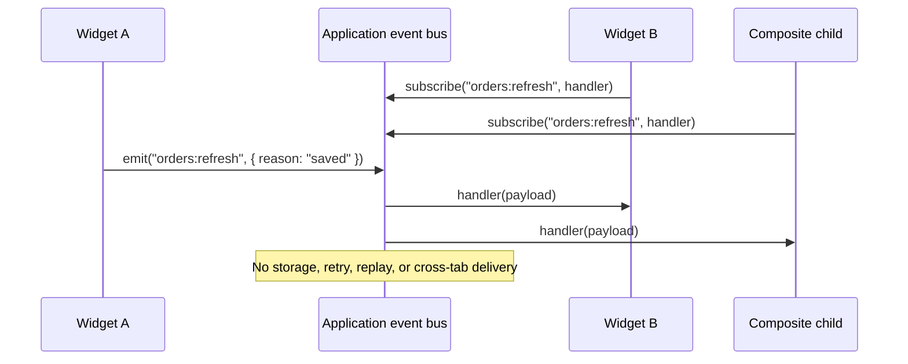

# Application Events

Application events are **transient, in-memory broadcasts** across the mounted [Application](./applications.md) runtime. They are for one-shot commands and notifications between widgets — refresh a panel, open a dialog, announce that a record was saved, tell a sibling card that the customer changed.

They are deliberately not storage:

| Concern | Application state | Application events |
| --- | --- | --- |
| Persistence | Optional (memory/session/local) | None |
| Replay | Latest value is available to every reader | No replay; only current subscribers receive a live emit |
| Shape | Declared, typed variables | Free-form event name + JSON payload |
| Purpose | Shared values | Commands/notifications |
| Survives reload | Yes, if persistence is enabled | No |
| Server involvement | None | None |

For durable values, use [Application State](./application-state.md). Events should be safe to lose.

## Bus lifecycle and scope

Each `ApplicationRouteSession` creates one event bus:

```text
emit(name, payload) -> [subscriber handlers]
```

- The deployed runtime session uses a `runtime:{releaseID}` scope.
- Composition preview creates its own `preview:{previewID}` bus, but actions are disabled there.
- Navigating between routes keeps the same bus because the application route session stays mounted.
- Components on the page you leave unmount and their subscriptions are removed. Events emitted after that are not queued for the next visit.
- Closing or reloading the runtime disposes the bus and clears all handlers.
- The bus is application-wide, not page-scoped. Any mounted subscriber in the session can listen to any valid name.



## Contract

| Rule | Value |
| --- | --- |
| Event name | Must match `^[A-Za-z][A-Za-z0-9_.:-]{0,63}$` — a letter first, then letters, numbers, `.`, `_`, `:`, or `-`; maximum 64 characters. |
| Name matching | Case-sensitive, exact. No wildcard subscriptions; `:` and `.` are naming conventions, not hierarchy semantics. |
| Payload | Any safe JSON value: `null`, string, finite number, boolean, array, or plain object. |
| Payload size | Maximum **64 KiB** of UTF-8 JSON. |
| JSON safety | No functions, class instances, cyclic objects, non-finite numbers, `__proto__`/`prototype`/`constructor` keys, excessive depth, or oversized arrays. |
| Default payload | An omitted/`undefined` payload is treated as `null` by the bus. |
| Delivery | Synchronous to subscribers that exist at emit time, in subscription order. |
| Return value | `emit` returns the number of handlers that completed without throwing. |
| Errors | A throwing handler is logged and does not prevent other handlers from running. |
| Replay | None. |
| Persistence | None. |
| Cross-tab / cross-user | None. The bus lives in one browser runtime. |
| Server | No server transport, audit record, or authorization decision. |

Use namespaced names by convention, for example `orders:refresh`, `customer:selected`, or `invoice.saved`. The name is free-form; nothing enforces the namespace.

## Emit from a widget action

1. Open the widget's **Events** tab.
2. Add a step to an event, for example `onRowSelect` or `onClick`.
3. Choose **Emit Application Event**.
4. Enter the **Event Name**.
5. Enter a JSON **Payload**. Template expressions in the payload are resolved against the current state and event context before emitting.

```json
{
  "events": {
    "onRowSelect": [
      {
        "actionType": "EMIT_APPLICATION_EVENT",
        "config": {
          "name": "customer:selected",
          "payload": {
            "customerID": "{{ event.row.customer_id }}",
            "customerName": "{{ event.row.customer_name }}",
            "source": "orders"
          }
        }
      }
    ],
    "onClick": [
      {
        "actionType": "EMIT_APPLICATION_EVENT",
        "config": { "name": "orders:refresh" }
      }
    ]
  }
}
```

The payload may also be a string, number, boolean, array, or `null`. If the payload is omitted, the runtime emits `null`.

At publish time the compiler checks the name and payload:

- The raw payload must be safe JSON no larger than 64 KiB.
- Invalid actions are removed from the release with an `ACTION_EVENT_INVALID` warning.

At runtime, the payload is resolved first, so an expression can produce a larger value than the raw config. The bus validates again after resolution. An emit that fails validation is ignored with a console warning and delivers nothing.

:::note
An action result of `{ "scope": "application", "event": "orders:refresh" }` means the emit was attempted, not that anyone received it. The action result does not include the delivered count. Use a direct `emitApplicationEvent` call in custom widget code if you need the count.
:::

## Subscribing

### Hook (React code in the application tree)

```jsx
import { useCallback, useState } from "react";
import { useApplicationEvent } from "../../logic/applicationRuntime/applicationEventBus";

export function LiveOrdersBadge() {
  const [nonce, setNonce] = useState(0);
  const handleRefresh = useCallback(() => {
    setNonce((value) => value + 1);
  }, []);

  useApplicationEvent("orders:refresh", handleRefresh);

  return <span data-refresh-nonce={nonce}>Orders</span>;
}
```

`useApplicationEvent(name, handler)`:

- reads the bus from `ApplicationEventBusContext`;
- does nothing when the bus is absent or the name is invalid;
- subscribes in an effect and unsubscribes on cleanup;
- re-subscribes when `name` or `handler` changes, so wrap the handler in `useCallback` when it is inline.

### Widget props

Every regular page widget, and every inline child widget inside a composite, receives:

| Prop | Signature | Purpose |
| --- | --- | --- |
| `emitApplicationEvent` | `(name, payload) => number` | Emit and receive the delivered count. |
| `subscribeApplicationEvent` | `(name, handler) => unsubscribe` | Subscribe imperatively; call the returned function on cleanup. |

```jsx
import { useEffect, useState } from "react";

export function CustomerTicker({ subscribeApplicationEvent }) {
  const [customerID, setCustomerID] = useState(null);

  useEffect(() => {
    if (typeof subscribeApplicationEvent !== "function") return undefined;
    return subscribeApplicationEvent("customer:selected", (payload) => {
      setCustomerID(payload?.customerID ?? null);
    });
  }, [subscribeApplicationEvent]);

  return <code>{customerID || "No customer selected"}</code>;
}
```

Custom widgets that emit can call the prop directly:

```js
const delivered = emitApplicationEvent?.("orders:refresh", { reason: "manual" }) ?? 0;
```

The first-party widget renderers do not automatically subscribe to application events. The props and bus exist for custom widgets, composite children, and future integrations.

### Composite children

`CompositeWidgetBody` passes the same `emitApplicationEvent` and `subscribeApplicationEvent` props to each inline child. This lets a child control inside a composite notify a page-level widget, or a sibling composite:

```text
Composite child button
  -> EMIT_APPLICATION_EVENT "customer:changed"
  -> page widget subscribed to "customer:changed"
```

Declared composite outputs are metadata in the widget config today; they do not automatically forward child events. Declare an output when you want to document the contract, and use a named application event for the actual signal.

## Use cases

| Use case | Event pattern |
| --- | --- |
| Refresh a dashboard panel after a save | `invoices:saved` or `invoices:refresh`; the subscriber increments a nonce or calls its own refetch. |
| Open a detail drawer from a table row | `customer:open` with `{ customerID }`; a drawer widget subscribes and opens. |
| Coordinate filters across independent widgets | `filters:changed` with `{ dateRange, region }`; each custom widget updates local presentation state. |
| Notify a composite host | `composite:changed` emitted by an inline child and consumed by a page-level widget. |
| Announce completion of a long workflow | `workflow:finished` with the instance ID; a toast/banner widget subscribes. |
| Clear transient UI after navigation | Emit `ui:close` before a `NAVIGATE` action. Note that destination listeners must already be mounted; navigation itself disposes the old page's listeners. |

Use application state instead when the information must be read later, must survive a reload, or must initialize a newly mounted page. A common pattern is: update application state, then emit an event for widgets that need to react imperatively.

## Limits and limitations

| Limitation | Detail |
| --- | --- |
| Payload size | 64 KiB of UTF-8 JSON, checked before delivery. |
| Name length/syntax | 64 characters, letter-first, no wildcard. |
| No queue or replay | An event emitted before a subscriber mounts is lost. |
| No persistence | Reloading or re-entering a page starts with no event history. |
| No cross-tab delivery | `localStorage`/`sessionStorage` events are not bridged into the bus. |
| No cross-user delivery | The bus is local to one runtime session. |
| No server audit | Emits do not create audit records or workflow runs. |
| No schema for payloads | Payloads are free-form safe JSON; declare conventions in the widget description or composite outputs. |
| No delivery acknowledgement to the emitter | The action result records the event name; only direct `emitApplicationEvent` returns a count. |
| No `once` / priority / async | Subscribers run synchronously in insertion order. |
| Page-scoped subscribers | Leaving a route unmounts its widgets and their handlers. |
| Preview | The event bus exists, but page actions are disabled in composition preview. |
| Standalone App Pages | No application event bus; `EMIT_APPLICATION_EVENT` actions fail with `APPLICATION_EVENTS_UNAVAILABLE`. |
| Rich widgets | HTML/iframe widgets are not part of the deployed application runtime, so they cannot emit through widget props. |

## Security

- Events never leave the browser runtime. They are not an authorization channel and must not be used to decide whether a user may execute a server operation.
- Payloads are visible to any client code and can be forged by a user with devtools. Treat them as untrusted UI input.
- Do not put credentials, tokens, personal data, or server-only identifiers in event payloads.
- Safe-JSON validation prevents prototype-pollution-shaped payloads and non-serializable values, but it does not encrypt or sign them.
- The event bus is per session and disposed on unmount; it is not a global `window` singleton.

## Troubleshooting

| Symptom | Likely cause | Resolution |
| --- | --- | --- |
| Subscriber never receives an event | Name typo or case mismatch, subscriber not mounted, or event emitted before subscription | Compare exact names, keep the subscriber mounted, and emit after mount. |
| Emit action disappeared after publish | Compiler removed it as `ACTION_EVENT_INVALID` | Check release warnings; use a valid name and safe JSON payload under 64 KiB. |
| `Application event payload is too large` in console | Resolved payload exceeded 64 KiB even if the raw template was small | Send identifiers and refetch in the subscriber instead of sending large data. |
| `Invalid application event name` | Name starts with a number, contains an unsupported character, or is longer than 64 characters | Use a letter-first name with only letters, numbers, `.`, `_`, `:`, `-`. |
| Event works in one widget but not another | The other widget is on a different route and unmounted, or it never subscribed | Subscribe in the mounted component; application events do not replay. |
| Action reports success but nothing happens | No subscriber existed; action success does not include delivery count | Verify the subscriber and its name; use a custom widget emit if a count is required. |
| Handler throws and other handlers still run | The bus isolates handler errors | Read the console error for the failing handler and fix that subscriber. |
| `APPLICATION_EVENTS_UNAVAILABLE` | Page is not running in an Application runtime, or the bus context is missing | Use an Application runtime; standalone App Pages have no application event bus. |
| Event lost after navigation | Route change unmounts subscribers | Move the state to application state, or emit after the destination page mounts. |

## Related modules

- [Applications](./applications.md) — runtime shell, route lifecycle, and release compiler.
- [Application State](./application-state.md) — durable values that complement events.
- [App Pages & Widgets](../app-pages-widgets/app-pages-widgets.md) — the widget event and action editor.
- [Snippets & Composites](./snippets-and-composites.md) — composite children receive the event props.
