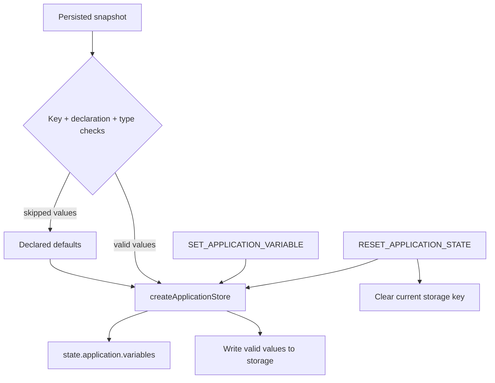

# Application State

Application state is **release-scoped, shared state** for every route in an [Application](./applications.md). It is declared once in the application definition, initialized from declared defaults, read by pages as `state.application.variables`, and updated by widget event actions (custom widgets can trigger those actions by firing widget events).

It is different from a [page variable](../app-pages-widgets/app-pages-widgets.md#page-variables):

| Concern | Page variable | Application variable |
| --- | --- | --- |
| Scope | One mounted page runtime | Every route in the application runtime |
| Survives navigation | No (unless the route uses `keepAlive`) | Yes, for the runtime session |
| Declared in | App Page config | Application definition |
| Written by | `SET_VARIABLE` action | `SET_APPLICATION_VARIABLE` action / store |
| Optional browser persistence | No | Yes (`session` or `local`) |
| Read path | `state.variables.key` | `state.application.variables.key` |

Use application state for cross-route context such as the selected customer, a global date filter, a lightweight "current workspace" flag, or a UI preference. Do not use it as a database, an authorization boundary, or a place for secrets.

## Declarations

State lives under `state` in the application definition:

```json
{
  "state": {
    "application": {
      "selectedCustomerID": { "type": ["string", "null"], "default": null },
      "dateRange": {
        "type": "object",
        "default": { "start": "2026-01-01", "end": "2026-12-31" }
      },
      "showArchived": { "type": "boolean", "default": false },
      "activeTags": { "type": "array", "default": [] }
    },
    "persistence": { "mode": "session", "resetOnRelease": true }
  }
}
```

| Field | Type | Required | Description |
| --- | --- | --- | --- |
| Variable key | key | Yes | Starts with a letter; then letters, numbers, `_`, or `-`; maximum 64 characters. Reserved names (`__proto__`, `prototype`, `constructor`) are rejected. |
| `type` | string or string[] | Yes | One of `string`, `number`, `boolean`, `object`, `array`, `null`, or a non-empty union of those types. |
| `default` | JSON value | Yes | Must match the declared type exactly. Objects/arrays must be bounded, safe JSON. |
| `persistence.mode` | enum | No | `none` (default), `session`, or `local`. |
| `persistence.resetOnRelease` | boolean | No | Defaults to `true`. Scopes the storage key to the release. |

Limits:

- Maximum **100** application variables per application.
- The whole definition is capped at **256 KiB** of safe JSON.
- Defaults cannot contain functions, class instances, non-finite numbers, unsafe keys, cyclic structures, or excessive nesting/array sizes. They are stored as JSON, not live objects.
- The validator reports `INVALID_VARIABLE_DEFAULT` when a default does not match its declared type. Invalid or reserved keys are rejected by the schema.
- Union types are allowed by the schema but the Studio editor only creates single-type variables.

### Type matching

The runtime uses exact type matching:

| Declared type | Accepted runtime value |
| --- | --- |
| `string` | string |
| `number` | finite number |
| `boolean` | boolean |
| `object` | plain JSON object (not an array, not a class instance) |
| `array` | array |
| `null` | `null` |
| Union, e.g. `["string", "null"]` | Any member of the union |

`SET_APPLICATION_VARIABLE` does not coerce values. Setting `"5"` into a `number` variable fails; setting `5` into a `string` variable fails. Convert values explicitly in the action expression, for example `{{ Number(event.value) }}`.

## Editing state in Application Studio

Open the application, then use the **Application state** section.

1. Enter a **Key**, choose a **Type**, and provide a **Default value**.
2. Click **Add variable**.
3. Edit a default inline. Text, number, and boolean values commit on blur. Object and array defaults accept JSON in a textarea. Invalid JSON or a mismatch shows an inline error.
4. Remove a variable with the trash button. Pages or deployed releases that reference the removed key will reject future writes and may show `undefined` for reads.

Union-typed variables are listed and can be removed, but their default is read-only in the Studio:

> Union-typed variables are preserved here. Edit their default in the definition JSON.

Use the `definition.json` editor, then **Save draft**, when a union default must change.

## Persistence

Persistence is opt-in. The **Persistence** panel offers:

| Mode | Storage | Lifetime |
| --- | --- | --- |
| `none` | Memory only | Survives route changes within the runtime session; lost on reload, closing the runtime, or a runtime-session remount (for example a new release). |
| `session` | `sessionStorage` | Survives reloads in the same tab/window; ends with the tab session. |
| `local` | `localStorage` | Survives browser restarts on this device, subject to browser storage policy. |

### Storage key and scoping

The store key is:

```text
jet-admin:application-state:v1:{tenantID}:{applicationID}:{principalScope}:{releaseScope}
```

- `principalScope` is the runtime principal (the Firebase user ID in the deployed runtime), or `default` when none is supplied.
- `releaseScope` is `release:{releaseID}` when `resetOnRelease` is `true`, and `shared` when it is `false`.

Consequences:

- A new deployment changes the release ID. With **Reset on new release** enabled, the runtime reads a new, empty key and starts from declared defaults. The old snapshot is not deleted; it is simply no longer addressed.
- With reset-on-release disabled, compatible values survive releases because the same `shared` key is used.
- The principal segment separates users sharing a browser profile. It is a naming convention, **not** a security boundary: anyone with access to the browser's developer tools can read the values.
- The store is created once per runtime session. Route changes do not recreate it.
- Composition preview always uses `mode: "none"` and does not create a storage key.

### Read and write filtering

On load, every persisted value is individually checked:

1. It must exist in the current declarations.
2. It must be safe JSON.
3. It must match the declared type.

Values that fail any check are skipped; valid siblings remain. A corrupt JSON snapshot is treated as empty. This means removing a variable or changing its type does not crash the runtime, but the old value is not migrated.

Writes are filtered the same way. The store subscribes to every state change and writes the current valid values immediately. There is no debounce and no retry. If storage is unavailable (private mode, quota exceeded, storage disabled), persistence silently returns `false`; the in-memory value still works for the current session.

### Clearing saved state

- **Store reset** (`RESET_APPLICATION_STATE` action) restores every declared default and removes the **current** storage key for the current principal/release scope.
- **Clear saved state** in the Studio state editor removes every `jet-admin:application-state:v1:{tenantID}:{applicationID}:` key from both `sessionStorage` and `localStorage` in the current browser, across release scopes and principal scopes. It reports how many snapshots were removed.

The Studio cannot clear another device's browser storage.

## Reading state

In the deployed runtime, page expressions and guards see:

```text
{{ state.application.variables.selectedCustomerID }}
```

Examples:

```text
{{ state.application.variables.showArchived ? "Archived" : "Active" }}
{{ state.application.variables.dateRange.start }}
{{ state.application.variables.activeTags.join(", ") }}
```

Use it in:

- widget property templates;
- page data-source input values;
- route guard JavaScript expressions in the route settings dialog;
- parent application variable values in subsequent actions;
- custom widget props, after the page runtime resolves their expressions against the state tree.

Standalone App Pages that are not opened through an Application do not receive an application state store. `state.application` is absent there.

## Updating state

### From the widget action editor

1. Open the widget in the Widget IDE or page editor.
2. Go to **Events** and choose the event (for example `onRowSelect`).
3. Add a step and choose **Set Application Variable**.
4. Enter a declared **Application Variable Key** (the bare key, for example `selectedCustomerID`).
5. Enter a **Value Expression**, for example `{{ event.row.customer_id }}`.

```json
{
  "events": {
    "onRowSelect": [
      {
        "actionType": "SET_APPLICATION_VARIABLE",
        "config": {
          "key": "selectedCustomerID",
          "value": "{{ event.row.customer_id }}"
        }
      },
      {
        "actionType": "NAVIGATE",
        "config": {
          "routeID": "customer-detail",
          "params": { "customerID": "{{ event.row.customer_id }}" },
          "query": { "tab": "overview" },
          "replace": false
        }
      }
    ]
  }
}
```

The action editor labels this action **Set Application Variable** and notes that it only executes in an Application runtime. At publish time, the compiler removes the action if the key is not declared, emitting `ACTION_APPLICATION_VARIABLE_INVALID`.

### From custom widget code

The runtime passes `emitApplicationEvent` and `subscribeApplicationEvent` to widget components, but application state writes are performed by actions, not by a widget prop. Custom widgets should call `fireWidgetEvent("onSomething")` and let a configured `SET_APPLICATION_VARIABLE` action perform the write. This keeps state writes type-checked and visible in the event configuration.

### Sequential actions

When several actions run in one event chain, a successful `SET_APPLICATION_VARIABLE` is made available to later expressions in that same chain through the action context. The store update is also applied. A failed set does not stop the rest of the chain; the failure is reported in the per-action result. `NAVIGATE` is the exception: it ends the chain because the rest of the actions belong to the page being left.

## Resetting state

Choose **Reset Application State** in the action editor. It takes no configuration:

```json
{
  "actionType": "RESET_APPLICATION_STATE",
  "config": {}
}
```

At runtime it:

1. Replaces every application variable with a fresh clone of its declared default.
2. Clears the persisted snapshot for the current store key.
3. Leaves page variables, query results, widget state, and application events untouched.

The compiler normalizes the action to an empty config and keeps it in the deployed runtime. Actions are disabled in composition preview, so reset cannot run there.

Place the reset **last** in a chain if later actions depend on the default values. Later actions in the same chain build their expression context from the pre-reset render tree plus pending set-variable mutations, so the just-reset values are not guaranteed to be visible until the store re-render commits.



## Reactive data sources and application variables

The page data-source editor exposes application variables in the **Refresh When Variable Changes** picker and stores paths such as:

```text
application.variables.selectedCustomer
```

Treat this as an authoring aid, not a guaranteed trigger in the current runtime. The reactive refresh loop compares the state-tree namespaces `queries`, `workflows`, `widgets`, `variables`, `listeners`, and `globals`; `application` is not in that diff list. A page variable change can therefore trigger a reactive source, while an application-variable-only change may not.

Reliable patterns:

- After `SET_APPLICATION_VARIABLE`, add an `EXECUTE_QUERY` action for the page data source. This runs the source immediately with the new value visible to the action context.
- Or mirror the value into a declared page variable and use that page variable in `refreshOn`.

Also remember that `triggerMode: "reactive"` sources run once on mount, in addition to reacting to refresh paths.

## Security and scoping

| Property | Behavior |
| --- | --- |
| Storage location | Browser memory, `sessionStorage`, or `localStorage`. Never sent to the backend as state. |
| Encryption | None. Values are plain JSON. |
| Tenant/application scope | Encoded in the key; the store is created only for a tenant + application + release. |
| Principal scope | Encoded in the key when the runtime supplies a principal; not an access-control mechanism. |
| Release boundary | Declarations and defaults are captured in the release definition. Live values are not part of a release. |
| Type safety | Enforced by `setVariable`, persistence reads/writes, and the definition validator. |
| Prototype safety | Values must be safe JSON; unsafe keys and non-plain objects are rejected. |
| Authorization | Application state is client-side convenience state. It cannot grant permissions. Use the [consumer policy](./applications.md#consumer-policy) and Casbin permissions for server-enforced access. |
| Secrets | Never store tokens, passwords, personal data, or anything that would be harmful if read or modified. |

Because the user controls the browser, any client-side guard that reads application state can be bypassed by modifying storage or the client bundle. Route guards and state are UX controls; server-side permissions and consumer policy are the enforcement layer.

## Use cases

| Use case | Suggested shape |
| --- | --- |
| Selected customer across orders and invoices | `selectedCustomerID: ["string", "null"]`, persisted in `session`. |
| Global date range | `dateRange: object`, persisted in `session`; bind page data-source inputs to `state.application.variables.dateRange.start`. |
| "Show archived" preference | `showArchived: boolean`, persisted in `local`. |
| Guided workflow step | `activeStep: string`, memory-only (`none`), reset when the user finishes or navigates home. |
| Cross-route draft filter | `draftFilters: object`, session persistence. If it must be shareable by URL, mirror it into page variables and use route query sync. |

## Limitations and troubleshooting

| Symptom | Cause | Resolution |
| --- | --- | --- |
| `Invalid application variable assignment` | Key is not declared, value is not safe JSON, or the value's type does not match | Declare the key, convert the value, and use a matching type/union. |
| Set action silently absent after publish | Compiler removed it because the key was undeclared or invalid | Check release warnings for `ACTION_APPLICATION_VARIABLE_INVALID`, declare the key, and publish again. |
| State resets on every deployment | `resetOnRelease: true` includes the release ID in the storage key | Disable **Reset on new release** if compatible values must survive. |
| State does not survive reload | Persistence mode is `none`, storage is blocked/unavailable, or a different principal/release key is used | Switch to `session`/`local`, verify browser storage, and check the release and principal. |
| New release shows old values unexpectedly | `resetOnRelease` is disabled, so the `shared` key is reused | Enable reset-on-release or clear saved state. |
| Old values remain after changing a type | Persisted values that fail the new type check are skipped, not converted | Ask users to reset/clear state, or change the default/type deliberately. |
| Studio cannot edit a union default | The visual editor preserves unions read-only | Edit the default in `definition.json`. |
| Reset does not affect another tab/device | Storage is per browser and there is no cross-tab synchronization | Reload the other tab; only **Clear saved state** in that browser can remove local snapshots. |
| Data source does not refetch when an application variable changes | The reactive diff engine does not currently track `application.variables` | Add an explicit `EXECUTE_QUERY` action after the set, or mirror the value into a page variable. |
| `APPLICATION_STATE_UNAVAILABLE` / action fails in a standalone page | The page is not running inside an Application | Use page variables or run it through an Application runtime. |

## Related modules

- [Applications](./applications.md) — releases, routes, environments, and consumer policy.
- [Application Events](./application-events.md) — one-shot commands between widgets and pages.
- [App Pages & Widgets](../app-pages-widgets/app-pages-widgets.md) — page variables, data sources, and the widget event editor.
- [Navigation & Shell](./navigation-and-shell.md) — route guards and URL synchronization that read application state.
