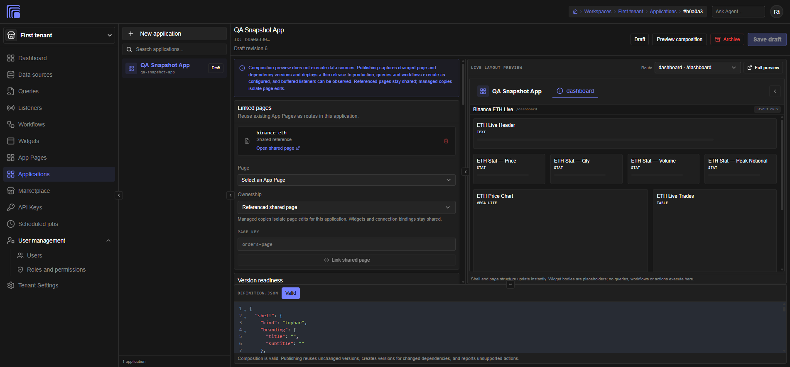
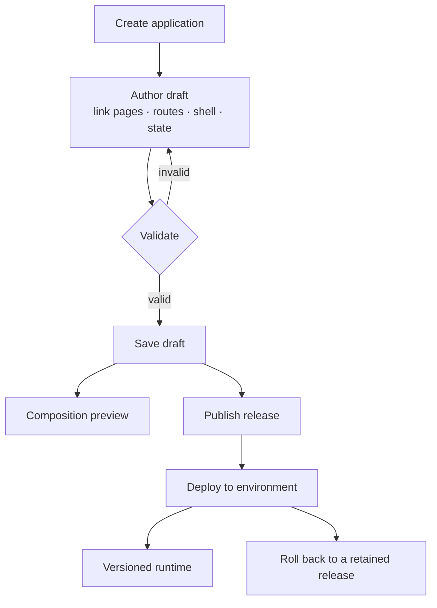
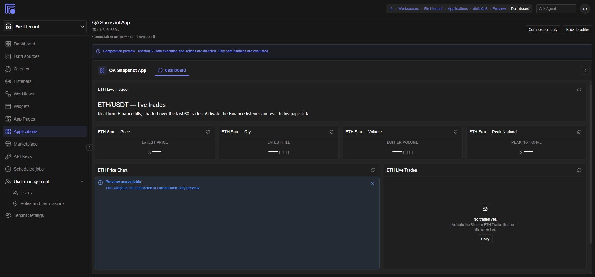
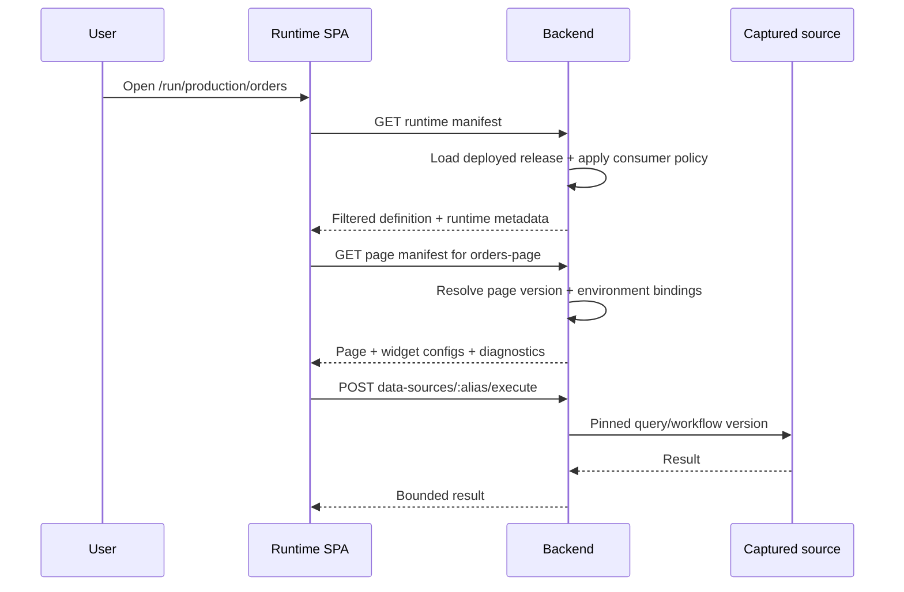

# Applications

An **Application** turns one or more existing [App Pages](../app-pages-widgets/app-pages-widgets.md) into a routed, versioned product surface: a shell with navigation, stable URLs, shared application state, guarded routes, and an immutable runtime that executes captured query, workflow, and listener versions.

Applications do **not** replace App Pages. A page is still designed in the page builder. The Application links pages as assets, gives each one a route, and compiles those assets into a release. This separation is deliberate: the same shared page can be referenced by several applications, and an application can pin a specific page version instead of tracking the live page.



## Key concepts

| Term | Definition |
| --- | --- |
| **Application** | A tenant-scoped composition record (`title`, `slug`, `description`, `status`) with a draft, linked page assets, releases, environments, and access policy. |
| **Draft** | The editable application definition. It has a monotonically increasing revision used for optimistic concurrency. |
| **Definition** | The JSON contract describing shell, routes, state declarations, theme/localization fields, and expression mode. Validated against `@jet-admin/application-contracts`. |
| **Linked page** | An App Page linked under an application asset key. It is either a `referenced` shared page or a `managed` copy owned by the application. |
| **Route** | A stable path (`/orders/:orderID`) bound to a linked page asset key, with optional params, typed query, parent, guard, URL sync, and keep-alive. |
| **Preview** | A composition-only snapshot of the saved draft. It renders the real shell and page layout, but executes no data sources and no actions. |
| **Release** | An immutable compiled snapshot of the draft plus exact page/widget/dependency version pointers and a content hash. |
| **Environment** | A named deployment target (`production` by default) that points at one release and owns datasource bindings. |
| **Binding** | A mapping from a datasource ID captured by the release to an environment-specific datasource ID. Credentials stay live and are never stored in releases. |
| **Consumer policy** | Optional default-deny route/action authorization for end users, roles, and API keys. |
| **Runtime** | The deployed, release-scoped application surface at `/run/:environment`. Queries, workflows, and buffered listeners resolve only from the release. |

## Lifecycle



The runtime is deliberately thin. A release stores pointers to immutable page versions, not live query or workflow definitions. Page manifests and executions are resolved from those pointers on demand, so redeploying an older release switches the production pointer without rewriting history.

## Application Studio

Open **Applications** in the sidebar, then choose an application or click **New application**. Creating one asks for a name and a lowercase slug (`orders-and-approvals`). The new application receives an empty draft definition and creator access.

The Studio is a resizable three-pane workspace:

| Pane | Purpose |
| --- | --- |
| **Editor** (left, top) | Linked pages, version readiness, routes, navigation and shell, application state, production, and release history. |
| **Live layout preview** (right, top) | Renders the current shell and page layout structure with inert widget placeholders. Choose a non-parameterized route to preview. |
| **`definition.json`** (bottom) | Raw JSON editor for the whole definition, with live validation diagnostics. |

The **Save draft** action is disabled while the definition is invalid or the application is archived. **Preview composition** is disabled when there are unsaved edits, pending operations, no routes, or the application is archived. **Archive** is available only after the draft is saved and there is no pending work.

### Link a page

1. In **Linked pages**, choose an App Page and an **Ownership** mode.
2. Enter a unique **Page key** (`assetKey`), for example `orders-page`. Keys start with a letter, then letters, numbers, `_`, or `-`; maximum 64 characters.
3. Click **Link shared page** or **Adopt managed copy**.

| Ownership | Behavior |
| --- | --- |
| `referenced` | Routes use the shared App Page. Edits made in the page builder affect this page everywhere it is referenced (and are captured the next time an application release is published). |
| `managed` | The application receives a copied App Page with the title `Original · assetKey` (truncated to 255 characters). Page edits are isolated to this copy. Widgets, queries, listeners, and datasource bindings remain shared assets. |

A managed copy is deleted when its link is removed only if it has no asset versions and no other application links. Once it has versions, it is retained so release history remains inspectable. A page that is still used by a route cannot be unlinked.

### Version readiness

Publishing captures the latest immutable version of every linked page and every referenced dependency. **Version readiness** shows each page's latest version, the version currently deployed, and an optional pinned version.

Choose **Capture latest at publish** (the default) or pin a specific published page version. The pin applies to the next release; existing releases keep their exact page version IDs forever. Publishing with a pinned page emits warnings when:

- the live page editor state has changed since the selected version was captured (`APPLICATION_PAGE_VERSION_STALE`);
- the selected page version captures older query, workflow, listener, or widget versions than the live assets (`APPLICATION_PAGE_DEPENDENCY_STALE`).

These are warnings, not silently upgraded dependencies. Publish again or create a new page version to capture the new state.

### Routes

The **Routes** section lists the route order. Drag the grip handle, use the up/down arrow keys on a focused handle, or use the row actions. Reordering routes also reorders their entries in `shell.navigation`, while `homeRouteID` stays fixed.

Add a route with:

| Field | Description |
| --- | --- |
| **Route ID** | Stable identifier used by navigation actions and consumer policy. Same key rules as page keys. |
| **Path** | Absolute path beginning with `/`. Segments may be literals or `:params`. Maximum 512 characters. |
| **Linked page** | The page asset key this route renders. |

Adding a non-parameterized route also adds a navigation item and, if the application has no home route yet, makes it the home route. Route IDs and route patterns must be unique. Patterns are compared case-insensitively with parameter names normalized, so `/Orders/:id` and `/orders/:orderID` collide.

Each route has two dialogs:

- **Query** declares typed query parameters and optional page-variable synchronization.
- **Settings** edits the title, parent route, keep-alive, general URL sync, and guard.

| Route field | Type | Behavior |
| --- | --- | --- |
| `id` | key | Unique route identifier. |
| `path` | string | `/` or slash-separated literal/`:param` segments. |
| `pageAssetKey` | key | Must match a linked page key. |
| `params` | object | Path parameter types: `string` (default), `uuid`, or `integer`. Every declared key must exist in the path. |
| `query` | object | `{ "key": { "type": "string \| number \| integer \| boolean \| uuid", "default": ... } }`. Defaults must match the type. |
| `syncPageVariables` | boolean | Requires at least one declared query parameter. Matching page variables initialize from the URL and non-default values write back. |
| `syncAllPageVariables` | boolean | Writes all page variables that have definitions to the URL, including variables not declared as typed route parameters. |
| `keepAlive` | boolean | Restores a bounded in-memory snapshot (variables, query results, widget state) when returning to the route. Path-parameter changes still reset the page. |
| `title` | string | Optional browser title; falls back to the page title and then the route ID. |
| `parentRouteID` | key | Hierarchy metadata. The child path must be nested under the parent path, and parent links cannot form a cycle. |
| `guard` | object | `{ expression, redirectRouteID }`. Only a literal boolean `true` admits the route; any failure redirects. |

Route guards fail closed. A missing expression, evaluation error, or non-`true` result redirects to a route that must exist, must not require path parameters, must not point at itself, and must not itself declare a guard. The Studio evaluates guards against `state.application.variables` and `state.route`.

Declared query parameters are validated and coerced to their type; a missing value uses its default when present. Undeclared query keys are preserved as raw strings, so tracking/analytics parameters do not invalidate the route.

A parameterized route is reached by deep link or a `NAVIGATE` action with path params. It cannot be a home route, not-found route, navigation item, or guard redirect target.

### Navigation and shell

The **Navigation & shell** section chooses one of four presets and tunes appearance, branding, home/not-found routes, expression mode, and per-route navigation items. The full behavior is documented in [Navigation & Shell](./navigation-and-shell.md).

### Application state

The **Application state** section declares release-scoped variables shared by every route, chooses persistence, and can clear saved snapshots. State semantics are documented in [Application State](./application-state.md).

### Production and release history

**Production** shows the release currently deployed to the `production` environment, its content hash, page-version count, and runtime warnings. From here you can:

- **Publish & deploy** the saved draft to production in one step;
- **Open runtime**;
- edit **Bindings** and **Consumer access**;
- open **Run history**.

**Release history** lists every immutable release with its release number, content hash, page-version count, source draft revision, and warning count. Deploying an older release is labeled **Roll back**. Rollback only moves the production pointer; it does not reverse external side effects or data migrations.

## Definition schema

The canonical schema is `applicationDefinitionSchema` in `packages/application-contracts/src/index.js`. The definition is strict: unknown keys are rejected. Limits are 100 routes, 100 application variables, and 256 KiB of bounded JSON.

```json
{
  "schemaVersion": 1,
  "shell": {
    "kind": "sidebar",
    "homeRouteID": "orders",
    "notFoundRouteID": null,
    "navigation": [
      {
        "routeID": "orders",
        "label": "Orders",
        "icon": "cart",
        "group": "Sales",
        "badge": "12",
        "hidden": false
      }
    ],
    "appearance": {
      "variant": "pills",
      "size": "md",
      "width": 220,
      "collapsedWidth": 64,
      "collapsible": true,
      "defaultCollapsed": false,
      "sticky": true,
      "position": "start",
      "align": "start",
      "showLabels": true,
      "showIcons": true,
      "showBranding": true
    },
    "branding": {
      "title": "Order Desk",
      "subtitle": "Operations"
    }
  },
  "routes": [
    {
      "id": "orders",
      "path": "/orders",
      "pageAssetKey": "orders-page",
      "params": {},
      "query": { "tab": { "type": "string", "default": "open" } },
      "syncPageVariables": true,
      "syncAllPageVariables": false,
      "keepAlive": false,
      "title": "Orders"
    },
    {
      "id": "order-detail",
      "path": "/orders/:orderID",
      "pageAssetKey": "orders-page",
      "params": { "orderID": "uuid" },
      "query": {},
      "syncPageVariables": false,
      "syncAllPageVariables": false,
      "keepAlive": false,
      "title": "Order detail"
    }
  ],
  "state": {
    "application": {
      "selectedCustomerID": { "type": ["string", "null"], "default": null }
    },
    "persistence": { "mode": "session", "resetOnRelease": true }
  },
  "resources": {},
  "actions": {},
  "theme": { "density": "comfortable", "tokenOverrides": {} },
  "localization": { "defaultLocale": "en", "supportedLocales": ["en"] },
  "expressionMode": "trusted-js"
}
```

:::note
`resources` and `actions` are reserved and must be empty objects in this schema version. `theme` and `localization` are validated and preserved, but the current Studio shell does not expose editors for them and the runtime does not apply them; use the JSON editor if they must be stored for a future release. `expressionMode` is exposed in **Navigation & shell**.
:::

The schema deliberately differs from the live App Page config. The application definition never contains query SQL, workflow graphs, listener definitions, or datasource credentials. Those are captured as asset versions and resolved by the backend.

## Composition preview

Preview compiles a **composition-only** artifact from the saved draft:

- The real application shell, route matching, navigation, guards, page layout, and `state.application.variables` values are rendered.
- Page data sources are stripped; widget events are removed; no query, workflow, or listener executes.
- Widget configs are reduced to a safe allowlist. Unsupported widgets are replaced with an informational alert (`PREVIEW_WIDGET_DISABLED`), and their original HTML, remote URLs, or executable config never reach the browser.
- Widget bindings are evaluated with a path-only resolver (`state.foo.bar`, array indexes). JavaScript expressions are not evaluated in preview.
- Preview state is not persisted, and **Reset Application State** actions are disabled.
- The artifact is capped at 500 widgets per page, 500 widgets per application, and 2 MiB.



Preview is for composition review, not a staging environment. To test real queries, workflows, listener buffers, and action chains, deploy a release and open the runtime.

## Publish and the release compiler

**Publish** uses the saved draft and the current draft revision. It performs a single repeatable-read transaction (180-second timeout):

1. For every linked page, verify read access. Use the pinned page version when present; otherwise capture the current page, reusing the latest published version when its content hash is unchanged.
2. Recursively capture referenced source versions (queries, workflows, listeners) and widget versions.
3. Assemble each page independently and compile its runtime widgets and actions.
4. Emit release diagnostics and a SHA-256 content hash.
5. Allocate the next release number and store the immutable release pointers.

The compiler is an allowlist, not a best-effort bundler:

| Concern | Publish behavior |
| --- | --- |
| Unsupported widget type | Publishing fails with `UNSUPPORTED_WIDGET_TYPE`. HTML and iframe widgets are intentionally excluded from the deployed runtime. |
| Widget-level data sources | Captured in the widget version for authoring but removed from the runtime payload. Only page data sources execute. |
| Direct `TRIGGER_QUERY` / `TRIGGER_WORKFLOW` | Resolved at page capture to the page data-source alias for the same asset. Unbound or ambiguous targets become `ACTION_TARGET_NOT_ALIASED` and are removed. |
| Unsupported action type | Removed with an `ACTION_TYPE_UNAVAILABLE` warning. |
| Invalid application variable action | Removed with `ACTION_APPLICATION_VARIABLE_INVALID` unless the key is declared in `state.application`. |
| Invalid event action | Removed with `ACTION_EVENT_INVALID` unless the name and safe payload are valid. |
| Invalid navigation action | Removed with `ACTION_ROUTE_NOT_FOUND` unless the route ID exists in the application definition. |
| Invalid data-source alias | Removed with `ACTION_TARGET_NOT_FOUND`. |
| Invalid inline composite child | Removed with `COMPOSITE_WIDGET_UNAVAILABLE`; the rest of the release still publishes. |

Published releases store page version IDs, application metadata, diagnostics, and a content hash. Query and workflow definitions live in asset versions, not in the release row. A release manifest is capped at 4 MiB.

### Deployed runtime action allowlist

The client may execute only these action types from a release:

`SET_VARIABLE`, `SET_APPLICATION_VARIABLE`, `RESET_APPLICATION_STATE`, `EMIT_APPLICATION_EVENT`, `NAVIGATE`, `SHOW_TOAST`, `CALL_WIDGET_METHOD`, `EXECUTE_QUERY`.

`EXECUTE_QUERY` targets a page data-source alias, never a raw query or workflow ID. The runtime additionally requires workflow/listener/query execution permission on the captured asset.

## Environments, bindings, and deploy

An environment is created on first deploy. Environment names are lowercase, start with a letter, and may contain lowercase letters, numbers, and hyphens (maximum 40 characters). Studio currently exposes `production`; the API accepts other names and the runtime URL includes the environment segment.

Deploying a release:

1. Verifies the release belongs to the application and tenant.
2. Creates the environment if it does not exist.
3. Moves `currentReleaseID` to the selected release and increments the environment config revision.
4. Appends a deployment record with the actor and timestamp.

Rollback is the same operation with an older release ID. Only the pointer changes.

### Environment bindings

Bindings let one release run against environment-specific datasources. The stored object maps a **release datasource ID** to a **target datasource ID**:

```json
{
  "11111111-1111-4111-8111-111111111111": "22222222-2222-4222-8222-222222222222"
}
```

Rules:

- Both keys and values must be datasource UUIDs; at most 100 mappings.
- A target datasource must exist in the tenant.
- If the source datasource still exists, the target must have the same datasource type.
- The mapping is applied when page query data sources execute. It does not rewrite arbitrary query IDs embedded inside other captured assets. Credentials remain live in the datasource; they are never stored in a release or binding.
- Binding updates use an optimistic revision (`ENVIRONMENT_BINDING_CONFLICT`) and append a binding revision with an optional change note. The Studio shows the last 20 revisions.
- The runtime page-manifest cache key includes the binding revision, so a binding change cannot reuse an older authorization or datasource context.

### Deploy checklist

- Draft is saved and valid.
- Every route's page asset exists and is reachable.
- Every query/workflow/listener pinned by a page version is still `published` for the tenant.
- Listener data sources have an enabled **Save to buffer** action with the configured buffer name.
- Bindings map every environment-specific query datasource required by the release.
- The consumer policy, if enabled, grants the intended users/roles/API keys the route and action aliases they need.

## Consumer policy

Consumer policy is optional and disabled by default. When enabled, it is **default deny**: only routes and data-source actions explicitly granted to the current user, one of their roles, or their API key are admitted. Deny entries take precedence.

```json
[
  {
    "subjectType": "role",
    "subjectID": "00000000-0000-4000-8000-000000000000",
    "routeID": "orders",
    "actionKey": null,
    "allow": true
  },
  {
    "subjectType": "user",
    "subjectID": "11111111-1111-4111-8111-111111111111",
    "routeID": "risk",
    "actionKey": null,
    "allow": false
  },
  {
    "subjectType": "apiKey",
    "subjectID": "22222222-2222-4222-8222-222222222222",
    "routeID": null,
    "actionKey": "orders",
    "allow": true
  }
]
```

| Field | Values | Notes |
| --- | --- | --- |
| `subjectType` | `user`, `role`, `apiKey` | Users must be tenant members; API keys must be enabled; roles must be available in the tenant. |
| `subjectID` | UUID | Subject identifier. |
| `routeID` | key or `null` | `null` is a wildcard for all routes. A non-null route must exist in the draft definition. |
| `actionKey` | page data-source alias or `null` | `null` is a wildcard for all actions on the matched route. |
| `allow` | boolean | Deny entries dominate allow entries. |

Semantics:

- Only entries matching the caller's principal (`user:<id>` or `apiKey:<id>`) and their roles are considered.
- Route admission requires at least one matching allow entry and no matching route deny entry.
- Action admission requires a matching allow entry and no matching action deny entry. `actionKey` is the page data-source alias.
- The runtime manifest filters the definition's routes and navigation to admitted routes. If the configured home route is not admitted, the first non-parameterized admitted route becomes the runtime home; if none exists, `homeRouteID` is `null`.
- Page-manifest and execution checks enforce the policy server-side, so modifying the client cannot bypass it.
- At most 200 entries. Updates use a revision (`CONSUMER_POLICY_CONFLICT`) and replace the whole entry list.

`GET /consumer-policy` returns all entries for Studio editing. The runtime evaluates only the caller's effective entries.

## Runtime

The runtime URL is:

```
/tenants/:tenantID/applications/:applicationID/run/:environment
```

The runtime session:

1. Fetches the environment's deployed release manifest. If no release is deployed, it fails with `APPLICATION_NOT_DEPLOYED`.
2. Applies the consumer-policy filter to routes, navigation, and home route.
3. Renders the shared `ApplicationShellFrame`.
4. Resolves a page manifest the first time each route's page is visited, then renders the page through `AppPageView`.
5. Creates the application state store from the release's declarations, persistence mode, and release ID.
6. Creates the application event bus for the session.

Page manifests are cached in-process by tenant, release, page version, binding revision, policy revision/enabled state, and route ID. The cache is capped at 200 entries and is disabled in tests.



Runtime guarantees and limits:

| Area | Behavior |
| --- | --- |
| Application state | Release-scoped declarations, type-checked writes, optional session/local persistence. See [Application State](./application-state.md). |
| Events | Transient in-memory bus, no persistence or replay. See [Application Events](./application-events.md). |
| Queries | Execute only aliases captured by the page version; result capped at 2 MiB. |
| Workflows | Start the pinned workflow version and observe through the runtime API (2-second polling). Declared outputs and pending data-collection requests only; result capped at 2 MiB. |
| Listeners | Observe an existing saved buffer; never start the integration. Initial read returns the latest retained 100 events, then advances by HMAC cursor. Cursor expiry returns `APPLICATION_CURSOR_EXPIRED` (410). |
| Input values | Query/workflow execution and workflow submissions accept bounded JSON up to 32 KiB. |
| Keep-alive | At most 20 route snapshots in memory per runtime session; widget method functions are not cached. |
| Release pinning | Execution sends the release ID; if production changed, the runtime returns `APPLICATION_RELEASE_CHANGED` and requires a reload. |

The runtime does not expose HTML or iframe widgets. It does render text, stat, alert, badge, progress, divider, button, table, key-value, JSON viewer, list, inputs, selects, checkboxes, radio groups, switches, sliders, date pickers, forms, tabs, Vega/Vega-Lite, composite, code block, calendar, context, file upload, image, kanban, timeline, and video widgets, subject to the release compiler allowlist.

## Run history

**Run history** lists recent **workflow runs started by this application operation** for an environment. It is read-only and shows:

| Column | Source |
| --- | --- |
| Status | Workflow instance status (`RUNNING`, `COMPLETED`, `FAILED`, etc.). |
| Run | Instance ID and workflow ID. |
| Route / action | Executing route ID and `pageAssetKey.alias` provenance. |
| Release | Release ID and environment. |
| Caller | `user` or `apiKey`. |
| Started | Instance creation timestamp. |

The backend returns up to 100 runs (Studio requests 50) from instances whose execution provenance matches the application and environment. It does not include standalone workflow editor runs, preview runs (preview executes nothing), or unrelated application runs. The dialog does not expose a cancel control; cancellation is available through the runtime workflow-cancel API.

## Permissions and tenancy

Application operations use Casbin actions on `application:<applicationID>`:

| Operation | Permission |
| --- | --- |
| List / read | `application:list`, `application:read` |
| Create | `application:create` |
| Edit draft, link pages, select versions, policy | `application:update` |
| Preview | `application:update` |
| Publish | `application:publish` |
| Deploy, bindings | `application:deploy` |
| Runtime manifest, page, query/workflow/listener | `application:execute` |
| Archive | `application:archive` |

Runtime execution additionally checks `appPage:execute`, `dataquery:execute`, `workflow:execute`, or `listener:observe` on the captured asset. Linking a page checks read access to the page; a managed copy also requires `appPage:create`. Every application row is tenant-scoped, and collection listing filters out applications the caller cannot read before pagination and counting.

## Use cases

| Scenario | Configuration sketch |
| --- | --- |
| Internal operations console | Link order, inventory, and incident pages; sidebar shell with grouped navigation; shared `selectedRegion` and `dateRange` application variables. |
| Multi-step customer workflow | Routes for list → detail → approval; page variables for the active record; `keepAlive` on the list; `NAVIGATE` actions with path params. |
| Role-gated application area | Consumer policy enabled; wildcard allow for the operator role; route-level deny for sensitive routes; page data-source action grants by alias. |
| Environment promotion | Build once, publish an immutable release, deploy it to a named environment (Studio currently exposes production), and map each environment's page query datasource IDs through bindings. |
| Embedded analytics workspace | Top bar or sidebar shell; charts/tables bound to page data sources; app variables for global filters; events to refresh panels after filter changes. |
| Contract/template page reuse | One shared page referenced by several applications, with per-application page version pins and managed copies where isolation is needed. |
| Rollback-safe release process | Keep every release; deploy a previous release to roll back the production pointer without mutating pages or dependencies. |

## Limits

| Limit | Value |
| --- | --- |
| Definition size | 256 KiB |
| Routes | 100 |
| Application variables | 100 |
| Navigation items | 100 |
| Navigation label | 120 characters |
| Navigation group / badge | 80 / 24 characters |
| Linked pages | 100 |
| Route path | 512 characters |
| Route query value | 4,096 characters per value |
| Route path parameter | 512 characters, no control characters |
| Consumer policy entries | 200 |
| Environment bindings | 100 |
| Preview artifact | 2 MiB, 500 widgets per page, 500 per application |
| Release manifest | 4 MiB |
| Runtime query / workflow / listener result | 2 MiB each |
| Runtime input / submission | 32 KiB |
| Run history | 100 per request |
| Environment name | 40 characters |
| Application slug | 80 characters |

## Troubleshooting

| Symptom | Likely cause | Resolution |
| --- | --- | --- |
| **Preview composition** is disabled | Unsaved changes, no routes, pending mutation, or archived | Save the draft, add a route, wait for pending operations, and use a non-archived application. |
| `INVALID_APPLICATION_DEFINITION` on save | Local validation passed but the server rejected asset references or a schema rule | Read the returned diagnostics; they include a `path` and `code`. Re-link missing pages or fix the definition JSON. |
| `APPLICATION_REVISION_CONFLICT` | Another tab/session saved the draft first | Reload the Studio and reapply your change. |
| `APPLICATION_NOT_DEPLOYED` | Environment has no current release | Publish and deploy a release to that environment. |
| `APPLICATION_RELEASE_CHANGED` | The production pointer changed while a runtime page was open | Reload the runtime so page manifests and executions use the new release. |
| `APPLICATION_PAGE_VERSION_NOT_FOUND` | A pinned page version was removed/never published, or a release dependency is missing | Choose another version, or switch the link to capture latest and publish again. |
| Warning `APPLICATION_PAGE_VERSION_STALE` | Pinned page version predates live page edits | Create a new page version or publish with latest-at-capture. |
| Warning `APPLICATION_PAGE_DEPENDENCY_STALE` | Page version captured older dependency versions | Re-capture the page/dependency versions before relying on the release. |
| Button action does nothing after deploy | The action was removed by the compiler | Open release history warnings. Bind direct query/workflow triggers to page data sources, declare app variable keys, use valid route IDs, and keep event payloads safe JSON. |
| `APPLICATION_CONSUMER_ACCESS_DENIED` | Policy enabled without a matching grant, or a deny entry matches | Add an allow for the principal/role and route/action, or disable the policy. |
| `ENVIRONMENT_BINDING_TYPE_MISMATCH` | Target datasource type differs from the captured datasource type | Choose a target of the same type. |
| Listener runtime returns `APPLICATION_LISTENER_BUFFER_REQUIRED` at publish | Listener has no enabled **Save to buffer** action with the configured name | Add the action to the listener, recreate the page version, and publish. |
| `APPLICATION_CURSOR_EXPIRED` | Buffered listener history for the cursor was evicted | Reopen the subscription to resynchronize from the latest retained events. |
| HTML/iframe widget missing in runtime | Rich HTML/iframe widgets are excluded from deployed applications | Rebuild the presentation with supported widgets or host the content outside the application. |

## Related modules

- [App Pages & Widgets](../app-pages-widgets/app-pages-widgets.md) — the page canvas, widgets, data sources, and action editor.
- [Application State](./application-state.md) — declarations, persistence, reset semantics, and security.
- [Application Events](./application-events.md) — the transient application-wide event bus.
- [Navigation & Shell](./navigation-and-shell.md) — presets, appearance, navigation items, and responsive behavior.
- [Snippets & Composites](./snippets-and-composites.md) — reusable page sections and self-contained composite widgets.
- [Data Query](../data-query/data-query.md) — the queries captured by page data sources.
- [Workflows](../workflows/workflows.md) — the workflows executed and observed by applications.
- [Listeners](../listeners/listeners.md) — buffered real-time events observed by applications.
- [Identity & Access Management](../identity-access-management/identity-access-management.md) — users, roles, API keys, and Casbin permissions.
