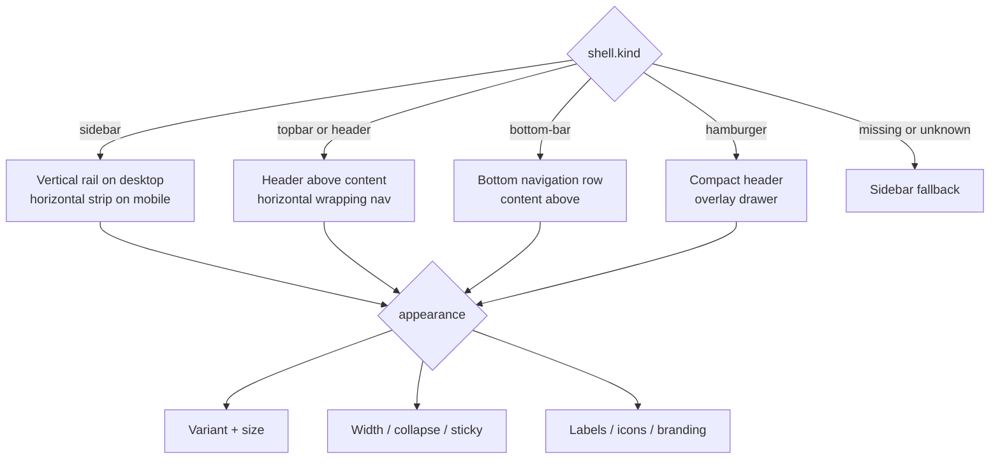

# Navigation & Shell

Every [Application](./applications.md) renders inside a shared shell. The same `ApplicationShellFrame` is used by the deployed runtime, composition preview, and Application Studio's live layout preview, so the shell you configure is the shell users see.

The shell definition lives in `definition.shell`. It is an application-level contract, not an App Page setting.

## Presets

Choose a preset in **Navigation & shell** → **Navigation preset**:

| Preset | `kind` | What it looks like | Preset appearance |
| --- | --- | --- | --- |
| **Sidebar** | `sidebar` | Collapsible vertical rail; grouped items; branding block. | `pills`, `md`, width 220, collapsed width 64, position start, collapsible, sticky, labels/icons/branding on. |
| **Top bar** | `topbar` | Horizontal navigation above the content surface. | `underline`, `md`, align start, collapsible, sticky, labels/icons/branding on. |
| **Bottom bar** | `bottom-bar` | App-style tab strip below the content. | `pills`, `sm`, align center, collapsible, sticky, labels/icons on; branding off. |
| **Hamburger** | `hamburger` | Compact header plus a slide-over navigation drawer. | `minimal`, `md`, width 260, position start, labels/icons/branding on. |

Applying a preset sets `shell.kind` and merges the preset's appearance values over the current appearance. Fields the preset does not mention keep their current values; the built-in presets set the fields relevant to their layout.

Presets are starting points, not locked combinations. You can switch to a top bar and later choose pills, a larger size, or disabled sticky behavior.

## Appearance

```json
{
  "appearance": {
    "variant": "pills",
    "size": "md",
    "width": 220,
    "collapsedWidth": 64,
    "collapsible": true,
    "defaultCollapsed": false,
    "sticky": true,
    "position": "start",
    "align": "start",
    "showLabels": true,
    "showIcons": true,
    "showBranding": true
  }
}
```

| Field | Values | Default | Applies to | Behavior |
| --- | --- | --- | --- | --- |
| `variant` | `pills`, `underline`, `minimal`, `solid` | `pills` | All | Item styling and active-state treatment. `underline` removes item rounding and uses a bottom border. |
| `size` | `sm`, `md`, `lg` | `md` | All | Item padding, text size, icon size, nav gap, and branding type scale. |
| `width` | integer 160–400 | `220` | `sidebar`, `hamburger` | Expanded rail width. Hamburger uses it as the drawer width, with a floor of 240 px at render time. |
| `collapsedWidth` | integer 48–120 | `64` | `sidebar` | Width of the collapsed rail. Must not exceed `width`. |
| `collapsible` | boolean | `true` | All | Shows the collapse control and permits collapsed state. Visible effect on sidebar, top bar, and bottom bar. |
| `defaultCollapsed` | boolean | `false` | All | Starts collapsed when `collapsible` is enabled. |
| `sticky` | boolean | `true` | Sidebar, top bar, bottom bar | Applies sticky positioning at the appropriate edge (desktop sidebar only). |
| `position` | `start`, `end` | `start` | `sidebar`, `hamburger` | Places the rail/drawer on the leading or trailing edge. |
| `align` | `start`, `center`, `end` | `start` | `topbar`, `bottom-bar` | Horizontal alignment of navigation items. |
| `showLabels` | boolean | `true` | All | Shows item text. When off, icons are forced on and badges/groups are suppressed. |
| `showIcons` | boolean | `true` | All | Shows item icons when labels are visible. |
| `showBranding` | boolean | `true` | Sidebar, top bar, hamburger | Shows the branding block (the bottom bar renderer does not include it). |

The editor hides controls that do not apply to the selected kind: position only appears for sidebar/hamburger, alignment only for top bar/bottom bar, width only for sidebar/hamburger, and collapsed width only for sidebar.

## How each shell renders

### Sidebar

- Desktop: a vertical rail whose width is `width` or `collapsedWidth`. Navigation scrolls independently.
- The branding block sits at the top; with `showBranding: true`, the collapsed rail shows only the brand icon.
- The collapse button sits at the bottom-right of the rail.
- `position: "end"` renders the rail on the right at desktop widths.
- Mobile: the rail becomes a horizontal, wrapping navigation strip above the content. Width and sticky positioning do not apply there. Group headings are hidden on mobile.
- `sticky` applies at desktop widths only.

### Top bar

- Header above the content with branding, horizontal navigation, and an optional collapse control at the end.
- Navigation wraps and can scroll horizontally when the items exceed the available width.
- `align` controls horizontal placement of items.
- Collapsing hides labels (and therefore badges and group headings); icons remain.
- `sticky` adds top-edge sticky positioning.
- Width/collapsed width have no effect.

### Bottom bar

- Navigation below the content, laid out as a wrapping, horizontally scrollable row.
- `align` controls horizontal placement.
- Branding is not rendered in this shell, even if `showBranding` is true.
- Collapsing hides labels and badges; icons remain.
- `sticky` adds bottom-edge sticky positioning.
- Width/collapsed width have no effect.

### Hamburger

- Compact header with a menu button and branding.
- The drawer is an absolute overlay with a backdrop. It closes on backdrop click, the close button, `Escape`, or route selection/navigation.
- Drawer side follows `position` (`start` = left, `end` = right).
- Drawer width is `Math.max(width, 240)` px, capped by the viewport.
- Navigation is vertical in the drawer, with labels, icons, groups, and badges as configured.
- The header has no collapse button; `collapsible` and `defaultCollapsed` do not produce a visible collapsed rail in this preset.
- Sticky does not make the hamburger header sticky.



## Branding

```json
{
  "branding": {
    "title": "Order Desk",
    "subtitle": "Operations"
  }
}
```

| Field | Limit | Behavior |
| --- | --- | --- |
| `title` | 120 characters, trimmed | Primary brand text. If empty, the runtime inherits the application title; the renderer's final fallback is `Application`. |
| `subtitle` | 160 characters, trimmed | Secondary line. Hidden when a sidebar is collapsed; not rendered by the bottom bar (which has no branding block). |

`showBranding: false` removes the block entirely. The bottom bar renderer has no branding block regardless of the flag.

## Home, not-found, and expression mode

| Setting | Rules |
| --- | --- |
| **Home route** | Must exist and must not contain path parameters. An empty application must use `null`. |
| **Not-found route** | Optional. Must exist and must not contain path parameters. When a URL matches no route, this route renders without changing the URL. |
| **Expression mode** | `trusted-js` (default) or `safe-path`. |

Root handling:

- If the application has a route at `/`, that route always wins.
- Otherwise, opening the application root redirects to `homeRouteID` when one is set.
- A parameterized route can still be the home target only if it has no parameters, so record routes must be deep-linked or reached by `NAVIGATE`.

`safe-path` switches the page renderer's widget config/value resolution and visibility evaluation to the path-only resolver used by composition preview: only `state.foo.bar` paths are read, JavaScript is not evaluated, and visibility fails closed. It does not sandbox every runtime path in this release: route guards, action configs, and page data-source input resolution still use the shared template evaluator. Choose `trusted-js` only for definitions you trust.

## Navigation items

```json
{
  "navigation": [
    {
      "routeID": "orders",
      "label": "Orders",
      "icon": "cart",
      "group": "Sales",
      "badge": "12",
      "hidden": false
    },
    {
      "routeID": "customers",
      "label": "Customers",
      "icon": "users",
      "group": "Sales",
      "badge": "",
      "hidden": false
    },
    {
      "routeID": "settings",
      "label": "Settings",
      "icon": "settings",
      "group": "Admin",
      "badge": "new",
      "hidden": false
    }
  ]
}
```

| Field | Required | Rules | Behavior |
| --- | --- | --- | --- |
| `routeID` | Yes | Must reference an existing, non-parameterized route. Must be unique in navigation. | Clicking the item navigates to that route. |
| `label` | Yes | 1–120 characters, trimmed. | Visible text when labels are shown; used as the tooltip/title when labels are hidden. |
| `icon` | No | One of the supported icon names; maximum 64 characters. Defaults to `dot`. | Rendered before the label when icons are shown. Unknown names fall back to `dot`. |
| `group` | No | Maximum 80 characters, trimmed. | Groups consecutive items. Vertical shells render a heading when the group changes; horizontal shells render a divider. |
| `badge` | No | Maximum 24 characters, trimmed. | Small pill at the trailing edge, rendered only when labels are shown. |
| `hidden` | No | Boolean, default `false`. | Keeps the item in the definition but omits it from the rendered navigation. |

Navigation can contain at most **100** items. The renderer silently skips items whose route is missing or parameterized; the save validator reports them as errors instead.

### Ordering and grouping

- The `navigation` array is the render order.
- The Application Studio's route drag-reorder also reorders the corresponding navigation entries to follow the routes array. `homeRouteID` is not changed by reordering.
- Navigation up/down buttons reorder items within the navigation array.
- Groups are visual only. They do not create nested menus or collapsible sections.
- A group heading appears before the first item in a group and when the group value changes. An empty group produces no heading.
- In a collapsed or label-less shell, group headings and badges are suppressed.
- Manual `definition.json` edits can put navigation in a different order than routes; the runtime follows the navigation array.

### Icons

Supported icon names:

```text
activity, bar-chart, bell, boxes, briefcase, calendar, clock, code,
credit-card, database, dot, file, globe, home, info, layers, dashboard,
grid, line-chart, list, map, message, pie-chart, rocket, search, settings,
shield, cart, star, table, user, users, workflow
```

`dot`, `info`, and unknown names render the same information icon. Icon names are case-sensitive in the picker; the renderer lowercases nothing.

### Labels, icons, and collapsed behavior

- `showIcons: false` with `showLabels: true` hides icons and shows text only.
- `showLabels: false` hides text and forces icons on, even if `showIcons` is false.
- Collapsing a sidebar or top/bottom bar hides labels, badges, and group headings; icons remain.
- In a sidebar, collapsing also hides the brand title/subtitle while keeping the brand icon.
- A hidden label is exposed as the item's `title`, preserving a hover tooltip.

## Responsive behavior

The shell uses Tailwind's medium breakpoint (`768px`) for the sidebar layout switch. This is separate from the page layout's mobile/tablet/desktop tiers used by [layout nodes](../app-pages-widgets/app-pages-widgets.md#layout-system).

| Shell | Below 768 px | At/above 768 px |
| --- | --- | --- |
| `sidebar` | Horizontal wrapping strip above content; no rail width, no desktop sticky. Group headings hidden. | Vertical rail with configured width; desktop sticky when enabled. |
| `topbar` | Wrapping header; navigation scrolls horizontally if needed. | Same wrapping header; alignment applies. |
| `bottom-bar` | Wrapping bottom row; remains at the bottom of the flex column. | Same; `sticky` applies at the bottom edge. |
| `hamburger` | Overlay drawer capped to the viewport and `max(width, 240)`. | Same overlay behavior; it is not a persistent rail. |

The application content area uses `min-h-0` flex containment. The page's own scroller (`overflow-y-auto` in `AppPageView`) handles page scrolling; shell navigation scrolls inside its own region where applicable. Avoid placing the page inside an additional unbounded-height wrapper when embedding it.

## Definition example

```json
{
  "shell": {
    "kind": "sidebar",
    "homeRouteID": "orders",
    "notFoundRouteID": "not-found",
    "navigation": [
      {
        "routeID": "orders",
        "label": "Orders",
        "icon": "cart",
        "group": "Sales",
        "badge": "12",
        "hidden": false
      },
      {
        "routeID": "customers",
        "label": "Customers",
        "icon": "users",
        "group": "Sales",
        "badge": "",
        "hidden": false
      },
      {
        "routeID": "settings",
        "label": "Settings",
        "icon": "settings",
        "group": "Admin",
        "badge": "",
        "hidden": false
      }
    ],
    "appearance": {
      "variant": "pills",
      "size": "md",
      "width": 240,
      "collapsedWidth": 64,
      "collapsible": true,
      "defaultCollapsed": false,
      "sticky": true,
      "position": "start",
      "align": "start",
      "showLabels": true,
      "showIcons": true,
      "showBranding": true
    },
    "branding": {
      "title": "Order Desk",
      "subtitle": "Operations"
    }
  }
}
```

The matching routes must exist and use page asset keys:

```json
{
  "routes": [
    { "id": "orders", "path": "/orders", "pageAssetKey": "orders-page" },
    { "id": "customers", "path": "/customers", "pageAssetKey": "customers-page" },
    { "id": "settings", "path": "/settings", "pageAssetKey": "settings-page" },
    { "id": "not-found", "path": "/not-found", "pageAssetKey": "not-found-page" }
  ]
}
```

## Legacy header normalization

Older definitions used `kind: "header"`. The contract preprocesses that value to `topbar` during validation, and the frontend normalizer does the same, so old applications keep rendering.

Additional normalization behavior:

- Missing `appearance` fields are filled from the default appearance.
- Missing `branding` becomes `{ "title": "", "subtitle": "" }`.
- A missing or non-array `navigation` becomes `[]`.
- The frontend falls back to `sidebar` for an unknown kind; the save schema rejects unknown kinds, so fix invalid JSON rather than relying on the fallback.
- When the Studio's **Navigation & shell** panel edits a definition, it writes normalized appearance, branding, and item objects back into the draft. This converts `header` to `topbar` and materializes defaults.

## Use cases

| Scenario | Recommended shell |
| --- | --- |
| Dense operations console with many sections | Sidebar, grouped items, `sm`/`md` size, collapsible rail, sticky. |
| Mobile-first field tool | Bottom bar with 4–6 items, icons + short labels, centered alignment, branding off. |
| Content or documentation portal | Top bar with underline items and a brand title/subtitle. |
| Sparse tool where navigation is secondary | Hamburger drawer with a compact header and wide drawer. |
| Role-specific navigation | Hide items per release (`hidden`) or filter routes through consumer policy; navigation follows admitted routes at runtime. |
| Branded workspace switcher | Sidebar or hamburger with branding title/subtitle and a home route; keep the home route stable through route reordering. |

## Validation rules

The server rejects these navigation/shell errors on save:

| Code | Meaning |
| --- | --- |
| `UNKNOWN_NAVIGATION_ROUTE` | A navigation item references a route that does not exist. |
| `PARAMETERIZED_NAVIGATION_ROUTE` | A navigation item references a route with path parameters. |
| `DUPLICATE_NAVIGATION_ROUTE` | The same route appears more than once in navigation. |
| `INVALID_HOME_ROUTE` | Home route is missing when routes exist, or a route was configured when no routes exist. |
| `PARAMETERIZED_HOME_ROUTE` | Home route requires path parameters. |
| `UNKNOWN_NOT_FOUND_ROUTE` / `PARAMETERIZED_NOT_FOUND_ROUTE` | Not-found route is missing or parameterized. |
| `INVALID_SHELL_WIDTH` | `collapsedWidth` exceeds `width`. |
| `UNKNOWN_ROUTE_PARENT` / `ROUTE_PARENT_CYCLE` / `NESTED_ROUTE_PATH` | Parent hierarchy is invalid, cyclic, or the child path is not nested. |
| `UNKNOWN_GUARD_REDIRECT` / `GUARD_REDIRECT_SELF` / `PARAMETERIZED_GUARD_REDIRECT` / `GUARD_REDIRECT_TARGET_GUARDED` | Guard redirect target is invalid. |

## Troubleshooting

| Symptom | Likely cause | Resolution |
| --- | --- | --- |
| Navigation item is missing at runtime | Its route is missing or parameterized, or `hidden: true` | Use a non-parameterized route and uncheck **Hidden**. |
| Save fails with a duplicate navigation error | The same route was added twice | Remove the duplicate item in **Navigation items**. |
| Collapse control does not appear | `collapsible` is false, or the shell is `hamburger` | Enable **Collapsible**; hamburger uses a drawer rather than a collapsed rail. |
| Collapsing does nothing visible on hamburger | The hamburger preset has no collapse control | Configure width/position instead, or switch to sidebar/top bar. |
| Width setting has no effect | The shell is `topbar` or `bottom-bar` | Width applies only to sidebar and hamburger. |
| Bottom bar shows no branding | The bottom-bar renderer omits the branding block | Use sidebar, top bar, or hamburger for branding. |
| Group headings do not appear | Labels are hidden/collapsed, or the shell is horizontal | Show labels; vertical shells render headings, horizontal shells render separators. |
| Badge disappeared | Labels are hidden or the shell is collapsed | Show labels; badges render only with labels. |
| Icon shows an information dot | Icon name is unknown or `dot` | Choose a supported icon name. |
| `/` does not redirect to home | A real route exists at `/` | Remove the root route if home redirect is desired. |
| Old applications still work but show `header` in JSON | Legacy kind was normalized only on read | Edit and save the shell; the normalized `topbar` value is written back. |
| `INVALID_SHELL_WIDTH` | Collapsed width is larger than expanded width | Reduce collapsed width or increase width. |

## Related modules

- [Applications](./applications.md) — routes, home/not-found behavior, and releases.
- [Application State](./application-state.md) — route guards and URL sync read application variables.
- [App Pages & Widgets](../app-pages-widgets/app-pages-widgets.md) — page layout and scrolling inside the shell.
- [Identity & Access Management](../identity-access-management/identity-access-management.md) — permissions for editing applications.
