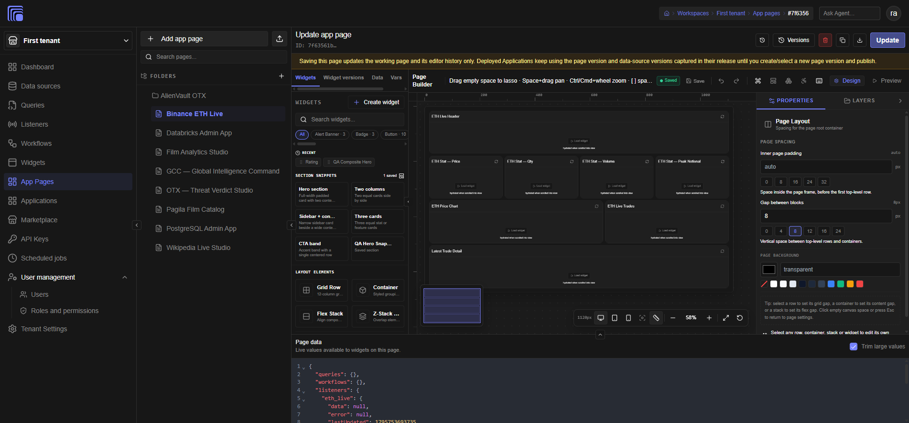
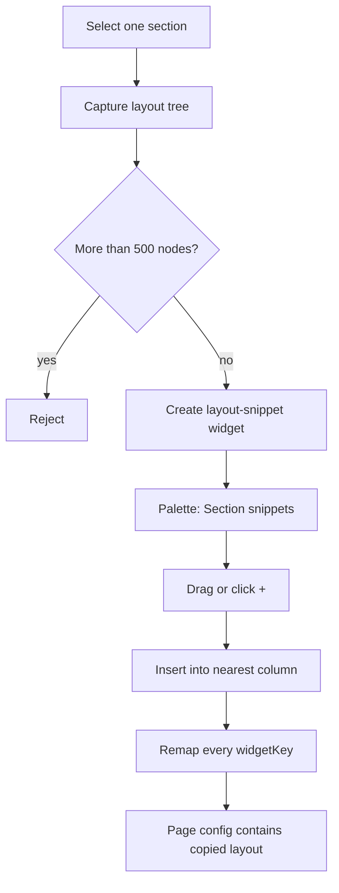
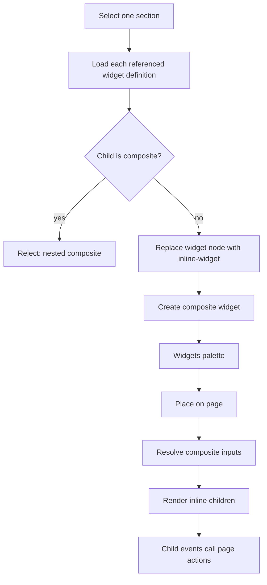

# Snippets & Composites

App Page builders have two ways to reuse a section:

| Feature | Stored as | Child widgets | Best for |
| --- | --- | --- | --- |
| **Section snippet** (`layout-snippet`) | A tenant-scoped widget that contains a captured layout tree | Live references to existing widget definitions | Reusing a section inside the same tenant, where the referenced widgets already exist. |
| **Composite widget** (`composite`) | A widget with an inlined layout and inlined child widget definitions | Complete copies embedded in the composite config | Packaging a section as a self-contained widget that renders on a page and versions with it. |

Both are created from the page editor by selecting a section. They solve different problems: a snippet inserts structure, while a composite renders a reusable compound widget.



## Where the controls live

Select exactly one non-root node on the canvas, then use the editor header:

- **Save selection as snippet** (layout-template icon) — opens **Save section as snippet**.
- **Create composite widget** (boxes icon) — opens **Create composite widget**.

Both actions are disabled unless exactly one node is selected and a tenant is available. Selecting `ROOT` is not allowed.

## Section snippets

### Create a snippet

1. Select a row, container, stack, or a widget slot on the canvas.
2. Click **Save selection as snippet**.
3. Enter a name and optional description.
4. Click **Save snippet**.

The selection is captured as the canonical nested layout JSON, up to **500 Craft nodes**. Larger selections fail with:

> Selection is too large to capture (N nodes; max 500).

The result is a normal widget record:

```json
{
  "widgetTitle": "Customer summary section",
  "widgetDescription": "Name, tier, and open balance",
  "widgetType": "layout-snippet",
  "widgetConfig": {
    "snippet": {
      "schemaVersion": 1,
      "description": "Name, tier, and open balance",
      "layout": {
        "type": "row",
        "id": "row_1",
        "span": 12,
        "sizing": "auto",
        "style": { "gap": "12px" },
        "children": [
          {
            "type": "widget",
            "id": "slot_1",
            "widgetKey": "widget_11111111-1111-4111-8111-111111111111_1",
            "span": 8,
            "sizing": "fill"
          }
        ]
      }
    }
  }
}
```

| Field | Description |
| --- | --- |
| `snippet.schemaVersion` | `1` for the current format. |
| `snippet.layout` | Canonical layout tree captured from the selected node. `null` in the descriptor default until a section is captured. |
| `snippet.description` | Optional note. The palette falls back to the widget description first. |
| `widgetTitle` | Palette label. |
| `widgetType` | Fixed as `layout-snippet`. Used to separate saved snippets from normal widgets. |

Snippets are **tenant-scoped**. They appear in the **Section snippets** area of the Widgets palette with a **saved** badge.

### Built-in vs saved sections

The palette combines:

- built-in section templates: **Hero section**, **Two columns**, **Sidebar + content**, **Three cards**, **CTA band**;
- saved snippets from the tenant.

Built-in templates contain empty layout scaffolding and no widgets. Saved snippets contain the captured structure and widget slot keys.

### Insert a snippet

- Drag the snippet card onto the canvas, or
- click the **+** button on the card.

The drop bridge inserts the snippet into the nearest legal **column** (page root, a container's inner column, or an ancestor), not inside a row or stack where a row is illegal.

Every inserted widget gets a fresh instance key while keeping the same underlying widget ID:

```text
widget_<widgetUUID>_<instanceIndex>
```

This is deliberate: inserting the same snippet twice must produce independent widget state. A snippet never reuses the source page's instance keys.

### Runtime and editing semantics

A snippet is a **palette/editing artifact**, not a widget you place as a live slot:

- It is filtered out of the normal widget list and has no first-party runtime renderer in `WIDGETS_MAP`.
- Inserting it copies the layout tree into the page; the snippet widget itself is not mounted.
- The inserted copy is independent. Editing the saved snippet later does **not** update pages where it was already inserted.
- Widget definitions remain **live references**. The snippet stores widget IDs/keys, not copied widget configs. Changes to a shared widget definition are visible on pages that reference it.
- Because child definitions are not inlined, snippets are intended for reuse within the same tenant where those widgets exist. A cross-tenant install or a page that lacks the widget IDs will not resolve them; use a composite when the section must be self-contained.
- To remove a snippet from the palette, delete the `layout-snippet` widget record. Already-inserted page copies are unaffected.

### Snippet example flow



## Composite widgets

### Create a composite

1. Select a row, container, stack, or widget slot.
2. Click **Create composite widget**.
3. Enter a name and optional description.
4. Click **Create composite**.

The capture walks the selected layout and replaces every widget node with an inline definition. For each referenced widget it loads the saved widget definition:

```json
{
  "type": "inline-widget",
  "id": "slot_1",
  "span": 6,
  "sizing": "fill",
  "inlineWidget": {
    "widgetType": "stat",
    "widgetTitle": "Open balance",
    "widgetConfig": {
      "valueTemplate": "{{ state.queries.balance.data.total }}",
      "label": "Open balance"
    }
  }
}
```

The resulting widget config is:

```json
{
  "widgetTitle": "Customer summary",
  "widgetType": "composite",
  "widgetConfig": {
    "composite": {
      "schemaVersion": 1,
      "layout": {
        "type": "column",
        "id": "root",
        "children": [
          {
            "type": "inline-widget",
            "id": "slot_1",
            "inlineWidget": {
              "widgetType": "text",
              "widgetTitle": "Heading",
              "widgetConfig": {
                "content": "{{ state.composite.inputs.title }}"
              }
            }
          }
        ]
      },
      "inputs": [
        { "key": "title", "type": "string", "default": "Customer summary" }
      ],
      "outputs": [
        { "key": "changed", "description": "Emitted when the customer changes" }
      ],
      "values": {}
    }
  }
}
```

| Field | Description |
| --- | --- |
| `composite.schemaVersion` | `1`. |
| `composite.layout` | Captured layout whose widget nodes have been converted to `inline-widget` nodes. `null` until captured. |
| `composite.inputs` | Typed input declarations: `{ key, type, default }`. Types are `string`, `number`, `boolean`, `object`, `array`. |
| `composite.outputs` | Documentation/contract entries: `{ key, description }`. |
| `composite.values` | Optional value overrides keyed by input key. If present, a value wins over the input default. |
| `widgetType` | Fixed as `composite`. |

A composite is **self-contained for its child widget configs**: the child definitions are embedded in the composite widget config. “Self-contained” does not include page data sources, queries, connectors, or application state; child expressions still resolve against the host page's state tree. Nested composite widgets are rejected during capture:

> Nested composite widgets are not supported yet. Expand the child composite first.

The composite appears as a normal widget in the **Widgets** palette (not in Section snippets). Insert it from the palette onto a page.

### Edit the composite

In the composite widget's properties, the **Composite Config** editor shows:

- the captured layout node count (read-only);
- typed **Inputs** with key, type, and default;
- **Outputs / events** declarations.

The captured layout itself is not edited there. To change the structure, recreate the composite from a new canvas selection. The editor intentionally keeps the layout immutable so the packaged child definitions stay consistent with the version that was captured.

### Inputs

Child widgets read resolved inputs from:

```text
{{ state.composite.inputs.title }}
```

Resolution rules:

1. If `composite.values` contains the input key, use that value; otherwise use the declared default.
2. `string`: stringify; `null` becomes `""`.
3. `number`: `Number(value)` if finite, otherwise `null`.
4. `boolean`: `true`/`"true"` → `true`, `false`/`"false"` → `false`, otherwise `null`.
5. `object` / `array`: use an object directly; a string is parsed as JSON; malformed values fall back to `{}` or `[]`.

`composite.values` is resolved through the page runtime's template resolver before the composite renders, so a value may be an expression such as `{{ state.variables.customerName }}`. The Composite Config editor does not currently expose a `values` editor; inputs are primarily configured through defaults, and `values` is part of the stored config contract.

There is no placement-level input dialog on the page. Two placements of the same composite widget share the same config and therefore the same input values. Use separate composite widgets when placements need different inputs.

### Outputs and events

Declared outputs are metadata: they document the events a composite exposes. They are not automatically emitted, and there is no typed payload validation for them today.

For runtime signaling:

- an inline child can emit an application event from its own action chain, using **Emit Application Event**;
- parent/page widgets subscribe through `subscribeApplicationEvent` or `useApplicationEvent`;
- inline children receive `emitApplicationEvent` and `subscribeApplicationEvent` props.

```text
Composite child "Save" button
  -> saved widget events run through the page action chain
  -> EMIT_APPLICATION_EVENT "customer:changed"
  -> page widget subscribed to "customer:changed"
```

See [Application Events](./application-events.md) for the payload and lifecycle contract.

### Runtime rendering

`AppPageWidgetSlot` detects `widgetType: "composite"` and renders `CompositeWidgetBody` instead of a normal `WIDGETS_MAP` component:

1. Resolve the composite config against the page state tree.
2. Build `state.composite.inputs` from `values`/defaults and expose `state.composite.outputs`.
3. Render the captured layout with `LayoutRenderer`.
4. Render each `inline-widget` through its widget component with:
   - the full page state tree plus the composite namespace;
   - page query results for `resolveWidgetData` (inline child widget-level data sources are not executed);
   - its own widget-local state under `composite:<nodeId>` (child method registration is not wired in the current renderer);
   - the saved child event handlers routed through the page action chain;
   - application event emit/subscribe props.

Inline child widget state is keyed by the captured layout node ID (`composite:<nodeId>`). Two placements of the same composite on the same page therefore share child-local state. If child state must be independent per placement, use one composite placement per page or separate composite widgets.

Composite children do not have independent asset versions. Their configs are part of the composite widget version.

### Composite flow



## Versioning

Snippets and composites participate in the platform's normal asset versioning:

- Creating a page version captures (or reuses when unchanged) one immutable version per placed widget (`widgetVersions`), including composites. A snippet that has been inserted is no longer a placed widget; the page layout references the widgets it contains, and each referenced widget is captured.
- Composite child definitions are stored inside the composite widget config, so they version with the composite. They are not separate page widgets.
- The App Page editor's **Widget versions** tab lets each placed widget use **Latest at capture** or a **Specific version**. The selection is stored in `appPageConfig.widgetVersionSelections[widgetID]`.

```json
{
  "appPageConfig": {
    "widgetVersionSelections": {
      "11111111-1111-4111-8111-111111111111": {
        "versionMode": "specific",
        "widgetVersionID": "22222222-2222-4222-8222-222222222222"
      },
      "33333333-3333-4333-8333-333333333333": {
        "versionMode": "latest-at-capture"
      }
    }
  }
}
```

Version behavior:

| Action | Effect on a release |
| --- | --- |
| Edit a snippet or composite widget | Existing releases keep their captured widget version. Publish a new page/release to capture it. |
| Edit a referenced widget used by a snippet | The page references the shared widget; the next captured page version picks up the selected widget version. |
| Edit an inline child of a composite | It is part of the composite config; capture a new composite/page version. |
| Delete a placed composite or child widget asset | The composite still owns its inline child configs. A plain placed widget reference that disappears fails page capture. |

Application releases always use the exact widget versions captured by their page versions. Standalone App Pages render live widget definitions; the version pin is capture metadata for Application page versions, not a standalone render mode.

## Shared widget library

The shared widget library is a deployment-wide operator-managed registry, separate from asset versions. It publishes **one widget bundle** at a time and supports install/uninstall-style copy semantics, not version history. See [Shared Widget Library](../platform/widget-library.md) for the API and permissions.

- A snippet can be published like any widget. Its bundle contains the snippet config (layout and widget keys), but it does **not** inline the referenced widget definitions.
- A composite is a better cross-tenant artifact because its child definitions are embedded in its config.
- Publishing to the library does not create a new asset version or change existing applications. Installing creates fresh IDs in the target tenant.
- The library has no ratings, versioning, or automatic upgrade path.

## Use cases

| Scenario | Choose | Why |
| --- | --- | --- |
| Reuse a standard KPI row inside the same tenant | Snippet | The underlying widgets already exist; structure reuse is enough. |
| Ship a customer card whose child widget definitions travel with it to another tenant | Composite | Child definitions are embedded and version together. The host page still needs the data sources and connectors the expressions reference. |
| Start a new page from a common hero/two-column layout | Built-in section template | Empty scaffolding with no tenant-specific widgets. |
| Package an interactive mini-form with a heading and save button | Composite | Renders as one widget and bundles child event configs. |
| Capture a page structure for a teammate | Snippet | Fast structure reuse with live shared widgets. |
| Reuse a section across multiple pages with independent widget state | Snippet | Insertion remaps widget instance keys so state stays separate. |

## Limitations

| Limitation | Detail |
| --- | --- |
| Capture size | Maximum 500 Craft nodes per capture. |
| Capture selection | Exactly one non-root node. |
| Snippet portability | References existing widget IDs; child definitions are not inlined. |
| Snippet propagation | Editing the saved snippet does not update already-inserted copies. |
| Snippet as a live widget | `layout-snippet` is a palette artifact; it has no first-party runtime renderer. |
| Composite nesting | Nested composite widgets are rejected at capture. |
| Layout editing | Captured composite layout is read-only in the Composite Config editor; recreate to change structure. |
| Placement inputs | No per-placement input binding UI; `values` are widget-level. |
| Duplicate placement state | Inline child state is keyed by captured node ID, so duplicate placements on one page share child state. |
| Outputs | Declarations only; no automatic emission or payload typing. |
| Child methods | Inline composite children render with local state but are not registered in the page widget-method registry, so `CALL_WIDGET_METHOD` cannot target them in the current renderer. |
| Composite preview | Composition preview replaces the composite with a "Preview unavailable" alert; use a deployed runtime to inspect it. |
| Runtime allowlist | Unsupported inline child types are removed from the release with `COMPOSITE_WIDGET_UNAVAILABLE`. |
| HTML/iframe in snippets | A snippet that brings an HTML/iframe widget into an Application page can block publishing with `UNSUPPORTED_WIDGET_TYPE`. |
| Library reproducibility | The widget library has no version history or upgrade path; a new publish creates a new registry entry. |

## Troubleshooting

| Symptom | Cause | Resolution |
| --- | --- | --- |
| Save snippet/composite button is disabled | No selection, multiple nodes selected, selected `ROOT`, or no tenant | Select exactly one non-root section. |
| “Selection is too large to capture” | More than 500 Craft nodes | Capture a smaller section or split it. |
| “The selected node could not be captured” | Craft snapshot has no display-name nodes or the tree cannot be converted | Reselect the section; avoid stale canvas state. |
| “A selected widget has no saved definition” | A widget slot has no parseable `widget_<uuid>` key | Re-add the widget from the palette and retry. |
| “Nested composite widgets are not supported yet” | Selection contains a composite child | Expand or remove the child composite, then capture. |
| Snippet inserts but widgets are missing | The target page/tenant lacks the referenced widget IDs | Insert in the original tenant or rebuild the section as a composite. |
| Two inserted copies share state | The snippet was inserted without remapping (for example, a manual tree paste) | Delete and insert through the palette/drop bridge, which remaps every key. |
| Composite renders “Preview unavailable” | Composition preview deliberately excludes composite widgets | Deploy a runtime release and inspect it there. |
| Composite input is `null` or empty | Value/default missing, non-finite number, invalid boolean, or malformed JSON | Fix the input default/`values` type; remember number/boolean coercion. |
| Composite child is missing after publish | Child type is outside the runtime widget allowlist | Check release warnings for `COMPOSITE_WIDGET_UNAVAILABLE`; rebuild with supported widgets. |
| Output event is never received | Outputs are metadata; no event was emitted | Add an **Emit Application Event** action to a child and subscribe with a matching name. |
| Library install has broken widget references | A snippet bundle was installed without its referenced widgets | Publish a composite, or include and install the dependencies from the same tenant. |

## Related modules

- [App Pages & Widgets](../app-pages-widgets/app-pages-widgets.md) — canvas, layout nodes, widget instances, and the event editor.
- [Applications](./applications.md) — page versions, widget pins, publish, and runtime.
- [Application Events](./application-events.md) — child-to-page signaling inside composites.
- [Shared Widget Library](../platform/widget-library.md) — deployment-wide widget publish/install.
- [Export & Import Bundles](../platform/export-import-bundles.md) — bundle closure and dependency remapping used by installs.
