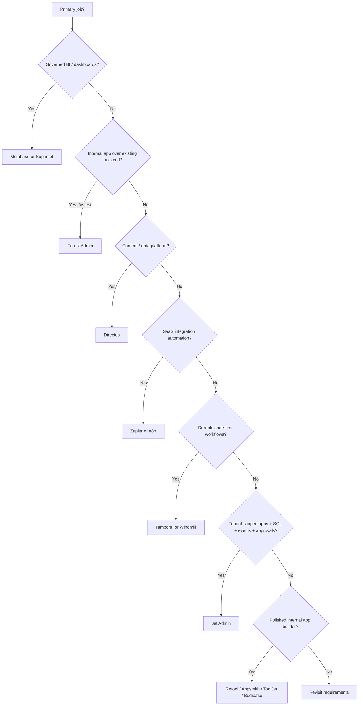

# Market Comparison

Jet Admin sits at the intersection of internal tools, workflow automation, and
lightweight BI. That makes "which tool should we use?" depend more on the job than on a
single feature checklist.

This page compares Jet Admin with twelve adjacent products using dimensions that
matter in practice: hosting, licensing, data sources, UI building, workflow execution,
event streaming, release model, extensibility, learning curve, and enterprise controls.

:::warning Assumptions and scope
- This is a **self-hosted Jet Admin** comparison, not a hosted Jet Admin service.
- The snapshot is **late 2026**. Licenses, plan names, and self-host policies change
  frequently; verify current vendor terms before purchasing.
- Feature labels are based on public documentation and general product positioning,
  not a hands-on benchmark. "Partial" means plan-gated, narrower, or not a core
  strength.
- No performance or scale claims are made. Load-test your own workload.
:::

## Short answer

| If the job is… | The safer default is… | Jet Admin's angle |
|---|---|---|
| Governed BI and dashboards | Metabase or Superset | Queries + Vega widgets + app pages, but no semantic layer or subscriptions |
| A polished internal app builder with a large ecosystem | Retool, Appsmith, or ToolJet | Self-hosted tenant model, listener pipeline, workflow engine, application releases |
| Fast CRUD over an existing app/API | Forest Admin | More generic and standalone, but more assembly required |
| A headless CMS / content API | Directus | Not a CMS |
| SaaS integration automation | Zapier or n8n | Fewer integrations; stronger UI + tenant model |
| Durable code-first orchestration | Temporal or Windmill | Low-code workflow DSL + optional Temporal driver |
| A tenant-scoped operations app with SQL, events, approvals, and a release layer | Jet Admin | The closest fit, with preview-grade maturity caveats |

## 1. Shape and licensing

| Tool | Category | Hosting | License model | Primary job |
|---|---|---|---|---|
| **Jet Admin** | Internal tools + automation + light BI | Self-hosted (Docker); no managed offering in this repo | README says MIT; **no root LICENSE file in this checkout** — verify | Tenant-scoped queries, listeners, workflows, pages, applications |
| **Retool** | Internal app builder | Cloud; self-hosted generally enterprise-tier | Proprietary / commercial | Fast internal apps over data and APIs |
| **Appsmith** | Internal app builder | Cloud + self-hosted community | Apache-2.0 community + commercial | Developer-friendly internal apps |
| **ToolJet** | Internal app builder | Cloud + self-hosted community | AGPL-3.0 community + commercial | Low-code internal tools + workflows |
| **Budibase** | Internal app builder | Cloud + self-hosted | GPL-3.0 core + commercial | CRUD apps, forms, automations, built-in DB |
| **Metabase** | BI / analytics | Cloud + self-hosted | AGPL-3.0 open-source edition + commercial Pro/Enterprise | Questions, dashboards, embedded analytics |
| **Superset** | BI / analytics | Self-hosted; managed via third parties | Apache-2.0 | SQL-first dashboards and exploration |
| **Forest Admin** | Admin panel framework | Hosted + paid self-hosted | Commercial platform; open-source agent libraries (GPL-3.0) | CRUD admin on an existing application backend |
| **Directus** | Data platform / headless CMS | Cloud + self-hosted | Source-available/commercial terms; changed repeatedly — verify | Instant APIs + admin UI over SQL databases |
| **n8n** | Automation / integration | Cloud + self-hosted | Sustainable Use License (source-available, not OSI) + commercial | Node-based integration and automation |
| **Zapier** | Automation / integration | SaaS only | Proprietary | No-code SaaS-to-SaaS automation |
| **Windmill** | Workflows + scripts + UIs | Cloud + self-hosted | AGPL-3.0 community + commercial | Code-first workflows, scripts, internal UIs |
| **Temporal** | Durable execution | Self-hosted + Temporal Cloud | MIT server/SDKs + commercial cloud | Reliable, code-first long-running workflows |

:::note Licensing is a decision input, not a footnote
AGPL/GPL/SUL/BSL terms can affect redistribution, embedding, and SaaS use. Jet Admin's
README says MIT, but the absence of a root `LICENSE` file in this checkout is a real
due-diligence item. Get written clarification before embedding the code in a product
you redistribute.
:::

## 2. Capability fit

Legend: **Strong** = native/core strength; **Partial** = available but plan-gated,
narrower, or requires assembly; **Limited** = peripheral; **—** = not a product goal.

### Data and UI

| Tool | Data sources | UI builder | Data binding | Best UI strength |
|---|---|---|---|---|
| **Jet Admin** | ~45 connector entries: SQL, warehouses, SaaS, files, queues, HTTP | Canvas + reusable widget library | `{{ }}` expressions over page state | Tables, forms, Vega charts, routed internal apps |
| **Retool** | Very broad DB/API/SaaS catalog | Strong drag-and-drop + code | JS/SQL binding | Polished internal apps and components |
| **Appsmith** | Broad DB/API/SaaS | Strong widget canvas + JS | JS everywhere | Developer-controlled internal apps |
| **ToolJet** | Broad DB/API/SaaS | Strong low-code canvas | JS/SQL binding | Fast internal tool assembly |
| **Budibase** | DB/API + built-in database | Strong CRUD/forms builder | Bindings + automations | CRUD apps and forms |
| **Metabase** | 20+ databases/warehouses | Dashboard/question builder | GUI + SQL | Analyst-friendly BI |
| **Superset** | SQLAlchemy-compatible databases | Dashboard/chart builder | SQL + viz controls | SQL-first BI at scale |
| **Forest Admin** | Existing app APIs/DB via agents | Generated CRUD + customization | Backend-defined | Admin panels on your own backend |
| **Directus** | SQL databases | Data-model-driven admin | REST/GraphQL + UI | Content/data management |
| **n8n** | Large integration node library | Minimal UI (workflow canvas) | Node mappings | Automation, not app UI |
| **Zapier** | Very large SaaS app catalog | No app builder | Form-based mappings | SaaS automation |
| **Windmill** | Scripts, HTTP, databases | Script-generated UIs | Code + low-code | Code-first internal tools |
| **Temporal** | Anything reachable from code | — | Code | Durable backend workflows |

### Automation, events, and release model

| Tool | Workflow engine | Listeners / streaming | App release model | Extensibility | Learning curve |
|---|---|---|---|---|---|
| **Jet Admin** | DAG: query, JS, condition, switch, fan-out/join, loop, delay, approval, data collection, sub-workflow; optional Temporal | Listener proxy + Redis Streams + Socket.IO push | Page versions; immutable application releases; deploy/rollback (preview foundation) | Workspace packages: connectors, widgets, nodes, shared UI | Medium–high |
| **Retool** | Workflows (plan-dependent), JS/SQL | Webhooks/API triggers; not a listener product | Version history; deployment model varies by plan | Custom components, APIs, code | Low–medium |
| **Appsmith** | Workflows (paid), JS | WebSocket widget/triggers; not a listener pipeline | Git-based version control/branches | Custom widgets, JS libraries | Medium |
| **ToolJet** | Workflows | Webhooks/triggers; limited listener model | App versioning/git sync (plan-dependent) | Custom components, plugins | Low–medium |
| **Budibase** | Automations (trigger → actions) | Webhooks/automation triggers | Draft/publish; backups | Custom components, scripts | Low |
| **Metabase** | Alerts/subscriptions, not a general DAG engine | — | Question/dashboard history | SQL snippets, embedding, APIs | Low |
| **Superset** | — | — | Dashboard history | Plugins, SQL Lab, APIs | Medium–high |
| **Forest Admin** | Actions/custom code; not a general DAG engine | — | Layout changes are live; no app-release pointer | Agent libraries, custom actions | Medium |
| **Directus** | Flows (trigger/condition/operation) | WebSockets + flows/webhooks | Schema snapshots; content revisions | Extensions, hooks, APIs | Low–medium |
| **n8n** | Core strength: node graph, queue mode | Webhooks, schedules, queue triggers | Workflow version history | Custom nodes, code nodes | Low–medium |
| **Zapier** | Core strength: trigger → action Zaps | Webhooks; no streaming UI | Draft/published Zaps | App integrations, code steps (plan-dependent) | Low |
| **Windmill** | Core strength: code-first flows/scripts | Webhooks, schedules, queues | Script/flow versions; deploy via git/CI | Any npm/Python dependency, custom scripts | Medium–high |
| **Temporal** | Core strength: durable code workflows | Signals/queries; no UI streaming | Code deployment + workflow versioning/patching | SDKs, interceptors, any code | High |

### Enterprise controls

| Tool | RBAC | SSO / SCIM | Audit | Self-host reality |
|---|---|---|---|---|
| **Jet Admin** | Tenant roles + asset permissions + API-key identities | No SAML/OIDC/SCIM in repo; Firebase identity | Audit log + CSV export | Docker reference stack; you operate Postgres/Redis/Temporal/S3 |
| **Retool** | Granular, plan-dependent | Usually enterprise-tier | Plan-dependent | Generally enterprise-tier |
| **Appsmith** | Business/enterprise tiers | Business/enterprise | Plan-dependent | Community edition is usable; advanced controls paid |
| **ToolJet** | Enterprise tiers | Enterprise | Enterprise | Community AGPL; advanced controls paid |
| **Budibase** | Paid tiers | Paid tiers | Paid tiers | Core self-host; enterprise features paid |
| **Metabase** | Pro/Enterprise | Pro/Enterprise | Pro/Enterprise | Open-source core; paid governance |
| **Superset** | Native RBAC | Auth integrations (OAuth/LDAP/etc.) | Limited native audit | You operate a Python/warehouse stack |
| **Forest Admin** | Roles/permissions | Enterprise | Enterprise | Self-hosted is a paid plan |
| **Directus** | Native RBAC | Plan-dependent | Activity/revisions | Self-host; license terms need review |
| **n8n** | Enterprise | Enterprise | Enterprise | SUL self-host for internal use; enterprise controls paid |
| **Zapier** | Enterprise | Enterprise | Enterprise | SaaS only |
| **Windmill** | Enterprise | Enterprise | Enterprise | AGPL community; enterprise features paid |
| **Temporal** | Namespace/IAM via cloud | Cloud/enterprise | Cloud/enterprise | You operate the cluster; not a UI RBAC product |

## 3. When to choose — and when not to

| Tool | Choose when… | Avoid when… |
|---|---|---|
| **Jet Admin** | You want a self-hosted, tenant-scoped platform that combines SQL/API queries, event listeners, workflows, app pages, and a release layer; you can accept preview-grade maturity and operate Postgres/Redis/Temporal | You need enterprise SSO/SCIM today, governed BI, row-level security, anonymous public apps, or a large connector marketplace with vendor support |
| **Retool** | You need the most polished internal app builder, broad connectors, and a mature ecosystem; budget supports per-user pricing and enterprise self-host | Per-seat cost or vendor lock-in is unacceptable; you need fully open-source redistribution |
| **Appsmith** | You want an Apache-2.0 community edition, a JS-friendly builder, and self-hosting with a large community | You need the shortest no-code learning curve or all governance features in the free tier |
| **ToolJet** | You want an AGPL community edition with a strong low-code canvas and workflow features | AGPL obligations or paid enterprise controls are a blocker |
| **Budibase** | You want fast CRUD/forms, a built-in database, and simple automations with low ceremony | You need complex event pipelines, fine-grained tenant RBAC, or SQL-heavy multi-source apps |
| **Metabase** | You need analyst-friendly BI, dashboards, subscriptions, and a governed semantic layer | You need write actions, internal CRUD, or event-driven workflows |
| **Superset** | You need a free Apache-2.0 SQL-first BI platform and can operate a Python stack | You want a turnkey low-code app builder or minimal ops burden |
| **Forest Admin** | You already have an application backend and want a generated admin panel quickly | You need a standalone platform with its own data model, listeners, and app releases |
| **Directus** | You need instant REST/GraphQL APIs and an admin UI over a SQL database / content model | You need a workflow engine, event listeners, or internal app composition |
| **n8n** | You need broad SaaS integration automation, webhooks, and self-hosting | You need a UI builder, tenant-scoped end-user apps, or governed BI |
| **Zapier** | You want a very large SaaS integration catalog with zero infrastructure | You need self-hosting, data residency, custom UI, or per-task cost control |
| **Windmill** | You want code-first workflows/scripts with generated UIs and self-hosting | You want a no-code builder for non-technical operators |
| **Temporal** | You need durable, replayable, long-running workflows with strong consistency and code-level control | You want a low-code UI, drag-and-drop app builder, or minimal operational complexity |

## 4. Jet Admin versus the closest alternatives

### Versus Retool

Retool is a common benchmark for polish and ecosystem. Its component library, connector
breadth, and debugging experience are generally more mature. Jet Admin's differentiators are
self-hosting, a tenant-first authorization model, a listener pipeline with Redis
Streams, and an application release layer that pins page versions. Jet Admin is not a
drop-in Retool replacement: expect rougher edges, fewer components, and no enterprise
SSO/SCIM today.

**Choose Jet Admin** if control over hosting and tenant isolation matters more than
polish. **Choose Retool** if time-to-value, ecosystem, and enterprise controls are the
priority and the budget supports it.

### Versus Appsmith and ToolJet

Appsmith (Apache-2.0) and ToolJet (AGPL-3.0) are the closest open-source peers. Both
generally have more mature visual builders and larger communities. Jet Admin's distinguishing
code paths are tenant-scoped asset permissions, the listener pipeline, workflow
approvals, and its page-version/application-release model; Appsmith/ToolJet are
stronger in widget breadth, JS-centric development, and day-to-day builder ergonomics.

**Choose Jet Admin** if you need its specific combination of tenants, listeners,
workflows, and release pinning. **Choose Appsmith/ToolJet** if you want a more
established open-source app builder and do not need Jet Admin's listener/application
model.

### Versus Budibase

Budibase optimizes for fast CRUD apps, forms, and a built-in database. It is easier for
non-technical builders. Jet Admin assumes more SQL/JSON knowledge but offers explicit
datasource/query separation, a DAG workflow engine, listener pipelines, and
tenant-scoped RBAC.

**Choose Budibase** for a quick internal CRUD app with minimal assembly. **Choose Jet
Admin** when the app is query-heavy, event-driven, or must be tenant-scoped.

### Versus Metabase and Superset

Metabase and Superset are BI products. They are better at governed metrics, semantic
modeling, dashboard subscriptions, and analyst self-service. Jet Admin can render Vega
charts and tables, but it is not a BI suite and does not ship a semantic layer.

**Choose Metabase/Superset** for read-only analytics as the primary job. **Choose Jet
Admin** when the dashboard must sit next to write actions, approvals, listeners, and
tenant-scoped apps.

### Versus Forest Admin and Directus

Forest Admin generates an admin panel on top of an existing application backend; it is
the fastest path when your backend already exposes the right APIs. Directus turns a SQL
database into a content/data platform with instant APIs and an admin UI.

Jet Admin is more generic and standalone: it connects to many systems, adds workflows
and listeners, and composes pages into applications. It is not a CMS and does not
generate a domain API for you.

### Versus n8n, Zapier, Windmill, and Temporal

These are automation/orchestration products, not internal app builders.

- **Zapier** wins on SaaS catalog and zero ops, but is SaaS-only and task-priced.
- **n8n** wins on self-hosted integration breadth, but its UI is a workflow canvas,
  not an end-user app.
- **Windmill** wins for code-first scripts/flows with generated UIs; it expects
  engineering ownership.
- **Temporal** wins for durable, replayable, long-running workflows; it is
  infrastructure, not a low-code platform.

Jet Admin's workflow engine is best for operational DAGs with human approvals and
data queries. For payment settlement, complex compensation, or workflows that must
survive multi-day infrastructure failures with strict replay semantics, use Temporal
directly or run Jet Admin's Temporal driver with a clear understanding of its limits.

## 5. Cost model reality

| Model | Examples | What you pay for | Hidden cost |
|---|---|---|---|
| Open-source self-host | Jet Admin, Appsmith CE, ToolJet CE, Budibase core, Metabase OSS, Superset, Windmill CE | Infrastructure + engineering time | Upgrades, security patching, backups, on-call |
| Open-core + paid governance | Appsmith, ToolJet, Budibase, Metabase, n8n, Windmill | SSO, RBAC, audit, support | Tiered feature gates and seat minimums |
| Commercial per-user | Retool, Forest Admin | Builder/viewer seats, enterprise features | Scaling viewers and self-host premiums |
| SaaS per-task | Zapier | Tasks/executions | Runaway automations and vendor lock-in |
| Durable execution | Temporal Cloud / self-host | Actions, storage, or cluster ops | Engineering complexity and observability |
| Agent/LLM usage | Jet Agent via OpenRouter | Tokens | Model choice, retries, prompt/tool loops |

Jet Admin's license fee may be zero (subject to the LICENSE question), but it is not
free to operate: you need PostgreSQL, Redis, optional Temporal, object storage,
Firebase, backups, monitoring, and upgrade discipline. Budget engineering time for
connector validation and security hardening.

## 6. Decision guide

## 7. What would change this recommendation

Choose Jet Admin more confidently if the project adds or proves:

- SAML/OIDC SSO and SCIM provisioning;
- a production-hardened application runtime with live Temporal/Redis/listener-proxy
  verification;
- row-level authorization or a documented pattern for per-user data filtering;
- connector conformance tests and clear maturity labels per connector;
- rate limiting, Helmet, and a documented internet-exposure checklist;
- a real migration/upgrade story with versioned Prisma migrations;
- a clear LICENSE file and commercial support options.

Choose against Jet Admin if any of these are hard requirements today:

- a governed BI semantic layer with scheduled subscriptions;
- anonymous public apps with database-enforced tenant isolation;
- enterprise SSO/SCIM and vendor support;
- a very large connector catalog with vendor-maintained integrations;
- exactly-once side effects for financial mutations;
- a fully managed service with an SLA.

## 8. Bottom line

Jet Admin is not the most polished tool in any single category. Its case is the
combination: **self-hosted, tenant-scoped, query-first, event-capable, workflow-aware,
and app-composable**, with a release layer that is less common among low-code builders.

If that combination matches your operating model and you can tolerate preview-grade
maturity, it can replace several disconnected tools. If you need best-in-class BI,
enterprise identity, or vendor-supported integrations today, pair Jet Admin with a
specialist rather than forcing it to be everything.

## Related reading

- [Introduction](../introduction/introduction.md)
- [Quickstart](../getting-started/quickstart.md)
- [Use Cases](../use-cases/use-cases.md)
- [Platform Architecture](../platform/architecture.md)
- [Security](../operations/security.md)
