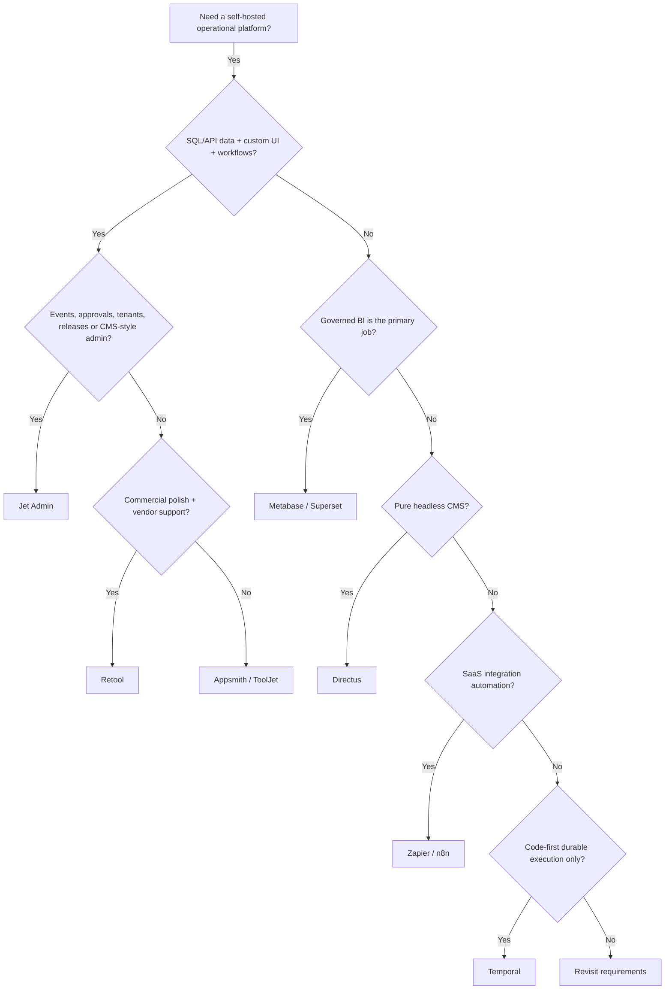

# Market Comparison

Jet Admin is an **MIT-licensed, self-hosted application platform** that combines
tenant-scoped data access, JavaScript app building, event listeners, Temporal-backed
workflows, CMS-style content operations, and immutable application releases in one
stack.

That combination is the point. Most adjacent products are excellent at one layer:
Retool at app building, Metabase at BI, Directus at content APIs, n8n at integration
automation, Temporal at durable execution. Jet Admin is the stronger choice when you
want those capabilities to share one data model, one authorization model, one release
process, and one self-hosted deployment.

:::note Scope
- This comparison describes the **self-hosted Jet Admin** in this repository.
- The snapshot is **late 2026**. Vendor plans and licenses change; verify current terms
  before purchasing.
- Feature labels are based on public documentation and product positioning, not a
  hands-on benchmark.
:::

## Where Jet Admin is strongest

| Requirement | Jet Admin advantage |
|---|---|
| Self-hosted internal tools without per-seat license fees | MIT license, Docker Compose reference stack, no vendor account required |
| One platform for data, UI, automation, and releases | 45 connectors, saved queries, app pages/widgets, listeners, workflows, applications, folders, bundles |
| Multi-tenant SaaS administration | First-class tenant isolation, tenant roles, asset-level Casbin permissions, API-key identities |
| SQL and API operations | Parameterized PostgreSQL queries, REST/GraphQL, warehouses, SaaS APIs, files, queues, and streaming sources |
| Event-driven and real-time apps | Listener proxy, Redis Streams, Socket.IO push, webhook ingress, buffered events, dead-letter queue |
| Durable workflows with human steps | Temporal is the workflow runner for approvals, loops, fan-out/join, delays, sub-workflows, and long-running runs |
| JavaScript-native binding | Full JavaScript inside `{{ }}` expressions over page, query, listener, workflow, route, and application state |
| Versioned delivery | Page versions, immutable application releases, environment bindings, deploy and rollback |
| CMS-style content operations | API keys expose scoped query/workflow access; saved queries and workflows manage content; app pages provide the editorial UI |
| Agent and AI automation | Bundled MCP server exposes 130 tools for datasources, queries, listeners, workflows, pages, widgets, IAM, and validation |
| Extensibility without forking the core | Typed widget contracts, workspace packages, bundle export/import, widget library, marketplace templates |
| Governed operations | Audit log with CSV export, folders, asset version references, release history, run history |

## Short answer

| If the job is… | Strongest primary fit | Jet Admin's advantage |
|---|---|---|
| Governed BI with a semantic layer | Metabase or Superset | SQL/API queries, Vega charts, tables and KPI widgets next to write actions, workflows and tenant-scoped apps |
| A polished internal app builder with a large ecosystem | Retool, Appsmith, or ToolJet | MIT license, self-hosting, tenant isolation, listener pipeline, Temporal workflows, immutable releases, MCP |
| Fast CRUD over an existing application backend | Forest Admin | Works standalone across 45 sources and adds workflows, listeners, app releases and multi-tenant administration |
| A headless CMS with instant REST/GraphQL APIs | Directus | Jet Admin can act as the CMS/admin layer with API keys, saved queries, workflows and app pages, while also running the operational apps around the content |
| SaaS integration automation | Zapier or n8n | The automation ships with the UI, tenant model, audit trail and release process; 45 connectors plus REST/GraphQL cover the long tail |
| Durable code-first orchestration | Temporal or Windmill | Temporal is the workflow runner underneath Jet Admin's visual DAG, approvals and data steps |
| A tenant-scoped operations platform with SQL, events, approvals, CMS-style admin and a release layer | **Jet Admin** | All of the above in one self-hosted stack, MIT licensed, with 130 MCP tools for agents |

## 1. Shape and licensing

| Tool | Category | Hosting | License model | Primary job |
|---|---|---|---|---|
| **Jet Admin** | Internal tools + automation + workflows + CMS-style admin + light BI | Self-hosted Docker Compose; deploy on your own infrastructure | **MIT** (root `LICENSE`) | Tenant-scoped data apps, event pipelines, workflows, content operations, releases |
| **Retool** | Internal app builder | Cloud; self-hosted generally enterprise-tier | Proprietary / commercial | Fast internal apps over data and APIs |
| **Appsmith** | Internal app builder | Cloud + self-hosted community | Apache-2.0 community + commercial | Developer-friendly internal apps |
| **ToolJet** | Internal app builder | Cloud + self-hosted community | AGPL-3.0 community + commercial | Low-code internal tools + workflows |
| **Budibase** | Internal app builder | Cloud + self-hosted | GPL-3.0 core + commercial | CRUD apps, forms, automations, built-in DB |
| **Metabase** | BI / analytics | Cloud + self-hosted | AGPL-3.0 open-source edition + commercial Pro/Enterprise | Questions, dashboards, embedded analytics |
| **Superset** | BI / analytics | Self-hosted; managed via third parties | Apache-2.0 | SQL-first dashboards and exploration |
| **Forest Admin** | Admin panel framework | Hosted + paid self-hosted | Commercial platform; open-source agent libraries (GPL-3.0) | CRUD admin on an existing application backend |
| **Directus** | Data platform / headless CMS | Cloud + self-hosted | Source-available/commercial terms; changed repeatedly — verify | Instant APIs + admin UI over SQL databases |
| **n8n** | Automation / integration | Cloud + self-hosted | Sustainable Use License (source-available, not OSI) + commercial | Node-based integration and automation |
| **Zapier** | Automation / integration | SaaS only | Proprietary | No-code SaaS-to-SaaS automation |
| **Windmill** | Workflows + scripts + UIs | Cloud + self-hosted | AGPL-3.0 community + commercial | Code-first workflows, scripts, internal UIs |
| **Temporal** | Durable execution | Self-hosted + Temporal Cloud | MIT server/SDKs + commercial cloud | Reliable, code-first long-running workflows |

:::tip MIT licensing
Jet Admin ships under the MIT license. You can self-host it, modify it, embed it in
commercial work, and redistribute it without seat fees or license gates. The trade-off
is operational ownership: you run PostgreSQL, Redis, Temporal, object storage and
backups.
:::

## 2. Capability fit

Legend: **Strong** = native/core strength; **Partial** = available but plan-gated,
narrower, or requires assembly; **Limited** = peripheral; **—** = not a product goal.

### Data, UI, and content

| Tool | Data sources | UI builder | Data binding | Best UI strength |
|---|---|---|---|---|
| **Jet Admin** | 45 connectors: SQL, warehouses, SaaS, files, queues, HTTP, streaming | Canvas + reusable widget library + saved sections/composites | Full JavaScript `{{ }}` expressions over page, query, workflow, listener, route and application state | Tables, forms, Vega charts, routed internal apps, CMS-style editors |
| **Retool** | Very broad DB/API/SaaS catalog | Strong drag-and-drop + code | JS/SQL binding | Polished internal apps and components |
| **Appsmith** | Broad DB/API/SaaS | Strong widget canvas + JS | JavaScript everywhere | Developer-controlled internal apps |
| **ToolJet** | Broad DB/API/SaaS | Strong low-code canvas | JS/SQL binding | Fast internal tool assembly |
| **Budibase** | DB/API + built-in database | Strong CRUD/forms builder | Bindings + automations | CRUD apps and forms |
| **Metabase** | 20+ databases/warehouses | Dashboard/question builder | GUI + SQL | Analyst-friendly BI |
| **Superset** | SQLAlchemy-compatible databases | Dashboard/chart builder | SQL + viz controls | SQL-first BI at scale |
| **Forest Admin** | Existing app APIs/DB via agents | Generated CRUD + customization | Backend-defined | Admin panels on your own backend |
| **Directus** | SQL databases | Data-model-driven admin | REST/GraphQL + UI | Content/data management |
| **n8n** | Large integration node library | Minimal UI (workflow canvas) | Node mappings | Automation, not app UI |
| **Zapier** | Very large SaaS app catalog | No app builder | Form-based mappings | SaaS automation |
| **Windmill** | Scripts, HTTP, databases | Script-generated UIs | Code + low-code | Code-first internal tools |
| **Temporal** | Anything reachable from code | — | Code | Durable backend workflows |

### Automation, events, and release model

| Tool | Workflow engine | Listeners / streaming | App release model | Extensibility | Learning curve |
|---|---|---|---|---|---|
| **Jet Admin** | Temporal-backed DAG: query, JavaScript, condition, switch, fan-out/join, loop, delay, approval, data collection, sub-workflow | Listener proxy + Redis Streams + Socket.IO push + webhook ingress | Page versions; immutable application releases; environment bindings; deploy and rollback | Workspace packages, typed widget contracts, bundles, widget library, MCP | Medium |
| **Retool** | Workflows (plan-dependent), JS/SQL | Webhooks/API triggers; not a listener product | Version history; deployment model varies by plan | Custom components, APIs, code | Low–medium |
| **Appsmith** | Workflows (paid), JS | WebSocket widget/triggers; not a listener pipeline | Git-based version control/branches | Custom widgets, JS libraries | Medium |
| **ToolJet** | Workflows | Webhooks/triggers; limited listener model | App versioning/git sync (plan-dependent) | Custom components, plugins | Low–medium |
| **Budibase** | Automations (trigger → actions) | Webhooks/automation triggers | Draft/publish; backups | Custom components, scripts | Low |
| **Metabase** | Alerts/subscriptions, not a general DAG engine | — | Question/dashboard history | SQL snippets, embedding, APIs | Low |
| **Superset** | — | — | Dashboard history | Plugins, SQL Lab, APIs | Medium–high |
| **Forest Admin** | Actions/custom code; not a general DAG engine | — | Layout changes are live; no app-release pointer | Agent libraries, custom actions | Medium |
| **Directus** | Flows (trigger/condition/operation) | WebSockets + flows/webhooks | Schema snapshots; content revisions | Extensions, hooks, APIs | Low–medium |
| **n8n** | Core strength: node graph, queue mode | Webhooks, schedules, queue triggers | Workflow version history | Custom nodes, code nodes | Low–medium |
| **Zapier** | Core strength: trigger → action Zaps | Webhooks; no streaming UI | Draft/published Zaps | App integrations, code steps (plan-dependent) | Low |
| **Windmill** | Core strength: code-first flows/scripts | Webhooks, schedules, queues | Script/flow versions; deploy via git/CI | Any npm/Python dependency, custom scripts | Medium–high |
| **Temporal** | Core strength: durable code workflows | Signals/queries; no UI streaming | Code deployment + workflow versioning/patching | SDKs, interceptors, any code | High |

### Enterprise controls

| Tool | RBAC | Identity | Audit | Self-host reality |
|---|---|---|---|---|
| **Jet Admin** | Tenant roles, asset-level permissions, API-key identities | Firebase identity for humans; API keys for automation | Audit log + CSV export | Full MIT stack; Docker reference deployment |
| **Retool** | Granular, plan-dependent | SSO usually enterprise-tier | Plan-dependent | Generally enterprise-tier |
| **Appsmith** | Business/enterprise tiers | SSO in business/enterprise | Plan-dependent | Community edition is usable; advanced controls paid |
| **ToolJet** | Enterprise tiers | SSO in enterprise | Enterprise | Community AGPL; advanced controls paid |
| **Budibase** | Paid tiers | SSO in paid tiers | Paid tiers | Core self-host; enterprise features paid |
| **Metabase** | Pro/Enterprise | SSO in Pro/Enterprise | Pro/Enterprise | Open-source core; paid governance |
| **Superset** | Native RBAC | OAuth/LDAP/etc. | Limited native audit | Python/warehouse stack to operate |
| **Forest Admin** | Roles/permissions | Enterprise | Enterprise | Self-hosted is a paid plan |
| **Directus** | Native RBAC | Plan-dependent | Activity/revisions | Self-host; verify license terms |
| **n8n** | Enterprise | Enterprise | Enterprise | SUL self-host for internal use; enterprise controls paid |
| **Zapier** | Enterprise | Enterprise | Enterprise | SaaS only |
| **Windmill** | Enterprise | Enterprise | Enterprise | AGPL community; enterprise features paid |
| **Temporal** | Namespace/IAM via cloud | Cloud/enterprise | Cloud/enterprise | You operate the cluster; not a UI RBAC product |

## 3. Best-fit scenarios

### Choose Jet Admin when

- You want **one self-hosted platform** for internal tools, workflows, event-driven
  apps, content operations and releases.
- You need **tenant isolation** and asset-level permissions without building an
  authorization layer.
- You want **JavaScript-native app building** with full `{{ }}` expressions over query,
  listener, workflow, route and application state.
- You need **Temporal-backed durability** with a visual DAG, human approvals, loops,
  fan-out/join and sub-workflows.
- You need **live events** from Kafka, MQTT, WebSocket, SSE, webhooks, databases or Redis
  delivered to app pages.
- You want **CMS-style content operations** backed by API keys, saved queries, workflows,
  and custom editorial pages.
- You want **immutable application releases** with page version pinning and rollback.
- You want **agent automation** through a bundled MCP server with 130 tools.
- You need an **MIT license** and no per-seat fees.

### Choose a specialist when it is the primary product

| Tool | Choose it when… | Jet Admin still adds |
|---|---|---|
| **Retool** | You want the most polished commercial app builder, the broadest managed connector ecosystem, and vendor support | MIT licensing, self-hosting, tenant isolation, listeners, Temporal workflows, release pinning, MCP |
| **Appsmith / ToolJet** | You want an established open-source app builder with a large widget/community ecosystem | Tenant model, listener pipeline, approvals, application releases, CMS-style operations, MCP |
| **Budibase** | You want the fastest no-code CRUD/forms experience with a built-in database | Query-first data modeling, event pipelines, tenant RBAC, Temporal workflows, release pinning |
| **Metabase / Superset** | Governed BI, semantic modeling, scheduled subscriptions and analyst self-service are the primary job | Write actions, approvals, listeners, tenant-scoped apps and CMS operations next to the dashboard |
| **Forest Admin** | You already have an application backend and want a generated admin panel immediately | Standalone multi-source data access, workflows, listeners, app composition and releases |
| **Directus** | You want a pure headless CMS with instant REST/GraphQL APIs and a content-first admin UI | CMS-style operations plus workflows, listeners, tenant isolation and custom operational apps in the same stack |
| **n8n / Zapier** | SaaS-to-SaaS integration breadth is the primary job | The UI, tenant model, audit trail, release process and human approval steps around the automation |
| **Windmill** | You want code-first scripts/flows with generated UIs | Low-code app composition, listeners, tenant RBAC, approvals and release management |
| **Temporal** | You need code-first durable execution as infrastructure, without an app platform | Visual workflow authoring, approvals, data steps, app pages and release management on top of Temporal |

## 4. Jet Admin versus the closest alternatives

### Versus Retool

Retool is a strong benchmark for commercial app-builder polish. Jet Admin competes on
**ownership and scope**: MIT license, self-hosted deployment, tenant-first
authorization, 45 connectors, a listener pipeline with Redis Streams, Temporal-backed
workflows, CMS-style API-key operations, and an application release layer that pins
page versions.

**Choose Jet Admin** when you want one self-hosted platform for data, automation,
content operations and versioned apps without per-seat licensing. **Choose Retool** when
a managed commercial ecosystem and vendor support are the priority.

### Versus Appsmith and ToolJet

Appsmith (Apache-2.0) and ToolJet (AGPL-3.0) are the closest open-source peers. Jet
Admin's differentiators are **tenant-scoped asset permissions, the listener pipeline,
Temporal workflows with human approvals, immutable application releases, CMS-style
operations, and a 130-tool MCP server**.

**Choose Jet Admin** when you need tenants, events, workflows, content operations and
release pinning in one stack. **Choose Appsmith/ToolJet** when you want their specific
builder ecosystem and do not need Jet Admin's listener/application model.

### Versus Budibase

Budibase optimizes for fast CRUD apps, forms, and a built-in database. Jet Admin
optimizes for **query-first, event-driven, multi-tenant operations**: explicit
datasource/query separation, a Temporal workflow engine, listener pipelines,
tenant-scoped RBAC, CMS-style API access and versioned application releases.

**Choose Budibase** for a quick internal CRUD app. **Choose Jet Admin** when the app is
query-heavy, event-driven, multi-tenant, or needs approvals and releases.

### Versus Metabase and Superset

Metabase and Superset are BI products focused on governed metrics, semantic modeling,
subscriptions and analyst self-service. Jet Admin adds **write actions, approvals,
listeners, workflows, tenant-scoped apps and CMS-style content operations** around the
same queries and Vega charts.

**Choose Metabase/Superset** when read-only analytics is the primary job. **Choose Jet
Admin** when the dashboard must sit next to operational actions and releases.

### Versus Forest Admin and Directus

Forest Admin generates an admin panel on top of an existing application backend.
Directus turns a SQL database into a content/data platform with instant APIs and an
admin UI.

Jet Admin is broader and standalone: it connects to 45 systems, adds workflows and
listeners, composes pages into applications, and can act as a **CMS/admin layer** with
API keys, saved queries, workflows and editorial app pages. For a schema-first headless
CMS with generated domain APIs, pair it with Directus; for CMS operations that need
tenant isolation, approvals, event pipelines and custom apps, Jet Admin is the stronger
fit.

### Versus n8n, Zapier, Windmill, and Temporal

These are automation/orchestration products, not internal app platforms.

- **Zapier** wins on SaaS catalog and zero ops.
- **n8n** wins on self-hosted integration breadth.
- **Windmill** wins for code-first scripts/flows with generated UIs.
- **Temporal** wins for durable, replayable, code-first workflows.

Jet Admin's advantage is that **Temporal is the workflow runner underneath a visual
platform**: you get durable execution plus app pages, listeners, human approvals,
tenant-scoped data access, audit history and release pinning. For code-only
orchestration outside an application platform, use Temporal directly.

## 5. Cost model reality

| Model | Examples | What you pay for | Hidden cost |
|---|---|---|---|
| MIT self-host | **Jet Admin** | Infrastructure + engineering time | Upgrades, security patching, backups, on-call |
| Apache/AGPL community | Appsmith CE, ToolJet CE, Superset, Windmill CE | Infrastructure + engineering time | Paid governance tiers, AGPL obligations |
| Open-core + paid governance | Appsmith, ToolJet, Budibase, Metabase, n8n, Windmill | SSO, RBAC, audit, support | Tiered feature gates and seat minimums |
| Commercial per-user | Retool, Forest Admin | Builder/viewer seats, enterprise features | Scaling viewers and self-host premiums |
| SaaS per-task | Zapier | Tasks/executions | Runaway automations and vendor lock-in |
| Durable execution | Temporal Cloud / self-host | Actions, storage, or cluster ops | Engineering complexity and observability |
| Agent/LLM usage | Jet Agent via OpenRouter | Tokens | Model choice, retries, prompt/tool loops |

Jet Admin has **no license fee and no per-seat pricing**. You pay for PostgreSQL,
Redis, Temporal, object storage, Firebase, backups, monitoring and engineering time.
That is the intended trade: infrastructure ownership in exchange for control, tenant
isolation and an MIT license.

## 6. Decision guide

## 7. Jet Admin strengths in one place

- **MIT licensed**, self-hosted, no per-seat fees.
- **45 connectors** across SQL, warehouses, SaaS APIs, files, queues and streaming.
- **JavaScript `{{ }}` expressions** over page, query, workflow, listener, route and
  application state.
- **Temporal-backed workflows**: approvals, loops, fan-out/join, delays, sub-workflows,
  data collection and durable runs.
- **Listener pipeline**: proxy, Redis Streams, Socket.IO push, webhook ingress, buffered
  events and dead-letter handling.
- **Tenant isolation** with Casbin policies, asset-level permissions and API-key
  identities.
- **CMS-style operations**: API keys, saved queries, workflows and editorial app pages.
- **Immutable releases**: page versions, application releases, environment bindings,
  deploy and rollback.
- **130-tool MCP server** for agent-driven inspection and operation.
- **Extensible by design**: typed widget contracts, workspace packages, bundles, widget
  library and marketplace templates.
- **Operator-friendly**: folders, audit log, run history, asset version references and
  CSV export.

## 8. Bottom line

Jet Admin's case is the **combination**: self-hosted, MIT licensed, tenant-scoped,
query-first, JavaScript-native, event-capable, Temporal-powered, CMS-capable and
app-composable, with a release layer that most low-code builders do not have.

If that combination matches your operating model, Jet Admin can replace several
disconnected tools with one stack. If you need best-in-class BI, a pure headless CMS,
or a fully managed vendor service as the primary product, pair Jet Admin with that
specialist—and keep Jet Admin for the operational layer around it.

## Related reading

- [Introduction](../introduction/introduction.md)
- [Quickstart](../getting-started/quickstart.md)
- [Use Cases](../use-cases/use-cases.md)
- [Platform Architecture](../platform/architecture.md)
- [Security](../operations/security.md)
