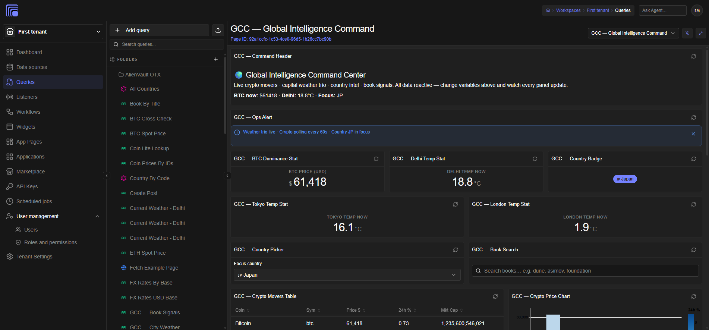
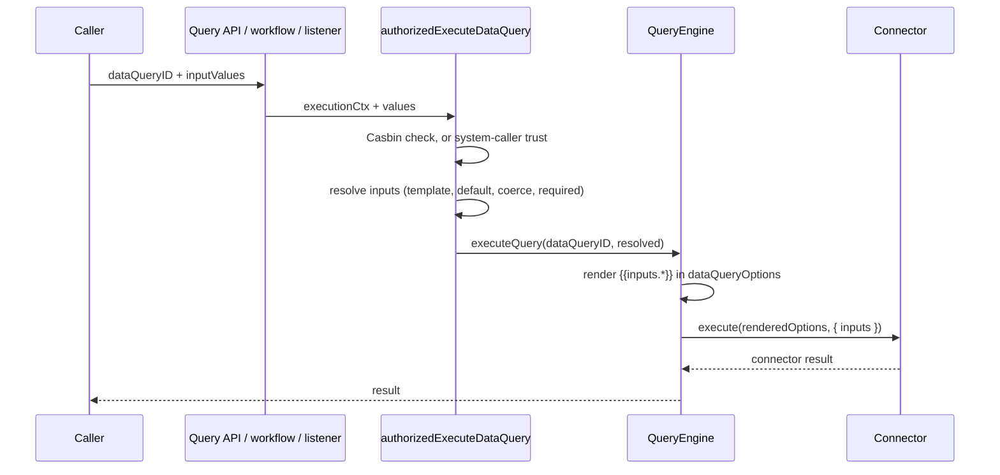

# Data Query

A **data query** is a saved, reusable operation against one tenant datasource. Depending on the connector, it can be a SQL statement, a MongoDB operation, a REST request, a GraphQL document, a Google Sheets read, a Redis command, and so on. Queries are the execution primitive used by app pages, workflows, cron jobs, and listener actions.



## Core concepts

| Concept | Meaning |
|---|---|
| `dataQueryID` | UUID of the saved query. |
| `datasourceID` / `datasourceType` | The bound datasource and its connector type. Both are stored on the query. |
| `dataQueryOptions` | Connector-specific query definition (SQL/REST/GraphQL fields, plus common options such as `timeoutSeconds`). |
| `inputDefinitions` | Declared argument schema: `[{ "key": "status", "type": "string" }]`. Supported types: `string`, `number`, `boolean`, `array`, `object`. |
| `{{inputs.*}}` | The only expression root available to query templates. Queries are resolved in safe-path mode and cannot read the workflow `ctx` or page `state`. |
| Test query | Executes without saving. `PATCH /queryTest` tests a query object; `POST /:dataQueryID/queryTest` tests a saved one. |
| Run query | Executes a saved query with input values. Requires `dataquery:execute`. |
| Creator access | Creating a query grants the creator a wildcard policy on that query. |

## Create a data query

1. Open **Queries** in the tenant navigation.
2. Choose **Add query**.
3. Enter a query title.
4. Select a configured datasource. The query form is rendered from `GET /queries/schemas?datasourceType=...`.
5. Fill in the connector fields (SQL, REST method/path, MongoDB operation, etc.).
6. Add arguments under **Arguments** / **Input Definitions**.
7. Choose **Test**. If arguments exist, a dialog prompts for values before execution.
8. Inspect the result pane, fix errors, then **Save**.

The query editor also stores:

| Field | Description |
|---|---|
| `runOnLoad` | A persisted hint used by builder surfaces. The backend does not automatically execute a saved query on load. |
| `dataQueryOptions.timeoutSeconds` | Per-query timeout in seconds. If omitted, the engine uses 60 seconds. |
| `dataQueryOptions.cache` | Set to `false` to disable the short-lived read-only result cache. |
| `dataQueryDescription` | Accepted by the UI/API, but the current create/update service does not persist a description. |
| `folderID` | Optional folder placement. |

:::warning
The update validator requires `dataQueryTitle` and `dataQueryOptions`. A PATCH is a full-form save; fetch the query, modify it, and send the complete object. Changing `datasourceType` does not migrate the old connector's option fields.
:::

## Configuration reference

### Common fields

| Field | Type | Required | Notes |
|---|---|---|---|
| `dataQueryTitle` | String, 1–255 | Yes | Display name. |
| `dataQueryOptions` | Object | Yes | Connector-specific fields below. |
| `datasourceID` | UUID or null | Practically yes | Must belong to the same tenant. A null datasource cannot execute. |
| `datasourceType` | Registered connector key | Yes | Must match the selected datasource's type. |
| `runOnLoad` | Boolean | No | Builder hint only. |
| `folderID` | UUID | No | Folder organization. |

### PostgreSQL / SQL connectors

| Field | Notes |
|---|---|
| `queryType` | `query` (raw SQL) or `gui` (editor mode flag). |
| `query` | SQL text. `{{inputs.key}}` placeholders are resolved before execution. |
| `inputDefinitions` | `{ key, type }` entries. Runtime values are bound by key. |
| `parameterized` | PostgreSQL executor option. When `true`, the SQL uses positional placeholders (`$1`, `$2`, …) and values are sent separately to `pg`. **Not exposed in the standard JSON Forms editor**; set it through the API, bundle, or a dedicated editor. |

### REST API

| Field | Notes |
|---|---|
| `apiEndpoint` | Path appended to the datasource `baseUrl`, e.g. `/v1/orders`. |
| `method` | `GET`, `POST`, `PUT`, `DELETE`, `PATCH`. |
| `headers` | `{ key, value }[]`; overrides datasource headers with the same key. |
| `queryParams` | `{ key, value }[]`; merged over datasource query params. |
| `body` | String body, typically JSON. Rendered/showed for `POST`/`PUT`/`PATCH`. |
| `contentType` | Overrides the datasource content type. |
| `inputDefinitions` | Same argument shape as SQL. |

### MongoDB

| Field | Notes |
|---|---|
| `operation` | `find`, `findOne`, `insertOne`, `insertMany`, `updateOne`, `updateMany`, `deleteOne`, `deleteMany`, `aggregate`, `count`. |
| `collection`, `filter`, `projection`, `sort`, `limit`, `skip` | JSON/BSON-style query fields. |
| `document`, `pipeline`, `options.upsert` | Write/aggregation configuration. |
| `inputDefinitions` | Supports `objectId` and `date` in addition to the common types. |

### GraphQL

| Field | Notes |
|---|---|
| `operationType` | `query` or `mutation`. |
| `query` | GraphQL document. |
| `variables` | JSON object. |
| `operationName` | Optional when the document has multiple operations. |
| `inputDefinitions` | Values are injected into `variables` by key. |

### Firestore / Google Sheets / Excel-CSV

- **Firestore:** `operation` (`get`, `list`, `query`, `add`, `set`, `update`, `delete`), `collectionPath`, optional `documentId`, `where`, `orderBy`, `limit`, and `data`.
- **Google Sheets:** `operation` (`read`, `write`, `append`, `update`, `clear`, `getSpreadsheetInfo`), `spreadsheetId`, `sheetName`, `range`, `data`, `valueInputOption`, `majorDimension`, `includeHeaders`.
- **Excel/CSV:** `sheetName`, `headerRow`, `range`, `limit`; the file comes from the datasource's `fileInfo.fileUrl`.

## Input binding and templates

Queries are resolved in **safe-path mode**. Only `inputs` is allowed:

```json
{
  "dataQueryTitle": "Orders by status",
  "datasourceID": "0e8f5f4a-3d1f-4f4b-9c3e-7a2d1c0b9a8e",
  "datasourceType": "postgresql",
  "dataQueryOptions": {
    "queryType": "query",
    "query": "SELECT id, status, total FROM orders WHERE status = '{{inputs.status}}' ORDER BY created_at DESC LIMIT 100",
    "inputDefinitions": [
      { "key": "status", "type": "string" }
    ]
  }
}
```

Rules:

- Use `{{inputs.<key>}}`; `{{ctx.*}}`, `{{state.*}}`, and JavaScript expressions are not available in queries.
- A single whole-string expression preserves its native type; `"{{inputs.minTotal}}"` remains a number when the definition type is `number`.
- Runtime resolution order per key: template resolution → default value → type coercion → required check.
- The frontend's argument dialog coerces numbers/booleans and parses JSON for object/array arguments.
- Missing values become `null` for the connector unless a default is configured.

:::warning
In non-parameterized SQL, `{{inputs.*}}` is string-interpolated into the SQL text. There is no escaping layer. Never put untrusted input directly into SQL; prefer a read-only database account and, for PostgreSQL, the `parameterized` mode with `$1` placeholders.
:::

## End-to-end example: parameterized PostgreSQL query

```sql
-- $1 = status (text), $2 = minTotal (numeric)
SELECT id, customer_id, status, total
FROM orders
WHERE status = $1 AND total >= $2
ORDER BY total DESC
LIMIT 50;
```

```http
POST /api/v1/tenants/:tenantID/queries HTTP/1.1
Authorization: Bearer <firebase-id-token>
Content-Type: application/json

{
  "dataQueryTitle": "High-value orders by status",
  "datasourceID": "0e8f5f4a-3d1f-4f4b-9c3e-7a2d1c0b9a8e",
  "datasourceType": "postgresql",
  "dataQueryOptions": {
    "queryType": "query",
    "query": "SELECT id, customer_id, status, total FROM orders WHERE status = $1 AND total >= $2 ORDER BY total DESC LIMIT 50",
    "parameterized": true,
    "timeoutSeconds": 30,
    "inputDefinitions": [
      { "key": "status", "type": "string" },
      { "key": "minTotal", "type": "number" }
    ]
  }
}
```

Run it:

```http
POST /api/v1/tenants/:tenantID/queries/:dataQueryID/run HTTP/1.1
Authorization: api_key <raw-api-key>
Content-Type: application/json

{
  "inputValues": {
    "status": "paid",
    "minTotal": 250
  }
}
```

```json
{
  "success": true,
  "dataQueryResult": [
    { "id": 1082, "customer_id": 42, "status": "paid", "total": "1240.00" },
    { "id": 1077, "customer_id": 18, "status": "paid", "total": "890.50" }
  ]
}
```

The PostgreSQL connector returns `result.rows`. Other connectors return their own natural shape: MongoDB arrays/documents, REST `response.data`, Google Sheets arrays, and so on.

## End-to-end example: REST API query

```json
{
  "dataQueryTitle": "Shipments by status",
  "datasourceID": "9a7d3f2e-1c4b-4a6d-8e0f-2b3c4d5e6f70",
  "datasourceType": "restapi",
  "dataQueryOptions": {
    "apiEndpoint": "/v1/shipments",
    "method": "GET",
    "queryParams": [
      { "key": "status", "value": "{{inputs.status}}" },
      { "key": "limit", "value": "{{inputs.limit}}" }
    ],
    "headers": [
      { "key": "X-Request-Source", "value": "jet-admin" }
    ],
    "timeoutSeconds": 20,
    "inputDefinitions": [
      { "key": "status", "type": "string" },
      { "key": "limit", "type": "number" }
    ]
  }
}
```

```http
POST /api/v1/tenants/:tenantID/queries/:dataQueryID/run HTTP/1.1
Authorization: api_key <raw-api-key>
Content-Type: application/json

{ "inputValues": { "status": "in_transit", "limit": 25 } }
```

If an input resolves to `undefined`, the REST executor fails fast with `Unresolved template in REST endpoint ...` instead of requesting a URL containing `undefined`.

## Test vs run

| Action | Endpoint | Body | Saves? | Permission |
|---|---|---|---|---|
| Test unsaved query | `PATCH /queries/queryTest` | `{ "dataQuery": { ... }, "inputValues": { ... } }` | No | `dataquery:test` + `datasource:read` |
| Test saved query | `POST /queries/:dataQueryID/queryTest` | `{ "inputValues": { ... } }` | No | `dataquery:test` |
| Run saved query | `POST /queries/:dataQueryID/run` | `{ "inputValues": { ... } }` | No | `dataquery:execute` |

Test and run share the same engine. A successful test proves the query can execute with the supplied values; it does not persist results or history.

## Runtime and execution behaviour



- **Authorization:** direct callers need `dataquery:execute` on the query. Workflow/app-page calls use delegated authorization: permission on the originating workflow/page can satisfy execution when direct query permission is absent. Listener and cron system calls are trusted and logged.
- **Timeout:** precedence is workflow-node override → query `dataQueryOptions.timeoutSeconds` → platform default **60 s**. The engine aborts the connector with an `AbortController` and rejects with `Query execution timed out after Ns`.
- **Caching:** read-only results are cached for **10 seconds**; datasource instances for **30 seconds**. Read-only detection covers common SELECT-style SQL, REST `GET`/`HEAD`/`OPTIONS`, GraphQL queries without `mutation`/`subscription`, read-only MongoDB/Redis/S3/Kafka operations, and similar connector rules. Writes are never cached. Set `dataQueryOptions.cache: false` to force execution.
- **Invalidation:** query update/delete clears the engine cache. Query `updatedAt` is part of the cache key, so an edited query returns fresh results even before the TTL. Datasource edits rely on the 30-second TTL unless a service path clears the cache.
- **Input order for parameterized SQL:** PostgreSQL receives values in the order of `inputDefinitions`, so `$1` must correspond to the first defined input, `$2` to the second, and so on.

## API and permissions

Mounted at `/api/v1/tenants/:tenantID/queries`.

| Method | Path | Permission | Notes |
|---|---|---|---|
| `GET` | `/schemas` | `dataquery:list` | Query form schemas, optionally `?datasourceType=`. |
| `GET` | `/` | `dataquery:list` | List with `search`, `page`, `pageSize`, `folderID`. |
| `POST` | `/` | `dataquery:create` + `datasource:read` | Create; grants creator access. |
| `GET` | `/:dataQueryID` | `dataquery:read` | Fetch one; datasource options are stripped. |
| `PATCH` | `/:dataQueryID` | `dataquery:update` + optional `datasource:read` | Full-form update. |
| `DELETE` | `/:dataQueryID` | `dataquery:delete` | Blocked if referenced by app pages, widgets, workflows, or listener actions. |
| `POST` | `/:dataQueryID/clone` | `dataquery:create` + `dataquery:read` + `datasource:read` | Copy with `(Copy)` title. |
| `GET` | `/:dataQueryID/export` | `dataquery:export` | Export as a bundle item. |
| `PATCH` | `/queryTest` | `dataquery:test` + `datasource:read` | Test an unsaved query object. |
| `POST` | `/:dataQueryID/queryTest` | `dataquery:test` | Test a saved query. |
| `POST` | `/:dataQueryID/run` | `dataquery:execute` | Execute with `inputValues`. |

There is a controller method for bulk query creation, but no route is mounted for it in the current build; do not depend on a bulk-create endpoint.

## Use cases

| Scenario | Query design |
|---|---|
| Dashboard table | Paginated read query with `limit`/`offset` or cursor arguments. |
| Form write | `INSERT`/`UPDATE` query with typed arguments and a narrow DB user. |
| API lookup | REST `GET` query with path/query params bound to inputs. |
| Search | SQL `ILIKE`/full-text query with a `search` string input; validate/limit input length. |
| Per-record automation | Query returns one row; workflow loops over many rows in a separate query. |
| Cached reference data | Read-only lookup, leave caching on, accept up to 10 s staleness. |

## Limitations and failure modes

| Failure | Cause / handling |
|---|---|
| `Query template validation failed` | A template uses an unsupported root, malformed braces, or JavaScript syntax. Use only `{{inputs.key}}` in safe-path fields. |
| `Query execution timed out after Ns` | Increase `timeoutSeconds` or the workflow node timeout, or optimize the query. Connector calls may still be running externally after abort. |
| `Authorization denied: Cannot execute query ...` | Caller lacks `dataquery:execute` and there is no permitted originating workflow/page. |
| `Datasource configuration not found` | `datasourceID` is null, belongs to another tenant, or the datasource row was deleted. |
| Test passes, workflow fails | Workflow passes different input names/values, or the workflow node timeout is lower than the query runtime. |
| Old data after editing a datasource | Datasource instance cache is 30 s. Re-run after the TTL. |
| Delete returns `409 DATA_QUERY_IN_USE` | Remove references from app pages, widget actions, workflow `dataQuery` nodes, and listener `trigger_query` actions. |
| REST OAuth2 query fails | The connector tester can acquire OAuth2 tokens, but the query executor applies only Basic/Bearer auth. Use a Bearer token. |
| SQL string input causes syntax errors/injection | Quote/escape manually only for trusted values; prefer PostgreSQL `parameterized` mode and read-only credentials. |

## Troubleshooting

1. **Test the saved query**, not only the unsaved form; saved `dataQueryOptions` may differ.
2. **Check input keys and types** — `{{inputs.status}}` requires an input definition with key `status`.
3. **Inspect the data source health** — a query timeout can actually be a network/TLS/credential failure.
4. **Check tenant scoping** — the datasource must be in the same tenant as the query.
5. **Check references before deletion** — the 409 response lists the blocking resources.
6. **Check result shape** — connectors return different shapes; map rows in a workflow JavaScript node or widget expression rather than assuming an array.

## Related pages

- [Data Source](../data-source/data-source.md) — connection configuration and credential handling.
- [Workflows](../workflows/workflows.md) — Data Query node, retries/timeouts, delegated auth.
- [Listeners](../listeners/listeners.md) — `trigger_query` pipeline actions.
- [App Pages & Widgets](../app-pages-widgets/app-pages-widgets.md) — query data sources and result bindings.
- [Identity & Access Management](../identity-access-management/identity-access-management.md) — query permissions and asset grants.
- [Security](../operations/security.md) — SQL injection, least privilege, and secrets.
