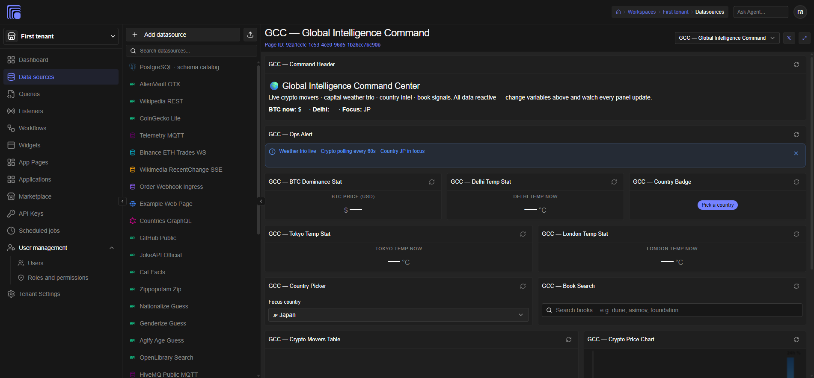

# Data Source

A **data source** is a saved connection: where the data lives, how to authenticate, and which connector implementation should execute queries or open listeners against it. Data sources are tenant-scoped and are the starting point for [Data Queries](../data-query/data-query.md) and [Listeners](../listeners/listeners.md).



## Core concepts

| Concept | Meaning |
|---|---|
| `datasourceType` | Canonical connector key such as `postgresql`, `restapi`, or `kafka`. The value is validated against the connector registry; unknown types are rejected at create/update time. |
| `datasourceOptions` | Connector-specific JSON configuration (host, database, URL, authentication, TLS settings). Stored encrypted at rest. |
| Credential masking | Credential-like keys in API responses are replaced with `●●●●●●●●`. Sending the mask back on update restores the stored secret. |
| Connection test | A per-connector `testConnection()` call. It checks reachability/authentication, not the correctness of a future query. |
| Proxy | A backend-mediated call to a small allowlist of connector helper methods, used by dedicated editors (Google Sheets, Excel/CSV, REST). Credentials never reach the browser. |
| Creator access | The caller who creates a data source receives a wildcard Casbin policy on that data source. |
| File-backed source | Excel/CSV data sources point at files uploaded to object storage with `POST /upload`. |

## Supported data source types

The registry in `packages/datasource-types` currently exposes **45** connector types. The keys below are the exact `datasourceType` values accepted by the API.

| Category | Type | Key | Listener-capable |
|---|---|---|---|
| Relational / warehouse | PostgreSQL | `postgresql` | Yes |
| Relational / warehouse | MySQL | `mysql` | — |
| Relational / warehouse | Microsoft SQL Server | `mssql` | — |
| Relational / warehouse | Oracle | `oracle` | — |
| Relational / warehouse | SQLite | `sqlite` | — |
| Relational / warehouse | CockroachDB | `cockroachdb` | — |
| Relational / warehouse | ClickHouse | `clickhouse` | — |
| Relational / warehouse | DuckDB | `duckdb` | — |
| Relational / warehouse | BigQuery | `bigquery` | — |
| Relational / warehouse | Supabase | `supabase` | — |
| NoSQL / search / graph | MongoDB | `mongodb` | Yes |
| NoSQL / search / graph | Firestore | `firestore` | Yes |
| NoSQL / search / graph | Redis | `redis` | Yes |
| NoSQL / search / graph | Elasticsearch | `elasticsearch` | — |
| NoSQL / search / graph | Neo4j | `neo4j` | — |
| Metrics | Prometheus | `prometheus` | — |
| Metrics | InfluxDB | `influxdb` | — |
| HTTP / SaaS | REST API | `restapi` | — |
| HTTP / SaaS | GraphQL | `graphql` | Yes |
| HTTP / SaaS | Web URL | `weburl` | — |
| HTTP / SaaS | Airtable | `airtable` | — |
| HTTP / SaaS | Google Sheets | `googlesheets` | — |
| HTTP / SaaS | Stripe | `stripe` | — |
| HTTP / SaaS | Twilio | `twilio` | — |
| HTTP / SaaS | SendGrid | `sendgrid` | — |
| HTTP / SaaS | Slack | `slack` | — |
| HTTP / SaaS | Notion | `notion` | — |
| HTTP / SaaS | Jira | `jira` | — |
| HTTP / SaaS | Google Analytics | `googleanalytics` | — |
| HTTP / SaaS | GitHub | `github` | — |
| HTTP / SaaS | GitLab | `gitlab` | — |
| Files | AWS S3 | `s3` | — |
| Files | Excel / CSV | `excelcsv` | — |
| Files | File System | `filesystem` | — |
| Files | SFTP | `sftp` | — |
| Messaging | Kafka | `kafka` | Yes |
| Messaging | RabbitMQ | `rabbitmq` | Yes |
| Messaging | MQTT | `mqtt` | Yes |
| Messaging | NATS | `nats` | Yes |
| Messaging | WebSocket | `websocket` | Yes |
| Messaging | Server-Sent Events | `sse` | Yes |
| Messaging | Syslog | `syslog` | Yes |
| Messaging | Webhook | `webhook` | Yes |
| Email / directory | SMTP | `smtp` | — |
| Email / directory | LDAP | `ldap` | — |

Listener-capable types are the 13 values with `supportsListener: true` and a `listenerConfigForm`; the [Listeners](../listeners/listeners.md) page covers their configuration schemas.

## Create a data source

1. Open **Data sources** in the tenant navigation.
2. Choose **Add data source**.
3. Enter a name (and optionally a description/tags).
4. Select the connector type. The form below the selector is generated from `GET /datasources/schemas` for that type.
5. Fill in connection details or a connection string.
6. Choose **Test** to run `testConnection()` against the current form values.
7. Choose **Save**.

The create request has this shape:

```http
POST /api/v1/tenants/:tenantID/datasources HTTP/1.1
Authorization: api_key <raw-api-key>
Content-Type: application/json

{
  "datasourceTitle": "Orders (read replica)",
  "datasourceType": "postgresql",
  "datasourceOptions": {
    "connectionOption": "connectionDetails",
    "connectionDetails": {
      "connectionName": "orders-read-replica",
      "host": "db.internal.example.com",
      "port": 5432,
      "database": "orders",
      "user": "jet_reader",
      "password": "<db-password>",
      "sslMode": "require"
    }
  },
  "datasourceTags": ["production", "read-only"]
}
```

The response masks credential-like fields:

```json
{
  "success": true,
  "datasource": {
    "datasourceID": "0e8f5f4a-3d1f-4f4b-9c3e-7a2d1c0b9a8e",
    "datasourceTitle": "Orders (read replica)",
    "datasourceType": "postgresql",
    "datasourceOptions": {
      "connectionOption": "connectionDetails",
      "connectionDetails": {
        "connectionName": "orders-read-replica",
        "host": "db.internal.example.com",
        "port": 5432,
        "database": "orders",
        "user": "jet_reader",
        "password": "●●●●●●●●",
        "sslMode": "require"
      }
    },
    "datasourceTags": ["production", "read-only"]
  }
}
```

:::warning
The update validator currently requires `datasourceTitle`, `datasourceType`, and `datasourceOptions` — a PATCH is effectively a full-form save. Read the data source first, then send back the complete object. Sending the masked sentinel keeps the existing secret; sending a new value replaces it.
:::

## Configuration reference

### Common fields

| Field | Type | Required | Notes |
|---|---|---|---|
| `datasourceTitle` | String, 1–255 | Yes | Display name. Not unique. |
| `datasourceType` | Registered key | Yes | Validated against the connector registry; cannot be an arbitrary string. |
| `datasourceOptions` | Object | Yes | Connector-specific. Stored as an AES-256-GCM envelope (`__encrypted`, `iv`, `data`, `authTag`). |
| `datasourceDescription` | String | No | Accepted by the form/controller, but the current create/update service does not persist it. Use tags or the title for durable metadata. |
| `datasourceTags` | String array | No | Free-form labels stored with the row. |
| `folderID` | UUID | No | Optional folder placement. See [Folders](../platform/folders.md). |

### PostgreSQL

| Field | Notes |
|---|---|
| `connectionOption` | `connectionDetails` (default) or `connectionString`. |
| `connectionDetails.connectionName` | Minimum 3 characters. |
| `connectionDetails.host` / `port` | Port defaults to `5432`. |
| `connectionDetails.database` / `user` / `password` | Required when using details. |
| `connectionDetails.sslMode` | `disable`, `allow`, `prefer`, `require`, `verify-ca`, `verify-full`. `verify-*` enables certificate verification. |
| `connectionDetails.additionalOptions.connectTimeout` | Seconds; converted to `connectionTimeoutMillis`. |
| `connectionDetails.additionalOptions.applicationName` | Sent as `application_name`. |
| `connectionString` | Full `postgresql://...` URI. |

### REST API

| Field | Notes |
|---|---|
| `baseUrl` | Required. Query `apiEndpoint` values are appended to it. |
| `timeout` | Seconds; executor default is `15` when omitted. |
| `authType` | `none`, `basic`, `bearer`, `oauth2`. |
| `username` / `password` | Used for Basic auth. |
| `bearerToken` | Used for Bearer auth. |
| `oauth2.clientId` / `clientSecret` / `tokenUrl` | Accepted by the connection tester. **The current REST query executor does not acquire OAuth2 tokens**; query execution applies only Basic/Bearer headers. Use a pre-issued Bearer token for queries until OAuth2 execution support lands. |
| `headers` / `queryParams` | Arrays of `{ key, value }`; query-level values override datasource defaults. |
| `contentType` | `application/json`, `application/xml`, or `text/plain`. |
| `followRedirects`, `sslVerify` | Present in the form schema and used by the connection tester, but not forwarded by the current query executor's Axios request. Treat them as connection-validation settings, not execution guarantees. |

### Other connectors

The authoritative field list for any type is the JSON Schema returned by:

```http
GET /api/v1/tenants/:tenantID/datasources/schemas?datasourceType=mongodb
```

The same schema drives the JSON Forms wizard, so UI labels and API field names stay aligned. Examples of type-specific structures:

```json
{
  "mongodb": {
    "connectionOption": "connectionString",
    "connectionString": "mongodb+srv://<user>:<password>@cluster.example.com/orders"
  },
  "webhook": {
    "connectionName": "stripe-inbound",
    "allowedMethods": "POST",
    "authType": "header",
    "authHeaderName": "x-jet-signature",
    "authSecret": "<shared-secret>"
  },
  "excelcsv": {
    "fileInfo": {
      "fileUrl": "https://storage.example.com/excel-csv-datasources/<tenantID>/orders.xlsx",
      "fileName": "orders.xlsx",
      "fileType": "application/vnd.openxmlformats-officedocument.spreadsheetml.sheet"
    }
  }
}
```

:::note
SQLite's `databasePath` and the File System connector's root path resolve on the **backend host** (or listener-proxy host for listeners), not on the user's machine. Use them only with paths you control and mount intentionally.
:::

## Test, health, and proxy behaviour

| Action | Endpoint | What it actually checks |
|---|---|---|
| Test unsaved form | `POST /datasources/test` | Connector `testConnection()` with the supplied options. |
| Test saved source | `POST /datasources/:datasourceID/test` or `GET /datasources/:datasourceID/health` | Decrypts stored options and runs `testConnection()`. Both return `healthy: true/false`. |
| Validate a REST JSON endpoint | `POST /datasources/test-json` | `restapi` only. Appends `testPath` to `baseUrl`, sends `GET`/`HEAD`, and checks that the response is parseable JSON rather than an HTML SPA shell. |
| Proxy a helper call | `POST /datasources/:datasourceID/proxy` | Loads and decrypts the saved source, then calls an allowlisted connector method. |
| Upload Excel/CSV | `POST /datasources/upload` | Multipart `file`, 10 MB limit, `.csv`/`.xlsx`/`.xls`; returns a storage URL. |

Proxy allowlist (anything else returns an error):

| Type | Allowed actions |
|---|---|
| `postgresql`, `mysql`, `mssql`, `sqlite`, `cockroachdb`, `oracle` | `getSchema`, `getSampleData`, `testConnection`, `runQuery`, `execute` |
| `mongodb` | `getSchema`, `getSampleData`, `testConnection`, `execute` |
| `googlesheets` | `listSpreadsheets`, `listSheets`, `previewData`, `readSheet`, `testConnection` |
| `excelcsv` | `previewData`, `getColumns`, `testConnection` |
| `restapi` | `testConnection`, `execute` |

Legacy alias keys (`postgres`, `google_sheets`, `excel_csv`, `rest_api`) are still present in the proxy allowlist for older saved rows, but new resources should use the canonical keys.

## End-to-end example: PostgreSQL

```http
POST /api/v1/tenants/:tenantID/datasources HTTP/1.1
Authorization: Bearer <firebase-id-token>
Content-Type: application/json

{
  "datasourceTitle": "Analytics warehouse",
  "datasourceType": "postgresql",
  "datasourceOptions": {
    "connectionOption": "connectionString",
    "connectionString": "postgresql://analytics_reader:<password>@warehouse.example.com:5432/analytics?sslmode=require"
  }
}
```

Then verify the saved connection:

```http
POST /api/v1/tenants/:tenantID/datasources/0e8f5f4a-3d1f-4f4b-9c3e-7a2d1c0b9a8e/test HTTP/1.1
Authorization: Bearer <firebase-id-token>
```

```json
{
  "success": true,
  "datasourceID": "0e8f5f4a-3d1f-4f4b-9c3e-7a2d1c0b9a8e",
  "healthy": true,
  "connectionResult": { "ok": true }
}
```

Use it from a query with `datasourceType: "postgresql"` and a SQL statement. See the parameterized query example in [Data Query](../data-query/data-query.md).

## End-to-end example: REST API source

```http
POST /api/v1/tenants/:tenantID/datasources HTTP/1.1
Authorization: api_key <raw-api-key>
Content-Type: application/json

{
  "datasourceTitle": "Fulfilment API",
  "datasourceType": "restapi",
  "datasourceOptions": {
    "baseUrl": "https://api.fulfilment.example.com",
    "timeout": 20,
    "authType": "bearer",
    "bearerToken": "<service-token>",
    "headers": [{ "key": "Accept", "value": "application/json" }],
    "queryParams": [{ "key": "region", "value": "eu" }],
    "contentType": "application/json"
  }
}
```

Validate that the endpoint is a JSON API (not a frontend shell):

```http
POST /api/v1/tenants/:tenantID/datasources/test-json HTTP/1.1
Authorization: Bearer <firebase-id-token>
Content-Type: application/json

{
  "datasourceType": "restapi",
  "datasourceOptions": {
    "baseUrl": "https://api.fulfilment.example.com",
    "authType": "bearer",
    "bearerToken": "<service-token>"
  },
  "testPath": "/health",
  "testMethod": "GET"
}
```

```json
{
  "success": true,
  "validationResult": {
    "ok": true,
    "validatedJson": true,
    "status": 200,
    "url": "https://api.fulfilment.example.com/health",
    "topLevelKeys": ["status", "version"]
  }
}
```

The saved source can now be selected in the query editor. A query sets `apiEndpoint: "/v1/shipments"`, `method: "GET"`, and maps `{{inputs.*}}` values into query params or the endpoint.

## Credentials and encryption

- Data source options are encrypted with AES-256-GCM using `VAULT_ENCRYPTION_KEY` (64 hex characters = 32 bytes). Missing or wrong-length keys cause create/update/test/execute failures.
- Vault-backed credentials (for example Google OAuth tokens and AI config) live in `tblVaultCredentials`, encrypted with the same key.
- Responses mask keys matching credential patterns. Logs redact sensitive keys and credential-bearing URLs.
- `VAULT_ENCRYPTION_KEY` has **no automatic rotation**. Rotating it without re-encrypting existing `tblDatasources.datasourceOptions` and `tblVaultCredentials.encryptedData` makes old rows undecryptable. Plan a migration and downtime.

:::danger
Use least-privilege database accounts. Jet Admin can execute arbitrary SQL through a SQL data source; read-only credentials are the only reliable guard against accidental writes from a saved query.
:::

## API and permissions

Mounted at `/api/v1/tenants/:tenantID/datasources`.

| Method | Path | Permission | Notes |
|---|---|---|---|
| `GET` | `/schemas` | `datasource:list` | Returns form config schemas, optionally filtered by `?datasourceType=`. |
| `GET` | `/` | `datasource:list` | List with `search`, `page`, `pageSize`, `folderID`. |
| `POST` | `/test` | `datasource:test` | Test unsaved options. |
| `POST` | `/test-json` | `datasource:test` | REST JSON endpoint validation. |
| `POST` | `/:datasourceID/test` | `datasource:test` | Test saved, decrypted options. |
| `GET` | `/:datasourceID/health` | `datasource:test` | Alias for the saved-source health check. |
| `POST` | `/upload` | `datasource:create` | Multipart file upload, 10 MB. |
| `GET` | `/:datasourceID` | `datasource:read` | Fetch one, masked. |
| `POST` | `/` | `datasource:create` | Create; grants creator access. |
| `PATCH` | `/:datasourceID` | `datasource:update` | Full-form update; merges masked secrets. |
| `GET` | `/:datasourceID/export` | `datasource:export` | Export as a bundle item. |
| `POST` | `/:datasourceID/clone` | `datasource:create` + `datasource:read` | Copy with fresh ID and `(Copy)` title. |
| `DELETE` | `/:datasourceID` | `datasource:delete` | Blocked if referenced queries are in use. |
| `POST` | `/:datasourceID/proxy` | `datasource:read` | Allowlisted connector helper call. |

## Use cases

| Scenario | Recommended pattern |
|---|---|
| Read-only reporting database | Dedicated read replica and read-only DB user. Use one data source per environment. |
| Internal REST service | `restapi` source with a service token stored in `bearerToken`; one query per endpoint. |
| SaaS list/update | Use the dedicated connector (Stripe, Slack, Jira, GitHub) so query fields are typed instead of raw REST bodies. |
| Spreadsheet uploads | `excelcsv` source plus `POST /upload`; replace the file URL when the sheet changes. |
| Event ingestion | Use a listener-capable source (Kafka, MQTT, webhook, Redis, etc.), not a polling query. See [Listeners](../listeners/listeners.md). |

## Limitations and failure modes

| Failure | Cause / handling |
|---|---|
| `Unsupported datasource type` | The `datasourceType` is not in `DATASOURCE_LOGIC_COMPONENTS`; use one of the keys listed above. |
| Connection test succeeds, queries fail | The test may only prove reachability. Check credentials/permissions, query syntax, connector-specific execution limits, and the query's timeout. For REST OAuth2, the tester supports token acquisition but the executor does not. |
| `Unable to decrypt datasource options` | `VAULT_ENCRYPTION_KEY` changed or does not match the key used when the row was written. Restore the key or re-encrypt the row. |
| Update silently keeps old credentials | The request sent the `●●●●●●●●` sentinel; that means "unchanged". Send a real new value to rotate. |
| Delete returns `409 DATASOURCE_IN_USE` | Queries owned by this source are referenced by app pages, widgets, workflows, or listener actions. Remove those references first. |
| Delete unexpectedly removes queries/listeners | Datasource deletion cascades to its queries and listeners after the reference check passes. Export first if needed. |
| Proxy action rejected | The action is not allowlisted for that type, or the method does not exist on the implementation. |
| File upload rejected | Extension must be `.csv`, `.xlsx`, or `.xls`; size must be ≤ 10 MB. |
| SQL data source sees the wrong database | SQLite/filesystem paths resolve on the backend host; a container may have a different filesystem than your workstation. |

## Troubleshooting checklist

1. **Test the saved source**, not only the unsaved form. A saved row may still contain a rotated/masked secret.
2. **Check the exact type key** with `GET /schemas`; aliases such as `postgres` are legacy, not canonical.
3. **Check tenant scope**: the `datasourceID` must belong to the `tenantID` in the URL.
4. **Check references before deleting**: `409 DATASOURCE_IN_USE` includes the blocking queries in `details.queries`.
5. **Check object storage** for Excel/CSV, logo, and widget uploads if URLs are broken.
6. **Check the listener proxy**, not the backend, for listener connectivity; data source options used by listeners are decrypted in the proxy process.

## Related pages

- [Data Query](../data-query/data-query.md) — query configuration, parameters, execution.
- [Listeners](../listeners/listeners.md) — listener-capable sources and pipelines.
- [Tenants](../tenants/tenants.md) — tenant scoping and delete cascades.
- [Identity & Access Management](../identity-access-management/identity-access-management.md) — datasource permissions and asset grants.
- [Configuration Reference](../operations/configuration-reference.md) — `VAULT_ENCRYPTION_KEY`, storage, and proxy settings.
- [Security](../operations/security.md) — secrets handling and least privilege.
