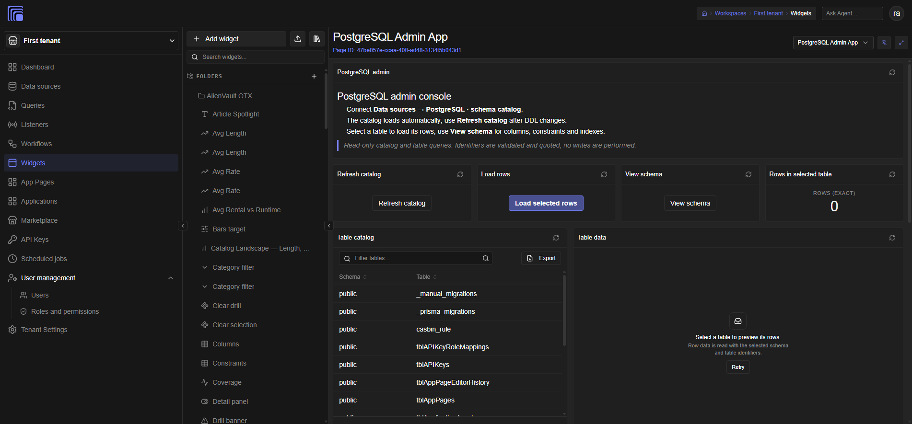
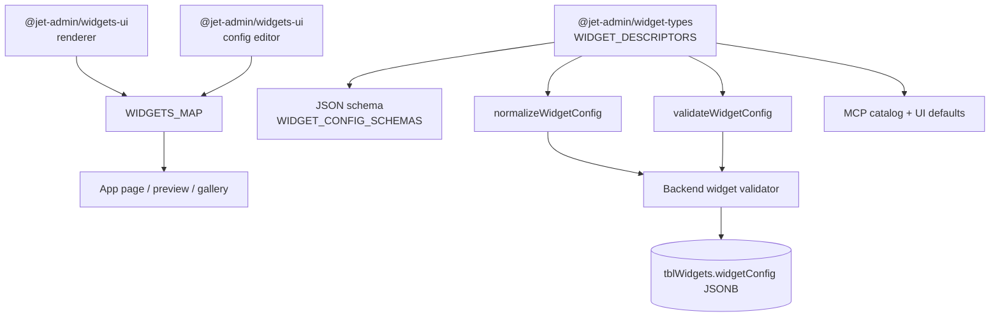

# Extending Widgets

A widget is a **type definition** plus a React renderer and a configuration editor. Widget *instances* are saved as `tblWidgets` rows with a JSON `widgetConfig`, then placed on app pages by `widgetKey`. There is no runtime plugin loader: adding a widget means adding code to the workspace packages, rebuilding, and restarting the backend/frontend.



## Contract layers



| Layer | Package | Source of truth |
|---|---|---|
| Descriptor | `@jet-admin/widget-types` | `src/descriptors.js` |
| Config JSON Schema | `@jet-admin/widget-types` | `src/schemas/*.schema.json` + `src/schemas/index.js` |
| Normalization | `@jet-admin/widget-types` | `src/normalize.js` |
| Validation | `@jet-admin/widget-types` | `src/validate.js` |
| Renderer | `@jet-admin/widgets-ui` | `src/<type>/<type>Widget.jsx` |
| Config editor | `@jet-admin/widgets-ui` | `src/<type>/<type>ConfigEditor.jsx` |
| Registry | `@jet-admin/widgets-ui` | `src/widget.map.js` (`WIDGETS_MAP`) |
| Events/methods | `@jet-admin/widget-types` | `src/index.js` (`WIDGET_EVENT_TYPES`, `WIDGET_METHODS`) |

The current build ships JSON schemas for **34 configurable widget types**, plus `composite` and `layout-snippet` descriptors for structural entries. Existing categories: analytics, data-display, input, structure, feedback, content, and display.

## The descriptor is the contract

Every widget type needs a versioned descriptor. It drives UI defaults, API validation, import/export compatibility, and MCP discovery. Never edit only the renderer and leave the descriptor stale.

```js
// packages/widget-types/src/descriptors.js
"rating": {
  type: "rating",
  schemaVersion: 1,
  category: "input",
  tags: ["rating", "stars", "score", "review"],
  searchAliases: ["star rating", "score"],
  defaults: {
    label: "Rating",
    max: 5,
    valueTemplate: "0",
    allowHalf: false,
    isLoading: ""
  },
  aliases: { value: "valueTemplate" },
  templateProps: ["valueTemplate", "isLoading"],
  required: [],
  dataKey: "state.widgets.<id>.value (number)",
  stateShape: { value: "number" },
  unsupportedEvents: [],
  unsupportedMethods: [],
  unsupportedReserved: [],
  example: {
    label: "Rating",
    max: 5,
    valueTemplate: "3",
    allowHalf: false
  }
}
```

Descriptor rules:

- `type` must equal its `WIDGET_TYPES` value and the `WIDGETS_MAP` key.
- `defaults` and `example` must validate in `authoring` mode and normalize idempotently. The package test suite enforces this.
- `aliases` migrate legacy keys to canonical keys; canonical values win on conflict.
- `templateProps` lists fields that accept `{{ ... }}` expressions at authoring time.
- `required` is enforced by `validateWidgetConfig` (presence, not non-emptiness).
- `unsupportedEvents` / `unsupportedMethods` hide declared-but-unimplemented capabilities from authors and agents. Configs may still carry them; they are preserved but warn.
- `unsupportedReserved` documents schema fields with no renderer effect yet.
- Unknown config keys pass through. Do not use validation as a way to strip extension metadata.

### JSON schema

Schemas are wrapped, not bare JSON Schema objects:

```json
{
  "widgetType": "rating",
  "description": "Star rating input with template-driven value.",
  "schema": {
    "type": "object",
    "properties": {
      "label": { "type": "string", "description": "Field label." },
      "max": { "type": "number", "default": 5, "minimum": 1, "maximum": 10 },
      "valueTemplate": {
        "type": "string",
        "description": "Current value; supports {{ }} templates."
      },
      "allowHalf": { "type": "boolean", "default": false },
      "isLoading": {
        "type": ["boolean", "string"],
        "description": "Loading template, e.g. {{ state.queries.q.isLoading }}."
      }
    }
  },
  "events": ["onClick", "onRefresh", "onLoad"]
}
```

Add the file to `src/schemas/` and import/register it in `src/schemas/index.js` under the type key. `get_widget_schemas` and the form builder use this registry.

### Validation modes

`validateWidgetConfig(type, config, { mode })` supports:

| Mode | Behavior |
|---|---|
| `authoring` (default) | Accepts `{{ }}` templates on template-capable props; unknown keys allowed; unknown event names warn |
| `resolved` | Rejects unresolved templates and requires concrete values for known scalar fields |

Return shape:

```js
{
  valid: boolean,
  errors: [{ code, field?, message }],
  warnings: [{ code, field?, message }]
}
```

Validation never throws for bad input. The backend converts errors into a `400` with `WIDGET_CONFIG_INVALID`. If you add a scalar field that needs type/enum checking, add it to `FIELD_SPECS` in `validate.js`; otherwise it passes through as extension metadata.

## Runtime renderer contract

The app page runtime passes the following props to a widget renderer:

| Prop | Meaning |
|---|---|
| `widgetID` | Placement instance ID (repeat-safe); use for a11y and local identity |
| `resourceID` | Saved widget resource ID |
| `placementKey` | Stable placement key in the page layout |
| `instanceID` | Instance used for state (`widgetState`) |
| `widgetTitle` | Display title |
| `widgetType` | Resolved type |
| `widgetConfig` | Resolved config with templates evaluated when a state tree exists |
| `data` | Output of `resolveWidgetData` (query/workflow/listener binding) |
| `widgetState` / `setWidgetState` | Per-placement state bag |
| `fireWidgetEvent(eventName, payload)` | Dispatch an event action |
| `refreshData()` | Refetch bound data and fire `onRefresh` |
| `onWidgetInit` | Callback for the widget root/ref |

Renderers must not fetch directly, mutate global state, or read the database. Data comes from query/workflow/listener bindings resolved by the page runtime; side effects go through event actions.

### A minimal renderer

```jsx
// packages/widgets-ui/src/rating/ratingWidget.jsx
import React from "react";
import PropTypes from "prop-types";
import { Star } from "lucide-react";
import { WidgetSurface, cn } from "@jet-admin/ui";
import { normalizeFieldBoolean } from "../_shared/fieldContracts";

export const RatingWidget = ({ widgetConfig, fireWidgetEvent }) => {
  const max = Math.max(1, Math.min(10, Number(widgetConfig?.max) || 5));
  const value = Number(widgetConfig?.valueTemplate) || 0;
  const half = normalizeFieldBoolean(widgetConfig?.allowHalf, false);
  const isLoading = normalizeFieldBoolean(widgetConfig?.isLoading, false);
  const interactive = Array.isArray(widgetConfig?.events?.onClick);

  if (isLoading) {
    return <WidgetSurface className="flex h-full items-center p-2 text-xs">Loading…</WidgetSurface>;
  }

  return (
    <WidgetSurface
      density={widgetConfig?.properties?.density || "comfortable"}
      className="flex h-full items-center gap-1 p-2"
      aria-label={widgetConfig?.label || "Rating"}
    >
      {Array.from({ length: max }).map((_, index) => {
        const filled = value >= index + 1 || (half && value >= index + 0.5);
        return (
          <button
            key={index}
            type="button"
            disabled={!interactive}
            aria-label={`${index + 1} of ${max}`}
            className={cn("rounded p-0.5", interactive && "cursor-pointer hover:bg-muted")}
            onClick={interactive ? () => fireWidgetEvent?.("onClick", { value: index + 1 }) : undefined}
          >
            <Star className={cn("h-4 w-4", filled ? "fill-current text-amber-400" : "text-muted-foreground")} />
          </button>
        );
      })}
    </WidgetSurface>
  );
};

RatingWidget.propTypes = {
  widgetConfig: PropTypes.object,
  fireWidgetEvent: PropTypes.func
};
```

Use `WidgetSurface` for consistent page chrome (`properties.showHeader`, density, borders). `normalizeFieldBoolean` is the shared fail-closed coercion used by other input widgets.

## Configuration editor contract

Config editors receive `{ stateTree, widgetEditorForm }` and write through the shared configurator kit. Prefer the kit over bespoke form state: it gives you search registration, changed-only filtering, defaults/reset, and section persistence.

```jsx
// packages/widgets-ui/src/rating/ratingConfigEditor.jsx
import React, { useMemo } from "react";
import PropTypes from "prop-types";
import { Input } from "@jet-admin/ui";
import {
  ConfigSection,
  ConfigField,
  BindableInput,
  useConfigValue,
  SegmentedControl
} from "../config";

export const RatingConfigEditor = ({ stateTree }) => {
  const liveStateTree = useMemo(() => ({ state: stateTree }), [stateTree]);
  const [label, setLabel] = useConfigValue("label", "Rating");
  const [max, setMax] = useConfigValue("max", 5);
  const [value, setValue] = useConfigValue("valueTemplate", "0");
  const [allowHalf, setAllowHalf] = useConfigValue("allowHalf", false);
  const [isLoading, setIsLoading] = useConfigValue("isLoading", "");

  return (
    <>
      <ConfigSection id="rating-content" title="Rating" tab="content">
        <ConfigField label="Label" path="label" htmlFor="rating-label">
          <Input id="rating-label" value={label ?? ""} onChange={(e) => setLabel(e.target.value)} />
        </ConfigField>
        <ConfigField label="Maximum" path="max" defaultValue={5} htmlFor="rating-max">
          <Input
            id="rating-max"
            type="number"
            min={1}
            max={10}
            value={max ?? 5}
            onChange={(e) => setMax(Number(e.target.value))}
          />
        </ConfigField>
        <ConfigField label="Value" path="valueTemplate" helper="Supports {{ state.queries... }} templates.">
          <BindableInput value={value ?? ""} onChange={setValue} liveStateTree={liveStateTree} />
        </ConfigField>
        <ConfigField label="Allow half stars" path="allowHalf" defaultValue={false} inline>
          <SegmentedControl
            ariaLabel="Allow half stars"
            value={allowHalf ? "yes" : "no"}
            onChange={(next) => setAllowHalf(next === "yes")}
            options={[{ value: "yes", label: "Yes" }, { value: "no", label: "No" }]}
          />
        </ConfigField>
      </ConfigSection>

      <ConfigSection id="rating-state" title="State" tab="behavior">
        <ConfigField label="Loading template" path="isLoading">
          <BindableInput value={isLoading ?? ""} onChange={setIsLoading} liveStateTree={liveStateTree} />
        </ConfigField>
      </ConfigSection>
    </>
  );
};

RatingConfigEditor.propTypes = { stateTree: PropTypes.object };
RatingConfigEditor.usesConfigKit = true;
export default RatingConfigEditor;
```

Kit components available from `../config`:

| Export | Use |
|---|---|
| `ConfigSection` | Tab-routed collapsible section with search keywords |
| `ConfigField` | Label, helper, error, modified dot, reset-to-default |
| `ConfigRow` / `ConfigGroup` | Layout helpers |
| `BindableInput` / `BindableSwitch` | Template-aware inputs |
| `SegmentedControl` | Compact enum selection |
| `OptionListEditor` | Edit `{label,value}` option arrays |
| `ColorField`, `SpacingField`, `SizeField`, `IconPicker` | Styling primitives |
| `ConditionBuilder`, `ConditionalStyleField` | Conditional logic/style rules |
| `WidgetConfigShell` | Full config panel shell (tabs/search/reset) |

`useConfigValue(path, fallback)` reads/writes `widgetEditorForm.values.widgetConfig[path]`. Mark the editor with `usesConfigKit = true` so tooling can detect kit adoption.

## Registry and events

Add an entry to `WIDGETS_MAP` in `packages/widgets-ui/src/widget.map.js`:

```js
import { Star } from "lucide-react";
import { RatingWidget } from "./rating/ratingWidget";
import { RatingConfigEditor } from "./rating/ratingConfigEditor";

export const WIDGETS_MAP = {
  // …existing entries
  rating: {
    label: "Rating",
    value: "rating",
    datasetFields: [],
    defaultAutoRun: false,
    description: "Star rating input",
    component: RatingWidget,
    configEditor: RatingConfigEditor,
    icon: ({ className }) => <Star className={className} />,
    sampleConfig: {
      label: "Rating",
      max: 5,
      valueTemplate: "0",
      allowHalf: false,
      isLoading: "",
      showHeader: false
    }
  }
};
```

Registry rules enforced by `packages/widgets-ui/__tests__/widgetsRegistry.test.js`:

- `entry.value` must equal the key.
- `label`, `description`, `sampleConfig` must exist.
- `component`, `configEditor`, and `icon` must be functions.
- Input widgets should set `defaultAutoRun: false`; display widgets that need data set `true`.

Events are declared in `WIDGET_EVENT_TYPES` (`COMMON`: `onClick`, `onRefresh`, `onLoad`; per-type extras). Methods are declared in `WIDGET_METHODS`. Register only what the renderer actually implements; otherwise add the name to `unsupportedEvents`/`unsupportedMethods` in the descriptor so it is hidden from authors and MCP discovery.

## Registration steps

1. **Descriptor:** add the type to `WIDGET_TYPES` and `WIDGET_DESCRIPTORS`. Provide valid `defaults` and `example`.
2. **Schema:** add `src/schemas/<type>.schema.json` and register it in `WIDGET_CONFIG_SCHEMAS`.
3. **Scalar validation (optional):** add a `FIELD_SPECS[type]` entry for known scalar fields/enums.
4. **Renderer:** add `src/<type>/<type>Widget.jsx` with the props above.
5. **Config editor:** add `src/<type>/<type>ConfigEditor.jsx` using the config kit.
6. **Exports:** export the renderer/editor from the type folder's `index.js` and, if useful, from `packages/widgets-ui/src/index.js`.
7. **Registry:** add the `WIDGETS_MAP` entry and sample config.
8. **Tests:** update the expected type/map arrays in `packages/widget-types/__tests__/descriptors.test.js` and `packages/widgets-ui/__tests__/widgetsRegistry.test.js`.
9. **Build:** `npm run build:packages` from the repo root, then rebuild/restart the frontend and backend.
10. **Catalogs:** run `node packages/mcp-server/scripts/generate-catalogs.mjs` so MCP discovery includes the new type.
11. **Docs:** add the type to the widget inventory and note any unsupported/reserved fields.

No database migration is needed: `tblWidgets.widgetConfig` is JSONB. Existing rows remain readable; new configs are normalized on write.

:::warning Removing or renaming a type
Saved widgets reference the type string. Removing a renderer causes the app page to show the "invalid widget type" message; renaming without an alias leaves old rows unrenderable. Keep a compatibility renderer or migrate rows explicitly.
:::

## Testing and troubleshooting

```bash
npm run build:packages
cd packages/widget-types && npm test
cd packages/widgets-ui && npm test
cd apps/frontend && npm run lint
```

Common failures:

| Symptom | Cause |
|---|---|
| `Unknown widgetType` from the API | Descriptor not registered, or backend still running the old `dist` |
| Config editor renders but values do not save | `ConfigField` lacks a `path`, or `useConfigValue` path/key mismatch |
| Templates render literally | Field is not listed in `templateProps`, or validation ran in `resolved` mode |
| Event never fires | Event name is not in `WIDGET_EVENT_TYPES` / is in `unsupportedEvents` |
| Registry test fails | Missing `label`/`description`/`icon`/`sampleConfig`, or `value !== key` |
| Widget shows stale data | Renderer ignored the `data` prop and fetched directly; use bindings/events |

See [App Pages & Widgets](../app-pages-widgets/app-pages-widgets.md) for page placement and binding, and [MCP Server](./mcp-server.md) for agent-facing schemas.
