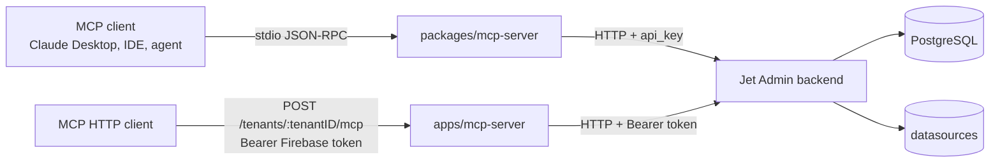

# MCP Server

Jet Admin ships a Model Context Protocol server that exposes tenant resources as callable tools. It is the same tool surface the in-app Jet Agent uses. There are two transports:

| Transport | Package / app | Auth | Context |
|---|---|---|---|
| stdio | `packages/mcp-server` | API key | One process = one tenant + one API key |
| Streamable HTTP | `apps/mcp-server` | Firebase Bearer token per request | One process = any tenant, per-request identity |

The tool handlers are identical. In HTTP mode the server forwards the caller's Firebase token to the backend, so every tool call runs under that user's Casbin permissions. In stdio mode the configured API key's role mappings are the authorization boundary.



## What it can do

At the time of writing the registry contains **130 tools**. The count is printed at startup and can be read from `tools/list`; it grows when tools are added, so treat 130 as a snapshot, not a protocol constant.

Representative capabilities:

| Area | Representative tools |
|---|---|
| Discovery / schemas | `get_tenant_resource_summary`, `search_resources`, `get_widget_schemas`, `get_data_query_schemas`, `get_datasource_schemas`, `get_listener_schemas`, `get_workflow_schema`, `get_app_page_schema`, `describe_node_type` |
| Validation (no writes) | `validate_workflow`, `validate_app_page`, `validate_form_schema`, `validate_expression`, `validate_listener`, `list_listener_action_types` |
| Datasources | `list_datasources`, `get_datasource`, `get_datasource_schema`, `get_datasource_sample_data`, `test_datasource_connection`, `test_datasource_json_endpoint`, `create_datasource`, `update_datasource`, `delete_datasource` |
| Queries | `list_queries`, `get_query`, `create_query`, `update_query`, `delete_query`, `test_query`, `run_query`, `test_query_by_data` |
| Workflows | `list_workflows`, `get_workflow`, `create_workflow`, `update_workflow`, `delete_workflow`, `execute_workflow`, `get_workflow_instance`, `list_workflow_instances`, `test_workflow`, `stop_workflow_instance` |
| Widgets | `list_widgets`, `get_widget`, `create_widget`, `update_widget`, `delete_widget` |
| App pages | `list_app_pages`, `get_app_page`, `create_app_page`, `update_app_page`, `delete_app_page`, `get_app_page_preview_url`, `list_app_page_versions`, `get_app_page_version`, `restore_app_page_version` |
| Listeners | `list_listeners`, `get_listener`, `create_listener`, `update_listener`, `delete_listener`, `activate_listener`, `deactivate_listener`, `add_listener_action`, `update_listener_action`, `delete_listener_action`, `get_listener_connection_status` |
| IAM (read-only) | `list_tenant_members`, `list_tenant_roles`, `get_tenant_info` |
| Admin / lifecycle | Folder CRUD/move, cron CRUD/history/status, audit list/export, API-key CRUD/clone, user/role CRUD, bundle import preview/execute, widget-library publish/install, tenant AI config, datasource proxy, clone/export for core assets, workflow data-collection submit |

### Resources and prompts

The server also registers:

| Resource | URI | Contents |
|---|---|---|
| Architecture map | `jetadmin://docs/architecture` | Core objects, canonical flows, conventions |
| Bindings | `jetadmin://docs/bindings` | safe-path vs js-template vs condition-js |
| Workflow nodes | `jetadmin://docs/workflow-nodes` | Handles, required config, output, pitfalls |
| Forms | `jetadmin://docs/forms` | Form widget, dataCollection JSON Schema, approval |
| Listeners | `jetadmin://docs/listeners` | Action types, ordering, webhook paths |
| Permissions | `jetadmin://docs/permissions` | Permission keys, seeded roles, 401/403 |

Prompts: `build_workflow` (goal → validate → create → execute → verify) and `debug_workflow_run` (instance → failing node → fix → re-run).

## Canonical agent flows

```text
Discover → validate → write → verify

Data:
  get_tenant_resource_summary
    → get_datasource_schema → get_datasource_sample_data
    → test_query_by_data → create_query → test_query

UI:
  get_widget_schemas → create_widget
    → create_app_page → validate_app_page → get_app_page_preview_url

Automation:
  describe_node_type → validate_workflow → create_workflow
    → execute_workflow → get_workflow_instance
    → verify status AND contextData/output

Human-in-the-loop:
  execute_workflow
    → pendingDataCollectionRequests
    → get_data_collection_request
    → submit_data_collection_request
```

The MCP's own instructions emphasize that a `COMPLETED` workflow can still take the wrong branch. Agents must inspect `contextData`/`output`, not just the status.

## Setup — Streamable HTTP (recommended for shared deployments)

### Docker Compose

```bash
# Backend must be running first; the MCP service depends on it being healthy.
docker compose --profile mcp up -d
docker compose --profile mcp ps
docker compose --profile mcp logs -f mcp-server
curl -fsS http://localhost:5001/health
```

Required Compose environment:

| Variable | Value / note |
|---|---|
| `JET_ADMIN_BACKEND_URL` | `http://backend:3000` inside Compose; use the private backend URL elsewhere |
| `FIREBASE_CREDENTIALS` | Same service-account JSON as the backend; the container exits without it |
| `PORT` / `MCP_PORT` | Container port, default `5001` |
| `MCP_HOST_PORT` | Host mapping |
| `DEBUG` / `MCP_DEBUG` | Verbose stderr logging |

Endpoint:

```text
POST http://localhost:5001/tenants/<tenantID>/mcp
GET  http://localhost:5001/tenants/<tenantID>/mcp   # SSE stream for server notifications
GET  http://localhost:5001/health
```

Every request must include:

```http
Authorization: Bearer <Firebase ID token>
Content-Type: application/json
Accept: application/json, text/event-stream
```

The server creates a fresh `McpServer` and stateless `StreamableHTTPServerTransport` per request; there is no session state to leak between tenants.

### Running from source

```bash
cd apps/mcp-server
cp .env.example .env
# JET_ADMIN_BACKEND_URL=http://localhost:8090
# FIREBASE_CREDENTIALS='{"type":"service_account",...}'
npm start
```

The backend must be reachable at `JET_ADMIN_BACKEND_URL`. Unlike the package README's `:5000` examples, the backend default is **8090**.

## Setup — stdio (single tenant, local client)

```bash
cd packages/mcp-server
cp .env.example .env
# JET_ADMIN_BACKEND_URL=http://localhost:8090
# JET_ADMIN_API_KEY=<raw key>
# JET_ADMIN_TENANT_ID=<tenant uuid>
npm start
```

`npm start` runs `node src/index.js`. The process writes all diagnostics to **stderr**; stdout is reserved for JSON-RPC. If stdout is polluted, the MCP client disconnects with a broken pipe.

### Claude Desktop / compatible client config

Use an absolute path. The example path is illustrative:

```json
{
  "mcpServers": {
    "jet-admin": {
      "command": "node",
      "args": ["/absolute/path/to/jet-admin/packages/mcp-server/src/index.js"],
      "env": {
        "JET_ADMIN_BACKEND_URL": "http://localhost:8090",
        "JET_ADMIN_API_KEY": "<raw-api-key>",
        "JET_ADMIN_TENANT_ID": "<tenant-uuid>",
        "DEBUG": "false"
      }
    }
  }
}
```

On Windows, use forward slashes or escaped backslashes in JSON. Restart the client after editing its config.

### Getting an API key

1. Open the tenant in Jet Admin.
2. Go to **Settings → API Keys**.
3. Create a key with the roles needed for the tools you intend to use.
4. Copy the raw key once; only the prefix/hash is stored.

For a read-only agent, grant list/read/execute-style permissions only. Do not reuse a tenant-admin key.

## Tool catalog generation

The MCP's offline catalogs (datasource types, widget types, workflow nodes) are generated from the platform packages:

```bash
node packages/mcp-server/scripts/generate-catalogs.mjs
# or
cd packages/mcp-server && npm run generate:catalog
```

Run this after adding a widget, datasource, or workflow node so MCP discovery matches the running build. The live backend `/schemas` keys are merged in when reachable, so the catalog cannot silently drift from the server.

## Configuration

### HTTP wrapper (`apps/mcp-server`)

| Variable | Required | Default | Purpose |
|---|---|---|---|
| `PORT` | no | `5001` | HTTP listen port |
| `JET_ADMIN_BACKEND_URL` | **yes** | — | Backend base URL as seen from the MCP container |
| `FIREBASE_CREDENTIALS` | **yes** | — | Firebase service account for per-request token verification |
| `DEBUG` | no | `false` | Verbose stderr logging |

### stdio package (`packages/mcp-server`)

| Variable | Required | Default | Purpose |
|---|---|---|---|
| `JET_ADMIN_BACKEND_URL` | **yes** | — | Backend base URL; `JET_ADMIN_BASE_URL` is accepted as a fallback |
| `JET_ADMIN_API_KEY` | **yes** | — | Raw API key; the client adds `api_key ` |
| `JET_ADMIN_TENANT_ID` | **yes** | — | Tenant UUID |
| `JET_ADMIN_FRONTEND_URL` | no | null | Base URL for preview links |
| `JET_ADMIN_TIMEOUT` | no | `30000` | HTTP timeout (ms) |
| `JET_ADMIN_RETRIES` | no | `3` | Retry attempts for network/5xx/429 errors; 4xx not retried |
| `JET_ADMIN_RETRY_DELAY` | no | `500` | Base exponential-backoff delay (ms) |
| `DEBUG` | no | `false` | Verbose stderr logging |

## Limits and behavior

| Limit | Value |
|---|---|
| Registered tools | 130 at the time of writing |
| HTTP body | 5 MB (`express.json`) |
| HTTP session state | None; fresh server/transport per request |
| Backend timeout | 30 s default |
| Retries | 3 by default; only network errors, 5xx, and 429 |
| Data-query output truncation | Only when a tool accepts `maxRows`; cap 1,000 rows, returns `{totalCount, truncated, maxRows, rows}` |
| Rate limiting | None in the MCP server |
| HTTP CORS | No CORS middleware; intended for server-to-server MCP clients |
| Protocol logging | stderr only in stdio; never stdout |

Tool output is JSON text in a single MCP content block. Tools return structured errors (`code`, `message`, `details`, `hint`) where possible; 401 means bad/absent credential, 403 means Casbin denied the operation, 404 usually means the ID does not belong to the tenant.

## Security boundaries

- **HTTP:** every request is verified with Firebase Admin. The token is forwarded into each tool handler; the backend enforces Casbin on the tenant routes (and membership on the routes that explicitly check it). There is no shared service identity and no cross-tenant session.
- **stdio:** the process is the boundary. Anyone who can read the process environment or the `.env` file can use the API key. Run it as the invoking user, not a shared service.
- **Tenant ID:** in HTTP it comes from the URL; in stdio from the environment. It is not validated by the MCP server itself — the backend's policy check is the gate.
- **Confirmation:** the backend Jet Agent wraps critical tools in an `askUser` confirmation gate. **Direct MCP clients bypass that gate.** Destructive tools (`delete_*`) rely on the client/agent honoring their descriptions; there is no server-side confirmation enforcement.
- **Data exposure:** `get_datasource` and some schema/sample fallbacks can return connection options. Tool descriptions warn that these may contain credentials. Prefer scoped keys and avoid printing secrets back into chat.
- **Network:** the HTTP server has no CORS, no rate limit, and no IP allowlist. Keep it on a private network or behind an authenticated gateway. Do not expose it to the public internet without an edge policy.
- **Transport:** stdio is not a network transport. Do not bridge it to a public socket without authentication.

:::warning Do not use a tenant-admin key for an exploratory agent
The MCP can create, update, delete, and execute resources. A read-only investigation should use a key with list/read permissions only. Review the generated tool descriptions and the agent's plan before granting write access.
:::

## Troubleshooting

| Symptom | Cause / fix |
|---|---|
| `Missing required environment variable` | Copy `.env.example` to `.env` and fill `JET_ADMIN_BACKEND_URL`, plus `JET_ADMIN_API_KEY`/`JET_ADMIN_TENANT_ID` for stdio |
| HTTP container exits at boot | `FIREBASE_CREDENTIALS` missing or invalid JSON |
| `Jet Admin API unreachable` | Backend not running at `JET_ADMIN_BACKEND_URL`; inside Compose use `http://backend:3000`, not `localhost:8090` |
| 401 | Bad/expired Firebase token or disabled API key |
| 403 | The identity lacks the Casbin permission for that tenant/resource; fix the role, not the retry |
| 404 | Wrong ID or ID belongs to another tenant; call `list_*`/`search_resources` |
| Tools missing in Claude Desktop | Restart the client after editing its config; verify stdout has no extra text |
| Tool returns `CONFIRMATION_REQUIRED` | You are using the backend Jet Agent, not a direct MCP client; confirm through the UI first |
| Catalog drift after adding a plugin | Run `node packages/mcp-server/scripts/generate-catalogs.mjs` and restart |

## Development

```bash
cd packages/mcp-server
npm test                 # node --test tests/*.test.mjs
npm run generate:catalog
npm start
```

The HTTP wrapper has no test script; exercise it against a running backend or through an MCP client. For backend module and widget changes, see [Contributing](./contributing.md) and [Extending Widgets](./extending-widgets.md).
