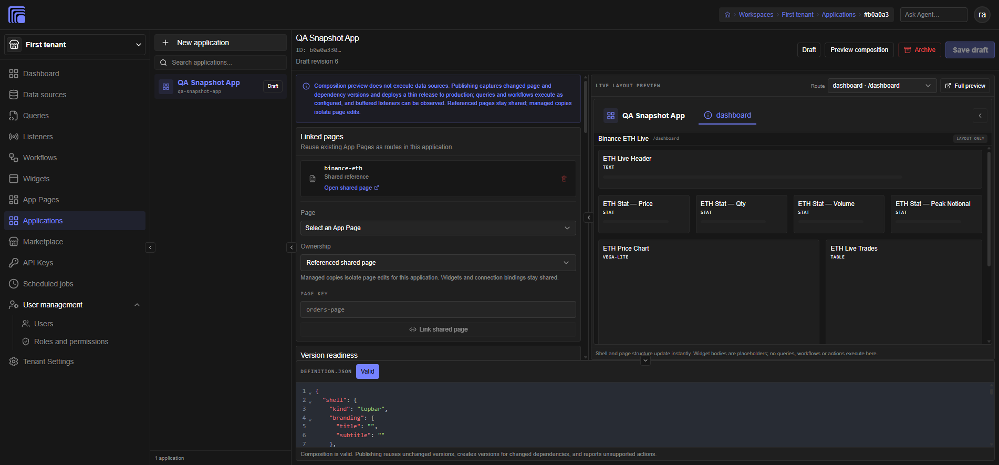
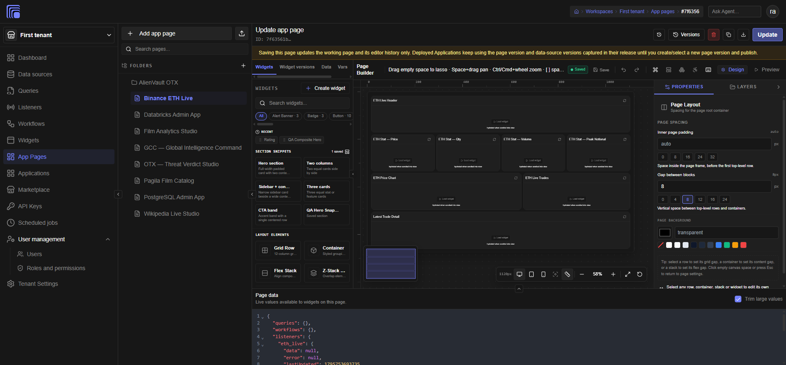
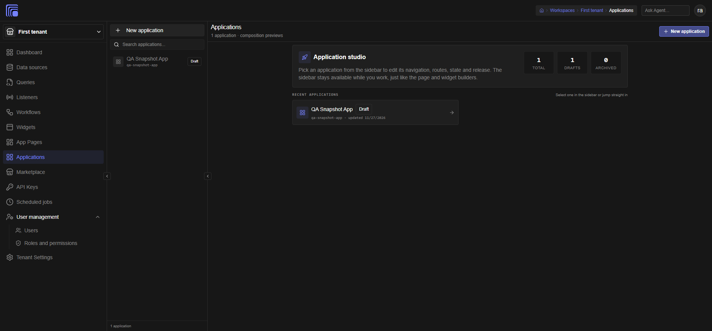
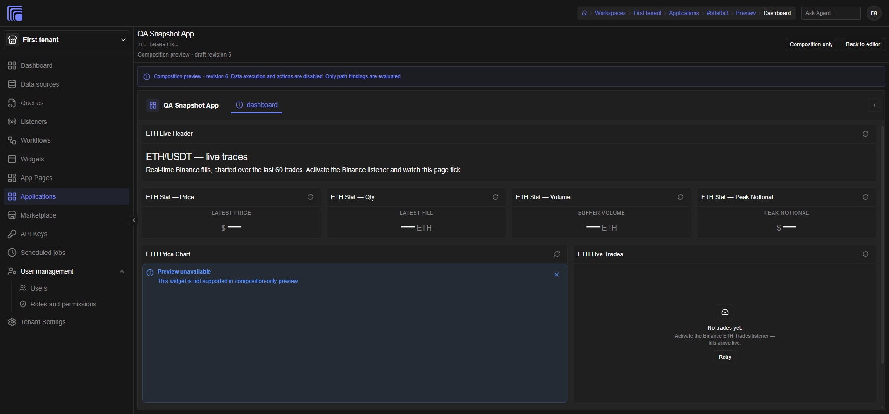
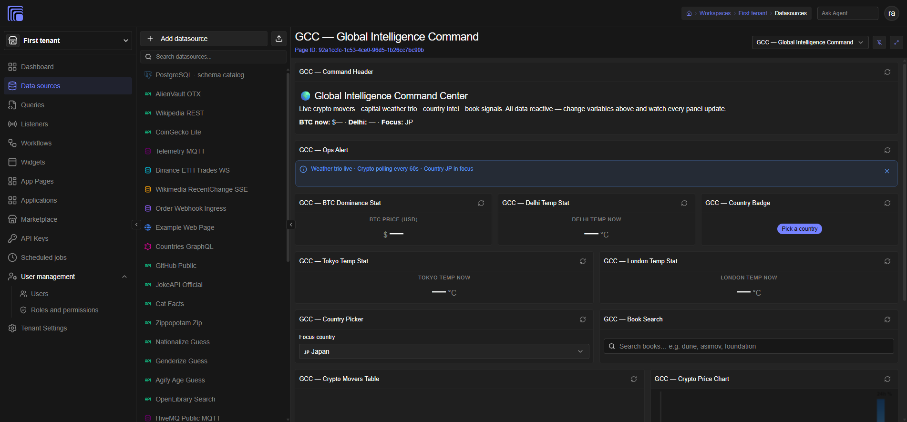
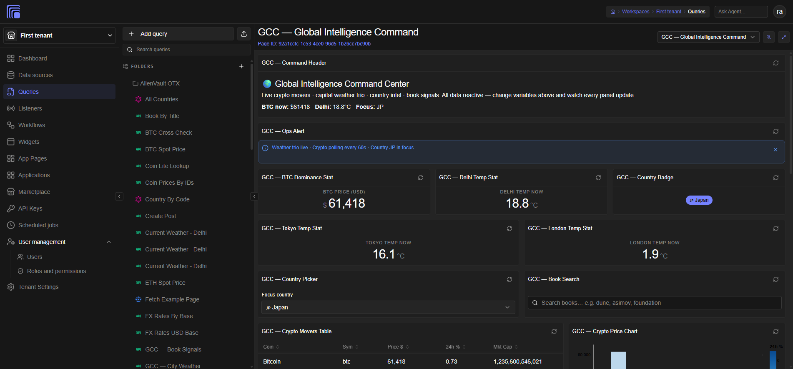
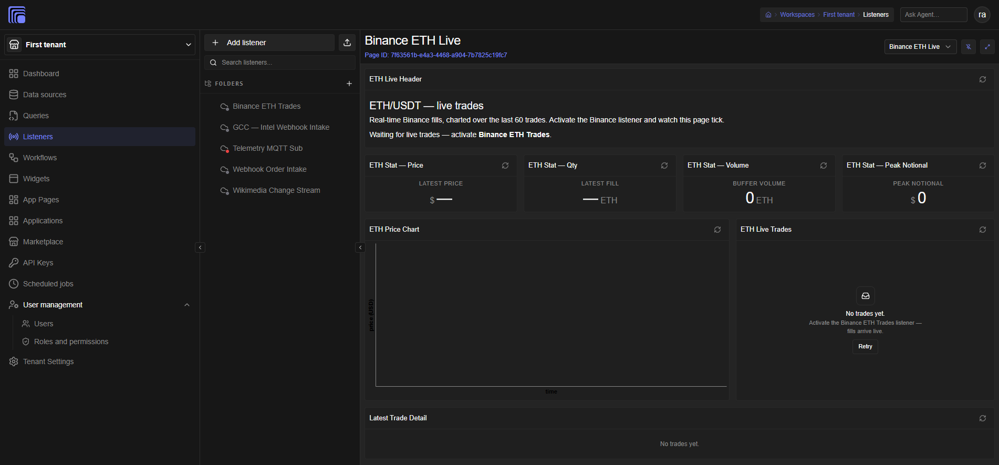
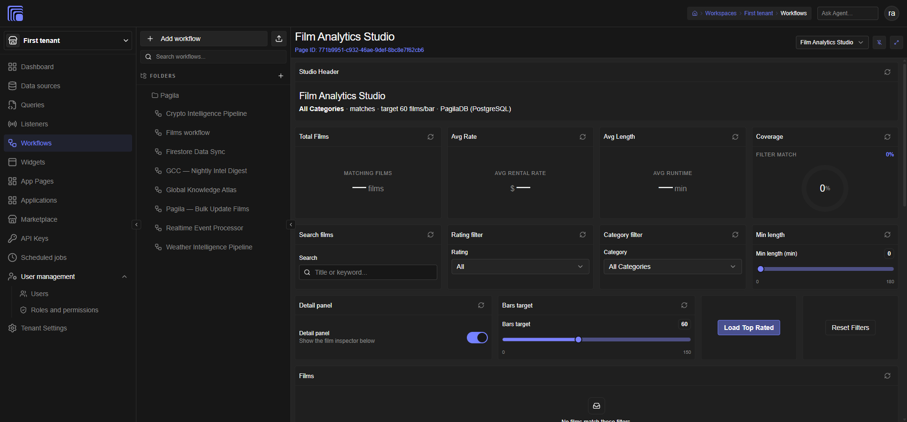
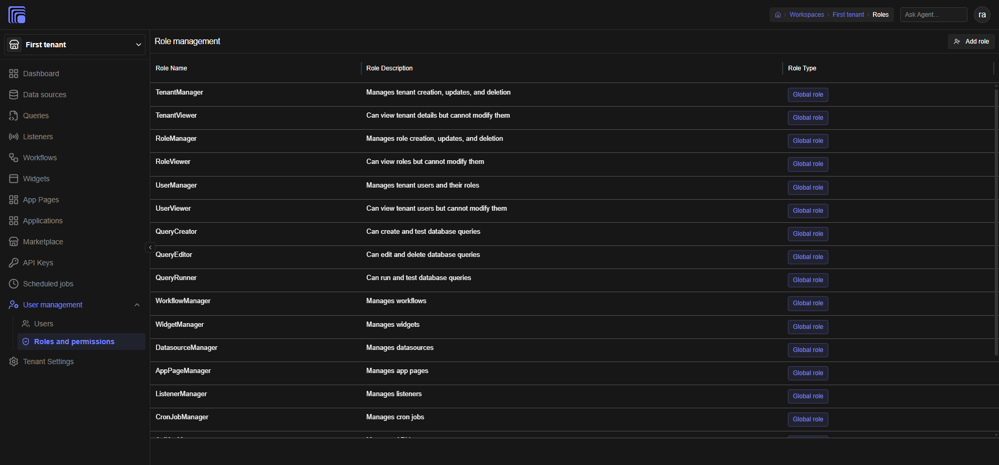
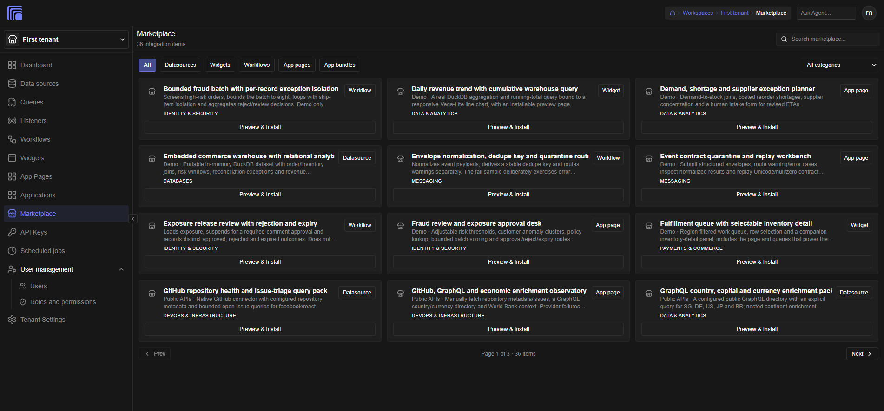

# Visual Tour

These snapshots come from a live Jet Admin deployment. Use them to orient
yourself before following the [Quickstart](./quickstart.md).

## Application Studio

Manage applications in the sidebar, link pages, configure routes and navigation,
edit state and releases, and inspect the live layout preview without executing
data sources.

## App Page Builder

Compose rows, containers, stacks and widgets on the canvas. The inspector
exposes layout, data sources, variables, widget versions, events and responsive
overrides.

## Applications directory

The applications module follows the same sidebar-first pattern as the other
builders: resizable list, search, recent applications and a dedicated landing
dashboard.

## Application preview

Composition preview evaluates routes and navigation without executing queries,
workflows or widget actions. Widgets that cannot run in composition-only mode
show an explicit fallback.

## Data sources

The data source drawer lists every connector in the tenant with search, folder
support and inline health/test controls.

## Data queries

Queries are parameterized, versionable models over a data source. The query
workspace supports SQL, REST and connector-specific editors, input definitions
and test execution.

## Listeners

Listeners capture live events from streaming and webhook sources. Pipeline
actions can persist buffers, emit to app pages, call workflows and push updates
over websockets.

## Workflows

Workflows are Temporal-backed DAGs with conditions, loops, fan-out/join,
approvals, sub-workflows, JavaScript and data collection.

## Identity and access

Tenant users, roles and permissions are enforced with Casbin policies. Users can
be tenant admins or hold one or more granular roles.

## Marketplace

Install curated templates containing pages, widgets, queries, workflows and
datasources into a tenant, then customize them like any other asset.

## Related pages

- [Applications](../applications/applications.md)
- [App Pages & Widgets](../app-pages-widgets/app-pages-widgets.md)
- [Platform architecture](../platform/architecture.md)
- [Quickstart](./quickstart.md)
