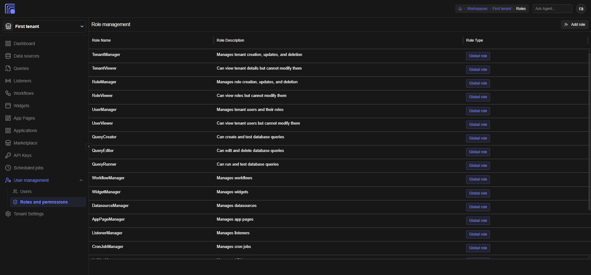
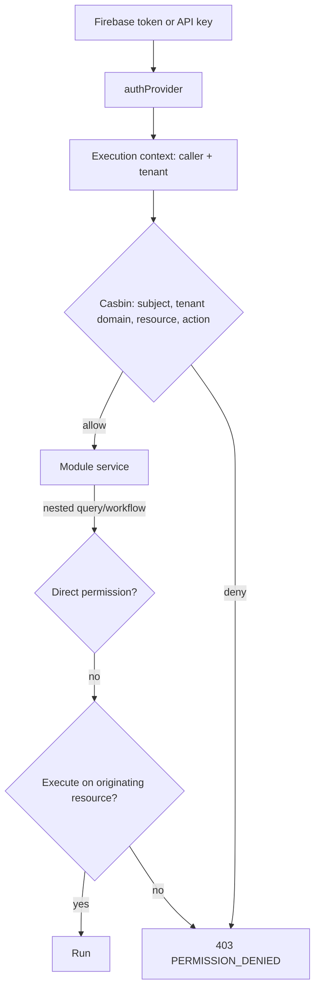
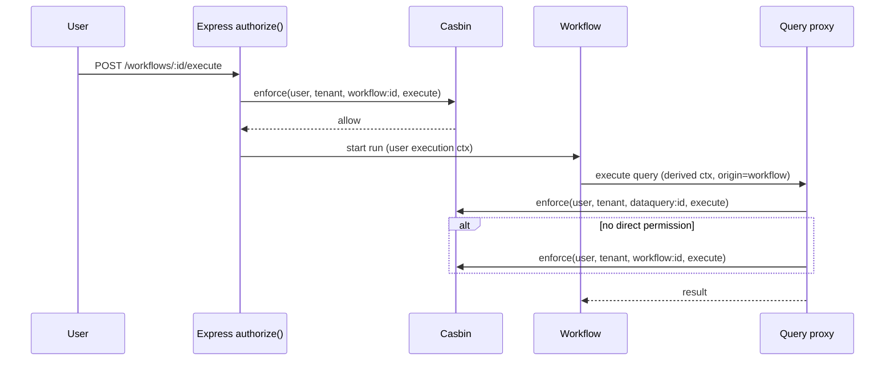

# Identity & Access Management

IAM answers three questions for every tenant-scoped request:

1. **Who is calling?** A human via a Firebase identity token, or an integration via an API key.
2. **Which tenant domain?** The `tenantID` in the route.
3. **What may they do?** A Casbin policy check on the requested resource and action.



## Core concepts

| Concept | Meaning |
|---|---|
| Platform user | A `tblUsers` row identified by `firebaseID` + email. A user can belong to multiple tenants. |
| Tenant membership | A `tblUsersTenantsRelationship` row with `role: "ADMIN"` or `"MEMBER"`. |
| Membership tier | `ADMIN` gets a tenant-wide Casbin wildcard (`*`, `*`). `MEMBER` gets only the policies from assigned custom roles. |
| Custom role | A tenant-owned `tblRoles` row plus permission mappings. Roles are reusable across members and API keys. |
| Global role | A role with `tenantID = NULL`, seeded deployment-wide. It can be assigned, but tenant routes cannot update or delete it. |
| General permission | A category-wide capability such as `tenant:workflow:execute`, stored as a `tblPermissions` row and mapped to Casbin `<resource>:*`. |
| Asset permission | A capability scoped to one resource, stored as `tenant:asset:<resourceType>:<resourceID>:<action>` and mapped to `<resource>:<id>`. |
| API key | A tenant-scoped machine credential with `api_key <raw>` authentication. It is authorized as its own subject and can hold roles. |
| Execution context | The caller/origin object passed through internal execution (`authorizedExecuteDataQuery`, `authorizedExecuteWorkflow`). Enables delegated authorization and traceability. |
| Delegated authorization | A caller without direct permission on a query/workflow can still execute it if they have execute permission on the **originating** workflow or app page. |
| Policy sync | Role create/update/delete immediately rewrites Casbin rules from the database. `POST /roles/sync-policies` is the manual repair path. |



## Authentication methods

A tenant route under `/api/v1/tenants/:tenantID/...` authenticates with one of these headers:

| Method | Header | Subject used by Casbin | Notes |
|---|---|---|---|
| Firebase ID token | `Authorization: Bearer <firebase-id-token>` | `userID` | Token verified with Firebase Admin on each request. |
| API key | `Authorization: api_key <raw-api-key>` | `apiKeyID` | Raw key is 64 hex chars; only the first 8-char prefix and a SHA-256 hash are stored. |

Requests with neither credential, or with an invalid/disabled key, are rejected with `401`. The platform-admin **operator** console uses a separate auth realm (`/api/v1/operator/...`) and is outside tenant IAM.

:::warning
**Provisioning caveat.** `authController.getUserInfo` contains a create-if-missing branch, but `authMiddleware.authProvider` looks up an existing `tblUsers` row and returns `INVALID_USER` before the controller runs. As shipped, a brand-new Firebase account may not be auto-provisioned by `/api/v1/auth`; verify the first-sign-in flow in your deployment and pre-provision the user row if needed.
:::

## Tenant roles and membership

### Membership model

| Tier | Stored as | Effective access |
|---|---|---|
| Admin | `tblUsersTenantsRelationship.role = "ADMIN"` | Tenant-wide wildcard policy; roles are not needed and the UI hides role assignment. |
| Member | `role = "MEMBER"` | Only permissions granted through assigned custom/global roles plus creator-asset grants. |

Custom roles are linked to members through `tblUserTenantRoleMappings` and to API keys through `tblAPIKeyRoleMappings`. Both are synchronized to Casbin `g` rules (`role:<roleID>`).

### Seeded global roles

The current seed includes job-function roles such as:

`ADMIN`, `TenantManager`, `TenantViewer`, `RoleManager`, `RoleViewer`, `UserManager`, `UserViewer`, `QueryCreator`, `QueryEditor`, `QueryRunner`, `WorkflowManager`, `WidgetManager`, `DatasourceManager`, `AppPageManager`, `ListenerManager`, `CronJobManager`, `FolderManager`, `ApiKeyManager`, `AuditViewer`, `AIManager`.

They are templates. Global roles are shown in the tenant role list but cannot be edited/deleted through the tenant API.

## Create and assign a custom role

1. Open **Roles** in tenant settings.
2. Choose **Add role**.
3. Enter a title (max 255) and a description.
4. Select **General Permissions** from the catalog. The picker shows human descriptions and hides `tenant:asset:*` rows.
5. Optionally add **Asset Permissions**:
   - choose an asset type (`appPage`, `dataquery`, `workflow`, `datasource`, `listener`, `cronjob`, `widget`);
   - search/select one asset in the tenant;
   - choose an action (`read`/`update`/`delete`, plus `run` for queries and `execute` for workflows).
6. Save. Casbin policies are rewritten immediately.
7. Open **Users**, select a Member, choose **Manage roles**, select the role(s), and save.

Roles do not require unique titles. Use job-function names, not personal names.

### Role request example

```http
POST /api/v1/tenants/:tenantID/roles HTTP/1.1
Authorization: Bearer <firebase-id-token>
Content-Type: application/json

{
  "roleTitle": "Ops dashboard editor",
  "roleDescription": "Can edit pages and run the fulfilment workflow",
  "permissionIDs": [
    "3f5c2a10-1d2e-4f3a-9b8c-7d6e5f4a3b2c",
    "8a7b6c5d-4e3f-4a2b-9c1d-0e9f8a7b6c5d"
  ],
  "assetPermissions": [
    {
      "resourceType": "workflow",
      "resourceID": "f0e1d2c3-b4a5-4968-8778-695a4b3c2d1e",
      "action": "execute"
    }
  ]
}
```

`permissionIDs` are **permission UUIDs**, not titles. Get them from `GET /roles/permissions`.

### Asset permission semantics

- The permission row is created on demand with title `tenant:asset:<resourceType>:<resourceID>:<action>`.
- `resourceType` is lower-case in the title, but the sync remaps `apppage` to Casbin's `appPage` resource.
- Entries missing `resourceType`, `resourceID`, or `action` are **silently skipped**. Validate client-side.
- Asset actions are fixed: queries `read/update/delete/run`, workflows `read/update/delete/execute`, other UI asset types `read/update/delete`.
- A role editor with `role:update` can grant any catalog permission. Treat role management as an administrative capability.

## Add and update members

### Add a member

`POST /api/v1/tenants/:tenantID/users` with:

```json
{
  "tenantUserEmail": "analyst@example.com",
  "roleIDs": ["3f5c2a10-1d2e-4f3a-9b8c-7d6e5f4a3b2c"]
}
```

The email must already belong to a platform user; there is no email invitation that creates an account. The user is added with tier `MEMBER` and an in-app notification. Duplicate membership is rejected with `USER_ALREADY_MEMBER_OF_TENANT`. The tenant UI's add-member dialog sends only the email; roles are assigned afterward from the member page.

### Update roles or tier

`PATCH /api/v1/tenants/:tenantID/users/:tenantUserID/roles`

```json
{
  "roleIDs": ["8a7b6c5d-4e3f-4a2b-9c1d-0e9f8a7b6c5d"],
  "userTenantRelationship": "MEMBER"
}
```

| Field | Notes |
|---|---|
| `roleIDs` | Required array by the validator (may be empty). Replaces custom role assignments for Members. |
| `userTenantRelationship` | `ADMIN` or `MEMBER`. Optional; omitted keeps the current tier. The validator passes it through. |

Behaviour:

- **Member → Admin:** sets tier `ADMIN`, adds the tenant wildcard policy, and removes role `g` links.
- **Admin → Member:** sets tier `MEMBER`, removes the wildcard, and adds Casbin role links for supplied `roleIDs`. The current service does not persist those role mappings in `tblUserTenantRoleMappings` on this branch; verify role visibility after demotion.
- **Member (no tier change):** replaces DB role mappings and Casbin links.
- **Admin (no tier change):** rejected as `USER_ALREADY_ADMIN_OF_TENANT`. Admins do not need roles.

`tenantUserID` is the target **userID**, not a membership row ID.

:::warning
Only the member-removal path checks "last Admin." The demotion path does not currently enforce it, so a tenant can be left with no Admin if the last Admin is demoted. Promote a replacement first.
:::

### Remove a member

`DELETE /api/v1/tenants/:tenantID/users/:tenantUserID` removes the membership and role mappings, and removes Casbin wildcard/role links. Removing the last Admin is rejected with `ONLY_ONE_ADMIN_IN_TENANT`.

## API keys

Create an API key in the tenant's **API keys** screen or API:

```http
POST /api/v1/tenants/:tenantID/apikeys HTTP/1.1
Authorization: Bearer <firebase-id-token>
Content-Type: application/json

{
  "apiKeyTitle": "CI deploy",
  "roleIDs": ["8a7b6c5d-4e3f-4a2b-9c1d-0e9f8a7b6c5d"]
}
```

The response contains the raw key **once**. Store it in your secret manager; it cannot be recovered. Use it as:

```http
GET /api/v1/tenants/:tenantID/workflows HTTP/1.1
Authorization: api_key <raw-api-key>
```

Rules:

- Keys are scoped to one tenant. Create separate keys per tenant.
- Keys are authorized as `apiKeyID`, not as the creator's `userID`. Assign the narrowest role that does the job.
- Disabling a key (`isDisabled`) or deleting it takes effect on the next request.
- `apiKeyExpiry` is accepted by the validator but the service does not store or enforce it. Use manual disable/delete rotation.
- `PATCH` can change title, `roleIDs`, and `isDisabled`; it cannot reveal the raw key.
- `POST /:apiKeyID/clone` creates a new key and returns a new raw value. The clone is created **disabled**; enable it after storing the key.

## Permission catalog

General permissions are defined in `apps/backend/config/permissions.json`. Most titles follow `tenant:<resource>:<action>`; tenant-wide actions are shorter (`tenant:read`, `tenant:update`, `tenant:delete`) and the permission-list action is `tenant:permissions:list`.

| Resource group | Actions |
|---|---|
| AI | `chat`, `read`, `delete` |
| API keys | `list`, `create`, `read`, `update`, `delete` |
| App pages | `list`, `create`, `read`, `update`, `delete`, `execute`, `export` |
| Applications | `list`, `create`, `read`, `update`, `archive`, `publish`, `deploy`, `execute` |
| Audit | `list` |
| Bundles | `preview`, `execute` |
| Cron jobs | `list`, `create`, `read`, `update`, `delete` |
| Data queries | `list`, `create`, `read`, `update`, `delete`, `test`, `execute`, `export` |
| Datasources | `list`, `create`, `read`, `update`, `delete`, `test`, `export` |
| Folders | `list`, `create`, `update`, `delete` |
| Listeners | `list`, `create`, `read`, `update`, `delete`, `execute`, `observe`, `export` |
| Marketplace | `list`, `preview`, `install`, `verify`, `unpublish` |
| Permissions | `list` |
| Roles | `list`, `create`, `read`, `update`, `delete` |
| Tenant | `read`, `update`, `delete` |
| Tenant users | `list`, `create`, `read`, `update`, `delete` |
| Widgets | `list`, `create`, `read`, `update`, `delete`, `execute`, `export` |
| Widget library | `list`, `publish`, `unpublish`, `install` |
| Workflows | `list`, `create`, `read`, `update`, `delete`, `execute`, `test`, `export` |

`GET /roles/permissions` returns unique core permissions (excluding asset permissions) ordered by title. Route checks import the same catalog via `P`, so a permission exists only if it is used by a route (or added deliberately).

## Authorization and delegated execution



- **Route checks:** `authMiddleware.authorize(P.resource.action)` builds `<resource>:<id>` (`*` for list/category routes) and checks Casbin in the tenant domain. Resource IDs come from params, body keys, or extracted request keys (`reqKey`).
- **Direct execution proxies:** `authorizedExecuteDataQuery` and `authorizedExecuteWorkflow` require an execution context. User/API-key callers are checked; system callers (listeners, cron) are trusted but logged.
- **Delegated fallback:** if direct execute is denied and `originatingResource` exists, the proxy checks execute on the origin (`workflow:<id>` or `appPage:<id>`). This is why a user can run a workflow that internally uses a query they cannot run directly.
- **Socket authorization:** joins are limited to `listener_test:<listenerID>` and `listener:app_page:<appPageID>`; the socket must have a verified Firebase identity, tenant membership, and a matching resource policy.
- **Policy sync:** `syncRolePolicies` deletes/re-adds rules for `role:<roleID>` in the tenant domain, then reloads the enforcer. Global roles are synced per tenant at tenant creation and on full sync.

## Configurable entities

### Role

| Field | Type | Required | Notes |
|---|---|---|---|
| `roleTitle` | String, 1–255 | Yes | Not unique. |
| `roleDescription` | String | No | UI marks it required; API accepts omission. |
| `permissionIDs` | UUID array | No | General permission IDs. |
| `assetPermissions` | Object array | No | `{ resourceType, resourceID, action }`. |

### Member / API key assignment

| Entity | Field | Notes |
|---|---|---|
| Member | `tenantUserEmail` | Must be an existing platform user. |
| Member | `roleIDs` | Custom/global role UUIDs. |
| Member | `userTenantRelationship` | `ADMIN`/`MEMBER`; only meaningful on member update. |
| API key | `apiKeyTitle` | Display name. |
| API key | `roleIDs` | Roles assigned to the key subject. |
| API key | `isDisabled` | Disable without deleting. |

### Per-user tenant config

`GET/POST /api/v1/auth/config/:tenantID` reads/writes an arbitrary JSON object for the caller. The body must be `{ "config": { ... } }`; the config must be an object. `checkTenantMembership` is enforced. It is suitable for UI preferences, not validated business data.

## API endpoints

| Method | Path | Permission |
|---|---|---|
| `GET` | `/:tenantID/users` | `tenant:user:list` |
| `POST` | `/:tenantID/users` | `tenant:user:create` |
| `GET` | `/:tenantID/users/:tenantUserID` | `tenant:user:read` |
| `PATCH` | `/:tenantID/users/:tenantUserID/roles` | `tenant:user:update` |
| `DELETE` | `/:tenantID/users/:tenantUserID` | `tenant:user:delete` |
| `GET` | `/:tenantID/roles` | `tenant:role:list` |
| `POST` | `/:tenantID/roles` | `tenant:role:create` |
| `GET` | `/:tenantID/roles/permissions` | `tenant:permissions:list` |
| `GET` | `/:tenantID/roles/:roleID` | `tenant:role:read` |
| `PATCH` | `/:tenantID/roles/:roleID` | `tenant:role:update` |
| `DELETE` | `/:tenantID/roles/:roleID` | `tenant:role:delete` |
| `POST` | `/:tenantID/roles/sync-policies` | `tenant:role:update` |
| `GET` | `/:tenantID/apikeys` | `tenant:apikey:list` |
| `POST` | `/:tenantID/apikeys` | `tenant:apikey:create` |
| `GET` | `/:tenantID/apikeys/:apiKeyID` | `tenant:apikey:read` |
| `PATCH` | `/:tenantID/apikeys/:apiKeyID` | `tenant:apikey:update` |
| `DELETE` | `/:tenantID/apikeys/:apiKeyID` | `tenant:apikey:delete` |
| `POST` | `/:tenantID/apikeys/:apiKeyID/clone` | `tenant:apikey:create` + read |
| `GET` | `/api/v1/auth` | authenticated user |
| `GET/POST` | `/api/v1/auth/config/:tenantID` | tenant membership |

## Use cases

| Scenario | Role design |
|---|---|
| Dashboard viewer | General `apppage:read`, `widget:read`, `dataquery:execute`; no update/delete. |
| Workflow builder | `workflow:list/create/read/update/test`, `dataquery:list/read`, plus asset `execute` on queries the workflow needs. |
| Support agent | Asset grants to specific pages/workflows; avoid tenant-wide delete. |
| CI automation | API key with `workflow:execute` on one workflow (asset permission) and no human-tier access. |
| Auditor | `audit:list`, read-only asset grants; no execute. |
| Tenant administrator | `ADMIN` tier; do not also assign roles. |

## Limitations and failure modes

| Situation | Behaviour |
|---|---|
| Unknown Firebase account | `INVALID_USER`; see provisioning caveat above. |
| No membership | Tenant route policy check fails or tenant list omits the tenant. |
| Invalid/disabled API key | `401 INVALID_API_KEY`. |
| No direct permission, no origin | `403 PERMISSION_DENIED`, or execution proxy error. |
| Origin permission only | Delegated fallback allows query/workflow execution. |
| Global role edit/delete through tenant route | Rejected because `tenantID` does not match (`role does not belong to this tenant`); the UI may still show controls. |
| Incomplete asset permission row | Silently skipped; no error, no grant. |
| Last Admin removal | Rejected. Last Admin **demotion** is not blocked. |
| Admin role update with no tier change | `USER_ALREADY_ADMIN_OF_TENANT`; Admins already have wildcard access. |
| API key expiry | Not enforced; `apiKeyExpiry` is ignored. |
| Role title duplicates | Allowed; identify roles by `roleID`. |
| Member/tenant plan limits | The middleware exists, but the shipped `SAMPLE_PLAN` uses `Infinity` for both tenant and member counts; do not assume a cap without changing deployment config. |
| Policy drift after manual DB edits | Run `POST /roles/sync-policies`; a restart reloads `casbin_rule`, so it does not repair drift between role mappings and the rule table. |
| Cache/role change delay | Role sync reloads Casbin immediately; a stale external cache is not part of the current backend. |

## Security notes

- Treat `ADMIN`, `role:create/update`, `apikey:create/update`, and `user:update` as privileged capabilities: they can escalate access.
- API keys are distinct subjects. Do not assume a key inherits its creator's wildcard; assign roles explicitly.
- The delegated fallback intentionally lets a workflow/page execute embedded queries. Grant execute on the parent only when you trust every embedded resource.
- Listener and cron executions are trusted system calls; protect listener/cron edit permissions.
- Never put raw keys, tokens, or passwords in role titles/descriptions, bundle JSON, or workflow context.
- Audit policy changes and membership changes. The audit middleware records authenticated actions, but it is not a tamper-proof ledger.

## Troubleshooting

| Symptom | Check |
|---|---|
| `403` after assigning a role | Role mappings were saved, `syncRolePolicies` succeeded, and the user has the role in the same tenant domain. Try `POST /roles/sync-policies` as an Admin. |
| Role picker empty | `GET /roles/permissions` requires `permission:list`; the user's role may lack it. |
| Cannot see a member | `GET /users` requires `user:list`; pagination defaults may hide later pages. |
| API key works for one tenant only | Keys are tenant-scoped by design. |
| `Only one admin` error | Promote another member before removing/demoting the last Admin. |
| Asset permission has no effect | Confirm the resource type/action match the route's check, and the resource ID is in the same tenant. |
| Policies seem stale after a DB restore | Run the sync endpoint, then retry; Casbin loads from `casbin_rule`. |

## Related pages

- [Tenants](../tenants/tenants.md) — tenant creation, membership, deletion.
- [Data Source](../data-source/data-source.md) — datasource permissions and secrets.
- [Data Query](../data-query/data-query.md) — query execute/test permissions.
- [Listeners](../listeners/listeners.md) — listener execute/observe permissions.
- [Workflows](../workflows/workflows.md) — workflow execute/test and approval authorization.
- [Export & Import Bundles](../platform/export-import-bundles.md) — roles and assets in bundles.
- [Security](../operations/security.md) — deployment hardening and audit.
