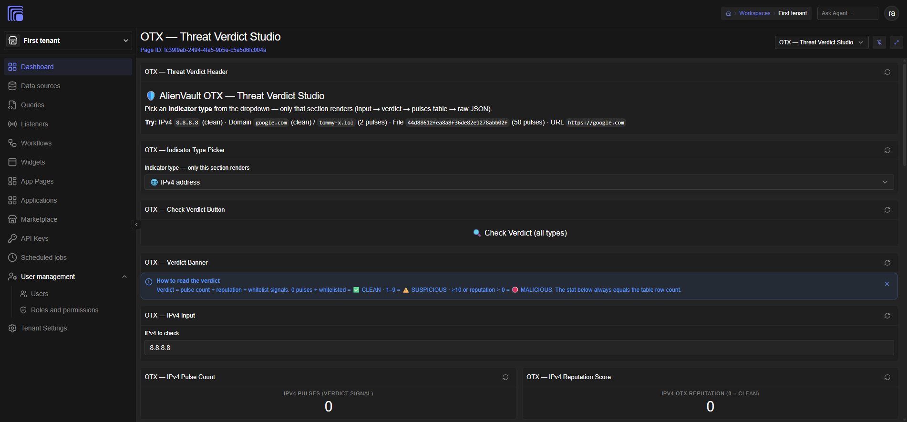
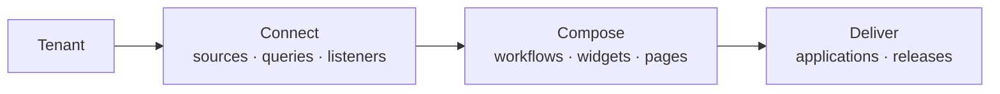
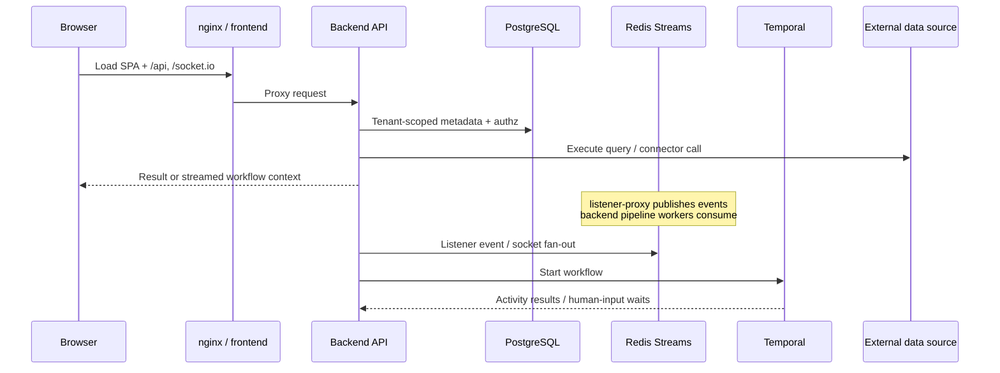
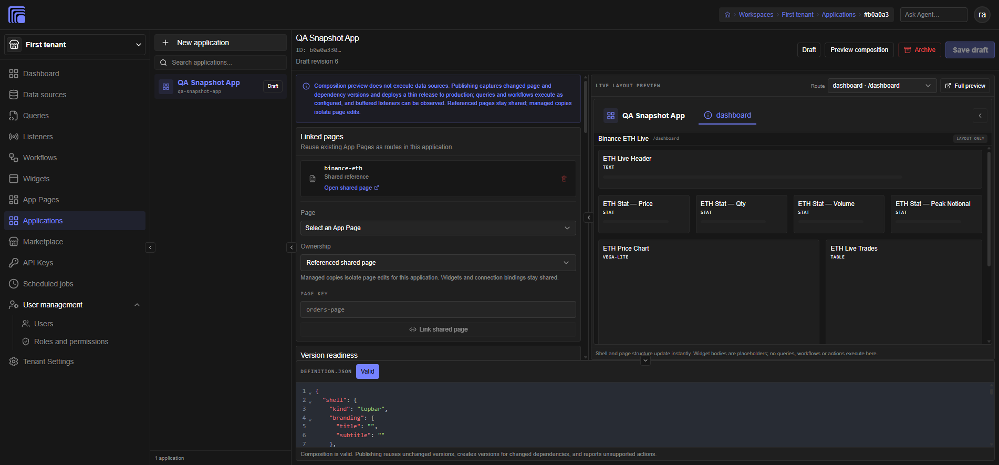

# Introduction

Jet Admin is a self-hosted platform for connecting to operational data, querying and
listening to it, automating work with workflows, and composing the results into
widgets, app pages, and routed applications. Everything runs inside an isolated
**tenant** and is authorized with tenant-scoped roles and permissions.

It is closest to the "internal tools" category — part data console, part automation
engine, part low-code app builder — rather than a pure BI tool. The repository
describes the product as an **open-source analytics platform and internal tools
builder**; the codebase shows the same shape: a PostgreSQL-backed system store, a
plugin-style connector layer, a DAG workflow engine, Socket.IO real-time delivery,
a canvas page builder, and a release layer for multi-page applications.

:::info Current version
The root `package.json` identifies this checkout as **`2.1.0-preview.1`**. Treat the
platform as preview-grade for externally facing or business-critical applications,
and read [Honest scope](#honest-scope) before committing to it.
:::

## Who it is for

| Persona | Typical job | First modules to learn |
|---|---|---|
| Platform / ops engineer | Give operations teams safe access to production data without building another admin app from scratch | Tenants → Data sources → Data queries → App pages |
| Data analyst | Publish parameterized reports and lightweight write actions on top of SQL warehouses | Data sources → Queries → Vega widgets → App pages |
| Support / finance operations | Inspect records, correct data, and run approval or escalation steps | Data queries → Widgets → Workflows → Applications |
| SaaS / platform team | Provide each customer with an isolated workspace, roles, and API access | Tenants → IAM → API keys → Bundles → Applications |
| Automation / AI engineer | Expose platform actions to agents or wire event-driven pipelines | Workflows → Listeners → MCP server / Jet Agent |

Jet Admin assumes you are comfortable with **SQL, HTTP APIs, JSON, and environment
variables**. The UI removes a lot of application code, not the need to understand the
data and failure modes underneath it.

## What it is — and what it is not

| Jet Admin is | Jet Admin is not |
|---|---|
| A self-hosted internal-tools and operations platform | A general-purpose SaaS BI suite with a semantic modeling layer |
| A tenant-scoped environment with Casbin RBAC, API keys, and audit logs | A replacement for your identity provider (it uses Firebase for human sign-in) |
| A query and action layer over databases, SaaS APIs, queues, and webhooks | A database, a CDC product, or a managed integration platform |
| A visual workflow engine with human approval and data-collection nodes | A general-purpose durable-execution platform comparable to raw Temporal |
| A canvas app builder with reusable widgets and page versions | A native mobile app builder or a public anonymous web-app host |
| A release layer that pins page and dependency versions per application | A fully mature application platform with row-level security and zero-downtime migrations |

## Mental model

The platform is easiest to understand as a build order. A **tenant** owns every
resource. Inside it, **connections** feed **queries** and **listeners**. Those feed
**workflows**, **widgets**, **app pages**, and **applications**. Administration wraps
all of it.

A useful shorthand:

> **Tenant → Connection → Query or Listener → Workflow or Widget → Page → Application → Release.**

Each arrow is a real reference in the database, not just a conceptual grouping. That
is why export/import bundles can walk dependencies, and why an application release can
pin exact page versions.

## Module map

| Module | What it does | Important boundary |
|---|---|---|
| **Tenants** | Isolated workspaces. Every asset carries a `tenantID`. | Deleting a tenant cascades through its resources. |
| **Identity & access** | Firebase sign-in for humans, API keys for automation, Casbin policies for authorization. | Invitations require an existing platform user; there is no email-invite account creation. |
| **Data sources** | Connection registry and credential vault. The registry contains roughly 45 connector entries. | Connector breadth does not guarantee equal depth or production hardening per connector. |
| **Data queries** | Saved, parameterized query definitions executed against one data source. | Queries are tenant-scoped and authorized; they are not a general SQL console for arbitrary users. |
| **Listeners** | Long-lived subscriptions and webhook ingress with a transform/action pipeline. | Runtime requires Redis and the standalone `listener-proxy`; it is not embedded in the backend. |
| **Workflows** | DAG execution with query, JavaScript, condition, switch, fan-out, join, loop, delay, data-collection, approval, sub-workflow, and end nodes. | Temporal is the primary workflow runner for every workflow; there is no native engine. |
| **Widgets** | Reusable visual components: table, Vega/Vega-Lite charts, stat, form, inputs, date pickers, HTML, iframe, kanban, calendar, and more. | Widgets are page-agnostic; data arrives through page-level aliases and JavaScript `{{ }}` expressions. |
| **App pages** | Canvas that combines widgets, data sources, and page variables. | Pages are authoring assets; they do not become an immutable artifact until captured by an application release. |
| **Applications** | Routed composition of existing app pages with a shell, navigation, application state, consumer policy, environments, immutable releases, and deploy/rollback. | Releases pin exact page versions; composition preview checks layout and route resolution without executing actions. |
| **Folders** | Per-entity folder trees for widgets, workflows, queries, listeners, cron jobs, and app pages. | Folders are scoped by `(tenantID, entityType)`. |
| **Bundles** | Export/import a resource and its dependency closure as sanitized JSON. | Credentials are stripped; datasources arrive requiring reconnect. |
| **Widget library** | Deployment-wide registry of published widgets that tenants can install. | Publish/unpublish is operator-only; there is no versioning or rating system. |
| **Jet Agent / MCP** | In-app AI agent plus a standalone MCP server exposing platform tools to external clients. | MCP tool access is only as safe as the API key and tenant you scope to it. |

## How a request moves

The runtime is a modular monolith with two specialist services. In the Docker
reference stack, the browser talks to nginx, nginx proxies to the backend, and the
backend talks to PostgreSQL, Redis, Temporal, and external systems.

Relevant operational facts:

- Human requests use a **Firebase ID token**; automation uses an **API key**.
- Every tenant route is gated by membership and Casbin policy evaluation.
- Secrets are encrypted at rest with `VAULT_ENCRYPTION_KEY` (AES-256-GCM).
- Listener ingress is open by design at `/webhooks/...`; the path suffix is the secret.
- Socket.IO handles live listener delivery and workflow progress.
- The docs deployment is separate from the application deployment; see
  [Deployment](../operations/deployment.md).

## What makes Jet Admin different

1. **Query-first, not spreadsheet-first.** The primary abstraction is a saved query
   against a real data source, with explicit input definitions and tenant-scoped
   execution. Widgets and pages bind to those queries rather than owning data.
2. **Event ingress is part of the product.** Listeners support databases (PostgreSQL
   `LISTEN`, MongoDB change streams, Firestore), queues and brokers (Kafka, RabbitMQ,
   NATS, MQTT, Redis), HTTP ingress (webhook, SSE, WebSocket), GraphQL subscriptions,
   and syslog. The listener pipeline can transform events and trigger queries,
   workflows, or app-page pushes.
3. **Tenant isolation and delegated execution are first-class.** Assets are scoped to
   a tenant, API keys are distinct authorization subjects, and workflows/pages can
   execute inner resources through the caller's identity plus an origin reference.
4. **Applications add a release boundary.** App pages can be composed into routed
   applications; publishing captures immutable page versions and deploys a thin
   release to the `production` environment. Rollback moves the production pointer.

   

5. **Extension is package-driven.** Datasource connectors, widget renderers, workflow
   nodes, and shared UI live in workspace packages, so adding a connector or widget
   does not require editing a central switchboard.
6. **Automation is exposed to agents.** The in-app Jet Agent uses an
   OpenRouter-compatible model, and the MCP server exposes a large tool catalog for
   external MCP clients.

None of these is unique in isolation. The combination — self-hosted, tenant-scoped,
query/listener/workflow/app in one system — is the reason to consider Jet Admin.

## Start paths

| If you want to… | Start here |
|---|---|
| Build a working app in 20–40 minutes | [Quickstart](../getting-started/quickstart.md) |
| Run the platform locally with Docker or natively | [Local Setup](../getting-started/local-setup.md) |
| See realistic patterns before designing your own | [Use Cases](../use-cases/use-cases.md) |
| Understand how the code is organized | [Platform Architecture](../platform/architecture.md) |
| Compose pages into a routed application | [Applications](../applications/applications.md) |
| Compare Jet Admin with other tools | [Market Comparison](../comparisons/market-comparison.md) |
| Deploy and operate it | [Deployment](../operations/deployment.md) · [Observability](../operations/observability.md) · [Security](../operations/security.md) |
| Integrate through the API | [API Reference](../developers/api-reference.md) |
| Configure every environment variable | [Configuration Reference](../operations/configuration-reference.md) |

### A sensible learning order

1. **Tenant + IAM.** Create a workspace, understand Admin vs Member, and create a
   scoped API key.
2. **Data source + query.** Connect a non-production database and prove a read query
   works before building UI.
3. **Widget + page.** Bind the query to a table or chart and confirm the page runtime
   executes it on load.
4. **Workflow.** Add one multi-step action with an explicit error path.
5. **Listener.** Only after Redis and the listener proxy are running, add event
   ingress.
6. **Application.** Compose pages into routes only when the pages are stable enough
   to version.
7. **Operations.** Add folders, audit review, exports, and a deployment/rollback
   process.

## Honest scope

:::warning Read this before a production commitment

Jet Admin is ambitious and broad, but it is not a finished enterprise product. The
following are deliberate, evidence-based caveats — not marketing language.

:::

- **Preview release.** The repository version is `2.1.0-preview.1`, and the README
  itself says the project "has a few bugs and rough edges." Plan a pilot, not a
  big-bang migration.
- **Applications are a foundation, not a proven runtime.** The project's own status
  document says composition, versions, releases, routing, and consumer policy are
  implemented, but "this is not a claim of production readiness," and live
  Temporal/Redis/listener-proxy verification remains blocked.
- **No built-in SSO/SCIM.** Human authentication is Firebase-based (email/password,
  Google sign-in, or whatever the Firebase project is configured for). There is no
  SAML/OIDC/SCIM implementation in the repository.
- **No application-level rate limiting or Helmet.** The security documentation
  explicitly lists these as gaps; enforce limits and headers at your edge proxy.
- **No row-level security layer.** Tenant isolation and asset permissions are
  enforced in application code/Casbin. Authorization does not filter individual rows
  returned by a query. If different users must see different rows, encode that in
  query arguments and the underlying database permissions.
- **No exactly-once guarantee.** Workflows and listener actions can retry, but the
  platform does not promise exactly-once side effects or duplicate-submit prevention.
  Make mutations idempotent where it matters.
- **Connector depth varies.** The registry has many connectors; not every connector
  has the same maturity, pagination support, or test coverage. Validate the specific
  connector and operations you need.
- **No public/anonymous consumer identities.** Application runtime is for
  authenticated tenant members. Application-level consumer policy can restrict
  routes and data-source aliases, but it does not add external identities.
- **Licensing needs a check.** The README says MIT, but this checkout does not
  contain a root `LICENSE` file. Confirm the current license with the maintainers
  before redistributing or embedding the project.

### Pair Jet Admin with a specialist when…

- You need a governed BI semantic layer, scheduled dashboard subscriptions, and a
  large analyst community. Metabase or Superset is the stronger primary BI product.
- You need a highly polished commercial app builder with a managed connector
  marketplace and vendor support. Retool, Appsmith, or ToolJet fit that requirement.
- You need durable, code-first orchestration outside an application platform. Use
  Temporal directly, or Windmill for script-centric workflows.
- You need a schema-first headless CMS that generates REST/GraphQL APIs from a content
  schema. Directus is the stronger primary CMS. Jet Admin can still act as the
  CMS/admin layer with API keys, saved queries, workflows, and editorial app pages.
- You need public customer-facing apps with anonymous users and database-enforced
  row-level isolation. Use a dedicated customer-facing stack for that boundary.

## Glossary

| Term | Meaning in Jet Admin |
|---|---|
| **Tenant** | Isolated workspace; the authorization domain for every asset. |
| **Datasource** | A stored connection configuration plus encrypted credentials. |
| **Data query** | A saved query definition with typed input definitions. |
| **Listener** | A long-lived subscription or webhook ingress bound to one datasource. |
| **Pipeline action** | A listener step: transform, trigger query, trigger workflow, save to buffer, or push to app page. |
| **Workflow** | A DAG of nodes with a shared execution context (`ctx`). |
| **Widget** | A reusable visual component with a config and event handlers. |
| **App page** | A canvas layout plus data-source aliases, variables, and widget placements. |
| **Application** | A routed composition of pages with a shell, state, policy, releases, and environments. |
| **Release** | An immutable application snapshot referencing exact page/dependency versions. |
| **Environment binding** | A mapping from datasource IDs captured by a release to live tenant datasources. |
| **Bundle** | A sanitized JSON export of a resource and its dependency closure. |
| **MCP** | Model Context Protocol; the bridge that exposes Jet Admin tools to AI clients. |

## License

Jet Admin is released under the **MIT License**. See the root
[`LICENSE`](https://github.com/Jet-labs/jet-admin/blob/master/LICENSE) file.

## Next step

The fastest way to turn this mental model into something concrete is the
[Quickstart](../getting-started/quickstart.md). If you would rather understand the
runtime first, read [Local Setup](../getting-started/local-setup.md) and then
[Platform Architecture](../platform/architecture.md).
