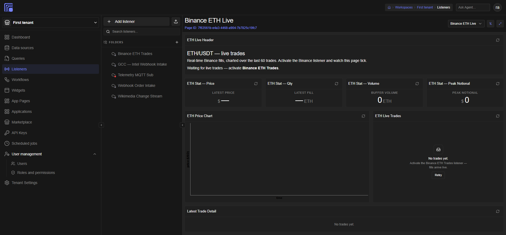
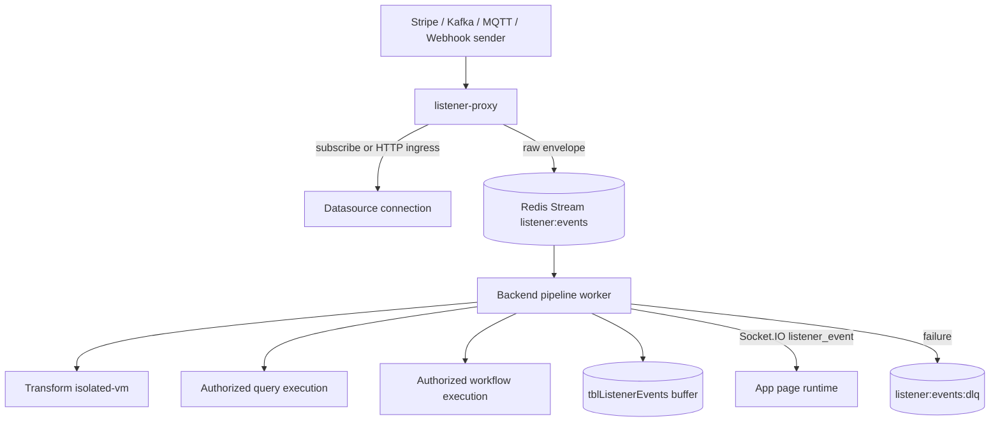

# Listeners

A **listener** subscribes to a listener-capable datasource and runs an ordered **pipeline** for every event: transform it, persist it, trigger a query or workflow, and/or push it to an app page. Listeners are the event-driven entry point of Jet Admin; workflows and queries are the units of work they call.



## Architecture



The backend does not hold subscriptions itself. The standalone **listener-proxy** owns stateful subscriptions and webhook ingress. The backend consumes raw events from the Redis Stream consumer group `listener-workers`. This lets you scale proxy and backend workers independently.

## Core concepts

| Concept | Meaning |
|---|---|
| `listenerType` | The datasource type being listened to, e.g. `webhook`, `kafka`, `postgresql`. The editor sets it from the selected datasource. |
| `listenerConfig` | Source-specific settings (topic, channel, path suffix, etc.). Masked in API responses like datasource options. |
| Ingress | How events arrive: webhook HTTP, broker subscription, database notification, WebSocket/SSE, syslog, etc. |
| Pipeline | Ordered `tblListenerActions` rows (`orderIndex`, then `actionID`). Disabled rows are skipped. |
| Transform | Sandboxed JavaScript (`isolated-vm`, 100 ms, 16 MB) that receives `event` and returns the event to pass downstream. Returning `null`/`undefined` filters the event. |
| Buffer | `save_to_buffer` persists events to `tblListenerEvents` under a named buffer with count/time retention. Used for replay/history and durable application observation. |
| Live push | `push_to_app_page` emits a Socket.IO `listener_event` to `listener:app_page:<appPageID>`. |
| Active/inactive | `status` controls whether the proxy should subscribe/register ingress. Activation is a hot reload; the proxy is told via Redis control messages. |
| Definition hash | Hash of config + enabled actions attached to envelopes so processing can be tied to the definition that received the event. |
| Delivery semantics | At-least-once. A worker ACKs the stream entry after processing; stale pending entries can be reclaimed, so dispatches should be idempotent. |

## Listener-capable sources

Only the following 13 types expose `listenerConfigForm` and `supportsListener: true`.

| Type | Required/important listener config |
|---|---|
| `postgresql` | `channels` — comma-separated `LISTEN` channels. |
| `firestore` | `collection`; optional `documentId` for one document. |
| `mongodb` | `collection` (empty = entire database); optional `operationTypes[]` (`insert`, `update`, `replace`, `delete`, `invalidate`, `drop`, `dropDatabase`, `rename`). |
| `graphql` | `subscription` document; optional `variables` JSON. |
| `rabbitmq` | `exchange`, `exchangeType` (`direct`/`topic`/`fanout`/`headers`), `routingKey` (default `#`), optional `queue`, `prefetch`. |
| `kafka` | `topic`; optional `consumerGroup` (default `jet-listener`), `fromBeginning` (default `false`). |
| `redis` | `subscriptionType` (`pubsub` or `stream`), `channels` or `stream`; stream mode supports `consumerGroup`, `consumerName`. |
| `webhook` | `pathSuffix` (custom URL), `responseStatusCode` (default `200`), `responseBody` (default `{"ok":true}`). |
| `mqtt` | `topics` (comma-separated, wildcards `#`/`+`), `qos` (`0`/`1`/`2`). |
| `websocket` | Optional `messageFilter`, `parseAsJSON` (default `true`). |
| `sse` | Optional `eventTypes` (comma-separated), `parseAsJSON` (default `true`). |
| `syslog` | `severityFilter` (default `all`), optional `facilityFilter`, `hostnameFilter`. |
| `nats` | `subjects` (comma-separated, wildcards), optional `queueGroup`. |

Source configs are validated by the connector's `subscribe()` implementation. The editor renders the JSON Schema from `GET /listeners/schemas?datasourceType=<type>`.

### Webhook authentication lives on the datasource

For `webhook` listeners, the request method/auth settings are stored on the **Webhook datasource**, not on the listener config:

| Datasource field | Values |
|---|---|
| `allowedMethods` | `POST`, `PUT`, `GET`, `ANY` (default `POST`). Note the form lists a single value; the runtime normalises strings/arrays. |
| `authType` | `none`, `basic`, `bearer`, `header`, `query_param`. |
| `username` / `password` | Basic auth. |
| `bearerToken` | Bearer auth. |
| `authHeaderName` | Header name or query-param name for `header`/`query_param`. |
| `authSecret` | Expected secret value. |

This is **shared-secret validation**, not provider-specific HMAC verification. If a provider (for example Stripe) signs payloads, verify the signature inside a transform or at an upstream gateway; the built-in header check only compares a static value.

## Create a listener

1. Open **Listeners**.
2. Choose **Add listener**.
3. Enter a title and optional description.
4. Choose the status (`inactive` or `active`). Creating as active immediately asks the proxy to subscribe.
5. Select a listener-capable datasource.
6. Fill in the generated listener configuration.
7. Optionally add an initial transform script.
8. Save.
9. On the listener page, add **Pipeline Steps** (transform, query, workflow, buffer, app page).
10. Use **Activate** / **Deactivate** to control ingestion. The live test panel streams the last 20 raw and transformed events.

Create payload:

```http
POST /api/v1/tenants/:tenantID/listeners HTTP/1.1
Authorization: Bearer <firebase-id-token>
Content-Type: application/json

{
  "listenerTitle": "Stripe payments",
  "listenerDescription": "Payment events from Stripe",
  "datasourceID": "9a7d3f2e-1c4b-4a6d-8e0f-2b3c4d5e6f70",
  "listenerType": "webhook",
  "listenerConfig": {
    "pathSuffix": "stripe-events",
    "responseStatusCode": 200,
    "responseBody": "{\"received\":true}"
  },
  "status": "inactive",
  "pipelineSteps": []
}
```

`pipelineSteps` is optional and accepts `{ type, config }` or `{ actionType, actionConfig }` shapes. After creation, the API response includes an `ingress` object with the public base URL, health URL, and (for webhooks) the available webhook URLs.

## Configuration reference

### Listener fields

| Field | Type | Required | Notes |
|---|---|---|---|
| `listenerTitle` | String, 1–255 | Yes | Display name. |
| `listenerDescription` | String | No | Free text. |
| `datasourceID` | UUID | Yes | Must belong to the tenant and be listener-capable. |
| `listenerType` | String | Yes | Canonical datasource type; UI derives it from the datasource. |
| `listenerConfig` | Object | No | Defaults to `{}`; schema depends on type. |
| `status` | `active` / `inactive` | No | Default `inactive`. |
| `endpointPath` | String | No | Optional legacy/bundle path hint; webhook ingress uses `listenerConfig.pathSuffix`. |
| `transformScript` | String | No | Convenience field that creates/updates a `transform` action at `orderIndex: 0`. |
| `folderID` | UUID | No | Folder placement. |

### Pipeline action types

| `actionType` | Purpose | Key `actionConfig` fields |
|---|---|---|
| `transform` | Reshape/filter the event in JS. | `script` |
| `trigger_workflow` | Start a workflow with mapped inputs. | `workflowID`, `inputValues` |
| `trigger_query` | Execute a data query with mapped inputs. | `dataQueryID`, `inputValues` |
| `save_to_buffer` | Persist the current event. | `bufferName` (default `default`), `retentionPolicy` (`count`/`time`/`both`), `maxEvents`, `maxAgeHours` |
| `push_to_app_page` | Emit to a page's listener channel. | `appPageID`, `channelName` (default `listener:<listenerID>`), `mode` (`replace`/`append`/`prepend`), `maxArrayLength` (default 1000) |

All actions have `isEnabled` and `orderIndex`. The worker always re-reads enabled actions from the database (5-second cache), so pipeline edits apply to in-flight events without redeploying.

### Transform contract

```js
// `event` is the raw event for the first transform, or the previous
// transform's output for later transform steps.
return {
  id: event.id,
  type: event.body?.type ?? "unknown",
  amount: event.body?.data?.object?.amount ?? 0,
  currency: event.body?.data?.object?.currency ?? "usd"
};
```

- Runs in `isolated-vm` with a 100 ms timeout and 16 MB memory limit.
- Returning `null` or `undefined` **filters** the event and stops the pipeline.
- A thrown error stops the pipeline (no downstream dispatch).
- Network, filesystem, `require`, and npm modules are not available.
- Later steps see the transformed event under `event`; mapping templates use `{{event.*}}`.

### Buffer retention

`save_to_buffer` inserts into `tblListenerEvents` and then enforces retention asynchronously:

- `retentionPolicy: "count"` keeps the newest `maxEvents` rows for that listener + buffer.
- `retentionPolicy: "time"` deletes rows older than `maxAgeHours`.
- `both` applies both rules.
- Invalid/zero values skip that retention rule (no unbounded delete).

There is no automatic retention sweep for buffers that stop receiving events; the last save performs the cleanup.

## End-to-end example: webhook → transform → buffer → workflow

### 1. Webhook datasource

```json
{
  "datasourceTitle": "Stripe inbound",
  "datasourceType": "webhook",
  "datasourceOptions": {
    "connectionName": "stripe-inbound",
    "allowedMethods": "POST",
    "authType": "header",
    "authHeaderName": "x-jet-signature",
    "authSecret": "<shared-secret>"
  }
}
```

### 2. Listener + pipeline

```http
POST /api/v1/tenants/:tenantID/listeners HTTP/1.1
Authorization: Bearer <firebase-id-token>
Content-Type: application/json

{
  "listenerTitle": "Stripe payments",
  "datasourceID": "9a7d3f2e-1c4b-4a6d-8e0f-2b3c4d5e6f70",
  "listenerType": "webhook",
  "listenerConfig": {
    "pathSuffix": "stripe-events",
    "responseStatusCode": 202,
    "responseBody": "{\"received\":true}"
  },
  "status": "active",
  "pipelineSteps": [
    {
      "type": "transform",
      "config": {
        "script": "return { id: event.body?.id, type: event.body?.type, amount: event.body?.data?.object?.amount ?? 0, currency: event.body?.data?.object?.currency ?? 'usd' };"
      }
    },
    {
      "type": "save_to_buffer",
      "config": {
        "bufferName": "stripe-payments",
        "retentionPolicy": "count",
        "maxEvents": 5000
      }
    },
    {
      "type": "trigger_workflow",
      "config": {
        "workflowID": "f0e1d2c3-b4a5-4968-8778-695a4b3c2d1e",
        "inputValues": {
          "paymentID": "{{event.id}}",
          "eventType": "{{event.type}}",
          "amount": "{{event.amount}}",
          "currency": "{{event.currency}}"
        }
      }
    }
  ]
}
```

### 3. Send an event

```bash
curl -X POST "https://hooks.example.com/webhooks/v1/inbound/<tenantID>/stripe-events" \
  -H "Content-Type: application/json" \
  -H "x-jet-signature: <shared-secret>" \
  -d '{
    "id": "evt_123",
    "type": "payment_intent.succeeded",
    "data": { "object": { "amount": 4999, "currency": "usd" } }
  }'
```

Response: HTTP `202` with `{"received":true}`.

### 4. What happens

1. The proxy authenticates the header and invokes the listener callback.
2. The raw event is published to `listener:events`.
3. A backend worker resolves enabled actions, applies the transform, saves the buffer row, and calls the workflow with mapped inputs.
4. The listener's `lastEventAt` and `eventCount` increment once at least one dispatch action succeeds.
5. If the caller sees a non-2xx/503, the event was not durably accepted; retry is safe from the sender's perspective, but downstream actions may already have run if a later action failed.

Webhook URL forms:

| URL | When to use |
|---|---|
| `https://<proxy>/webhooks/v1/inbound/<tenantID>/<pathSuffix>` | Preferred when a suffix is configured. |
| `https://<proxy>/webhooks/v1/inbound/<listenerID>` | Always available fallback. |

The base URL comes from `LISTENER_PROXY_PUBLIC_URL`; when unset it falls back to `http://localhost:<LISTENER_PROXY_PORT>` (default `8095`). Health: `GET <base>/health`.

## Runtime and delivery behaviour

- **Ingress:** stateful subscriptions are sharded across proxies. Webhook ingress is stateless and served by every proxy (anycast).
- **Queue:** Redis Stream `listener:events`, consumer group `listener-workers`, approximate max length `LISTENER_STREAM_MAXLEN` (default 10,000). Failures go to `listener:events:dlq` for manual replay.
- **Action order:** `orderIndex` ascending, then `actionID`.
- **Transform errors:** break the pipeline. **Dispatch errors:** caught and logged; remaining actions continue.
- **Metadata:** `eventCount`/`lastEventAt` update only when at least one dispatch action ran successfully; filtered/aborted/all-disabled events do not inflate counts.
- **Retries:** unexpected processing failures are not retried inline; the envelope moves to the DLQ. Redis consumer pending entries are reclaimed after five minutes, so long-running dispatches can be processed twice.
- **Live testing:** clients join `listener_test:<listenerID>`; the UI displays up to 20 recent raw/transformed events.
- **Live app delivery:** clients join `listener:app_page:<appPageID>` (authorized by socket auth); events are emitted as `listener_event` with data, mode, limit, and timestamp.
- **Hot reload:** create/update/delete/action changes call the proxy through Redis control messages; if Redis is unavailable, the database change succeeds but the proxy may be stale until reconnect/resync.

:::warning
Do not use `save_to_buffer` as a transactional outbox. It persists the event, but dispatch to workflows/queries is a separate side effect. Design actions to be idempotent (dedupe keys, upserts) because stream delivery is at-least-once.
:::

## API and permissions

Mounted at `/api/v1/tenants/:tenantID/listeners`.

| Method | Path | Permission | Notes |
|---|---|---|---|
| `GET` | `/status/connections` | `listener:read` | Proxy placement/health. |
| `GET` | `/schemas` | `listener:list` | Listener schemas, optionally `?datasourceType=`. |
| `GET` | `/` | `listener:list` | List with `search`, `page`, `pageSize`, `folderID`. |
| `POST` | `/` | `listener:create` + `datasource:read` + pipeline `workflow:execute`/`dataquery:execute` | Create; grants creator access. |
| `GET` | `/:listenerID` | `listener:read` | Fetch one with actions and `ingress`. |
| `PUT` | `/:listenerID` | `listener:update` + optional datasource/pipeline permissions | Update; title/type/config are optional in the body validator. |
| `DELETE` | `/:listenerID` | `listener:delete` | Stops proxy registration and cascades actions/events. |
| `GET` | `/:listenerID/export` | `listener:export` | Bundle export. |
| `POST` | `/:listenerID/clone` | `listener:create` + `listener:read` + pipeline permissions | Clone as `inactive`. |
| `POST` | `/:listenerID/activate` | `listener:update` | Set active and reload. |
| `POST` | `/:listenerID/deactivate` | `listener:update` | Set inactive and unregister. |
| `POST` | `/:listenerID/actions` | `listener:update` + pipeline permissions | Add step. |
| `PUT` | `/:listenerID/actions/:actionID` | `listener:update` + pipeline permissions | Update/reorder step. |
| `DELETE` | `/:listenerID/actions/:actionID` | `listener:update` | Delete step. |

Pipeline permissions are extracted from the submitted `pipelineSteps`/actions: a `trigger_workflow` step requires `workflow:execute`, and a `trigger_query` step requires `dataquery:execute`, on the referenced resource. A listener can therefore require more than `listener:*` to create or edit.

## Use cases

| Scenario | Pattern |
|---|---|
| Payment webhooks | `webhook` listener + transform + buffer + workflow approval. |
| Live dashboard | Kafka/MQTT/WebSocket listener + `push_to_app_page` + app-page listener data source. |
| Audit stream | Broker listener + `save_to_buffer` with time retention. |
| Cache invalidation | Postgres `LISTEN` or Redis pub/sub + `trigger_query` that refreshes a materialized view. |
| IoT alerting | MQTT listener + transform threshold + `trigger_workflow` with notification step. |
| Log ingestion | Syslog listener + severity filter + buffer, no workflow per event. |

## Limitations and failure modes

| Failure | Cause / handling |
|---|---|
| Listener shows active but no events | The proxy may not have subscribed (Redis/control unavailable), the source connection is down, or the datasource is not listener-capable. Check `GET /status/connections`, proxy `/health`, and `lastError`. |
| `404 Webhook listener not found or inactive` | Wrong suffix/listener ID, listener is inactive, or the proxy has not loaded the listener. |
| `401` from webhook | Header/basic/bearer/query secret does not match the Webhook datasource config. |
| `405` from webhook | HTTP method not in `allowedMethods`. |
| Duplicate downstream actions | At-least-once stream delivery (pending reclaim) or sender retries. Add idempotency keys/upserts. |
| Transform silently drops all events | Script returns `null`/`undefined`, or throws (throws stop the pipeline). Check the live test panel's `transformError`. |
| Buffer grows without bound | Retention policy is missing or values are zero/invalid; set `maxEvents`/`maxAgeHours`. |
| `push_to_app_page` does nothing | No app page connected to `listener:app_page:<appPageID>`; `appPageID` missing/wrong; socket auth rejected the join. |
| Two listeners with the same webhook suffix | `tblListeners` has a unique `(tenantID, endpointPath)` constraint, but `pathSuffix` is not database-unique; the router key can be overwritten by the later subscription. Keep suffixes unique per tenant. |
| Workflow/query not triggered | Action disabled, missing permission at create/update time, referenced resource belongs to another tenant (rejected), or actionConfig input mapping is invalid. |
| Event count unchanged | No dispatch action succeeded; transforms may have filtered the event or all actions are disabled. |

## Security notes

- Ingress endpoints are **public** except for the configured webhook secret; there is no tenant bearer authentication on `/webhooks/*`. Protect suffixes and secrets like credentials.
- The built-in webhook check is a static shared secret, not HMAC signature verification. Verify provider signatures separately when required.
- Listener actions execute with a **system** execution context: the referenced workflow/query is trusted without a per-user Casbin check. Restrict who can create/edit listeners and asset permissions accordingly.
- Transform scripts are sandboxed, but they process untrusted input. Avoid logging full payloads; payloads may contain PII.
- `listenerConfig` secrets are masked in API responses and encrypted in the datasource options; do not put secrets in titles/descriptions.
- Webhook body limit is 5 MB at the listener-proxy (`EXPRESS_REQUEST_SIZE_LIMIT`), even though the shared router is configured for 10 MB.

## Troubleshooting

1. **Check proxy health** at `LISTENER_PROXY_PUBLIC_URL/health` and the tenant `GET /listeners/status/connections`.
2. **Open the listener's live test panel** and send one event; inspect raw vs transformed payload and `transformError`.
3. **Check `lastError`** on the listener row; subscription failures record the connector error.
4. **Verify the webhook URL** (tenant + suffix vs direct listener ID) and that the listener is active.
5. **Check permissions on pipeline resources** — editing a step can require workflow/query execute rights.
6. **Check the DLQ** (`listener:events:dlq`) for envelopes that failed processing.
7. **Check the buffer** in `tblListenerEvents` and retention settings if downstream apps see no history.

## Related pages

- [Data Source](../data-source/data-source.md) — create the underlying listener-capable connection.
- [Data Query](../data-query/data-query.md) — `trigger_query` action targets.
- [Workflows](../workflows/workflows.md) — `trigger_workflow` action targets and approval flows.
- [App Pages & Widgets](../app-pages-widgets/app-pages-widgets.md) — listener data sources and live delivery.
- [Identity & Access Management](../identity-access-management/identity-access-management.md) — listener/execute/observe permissions.
- [Observability](../operations/observability.md) — Redis streams, DLQ, and listener health.
- [Configuration Reference](../operations/configuration-reference.md) — proxy URL, Redis, and body limits.
