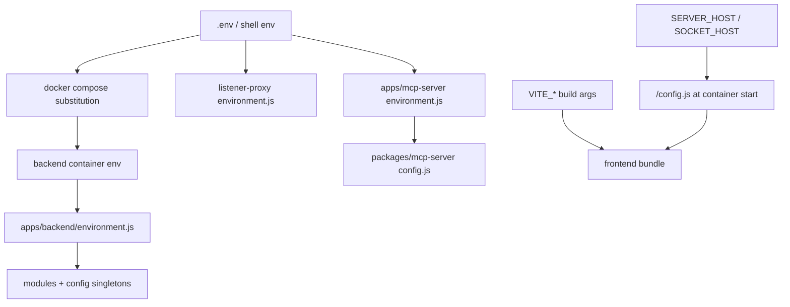

# Configuration Reference

This page lists the environment variables the checked-in code actually reads. It is derived from `apps/backend/environment.js`, `apps/backend/config/*.js`, `apps/frontend/src/constants.js`, `apps/frontend/src/config/*`, `apps/listener-proxy/environment.js`, `apps/mcp-server/environment.js`, `packages/mcp-server/src/config.js`, the Dockerfiles, entrypoints, and `docker-compose*.yml`.

:::info Code wins
`.env.docker` is a template, not a schema. Where its comments and the code disagree, the code is authoritative. A few known drifts are called out below instead of being presented as working configuration.
:::

There is **no root `.env.example`**. The supported templates are:

| File | Use |
|---|---|
| `.env.docker` | Compose template; copy to `.env` before `docker compose up` |
| `.env.docker.local` | Optional local override passed with `--env-file`; do not commit secrets |
| `apps/backend/.env` | Manual backend runs (`environment.js` calls `dotenv`) |
| `apps/listener-proxy/.env` | Manual listener-proxy runs |
| `apps/mcp-server/.env` | HTTP MCP server |
| `packages/mcp-server/.env` | stdio MCP server |

## How configuration is loaded

- **Backend:** `environment.js` is the only sanctioned reader of `process.env`. It loads `apps/backend/.env` without overriding real container environment. Some Temporal and application files still read `process.env` directly; those exceptions are listed with their variables.
- **Frontend:** every `VITE_*` variable is **build-time**. `docker compose build` passes build args, and Vite inlines them. `SERVER_HOST` and `SOCKET_HOST` are special: `docker-entrypoint.frontend.sh` writes `window.__JET_ADMIN_CONFIG__` to `/config.js` at startup, so changing them needs a container restart, not a rebuild. If both are empty, the app falls back to `window.location.origin` in production and `http://localhost:8090` in dev.
- **Compose:** `docker compose` reads `.env` for `${VAR}` substitution. `.env.docker` is not loaded automatically. `SEED_DATABASE`, `NGINX_PORT`, `NODE_PORT`, and `CLIENT_MAX_BODY_SIZE` are consumed by shell entrypoints, not Node.
- **MCP:** the stdio server reads its own package `.env`; the HTTP wrapper reads `apps/mcp-server/.env` first, then delegates tool configuration to `packages/mcp-server/src/config.js`.

## Backend — core runtime

| Variable | Required | Default | Purpose | Security / failure notes |
|---|---|---|---|---|
| `NODE_ENV` | no | `development` | Selects environment mode. | `test` exposes the `authProviderTest` helper (not currently mounted) and changes test behavior. Never set `test` in production. |
| `NODE_ID` | **not read** | computed: `dev_node_1` in development, `prod_node_1` otherwise | Prefix for rotated log files: `logs/<NODE_ID>-<date>.log`. | It is derived from `NODE_ENV`; setting `NODE_ID` in Compose has no effect. Multiple prod replicas write the same filename prefix and will collide on a shared log volume. |
| `PORT` | no | `8090` (backend code) | Node listener port. | In Compose the entrypoint rewrites this: nginx listens on `$NGINX_PORT` (`3000`) and Node on `127.0.0.1:$NODE_PORT` (`3001`). Health probes must target nginx's port. |
| `ENABLED_MODULES` | no | `auth,tenant` | Comma-separated module allowlist (no spaces). Dependencies must also be enabled. | Only routers that call `isModuleEnabled()` are gated. `audit`, `folder`, `bundle`, `widget-library`, `marketplace`, `templates`, and `applications` are mounted unconditionally under the tenant router. Entries such as `dashboard` and `permission` are not module constants and have no gating effect. |
| `DATABASE_URL` | **yes** | — | Prisma PostgreSQL connection string. | Boot fails if Prisma cannot connect. In Compose the default points at the bundled `postgres` service; external DB users should omit `postgres` from the `up` service list. |
| `REDIS_URL` | **yes** for listener pipeline / multi-replica | empty | ioredis URL shared by the listener Streams bus, cron locks, and the Socket.IO adapter. | `initializeQueue()` throws when unset, but startup catches the error and continues in a degraded API-only mode. Without Redis there is no listener ingestion and no cross-replica Socket.IO fan-out; cron falls back to a per-process guard. If Redis is configured but unreachable, cron fails closed unless `CRON_LOCK_FAIL_OPEN=true`. |
| `EXPRESS_REQUEST_SIZE_LIMIT` | no | `5mb` | JSON and urlencoded body limit. | Does not apply to multipart uploads, which use a separate 10 MB multer cap. |
| `CORS_WHITELIST` | no | `http://localhost:3000,http://localhost:5173,http://127.0.0.1:3000,http://127.0.0.1:3001,http://localhost:3001` | Exact-match browser origins, comma-separated. Trimmed and empty entries removed. | `/webhooks` uses open CORS by design and ignores this list. A missing origin header is allowed for server-to-server calls. Add every public frontend origin; include the scheme and non-default port. |
| `BACKEND_URL` | no | — | Public backend base URL. | Used for Google OAuth redirect URI and as the OpenRouter `HTTP-Referer` fallback. Behind TLS this must be `https://...`, otherwise OAuth redirects and provider headers are wrong. |
| `APPLICATION_CURSOR_SECRET` | no | falls back to `VAULT_ENCRYPTION_KEY` | HMAC key for application listener cursors. | Read directly from `process.env` in `application.listenerRuntime.js`, not `environment.js`. If neither secret is set, listener observation returns `503 APPLICATION_CURSOR_UNAVAILABLE`. This is a key-purpose fallback and is not ideal; set a dedicated secret. |
| `CRON_LOCK_FAIL_OPEN` | no | unset (fail closed) | When `true`, a cron run proceeds without a Redis distributed lock if Redis is unreachable. | Read directly in `cronJobEngine`. Leave unset in multi-replica deployments: fail-open can duplicate scheduled workflow runs. |

## Backend — auth, secrets, OAuth

| Variable | Required | Default | Purpose | Security / failure notes |
|---|---|---|---|---|
| `FIREBASE_CREDENTIALS` | **yes** for Firebase user auth | — | Firebase service-account JSON blob, usually one line. | `verifyIdToken` fails for every Bearer request if missing or malformed. The MCP HTTP server also exits at boot without it. Never expose this JSON to the browser. |
| `VAULT_ENCRYPTION_KEY` | **yes** for vault, datasource secrets, OAuth, AI tenant keys | — | 32-byte hex key (64 hex chars) for AES-256-GCM. | Losing or changing the key makes existing `tblVaultCredentials` and encrypted datasource options unreadable. There is no rotation automation. Validate length: the code throws if it is not exactly 32 bytes. |
| `OAUTH_STATE_SECRET` | **yes** when Google OAuth is enabled | — | Signs short-lived (10 min) OAuth `state` JWTs. | No fallback. Missing secret makes OAuth URL generation/callback verification fail. Use a dedicated random value. |
| `GOOGLE_CLIENT_ID` / `GOOGLE_CLIENT_SECRET` | **yes** when Google OAuth is enabled | — | Google OAuth client pair. | Stored as workspace config and mirrored into the vault helper. Treat the secret as deployment-sensitive; the callback is public but state-signed. |

## Backend — AI (Jet Agent)

| Variable | Required | Default | Purpose | Security / failure notes |
|---|---|---|---|---|
| `OPENROUTER_API_KEY` | **yes** for workspace-wide agent | — | OpenRouter-compatible API key. | Tenant vault `ai_config` wins when configured. Without either, AI endpoints return `403 AI_DISABLED`. Do not put keys in tenant-facing exports. |
| `AI_BASE_URL` | no | `https://openrouter.ai/api/v1` | OpenAI-compatible endpoint. | Change only for a compatible gateway; the agent uses the OpenAI SDK shape. |
| `AI_MODEL` | no | `minimax/minimax-m3` | Primary model slug. | Fallback models are tried on retryable failures. |
| `AI_FALLBACK_MODELS` | no | three free Nemotron/GLM slugs | Comma-separated fallback slugs. | Parsed and trimmed; empty entries removed. |
| `OPENROUTER_HTTP_REFERER` | no | `BACKEND_URL` or `http://localhost:8090` | OpenRouter attribution header. | Set to the public app URL in production. |
| `OPENROUTER_APP_TITLE` | no | `Jet Admin` | OpenRouter dashboard label. | Informational. |
| `AI_MAX_STEPS` | no | `25` | Maximum agent tool-call steps per request. | Direct MCP clients are not limited by this; it only bounds the backend agent loop. |
| `AI_TEMPERATURE` | no | `0.2` | Parsed for compatibility. | **Not consumed** by the current `ai.service.js` model calls; changing it has no effect. |
| `MCP_SERVER_URL` | no | `http://localhost:<MCP_SERVER_PORT>` | URL the backend agent uses for MCP tool calls. | Compose sets `http://mcp-server:5001`. Unreachable MCP yields `503 AI_TOOLS_UNAVAILABLE`; the rest of the app still works. |
| `MCP_SERVER_PORT` | no | `5001` | Port used to derive the default `MCP_SERVER_URL`. | It does **not** configure the standalone MCP HTTP server, which listens on `PORT`. |

## Backend — object storage

| Variable | Required | Default | Purpose | Security / failure notes |
|---|---|---|---|---|
| `S3_ENDPOINT` | **yes** for uploads | empty | Server-side S3-compatible endpoint (AWS, MinIO, RustFS). | Must be reachable from the backend container, not from the browser. Empty disables uploads with a clear error. |
| `S3_REGION` | no | `us-east-1` | S3 region. | MinIO/RustFS generally ignore it. |
| `S3_ACCESS_KEY_ID` / `S3_SECRET_ACCESS_KEY` | **yes** for uploads | empty | S3 credentials. | Do not reuse the RustFS console credentials for anything else. Rotate by updating both backend and `storage-init`/worker environments. |
| `S3_BUCKET` | no | effective default `jet-admin-datasource-file-uploads` | Upload bucket for datasource/widget files. | Code default is empty; `fileStorage` substitutes the datasource bucket. The tenant-assets bucket for logos is fixed in `constants.STORAGE.BUCKETS`. |
| `S3_PUBLIC_BASE_URL` | **yes** for uploads | empty | Browser-facing base URL used as `<base>/<bucket>/<key>`. | Upload writes the object, then `buildPublicUrl()` throws if this is empty, so the API call fails and can leave an orphan object. Do not point it at a private admin endpoint. |
| `S3_FORCE_PATH_STYLE` | no | `"true"` | Path-style addressing. | Set `"false"` for AWS virtual-hosted style; leave true for MinIO/RustFS. |

:::warning Public upload buckets
`storage-init` creates the upload buckets and attaches a **public-read** `s3:GetObject` policy so `S3_PUBLIC_BASE_URL` links render in browsers. Anyone with a URL can read the object. Do not upload secrets or private customer documents, or replace the policy with signed URLs.
:::

## Backend — logging and audit

| Variable | Required | Default | Purpose | Security / failure notes |
|---|---|---|---|---|
| `LOG_LEVEL` | no | `info` | File level: `error`, `warning`, `success`, or `info`. The console transport has no explicit level. | `warn` is not one of the custom levels. Invalid values can suppress or misroute logs. |
| `LOG_RETENTION` | no | `7` | Days of rotated files retained (`maxFiles: <n>d`). | Disk growth is bounded by retention × file size × replicas. |
| `LOG_FILE_SIZE` | no | `1` | Per-file size in MB (`<n>m`). | Too small creates many files; too large delays rotation. |
| `SYSLOG_HOST` | no | `127.0.0.1` | Syslog collector host. | An unreachable syslog target drops syslog only; file logging continues. |
| `SYSLOG_PORT` | no | `514` | Syslog port. | UDP/TCP depending on protocol. |
| `SYSLOG_PROTOCOL` | no | `udp4` | `udp4` or another `winston-syslog` protocol. | Syslog is plaintext unless your collector wraps it; do not send secrets (redaction runs first). |
| `SYSLOG_LEVEL` | no | `warning` | Syslog threshold. | With custom levels, `warning` excludes `success`/`info`. |

Audit logging has **no environment switch**. It is buffered in memory (50 entries, 5-second flush) and enabled on the tenant router and auth router. A crash can lose the last buffer window by design.

## Backend — listener pipeline and Redis Streams

| Variable | Required | Default | Purpose | Security / failure notes |
|---|---|---|---|---|
| `LISTENER_STREAM` | no | `listener:events` | Redis Stream for raw listener envelopes. | Must match the listener-proxy. |
| `LISTENER_GROUP` | no | `listener-workers` | Consumer group used by backend pipeline workers. | Competing consumers across replicas. Changing it starts a new group at `0` unless recreated; expect replay. |
| `LISTENER_DLQ_STREAM` | no | `listener:events:dlq` | Dead-letter stream for poison/infra-failed envelopes. | Manual replay only. Inspect before trimming. |
| `LISTENER_CONTROL_CHANNEL` | no | `listener:control` | Pub/sub control channel for proxy reload/remove signals. | Target channels are `listener:control:<proxyID>`. Best effort. |
| `LISTENER_PREFETCH` | no | `20` | `XREADGROUP COUNT` per read. | Higher values increase in-flight work per replica. |
| `LISTENER_STREAM_MAXLEN` | no | `10000` | Approximate `MAXLEN` for stream and DLQ. | Trimming is approximate (`~`); long outages can drop old events. |
| `LISTENER_PROXY_PORT` | no | `8095` | Port the listener-proxy listens on and the backend expects for ingress. | The proxy prefers `LISTENER_PROXY_PORT` over `PORT`; on Render set this explicitly if the platform injects `PORT`. |
| `LISTENER_PROXY_PUBLIC_URL` | no | empty | Public base URL advertised by a proxy for webhook registration guidance. | Shown in listener UI/API as `ingress`. This is the **proxy** URL, not the backend API URL. |

## Backend — Temporal workflows

Workflow execution is Temporal-only. The old native engine has been removed; `WORKFLOW_ENGINE_DRIVER` is still parsed into the environment object but no execution code consumes it.

| Variable | Required | Default | Purpose | Security / failure notes |
|---|---|---|---|---|
| `WORKFLOW_ENGINE_DRIVER` / `WORKFLOW_ENGINE` | no | `native` | Legacy compatibility value. | Parsed in `environment.js` but **not consumed** by the workflow service; setting `native` does not restore the removed engine. Temporal variables are what actually control execution. |
| `TEMPORAL_ADDRESS` | yes | `localhost:7233` | gRPC endpoint. | Compose uses `temporal:7233`. Read directly in `modules/workflow/temporal/config.js` and `client.js` too. |
| `TEMPORAL_NAMESPACE` | no | `default` | Temporal namespace. | Must match the worker. |
| `TEMPORAL_TASK_QUEUE` | no | `jet-admin-workflows` | Worker task queue. | Backend in-process worker and `temporal-worker` must use the same queue. |
| `TEMPORAL_API_KEY` | Cloud only | null | Temporal Cloud API key. | Presence enables TLS in the client. Read directly from `process.env`. Store as a secret. |
| `TEMPORAL_TLS` | Cloud/mTLS only | `"false"` | Enables TLS when `"true"`. | Also auto-enabled by `TEMPORAL_API_KEY` or a client cert. |
| `TEMPORAL_TLS_CERT` / `TEMPORAL_TLS_KEY` | mTLS only | null | **File paths** to client cert/key. | The code calls `fs.readFileSync`; these are paths inside the container, not PEM literals. |
| `TEMPORAL_TLS_CA` / `TEMPORAL_TLS_SERVER_NAME` | Cloud/mTLS only | null | CA file path and TLS server-name override. | Used when API-key auth/TLS is active. |
| `TEMPORAL_MAX_CONCURRENT_ACTIVITIES` / `TEMPORAL_MAX_CONCURRENT_WORKFLOWS` | no | `20` / `20` | Worker concurrency caps. | Raise with CPU/memory and Temporal task-queue capacity, not blindly. |
| `TEMPORAL_WORKER_START_MAX_ATTEMPTS` | no | `0` (infinite) | Startup retry attempts. | `0` means keep retrying forever; the sidecar entrypoint waits 120 s then starts anyway. |
| `TEMPORAL_WORKER_START_BASE_DELAY_MS` / `TEMPORAL_WORKER_START_MAX_DELAY_MS` | no | `1000` / `30000` | Exponential backoff window. | Applies to worker connection retries. |
| `TEMPORAL_WORKER_RESTART_ON_CRASH` | no | `"true"` | Supervisor restarts the worker after a crash. | Set `"false"` only when an external supervisor owns restarts. |
| `WORKFLOW_STALE_AFTER_MS` | no | `300000` (5 min) | Age threshold for selecting `RUNNING` instances for reconciliation. | Age is only a selection criterion. Reconciliation asks Temporal; it does not mark a durable run failed from database age alone. |
| `TEMPORAL_HUMAN_TIMEOUT` | no | `24 hours` | Default human-in-the-loop timeout. | Read directly in `temporal/config.js`; not exposed through `environment.js`. Duration string. |
| `TEMPORAL_WORKFLOW_TYPE` | no | `dslInterpreterWorkflow` | Temporal workflow type name. | Read directly in `temporal/config.js`. Changing it breaks existing starts unless names match. |

## Backend — module-specific direct reads

These are legitimate but bypass the `environment.js` convention:

| Variable | Read in | Notes |
|---|---|---|
| `APPLICATION_CURSOR_SECRET` | `application.listenerRuntime.js` | HMAC cursor key; falls back to `VAULT_ENCRYPTION_KEY`. |
| `CRON_LOCK_FAIL_OPEN` | `cronJobEngine/engine.js` | `true` allows runs without a Redis lock during an outage. |
| `TEMPORAL_*` | `temporal/config.js`, `temporal/client.js` | See the Temporal table. |
| `DATABASE_URL` | `marketplace/template.installer.js` | Uses a raw `pg` client for template installs. Keep it identical to Prisma's URL. |

## Frontend (`apps/frontend`)

| Variable | Required | Default | Purpose | Security / failure notes |
|---|---|---|---|---|
| `VITE_SERVER_HOST` / runtime `SERVER_HOST` | **yes** | dev `http://localhost:8090`; prod same-origin; runtime `/config.js` wins | REST base URL for every `src/data/apis/*` call. | Runtime `SERVER_HOST` is preferred, then baked `VITE_SERVER_HOST`, then same-origin. No trailing slash. |
| `VITE_SOCKET_HOST` / runtime `SOCKET_HOST` | **yes** | same as above | Socket.IO endpoint. | Runtime value wins. Wrong value means workflows/listeners/widgets show stale state. |
| `VITE_FIREBASE_API_KEY` | **yes** | none | Firebase web config. | `initializeApp` throws without it; blank white screen. These values are public client identifiers, not Admin credentials. |
| `VITE_FIREBASE_AUTH_DOMAIN` | **yes** | none | Firebase auth domain. | Must match the Firebase project used by the backend service account. |
| `VITE_FIREBASE_PROJECT_ID` | **yes** | none | Firebase project ID. | Same project as `FIREBASE_CREDENTIALS`. |
| `VITE_FIREBASE_STORAGE_BUCKET` | **yes** | none | Firebase storage bucket. | Only used by Firebase storage helpers; file uploads use S3. |
| `VITE_FIREBASE_MESSAGING_SENDER_ID` | **yes** | none | Firebase sender ID. | Required by `initializeApp`. |
| `VITE_FIREBASE_APP_ID` | **yes** | none | Firebase app ID. | Required by `initializeApp`. |
| `VITE_FIREBASE_MEASUREMENT_ID` | no | none | Analytics measurement ID. | Optional but part of the standard config block. |
| `VITE_WEBHOOK_PORT` | no | `8095` | Display-only hint in the realtime listener guidance box. | Does not change ingress routing. |

All `VITE_*` values are baked at build time. Rebuild the frontend image or pass new Compose `build.args` to change them. `VITE_SUPABASE_URL`, `VITE_SUPABASE_ANON_KEY`, `VITE_SUPABASE_KEY`, `VITE_USE_CRAFT_EDITOR`, `VITE_API_URL`, and `VITE_FIREBASE_CONFIG` are **not read** by the current frontend code.

## Listener proxy (`apps/listener-proxy`)

The proxy is a separate ingress process. It reuses backend engine/queue code but has its own environment module.

| Variable | Required | Default | Purpose | Security / failure notes |
|---|---|---|---|---|
| `NODE_ENV` | no | `production` | Runtime mode. | Does not change proxy behavior beyond logging/defaults. |
| `PORT` | no | — | Fallback listen port. | `LISTENER_PROXY_PORT` takes precedence. |
| `LISTENER_PROXY_PORT` | no | `8095` | Proxy HTTP port (webhooks, `/health`, control fallback). | Compose maps host `8095` to this. Set explicitly on platforms that inject `PORT`. |
| `DATABASE_URL` | **yes** | empty | Loads listener definitions and decrypts datasource options. | Must match the backend database. The proxy exits if unset. |
| `REDIS_URL` | **yes** | empty | Publishes raw envelopes to the stream and joins the proxy registry. | The proxy exits if unset; it also waits for Redis at boot. |
| `VAULT_ENCRYPTION_KEY` | **yes** for encrypted datasources | empty | Decrypts listener datasource options. | Must match the backend. A mismatch puts listeners in `error` state with an undecryptable-options error. |
| `PROXY_CONTROL_TOKEN` | no | null | Shared secret for the internal reload endpoint. | Set when the proxy port is reachable by anything other than the backend. |
| `LISTENER_PROXY_PUBLIC_URL` | no | empty | Advertised proxy URL in the registry. | Informational; does not affect routing. |
| `LISTENER_PROXY_WEIGHT` | no | `100` | Shard weight for listener assignment. | Higher weight takes a larger share. |
| `LISTENER_STREAM` / `LISTENER_GROUP` / `LISTENER_DLQ_STREAM` / `LISTENER_CONTROL_CHANNEL` | no | same as backend | Bus names. | Must match the backend when customized. |
| `LISTENER_PREFETCH` / `LISTENER_STREAM_MAXLEN` | no | `20` / `10000` | Bus tuning. | Must match the backend when customized. |
| `EXPRESS_REQUEST_SIZE_LIMIT` | no | `5mb` | Ingress body limit. | Large webhook payloads get 413. |
| `LOG_LEVEL` | no | `info` | Proxy log level. | Same custom levels as the backend. |

## MCP server

### HTTP wrapper (`apps/mcp-server`)

| Variable | Required | Default | Purpose | Security / failure notes |
|---|---|---|---|---|
| `PORT` | no | `5001` | HTTP listen port. | Render injects `PORT`; the Docker HEALTHCHECK uses `${PORT:-5001}`. |
| `JET_ADMIN_BACKEND_URL` | **yes** | — | Backend API base URL as seen from the MCP container. | Compose uses `http://backend:3000` (container port), not host `8090`. |
| `FIREBASE_CREDENTIALS` | **yes** | — | Firebase service account used to verify each request's Bearer token. | The container exits at boot if invalid. Use the same project as the backend. |
| `DEBUG` | no | `false` | Verbose stderr logging. | Never logs to stdout; stdout is the MCP protocol channel in stdio mode. |

### stdio package (`packages/mcp-server`)

| Variable | Required | Default | Purpose | Security / failure notes |
|---|---|---|---|---|
| `JET_ADMIN_BACKEND_URL` | **yes** | — | Backend API base URL. | `JET_ADMIN_BASE_URL` is accepted as a fallback. |
| `JET_ADMIN_API_KEY` | **yes** for stdio | — | Raw API key (the client adds the `api_key` prefix). | One process = one tenant + one key. Use a scoped key. |
| `JET_ADMIN_TENANT_ID` | **yes** for stdio | — | Tenant UUID all tools operate against. | Tool handlers never accept a different tenant. |
| `JET_ADMIN_FRONTEND_URL` | no | null | Frontend base URL for preview links. | Only affects `get_app_page_preview_url`. |
| `JET_ADMIN_TIMEOUT` | no | `30000` | HTTP timeout in ms. | Per backend request. |
| `JET_ADMIN_RETRIES` | no | `3` | Retry attempts for network/5xx/429 errors. | `0` disables retries. 4xx are not retried. |
| `JET_ADMIN_RETRY_DELAY` | no | `500` | Base delay in ms; doubles per attempt. | Caps are not configurable. |
| `DEBUG` | no | `false` | Debug logging to stderr. | Must remain stderr; stdout is JSON-RPC. |

## Compose-only and entrypoint variables

These are read by `docker compose`, the shell entrypoints, the Postgres/Redis images, or `storage-init` — not by the Node application.

| Variable | Default | Consumed by | Notes |
|---|---|---|---|
| `SEED_DATABASE` | Compose default `true`; `.env.docker` default `false` | `docker-entrypoint.backend.sh` | When `true`: `prisma db push` → manual migrations → `npm run seed`. Set `false` after initialization. The seed creates a fixed system user; review it before production use. |
| `NGINX_PORT` | `3000` in Compose, else `$PORT` or `3000` | backend entrypoint | Public nginx port inside the backend container. |
| `NODE_PORT` | `3001` | backend entrypoint | Internal Node port; Node sees `PORT=$NODE_PORT`. |
| `CLIENT_MAX_BODY_SIZE` | `10m` | backend nginx template | Request body cap at nginx. |
| `POSTGRES_USER` | `postgres` | postgres image + Compose URL | Not read by Node directly; `DATABASE_URL` is. |
| `POSTGRES_PASSWORD` | Compose fallback / `.env.docker` placeholder | postgres image + Compose URL | Set a strong value. Never reuse the sample. |
| `POSTGRES_DB` | `jet_admin_db` | postgres image + Compose URL | Database name. |
| `POSTGRES_HOST_PORT` | `5432` | Compose port mapping | Host debug port. Close it in production. |
| `REDIS_HOST_PORT` | `6379` | Compose port mapping | Host debug port. Redis has no password in the bundled compose. |
| `RUSTFS_ACCESS_KEY` / `RUSTFS_SECRET_KEY` | `rustfsadmin` | RustFS image | Change before exposing. Must match `S3_ACCESS_KEY_ID`/`S3_SECRET_ACCESS_KEY`. |
| `RUSTFS_S3_PORT` / `RUSTFS_CONSOLE_PORT` | `9000` / `9001` | RustFS image | S3 API and web console. |
| `MCP_PORT` / `MCP_HOST_PORT` | `5001` | MCP container / host mapping | `MCP_PORT` is passed as `PORT` to the MCP container. |
| `MCP_DEBUG` | `false` | MCP container | Passed as `DEBUG`. |
| `STORAGE_INIT_MAX_ATTEMPTS` | `30` | `storage-init.js` | Bucket bootstrap retries (2 s apart). |
| `VITE_WEBHOOK_PORT` | `8095` | frontend build arg | Display-only. |

## Profiles and minimal configurations

Compose profiles are opt-in service groups:

| Profile | Services | Command |
|---|---|---|
| none | frontend, backend, postgres, redis, listener-proxy, Temporal stack, temporal-worker | `docker compose up -d --build` |
| `storage` | rustfs, storage-init | `docker compose --profile storage up -d` |
| `mcp` | mcp-server | `docker compose --profile mcp up -d` |
| `tools` | temporal-admin-tools | `docker compose --profile tools up -d` |

A minimal **API-only** deployment can omit frontend, Temporal, listener-proxy, and MCP, but must still provide `DATABASE_URL` and—if listener/cron features are used—`REDIS_URL`. A minimal **workflow** deployment needs Temporal plus PostgreSQL. A deployment without S3 still renders the app, but all uploads fail.

:::warning Known configuration drift
- `NODE_ID` is computed, not read. Compose's `NODE_ID=docker_node_1` is dead configuration.
- `MCP_SERVER_PORT` only derives the backend URL; the MCP server itself uses `PORT`.
- `MCP_SERVER_URL` is backend-only. The HTTP MCP container has no variable telling it its own public URL.
- `VITE_SUPABASE_*`, `VITE_USE_CRAFT_EDITOR`, `VITE_API_URL`, and `VITE_FIREBASE_CONFIG` are stale docs names with no code path.
- `GEMINI_API_KEY`, `NVIDIA_API_KEY`, `JWT_*`, `SESSION_SECRET`, `RABBITMQ_*`, `SSL_CERT_CN`, `UNPOOLED_DATABASE_URL`, and `JET_ADMIN_INTERNAL_API_KEY` were removed. Do not re-add them as working configuration.
- `apps/mcp-server/.env.example` uses `FIREBASE_CREDENTIALS=''`; the container requires the actual JSON and exits otherwise.
:::

## Configuration review checklist

Before deploying:

- [ ] `DATABASE_URL` points at the intended database and uses TLS where required.
- [ ] `VAULT_ENCRYPTION_KEY` is exactly 64 hex characters and is backed up outside the database.
- [ ] `FIREBASE_CREDENTIALS` belongs to the same project as every `VITE_FIREBASE_*` value.
- [ ] `CORS_WHITELIST` and `BACKEND_URL` use the public HTTPS origins, with no trailing slash.
- [ ] `REDIS_URL` is reachable from backend, listener-proxy, temporal-worker, and any cron replica.
- [ ] `S3_*` matches the actual storage; the bucket policy is appropriate for the data classification.
- [ ] `ENABLED_MODULES` includes every dependency required by the modules you expose.
- [ ] Temporal variables match between backend, worker, and the Temporal server.
- [ ] `SEED_DATABASE=false` after the first successful boot.
- [ ] No real secrets are committed in `.env`, Compose files, or docs.

## Related pages

- [Deployment](./deployment.md) — Compose services, TLS, backups, upgrades, and rollbacks.
- [Observability](./observability.md) — log fields, health probes, audit, and failure modes.
- [Security](./security.md) — tenant isolation, Casbin, secrets, SSRF, and sandbox boundaries.
- [Local Setup](../getting-started/local-setup.md) — first-run commands.
