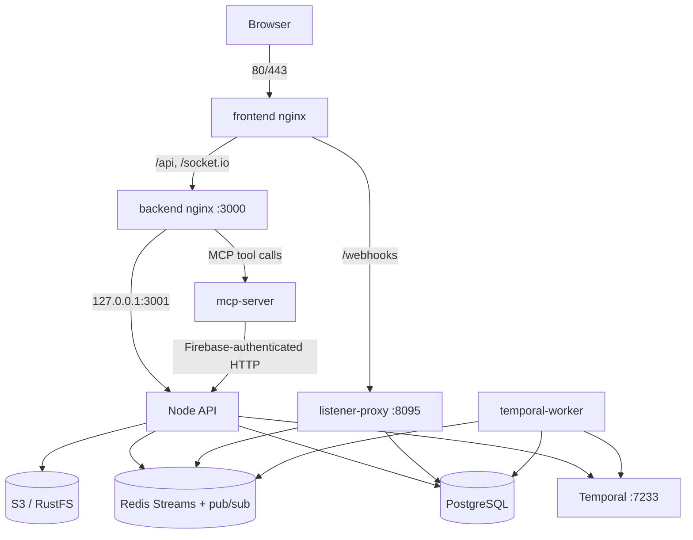

# Deployment

Jet Admin runs as a set of containers around a PostgreSQL system database. Redis carries the listener event bus and Socket.IO fan-out; Temporal executes workflows; a separate listener proxy owns inbound webhooks and datasource subscriptions. This page describes the checked-in Compose topology and the operational procedures around it.



## Deployment artifacts

| Artifact | Purpose |
|---|---|
| `docker-compose.yml` | Ready-to-run Compose with local defaults and the full Temporal stack |
| `docker-compose-sample.yml` | Same topology with `your_*` placeholder secrets; recommended starting point |
| `Dockerfile.frontend` | Node 20 build → `nginx:alpine`, SPA + same-origin proxy |
| `Dockerfile.backend` | Node 20-slim + internal nginx; Prisma; PM2; `/entrypoint.sh` |
| `Dockerfile.listener-proxy` | Node 20-slim; webhook ingress + subscription sharding |
| `Dockerfile.temporal-worker` | Node 20-slim; Temporal worker sidecar |
| `Dockerfile.mcp` | Node 20-slim; Streamable HTTP MCP server |
| `nginx.frontend.conf` | SPA fallback, `/health`, `/api`, `/socket.io`, `/webhooks` |
| `nginx.backend.conf` | Internal reverse proxy template rendered at container start |
| `docker-entrypoint.*.sh` | Port resolution, dependency waits, schema bootstrap, runtime config |

:::warning There is no Kubernetes manifest or Helm chart in this repository
The supported first-party paths are Docker Compose, single Docker images, Render-style container hosting, and Firebase Hosting for the static frontend. Treat any other orchestrator as custom work: you must reproduce the port contract, health checks, volumes, and entrypoint behavior described here.
:::

## Compose services

`docker-compose.yml` and `docker-compose-sample.yml` define the same services. The main file contains local demo values; the sample file uses placeholders.

| Service | Image / build | Host → container | Depends on | Healthcheck |
|---|---|---|---|---|
| `frontend` | `Dockerfile.frontend` | `80:80` | `backend` healthy | `wget --spider http://127.0.0.1/health`, 30 s |
| `backend` | `Dockerfile.backend` | `8090:3000` | `temporal` started; `redis` healthy; optional `rustfs` healthy | `wget --spider http://localhost:3000/health`, 30 s, start period 180 s, 10 retries |
| `postgres` | `postgres:15-alpine` | `${POSTGRES_HOST_PORT:-5432}:5432` | — | `pg_isready -U $POSTGRES_USER -d $POSTGRES_DB`, 10 s |
| `redis` | `redis:7-alpine` | `${REDIS_HOST_PORT:-6379}:6379` | — | `redis-cli ping`, 10 s |
| `listener-proxy` | `Dockerfile.listener-proxy` | `${LISTENER_PROXY_PORT:-8095}:8095` | `redis` healthy; optional `postgres` healthy | `wget --spider http://localhost:8095/health`, 30 s |
| `temporal-postgres` | `postgres:15-alpine` | `5433:5432` | — | `pg_isready -U temporal -d temporal`, 5 s |
| `temporal` | `temporalio/auto-setup:1.23` | `7233:7233` | `temporal-postgres` healthy | `tctl --address temporal:7233 cluster health \| grep SERVING`, 15 s |
| `temporal-ui` | `temporalio/ui:2.28.0` | `8088:8080` | `temporal` healthy | none |
| `temporal-worker` | `Dockerfile.temporal-worker` | no ports | `temporal` healthy; optional `rustfs` healthy | `pgrep -f modules/workflow/temporal/worker.js`, 30 s |
| `temporal-admin-tools` | `temporalio/admin-tools:1.23` | no ports | `temporal` healthy | none; profile `tools` only |
| `rustfs` | `rustfs/rustfs:latest` | `${RUSTFS_S3_PORT:-9000}:9000`, `${RUSTFS_CONSOLE_PORT:-9001}:9001` | — | `curl -f http://127.0.0.1:9000/health`, 15 s; profile `storage` |
| `storage-init` | `Dockerfile.backend` | one-shot | `rustfs` healthy | exits 0; profile `storage` |
| `mcp-server` | `Dockerfile.mcp` | `${MCP_HOST_PORT:-5001}:${MCP_PORT:-5001}` | `backend` healthy | `wget --spider http://localhost:${MCP_PORT:-5001}/health`, 30 s; profile `mcp` |

### Port contract inside the backend container

The backend image runs **two** listeners:

```text
host :8090  →  container nginx :3000  →  Node 127.0.0.1:3001
```

`docker-entrypoint.backend.sh` resolves the ports:

- `NGINX_PORT` defaults to `${PORT:-3000}`.
- `NODE_PORT` defaults to `3001`.
- `PORT` is re-exported as `NODE_PORT` before Node starts.
- The resolved nginx port is written to `/tmp/nginx_port` so the Docker `HEALTHCHECK` works even when a platform injects `PORT` (Render).
- `nginx.backend.conf` is rendered with `envsubst` limited to `NGINX_PORT`, `NODE_PORT`, and `CLIENT_MAX_BODY_SIZE`.

Health probes must target nginx, not Node. The Compose probe uses `http://localhost:3000/health`; the image probe reads `/tmp/nginx_port`.

### Volumes and network

| Volume | Mount | Contents |
|---|---|---|
| `jet-admin-postgres-data` | `/var/lib/postgresql/data` | System database |
| `jet-admin-redis-data` | `/data` | AOF/RDB for Streams, locks, Socket.IO adapter state |
| `jet-admin-backend-logs` | `/app/apps/backend/logs` | Winston rotated logs and backend nginx access/error logs |
| `jet-temporal-postgres-data` | `/var/lib/postgresql/data` | Temporal persistence and visibility |
| `jet-rustfs-data` | `/data` | Uploaded objects when the `storage` profile is used |

All services join the bridge network `jet-admin-network`. There is no mTLS or network policy inside this bridge: any compromised container can reach PostgreSQL, Redis, Temporal, and the backend. Segment at the platform level if that threat model matters.

## First boot

### Bundled database (evaluation / small self-host)

```bash
cp .env.docker .env
# Set VAULT_ENCRYPTION_KEY, FIREBASE_CREDENTIALS, VITE_FIREBASE_*, and a strong POSTGRES_PASSWORD.
# For a fresh database, set SEED_DATABASE=true.
docker compose -f docker-compose-sample.yml up -d --build
docker compose -f docker-compose-sample.yml ps
docker compose -f docker-compose-sample.yml logs -f backend
```

`SEED_DATABASE` is easy to miss: `.env.docker` ships it as `false`, while the Compose fallback is `true`. With `false`, the backend starts against an empty schema and every Prisma query fails. Set it to `true` for the **first** boot of a new database, then set it back to `false`.

When `SEED_DATABASE=true`, the backend entrypoint runs:

1. `npx prisma db push` — reconciles the database from `prisma/schema.prisma`.
2. `node scripts/run-manual-migrations.js` — applies pending files from `prisma/migrations/manual/`, tracked in `_manual_migrations`.
3. `npm run seed` — seeds permissions, built-in roles, and a fixed system user.

:::warning Not `prisma migrate deploy`
The repository keeps SQL history in `prisma/migrations/manual/` and has no standard Prisma migration directories. `prisma migrate deploy` is **not** used and would fail with P3015. Use the entrypoint or run the two commands above explicitly.
:::

### External database

Set `DATABASE_URL` to the external database and leave `postgres` out of the `up` service list. Nothing in Compose requires the bundled database; the backend entrypoint waits up to 60 seconds with `pg_isready` and then fails with a hint.

```bash
docker compose -f docker-compose-sample.yml up -d --build \
  frontend backend listener-proxy redis \
  temporal-postgres temporal temporal-ui temporal-worker
```

For a managed database, prefer TLS in the URL (for example `sslmode=require`) and restrict network access to the backend/worker egress addresses.

## Reverse proxy and TLS

Jet Admin containers speak plain HTTP. TLS must terminate at an edge proxy, load balancer, or platform router. The frontend nginx already serves the SPA and proxies API traffic, so the simplest public surface is a single HTTPS origin:

```text
https://app.example.com/            → frontend:80
https://app.example.com/api/        → frontend nginx → backend:3000
https://app.example.com/socket.io/  → frontend nginx WebSocket upgrade → backend:3000
https://app.example.com/webhooks/   → frontend nginx → listener-proxy:8095
```

Requirements for the edge proxy:

- Forward `Host`, `X-Real-IP`, `X-Forwarded-For`, and `X-Forwarded-Proto`. The backend enables Express `trust proxy`.
- Allow WebSocket upgrades for `/socket.io` and a long read timeout (the checked-in nginx uses 3600 s).
- Allow request bodies at least as large as `CLIENT_MAX_BODY_SIZE` (default `10m`) and `EXPRESS_REQUEST_SIZE_LIMIT` (default `5mb`).
- Do not cache `index.html`; hashed assets under `/assets/**` are immutable.
- Keep the backend, listener-proxy, MCP, PostgreSQL, Redis, and Temporal ports off the public internet.

An illustrative edge block (not shipped in the repo):

```nginx
server {
    listen 443 ssl http2;
    server_name app.example.com;

    ssl_certificate     /etc/letsencrypt/live/app.example.com/fullchain.pem;
    ssl_certificate_key /etc/letsencrypt/live/app.example.com/privkey.pem;

    client_max_body_size 10m;

    location / {
        proxy_pass http://127.0.0.1:8080;  # frontend container
        proxy_set_header Host $host;
        proxy_set_header X-Forwarded-For $proxy_add_x_forwarded_for;
        proxy_set_header X-Forwarded-Proto $scheme;
    }
    location /socket.io/ {
        proxy_pass http://127.0.0.1:8080;
        proxy_http_version 1.1;
        proxy_set_header Upgrade $http_upgrade;
        proxy_set_header Connection "upgrade";
        proxy_set_header Host $host;
        proxy_read_timeout 3600s;
        proxy_send_timeout 3600s;
    }
}
```

Set `BACKEND_URL=https://app.example.com` (or the API host, if separate) and include every browser origin in `CORS_WHITELIST`. If the frontend and API are on different origins, add both to the whitelist and use HTTPS URLs with no trailing slash.

:::warning Listener ingress is a separate public surface
Webhook senders must reach the listener proxy, not the backend API. Publish the proxy at a stable hostname and set `LISTENER_PROXY_PUBLIC_URL` so the UI guidance and listener API return the correct ingress URL. The proxy's `/webhooks` router is intentionally open-CORS and is protected by per-listener authentication; when `authType=none`, the configured `endpointPath`/`pathSuffix` is the only secret, so treat it as one.
:::

## Render and other container platforms

There is no `render.yaml` in the repository; configure services in the platform panel.

### Backend

- Build with `Dockerfile.backend`.
- Set the health check path to `/health`.
- The entrypoint adopts the platform's injected `PORT` as `NGINX_PORT`; Node still binds `127.0.0.1:3001`.
- Provide `DATABASE_URL`, `FIREBASE_CREDENTIALS`, `VAULT_ENCRYPTION_KEY`, `BACKEND_URL`, `CORS_WHITELIST`, `REDIS_URL`, `S3_*`, and `ENABLED_MODULES`.
- Add `OAUTH_STATE_SECRET`, `GOOGLE_CLIENT_ID`, and `GOOGLE_CLIENT_SECRET` only if Google sign-in is enabled.
- Add `TEMPORAL_ADDRESS`, `TEMPORAL_NAMESPACE`, and `TEMPORAL_TASK_QUEUE` if workflows are enabled. A private Temporal endpoint or Temporal Cloud is required; do not expose gRPC publicly.
- Do not enable `SEED_DATABASE` on every deploy.

### Listener proxy

- Build with `Dockerfile.listener-proxy`.
- Provide `DATABASE_URL`, `REDIS_URL`, `VAULT_ENCRYPTION_KEY`, and `PROXY_CONTROL_TOKEN`.
- Set `LISTENER_PROXY_PORT` explicitly if the platform injects `PORT`. The proxy's listen selection prefers `LISTENER_PROXY_PORT`, so a Render `PORT` alone is ignored and the default `8095` is used.
- Health check: `/health`.

### MCP

- Build with `Dockerfile.mcp`; health check `/health`.
- Provide `JET_ADMIN_BACKEND_URL` (the private backend URL) and `FIREBASE_CREDENTIALS`.
- Keep it private. The server verifies a Firebase Bearer token on every request, but it has no rate limiting and no built-in network allowlist.

### Frontend

- Build with `Dockerfile.frontend` and serve the resulting nginx image, or deploy `apps/frontend/dist` to a static host.
- Rebuild when `VITE_FIREBASE_*` or the build-time `VITE_SERVER_HOST`/`VITE_SOCKET_HOST` changes.
- If the frontend is on a different origin from the API, add it to `CORS_WHITELIST` and set `SERVER_HOST`/`SOCKET_HOST` to the public API URL at container runtime.

## Firebase Hosting

`apps/frontend/firebase.json` publishes `dist`, rewrites all routes to `index.html`, caches `/assets/**` immutably, and marks `index.html` no-cache.

```bash
cd apps/frontend
npm run build
npm run deploy
```

`npm run deploy` runs `vite build` and then `firebase deploy --only hosting`. The checked-in `.firebaserc` targets a default project; replace it or pass `--project` for your own Firebase project. Hosting only serves the SPA — the API, WebSockets, webhooks, and MCP remain separately hosted.

## Temporal

### Bundled stack

The main Compose file includes:

- `temporal-postgres` — separate persistence (host debug port `5433`).
- `temporal` — `auto-setup:1.23`, gRPC `7233`.
- `temporal-ui` — pinned `2.28.0`, host `8088`.
- `temporal-worker` — built from this repo, same `DATABASE_URL`, `REDIS_URL`, `FIREBASE_CREDENTIALS`, `VAULT_ENCRYPTION_KEY`, and `S3_*` as the backend.

The backend also starts an **in-process** Temporal worker from `startAllListeners()`. With the sidecar enabled, both workers poll the same task queue. That is valid Temporal behavior (competing workers) and increases throughput; it also means a backend replica consumes workflow tasks even if you intended the sidecar to be the only worker. Size `TEMPORAL_MAX_CONCURRENT_ACTIVITIES`/`WORKFLOWS` with that in mind.

### Standalone dev stack

```bash
npm run temporal:up      # docker compose -f docker-compose.temporal.yml up -d
npm run temporal:logs
npm run temporal:down
```

`docker-compose.temporal.yml` is for Temporal-only local development. Do not run it alongside the main Compose file: both use the `jet-admin-network` network name and host ports `7233`, `8088`, and `5433`.

### Temporal Cloud / secured cluster

Set:

- `TEMPORAL_ADDRESS` to `host:port`.
- `TEMPORAL_NAMESPACE` and `TEMPORAL_TASK_QUEUE`.
- `TEMPORAL_API_KEY` for Cloud, and/or `TEMPORAL_TLS=true`.
- `TEMPORAL_TLS_CERT`, `TEMPORAL_TLS_KEY`, `TEMPORAL_TLS_CA` as **file paths inside the container**.
- `TEMPORAL_TLS_SERVER_NAME` when the certificate name differs from the address.

The worker retries connection failures with exponential backoff. `TEMPORAL_WORKER_START_MAX_ATTEMPTS=0` means retry forever; the sidecar entrypoint prints a warning after 120 seconds but still starts the process so the built-in retry can take over.

## Backups

Back up four things: PostgreSQL, Temporal persistence, object storage, and the encryption/secrets material. A database dump without the vault key is not a restorable deployment.

### PostgreSQL

Bundled database:

```bash
mkdir -p backups
docker compose exec -T postgres pg_dump \
  -U "${POSTGRES_USER:-postgres}" \
  -d "${POSTGRES_DB:-jet_admin_db}" \
  -Fc > "backups/jet_admin_$(date +%Y%m%d_%H%M%S).dump"
```

External database: run the same `pg_dump -Fc` with the external connection string. Schedule it with your platform's backup service or a cron job outside the app; the repository ships no backup scheduler.

Restore into a stopped application:

```bash
docker compose stop backend temporal-worker listener-proxy
docker compose exec -T postgres pg_restore \
  -U "${POSTGRES_USER:-postgres}" \
  -d "${POSTGRES_DB:-jet_admin_db}" \
  --clean --if-exists < backups/jet_admin_YYYYMMDD_HHMMSS.dump
docker compose start backend temporal-worker listener-proxy
```

`pg_restore --clean --if-exists` drops and recreates objects. Test restores on a copy; never point the command at the wrong database.

### Temporal persistence

Temporal keeps workflow state in its own database. Back up both `temporal` and `temporal_visibility` if you use the bundled stack:

```bash
docker compose exec -T temporal-postgres pg_dump -U temporal -d temporal -Fc \
  > "backups/temporal_$(date +%Y%m%d).dump"
docker compose exec -T temporal-postgres pg_dump -U temporal -d temporal_visibility -Fc \
  > "backups/temporal_visibility_$(date +%Y%m%d).dump"
```

Workflow projections in the application database are not a substitute for Temporal history. Restoring only the app database can leave `RUNNING` projections without a corresponding Temporal execution; reconciliation will then report them as unknown.

### Redis

Redis holds the listener Stream + consumer group, the DLQ, cron locks, and Socket.IO pub/sub state. Streams are durable while the volume survives, but they are not the system of record. Back up the `redis_data` volume if you need the DLQ or unconsumed events:

```bash
docker compose exec redis redis-cli BGSAVE
# then snapshot/copy the redis_data volume with your platform tooling
```

`BGSAVE` writes an RDB snapshot into `/data`; AOF is also enabled by the Compose command. Cron locks carry TTLs and should not be restored into a running cluster.

### Object storage

Uploaded files live in S3-compatible storage, not in PostgreSQL. Use your storage tooling, for example:

```bash
aws s3 sync s3://your-upload-bucket "backups/s3/your-upload-bucket"
aws s3 sync s3://tenant-assets "backups/s3/tenant-assets"
```

The `tenant-assets` bucket holds tenant logos; the upload bucket holds datasource and widget files. Bucket names are defined in `constants.STORAGE.BUCKETS` and can be overridden for uploads with `S3_BUCKET`.

### Secrets

Back up, in a separate secret manager:

- `VAULT_ENCRYPTION_KEY` (required to decrypt vault rows and encrypted datasource options)
- `FIREBASE_CREDENTIALS`
- `OAUTH_STATE_SECRET`, `GOOGLE_CLIENT_SECRET`
- `S3_ACCESS_KEY_ID` / `S3_SECRET_ACCESS_KEY`
- `TEMPORAL_API_KEY` / TLS private keys
- `.env` or your platform's environment configuration

:::danger Losing the vault key is data loss
There is no automatic re-encryption or key escrow. If `VAULT_ENCRYPTION_KEY` is lost, stored datasource credentials, OAuth tokens, and tenant AI keys cannot be decrypted. Keep at least two offline copies and record which key version encrypted which backup.
:::

## Upgrades

### Pre-flight

1. Read the release notes and check for new manual migrations (`prisma/migrations/manual/`).
2. Take a PostgreSQL dump, a Temporal dump, and a storage snapshot.
3. Confirm the vault key and Firebase credentials are available outside the running containers.
4. Run the upgrade in staging against a restored copy of production data.

### Application upgrade

```bash
# 1. Fetch the new source or image.
git pull

# 2. Build new images before stopping the old stack.
docker compose build --pull

# 3. Stop writers while the schema changes.
docker compose stop backend temporal-worker listener-proxy

# 4. Apply schema changes with the NEW image.
docker compose run --rm --no-deps --entrypoint sh backend -lc \
  'cd /app/apps/backend && npx prisma db push && node scripts/run-manual-migrations.js'

# 5. Start the new stack.
docker compose up -d
```

`prisma db push` may refuse destructive changes without `--accept-data-loss`. Do not add that flag blindly: inspect the diff, take a backup, and prefer an explicit manual migration for anything that drops or rewrites data.

`SEED_DATABASE=true` also performs these steps, but it additionally runs the seed script. Use the one-off commands above for upgrades so seeding is a deliberate choice.

### Data migrations and compatibility

- Manual SQL applies in filename order and is tracked in `_manual_migrations`; it is forward-only.
- There are no down migrations. A rollback that crosses a schema change requires restoring the matching database dump.
- Deploy backend and `temporal-worker` together. Workers bundle activity code and can write projections that an older backend does not understand.
- The listener envelope format is versioned by `listenerDefinitionHash`; in-flight events may be rejected after a listener definition changes. That is intentional (stale-definition protection), not a reason to replay blindly.

### Rollback

**Code-only rollback** (no incompatible schema change):

```bash
docker compose down                 # keeps named volumes
git checkout <previous-release-tag>
docker compose up -d --build
```

Or, if you tag and publish images:

```bash
docker compose down
IMAGE_TAG=<previous> docker compose up -d
```

`docker compose down -v` deletes the database, Redis, logs, Temporal, and object-storage volumes. Do not use `-v` during a rollback unless you are intentionally destroying state.

**Rollback across a schema change:**

1. Stop backend, worker, and listener-proxy.
2. Restore the database dump taken before the upgrade.
3. Restore Temporal only if the upgrade changed workflow definitions or history compatibility; otherwise leave Temporal running.
4. Deploy the previous application version.
5. Verify `/health`, login, one datasource query, one workflow execution, one listener event, and one file upload.

## Production hardening checklist

- [ ] TLS terminates at a trusted edge; HTTP redirects to HTTPS.
- [ ] PostgreSQL, Redis, Temporal, listener-proxy, and MCP are not publicly reachable.
- [ ] `POSTGRES_PASSWORD`, `RUSTFS_*`, and any bundled credentials are changed from sample values.
- [ ] Redis is on a private network or a managed instance with authentication; the bundled Compose Redis has no password.
- [ ] `SEED_DATABASE=false` after initialization.
- [ ] `VAULT_ENCRYPTION_KEY` is 64 hex characters, backed up, and not shared with unrelated services.
- [ ] `FIREBASE_CREDENTIALS` is a production service account with least privilege, not a personal credential.
- [ ] `CORS_WHITELIST` contains only real HTTPS origins.
- [ ] `BACKEND_URL` and `LISTENER_PROXY_PUBLIC_URL` are public HTTPS URLs.
- [ ] Upload buckets are intentionally public-read, or the policy is replaced with signed access.
- [ ] Log rotation is sized for retention × replicas × file size.
- [ ] Health checks are wired to `/health` and alert on repeated failures.
- [ ] Backups run on a schedule and restores are tested.
- [ ] In-app rate limiting and `helmet` are not assumed; add them at the edge until they land in code (see [Security](./security.md)).
- [ ] `ENABLED_MODULES` is intentional; unknown entries are ignored rather than enabling features.

## Failure modes and first checks

| Symptom | Likely cause | First check |
|---|---|---|
| Backend unhealthy on first boot | `SEED_DATABASE=false` against an empty schema, or DB unreachable | `docker compose logs backend`; verify `DATABASE_URL`, then set `SEED_DATABASE=true` for the first boot |
| Webhooks return 502 | `listener-proxy` down or not on `listener-proxy:8095` | `docker compose ps listener-proxy`; `curl http://localhost:8095/health` |
| Workflows stay `RUNNING` | Temporal unreachable, worker not polling, or a human-in-the-loop request is pending | Temporal UI `:8088`; worker logs; workflow instance `pendingDataCollectionRequests` |

## Related pages

- [Configuration Reference](./configuration-reference.md) — every variable and its default.
- [Observability](./observability.md) — probes, logs, audit, and runbooks.
- [Security](./security.md) — network boundaries, secrets, and known gaps.
- [Local Setup](../getting-started/local-setup.md) — developer-oriented startup.
