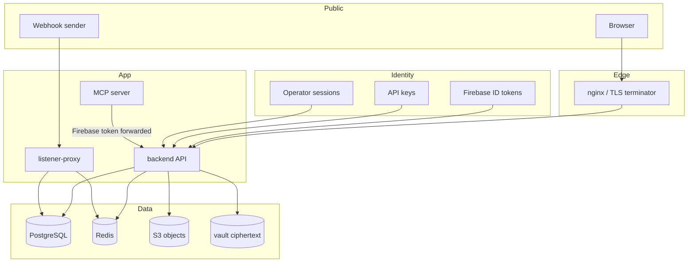

# Security

Jet Admin is multi-tenant software with three disjoint identity realms, application-enforced tenant isolation, and Casbin RBAC. This page describes the model that exists in code, then lists the gaps that must **not** be presented as mitigated.



## Identity realms

The realms are intentionally disjoint. A Firebase user is not an operator; an API key is not a user session; an operator session is not a Casbin subject.

| Realm | Credential | Verification | Session / lifetime | Used by |
|---|---|---|---|---|
| End user | `Authorization: Bearer <Firebase ID token>` | `firebase-admin` `verifyIdToken` using `FIREBASE_CREDENTIALS`; resolves `tblUsers` by `firebaseID` | Per request. Socket.IO sends the token in `handshake.auth.token`. | Tenant UI and API |
| API key | `Authorization: api_key <raw-key>` | 8-character prefix lookup among non-disabled keys, then SHA-256 + `timingSafeEqual` against the stored hash | Long-lived until disabled/deleted; the raw key is shown once at creation | Scripts, MCP stdio, service integrations |
| Operator | Email + password → opaque bearer token | PBKDF2-SHA512, 600,000 iterations, 64-byte hash; compare is timing-safe with a legacy 1,000-iteration fallback | 12-hour opaque session; only a SHA-256 token hash is stored | Platform admin console only |

Additional rules:

- `NODE_ENV=test` exposes a test auth helper (`authProviderTest`) that logs in a fixed test user. It is not currently mounted on any route, but never deploy with `test`: any future wiring would bypass Firebase.
- API keys carry a `tblAPIKeys.tenantID` and get Casbin policies through their role mappings. Tenant routes do **not** separately compare that value to the URL `:tenantID`; the Casbin domain policy is the gate. Ordinary creation grants roles only in the key's own tenant, but a mis-granted policy in another domain would be honored.
- Operator accounts exist only in `tblOperators` and are created with `node scripts/create-operator.js`. There is no self-service registration.
- `OPERATOR_SESSION_INVALID` is returned for unknown, expired, revoked, or disabled-operator sessions.
- Google OAuth uses a 10-minute JWT `state` signed with `OAUTH_STATE_SECRET`; tokens are stored in the vault, not in local storage.

### Operator bootstrap and recovery

```bash
cd apps/backend
node scripts/create-operator.js admin@example.com '<strong-password>' 'Platform Admin'
node scripts/create-operator.js --reset admin@example.com '<new-password>'
```

`--reset` rotates the password and revokes **all** active sessions for that operator. There is no MFA, no login rate limiting, and no account lockout in the current code; protect the operator console at the network edge.

## Tenant isolation

Tenant isolation is **application-enforced**, not database-enforced. There is no PostgreSQL row-level security in `schema.prisma`.

The layers that do exist:

1. **URL domain:** every tenant resource is nested under `/api/v1/tenants/:tenantID/...`.
2. **Service filters:** the backend guideline requires every tenant-scoped Prisma query to include `tenantID` in its `where`. Services such as datasource, widget, workflow, listener, and role follow this pattern.
3. **Casbin domain:** policies are stored with `dom = :tenantID`; a subject with no policy in that domain is denied. Route authorization also derives the resource selector from the path/body.
4. **Reference checks:** JSON-configured resources (workflows, listeners, app pages, cron jobs) store IDs as strings. `assertTenantReferences()` rejects referenced queries/workflows/listeners/pages/datasources from another tenant at save time.
5. **API-key binding:** an API key carries its own `tenantID` and ordinary creation only grants roles there. There is no explicit key-tenant vs URL-tenant comparison; a matching Casbin domain policy is what allows access.
6. **Vault checks:** `vaultService.getCredential()` looks up by ID and then explicitly compares `credential.tenantID` to the requested tenant.
7. **File paths:** widget uploads use `widget-files/<tenantID>/...`, and `GET /widgets/files` rejects paths outside that prefix. Tenant logos use `logos/...` in the `tenant-assets` bucket without a tenant prefix.

:::danger No RLS backstop
A missing `tenantID` predicate in a new service query is a cross-tenant data leak, not a database error. Code review and tests are the only guard. Do not assume PostgreSQL will contain the blast radius.
:::

Redis is also cross-tenant: the `listener:events` Stream contains envelopes for every tenant, and the Socket.IO adapter is deployment-wide. Anyone with Redis access can read tenant event data. Use a private network and authentication on managed Redis.

## Authorization — Casbin RBAC

Model: `apps/backend/config/casbin_model.conf`.

```ini
[request_definition]
r = sub, dom, obj, act

[policy_definition]
p = sub, dom, obj, act, eft

[role_definition]
g = _, _, _

[policy_effect]
e = some(where (p.eft == allow)) && !some(where (p.eft == deny))

[matchers]
m = g(r.sub, p.sub, r.dom) && r.dom == p.dom && keyMatch(r.obj, p.obj) && (r.act == p.act || p.act == "*")
```

- `sub` is a user ID, API-key ID, or a role subject such as `role:<roleID>`.
- `dom` is the tenant ID.
- `obj` is `<resourceType>:<resourceID>` or `<resourceType>:*`.
- `act` is an action such as `read`, `update`, `execute`, `*`.
- `keyMatch` allows prefix wildcards in the object; `p.act == "*"` allows any action.

Policies live in the `casbin_rule` table (`ptype`, `v0`–`v5`). The enforcer loads the full policy set at startup and reloads after role/permission changes. `POST /api/v1/tenants/:tenantID/roles/sync-policies` rebuilds policies from the relational role/permission tables — use it after a `casbin_rule` wipe or a permission-catalog change.

### Permission catalogue

`apps/backend/config/permissions.json` is the single source of truth. It currently defines **19 resources and 96 actions**:

| Resource | Representative actions |
|---|---|
| `ai` | `chat`, `read`, `delete` |
| `apikey` | `list`, `create`, `read`, `update`, `delete` |
| `appPage` | CRUD, `execute`, `export` |
| `application` | `list`, `create`, `read`, `update`, `archive`, `publish`, `deploy`, `execute` |
| `audit` | `list` |
| `bundle` | `preview`, `execute` |
| `cronjob` | CRUD |
| `dataquery` | CRUD, `test`, `execute`, `export` |
| `datasource` | CRUD, `test`, `export` |
| `folder` | `list`, `create`, `update`, `delete` |
| `listener` | CRUD, `execute`, `observe`, `export` |
| `marketplace` | `list`, `preview`, `install`, `verify`, `unpublish` |
| `permission` | `list` |
| `role` | CRUD |
| `tenant` | `read`, `update`, `delete` |
| `user` | `list`, `create`, `read`, `update`, `delete` |
| `widget` | CRUD, `execute`, `export` |
| `widgetLibrary` | `list`, `publish`, `unpublish`, `install` |
| `workflow` | CRUD, `execute`, `test`, `export` |

Seed roles include `ADMIN` (all permissions), `TenantManager`, `TenantViewer`, `RoleManager`, `RoleViewer`, `UserManager`, `UserViewer`, `QueryCreator`, `QueryEditor`, `QueryRunner`, `WorkflowManager`, `WidgetManager`, `DatasourceManager`, `AppPageManager`, `ListenerManager`, `CronJobManager`, `FolderManager`, `ApiKeyManager`, `AuditViewer`, and `AIManager`.

### Resource-level and cross-resource checks

Routes call `authMiddleware.authorize(P.<resource>.<action>)`. The middleware resolves the object ID from `req.params` using conventions such as `dataQueryID`, `workflowID`, or `appPageID`, or from `bodyKey`, `reqKey`, or `paramKey`. List endpoints usually become `<resource>:*` and require a wildcard policy.

Cross-resource requirements are declarative and common:

- Creating a workflow requires `workflow.create`, plus `dataquery.execute` on every referenced query and `workflow.execute` on every referenced sub-workflow.
- Moving entities requires `folder.update` on the folder plus `<entity>.update` on each moved item.
- Creating an app page requires `appPage.create`, plus execute/read checks on referenced queries, workflows, listeners, and widgets.
- Creating a cron job requires `cronjob.create` and `workflow.execute` on the target workflow.
- Creating a listener requires `listener.create`, `datasource.read`, and execute checks for referenced workflows/queries.

After a resource is created, `grantCreatorAccess()` adds a `*` policy on that specific object for the creator and, when applicable, the creating API key. Deleting a resource calls `removePoliciesForResource()`; deleting a role calls `removePoliciesForRole()`. These cleanup calls are not transactional with the business row, so a failure can leave orphaned policies. `sync-policies` repairs role-derived drift, not creator-specific object policies.

### Membership vs authorization

`checkTenantMembership` consults `tblUsersTenantsRelationship` and is applied to AI routes and auth-config routes. It is **not** a global middleware on every tenant route. On ordinary tenant resources, the Casbin domain policy is the effective gate. A user with a policy in a tenant but no membership row may still pass route-level Casbin checks. Membership is therefore an additional check, not the isolation boundary by itself.

## Secrets at rest and in transit

### Encryption

`utils/encryption.util.js` uses AES-256-GCM with a random 12-byte IV and stores `{ iv, data, authTag }` (hex). `VAULT_ENCRYPTION_KEY` must be a 32-byte hex string (64 hex characters).

Encrypted at rest:

- Vault credentials (`tblVaultCredentials.encryptedData`): OAuth tokens, tenant AI configuration, and other provider credentials.
- Datasource options: `datasourceService.encryptOptions()` stores `{ __encrypted: true, iv, data, authTag }` in `tblDatasources.datasourceOptions`.

Not encrypted at rest: audit request/response bodies (redacted and truncated), workflow context/log payloads, widget/page definitions, and file objects. Treat database and object-storage backups as sensitive.

### Masking and redaction

- API responses that contain datasource options pass through `maskDatasourceOptions()`; credential-like fields become `●●●●●●●●`, preserving object shape for editors.
- On update, `mergeAndRestoreMaskedOptions()` treats `●●●●●●●●` as "unchanged" and restores the stored value. A literal mask value cannot be set through the API.
- Logs use `redact()` exact-key matching plus string sanitization (URL userinfo, `password=`, `token=`, `Bearer ...`). Redaction is best-effort, not a guarantee against a novel key name.
- Audit payloads use the same redaction and are truncated at 2,000 characters.

### Key rotation

There is **no automated rotation** for `VAULT_ENCRYPTION_KEY`, `OAUTH_STATE_SECRET`, or `FIREBASE_CREDENTIALS`.

Rotating the vault key requires:

1. Stopping writers.
2. Decrypting every vault row and encrypted datasource row with the old key.
3. Re-encrypting with the new key.
4. Updating backend, worker, and listener-proxy environments atomically.
5. Restarting and verifying datasource tests, OAuth, AI config, and listener decryption.

There is no key-version field and no built-in re-encryption CLI. Plan a maintenance window. Keep the old key until every backup that contains old ciphertext has expired.

:::warning Datasource decrypt failure is not fail-closed
`datasourceService.decryptOptions()` catches decryption errors and returns the raw encrypted envelope rather than throwing. A wrong key usually surfaces later as a confusing connection error (missing host/credentials), not as a clean "cannot decrypt" error. Check the vault key first when every datasource test suddenly fails after an environment change.
:::

### Transport

Application containers speak plain HTTP. TLS must terminate at nginx, a load balancer, or the hosting platform. `expressApp.enable("trust proxy")` is set, so `X-Forwarded-*` must be sanitized at the edge; direct client access to the backend would let a caller spoof those headers.

### API keys and operator sessions

- Raw API keys are 64 hex characters (32 random bytes). Only an 8-character prefix and a SHA-256 hash are stored. The raw key is returned once at creation and is not recoverable.
- Cloned keys are created disabled and with a fresh raw value.
- `apiKeyExpiry` is accepted by the request schema but is **not persisted or enforced** by the API-key service. Expiry must be handled by disabling/deleting keys.
- Operator passwords use PBKDF2-SHA512 with 600,000 iterations; token storage is hashed with SHA-256. Password reset revokes all sessions.

## SSRF and outbound request safety

Datasource connectors are intentionally able to reach private networks: PostgreSQL, Redis, Kafka, MQTT, SMB/SFTP, and internal REST APIs are valid targets for a self-hosted platform. There is **no global private-IP egress denylist**. The security boundary is authorization: `datasource.create`, `datasource.update`, `datasource.test`, and `dataquery.create/update` are privileged permissions.

What is confined:

- **GitHub and GitLab connectors** use `confinedFetch`/`buildConfinedUrl`. They require an `http`/`https` base, reject backslashes and absolute paths, keep the request under the configured origin and base path, and follow redirects manually while refusing cross-origin or path-escaping redirects.
- **Datasource proxy actions** are allowlisted per datasource type before `dsInstance[action]()` is called. Do not replace this with an existence check.
- **Dynamic datasource types** are validated against the registry before creation, so an unknown type cannot be stored and later dispatched.

What is not confined:

- The generic **REST API** connector concatenates `datasourceOptions.baseUrl` with the query's `apiEndpoint` and passes the result to axios. It checks for unresolved templates and an empty hostname, but it does not enforce origin/path confinement. A query author who can reach a datasource can direct the request to another authority and the configured `Authorization` header travels with it. Treat `dataquery.create/update` plus `datasource.read` as credential-adjacent permissions.
- There is no DNS-rebinding/private-IP guard for arbitrary REST, webhook, or database connections.
- Webhook ingress is designed to receive from the internet; per-listener auth is optional.

:::danger Review this before granting query-authoring access
A user who can create or edit data queries can often choose the outbound request target for REST datasources. Restrict `dataquery.create/update` and `datasource.read` to trusted builders, or add an origin allowlist to the REST connector before opening authoring to untrusted users.
:::

## Webhook ingress safety

Webhook ingress is served by `listener-proxy`, not the backend. It is intentionally open-CORS so third-party senders can post.

- Routes: `/webhooks/v1/inbound/:tenantID/:pathSuffix` and `/webhooks/v1/inbound/:listenerID`.
- A wrong suffix/listener ID returns 404 and does not reveal whether a listener exists.
- `allowedMethods` is enforced; a mismatch returns 405 with the allowed list.
- Optional auth modes: `basic`, `bearer`, `header` (default header name `x-api-key`), and `query_param` (default `api_key`). `none` means the URL itself is the secret.
- Auth comparisons use ordinary string equality, not `timingSafeEqual`. The practical timing signal is small, but this is not constant-time.
- A successful HTTP response means the event was durably accepted by the engine; enqueue failure returns 503 so the sender can retry.
- Body size is bounded by the proxy's `EXPRESS_REQUEST_SIZE_LIMIT` (default 5 MB). The internal webhook router also declares 10 MB parsers, but the outer proxy parser applies first for JSON bodies.

Treat a human-readable `pathSuffix` as a secret when `authType=none`. Prefer Basic/Bearer/header auth for internet-facing hooks, rotate the secret by updating the listener, and do not log full webhook URLs (they may contain query-param secrets).

## Sandbox boundaries

### Server-side JavaScript

User-authored JavaScript runs in `isolated-vm` isolates with deep-copied inputs and no `require`, `import`, `fetch`, or filesystem access:

| Execution path | Timeout | Memory | Input / output |
|---|---|---|---|
| Listener transform (`listenerTransformerVm`) | 100 ms | 16 MB | `event` in scope; return event to keep, `null`/`undefined` drops |
| Data-query result transform (`queryTransformerVm`) | 5 s | 64 MB | `data` in scope; `null`/`undefined` passes through |
| Workflow JavaScript node (`workflow-nodes-logic`) | Node `timeoutSeconds` (default 30 s) | 128 MB | `ctx` in scope; return value stored in `outputVariable` |
| Workflow condition/switch expressions | 5 s | 128 MB | `Boolean(expr)` with `ctx` |

The workflow VM helper falls back to Node's built-in `vm` module if the native `isolated-vm` addon cannot be loaded. The fallback is **not a security boundary** against hostile code; it exists for tests and environments where the native module is unavailable. Ensure `isolated-vm` builds in production images and monitor startup for fallback behavior.

### Browser-side embeds

- **HTML widget:** always renders a `sandbox` attribute, even when empty. `allow-same-origin` is forcibly omitted. `allowScripts`, `allowForms`, and `allowPopups` default to false and only real boolean/`"true"` values enable them.
- **Markdown text:** raw HTML is escaped before rendering; links/images are dropped to text unless they pass the URL policy (`http`, `https`, `mailto`, `tel`, relative). `javascript:`, `data:`, `vbscript:`, `file:`, and `blob:` are rejected.
- **postMessage:** only accepted when `event.source` is exactly the embedded frame's window, `type` is `jet-html-message`, `widgetID` matches the placement, and the payload is a JSON object under 64 KB.
- **IFrame widget:** exposes `allowSameOrigin` as an explicit option (default false). Enabling it alongside scripts gives the embedded page same-origin capabilities; only embed trusted origins.
- **App-page templates:** frontend JS templates run with the user's browser session and page state. Treat app-page/widget authoring permissions as trusted-content permissions, not as a sandbox.

## Network and input controls

- **CORS:** strict exact-match whitelist for everything except `/webhooks`; credentials are allowed; a hardcoded Chrome-extension origin is also accepted. Socket.IO uses the same whitelist.
- **Body limits:** `EXPRESS_REQUEST_SIZE_LIMIT` default 5 MB for JSON/urlencoded; multipart uploads are capped at 10 MB in multer. `rawBody` is retained for webhook/signature-style use.
- **Validation:** most body/params/query inputs are validated with Zod; simple reads and a few legacy routes rely on path authorization only. Unknown keys are often passed through (`.passthrough()`) for forward compatibility, so validation is not a strict schema firewall.
- **File uploads:** S3-only; no antivirus, content disarm, or MIME sniffing. The upload bucket may be public-read. File names are timestamp-prefixed but not sanitized beyond the storage key construction; avoid rendering untrusted names as HTML.
- **Reverse proxy:** the internal nginx template forwards all paths to Node and sets WebSocket upgrade headers for `/socket.io`. It does not add security headers, HSTS, or rate limits.

## Known gaps

These are present in the code at the time of writing. Do not describe them as solved:

1. **No `helmet`, no `express-rate-limit`.** There are no in-app security headers or request rate limits. Operator login, webhook ingress, and API keys have no brute-force protection. Add limits at the edge until code changes land.
2. **No PostgreSQL RLS.** Tenant isolation relies on every service query filtering `tenantID`. A missed predicate is a cross-tenant leak.
3. **No global SSRF egress policy.** Datasource creation is privileged, but REST query authors can influence outbound targets; GitHub/GitLab are confined, generic REST is not.
4. **Vault key rotation is manual and unversioned.** No envelope encryption, no key IDs, no re-encryption CLI.
5. **Datasource decrypt errors degrade instead of failing closed.** The encrypted envelope is returned as options and fails later in the connector.
6. **OAuth callback posts to `window.opener` with target origin `*`.** The payload is escaped, but any opener can receive it. Restrict to the app origin if you embed the callback cross-origin.
7. **Operator realm has no MFA, lockout, or rate limit.** A 12-hour session is a bearer token in the browser. Protect the console at the network edge.
8. **API-key expiry is not enforced.** `apiKeyExpiry` is accepted but ignored by the service; disable/delete keys instead.
9. **Webhook secrets are compared with `!==`.** Not constant-time. The URL/path suffix is also a bearer secret when auth is `none`.
10. **Public upload buckets.** `storage-init` attaches a public-read policy. Object URLs are unguessable-ish but not access-controlled; tenant isolation is not enforced at the object layer.
11. **Tenant AI config is readable in plaintext.** `GET /tenants/:tenantID/ai-config` returns the stored provider API key to any caller with `tenant.read`; the response is not masked. Treat `tenant.read` as a secret-bearing permission or mask this endpoint before broad tenant-viewer rollout.
12. **No CSRF tokens.** Auth is header-based rather than cookie-based, which reduces classic CSRF risk, but any future cookie session must add CSRF protection.
13. **No audit coverage for operator, webhook, or Socket.IO actions.** Audit is limited to the tenant/auth HTTP routers.
14. **Compose exposes PostgreSQL, Redis, Temporal Postgres, Temporal UI, and RustFS console on host ports with sample credentials.** Close or firewall them in production.
15. **`NODE_ENV=test` carries a Firebase-bypass helper.** `authProviderTest` is defined but not currently mounted; still enforce `NODE_ENV=production` so future test-only wiring cannot become an accidental bypass.

## Hardening checklist

- [ ] Put the operator console and MCP behind SSO/VPN or an IP allowlist; add MFA at the edge.
- [ ] Add edge rate limits for `/api/v1/operator/auth/login`, `/api/v1/auth`, `/webhooks`, and AI streaming.
- [ ] Add HSTS, CSP, `X-Content-Type-Options`, `X-Frame-Options`/frame-ancestors, and a referrer policy at the edge.
- [ ] Restrict `dataquery.create/update` and `datasource.read` to trusted users; review the REST origin gap.
- [ ] Keep `VAULT_ENCRYPTION_KEY` in a secret manager with versioned backups; test a restore/decrypt before rotating.
- [ ] Disable API keys by setting `isDisabled:true`; rotate on a schedule because expiry is not enforced.
- [ ] Restrict `tenant.read` or mask `GET /tenants/:tenantID/ai-config`, which currently returns the stored AI provider key.
- [ ] Use per-listener Basic/Bearer/header auth for internet webhooks; treat suffixes as secrets.
- [ ] Replace public bucket policies with signed URLs if uploaded content is confidential.
- [ ] Segment Redis and PostgreSQL on private networks; do not expose Temporal or RustFS consoles.
- [ ] Ship audit logs and backend logs to append-only storage; do not rely on container files for forensics.
- [ ] Rebuild `isolated-vm` for the production platform and verify the native module loads.
- [ ] Review `CORS_WHITELIST` after every domain change; remove localhost entries in production.

## Incident response

### Suspected API-key compromise

1. Disable the key: `PATCH /api/v1/tenants/:tenantID/apikeys/:apiKeyID` with `{ "isDisabled": true }`.
2. Inspect audit rows for that key ID and the last 24–72 hours of requests.
3. Clone the key only if you need the same role mappings; the clone is created disabled with a fresh secret.
4. Rotate any datasource credentials the key could read.

### Suspected operator compromise

1. Run `node scripts/create-operator.js --reset <email> <new-password>`; this revokes all sessions.
2. Review operator actions in platform logs — operator routes are not in the tenant audit table.
3. Rotate `FIREBASE_CREDENTIALS`, vault key, and OAuth secrets if the operator had infrastructure access.

### Suspected vault compromise

1. Rotate `VAULT_ENCRYPTION_KEY` with a planned re-encryption (no automated tool exists).
2. Rotate all provider credentials stored in the vault: Google OAuth, AI keys, datasource credentials.
3. Invalidate API keys and operator sessions.
4. Restore from a backup only after confirming the backup predates the compromise.

## Related pages

- [Configuration Reference](./configuration-reference.md) — secret-related variables and defaults.
- [Deployment](./deployment.md) — TLS, network layout, backups, and hardening checklist.
- [Observability](./observability.md) — audit coverage and incident runbooks.
- [Identity & Access Management](../identity-access-management/identity-access-management.md) — user-facing roles and permissions.
