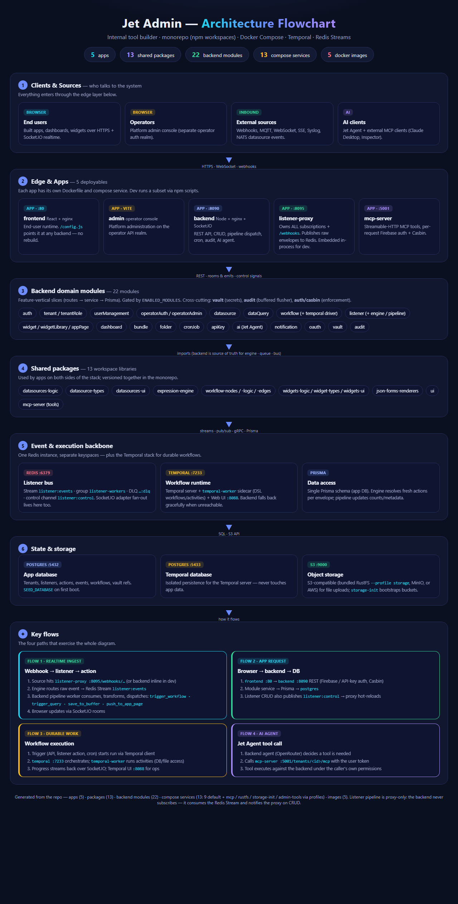
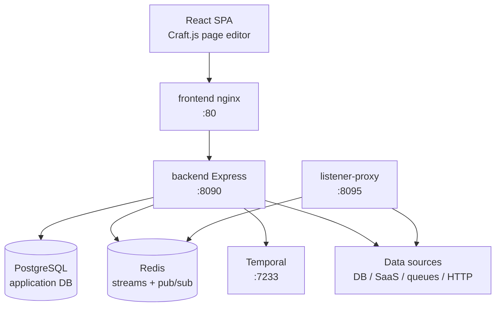
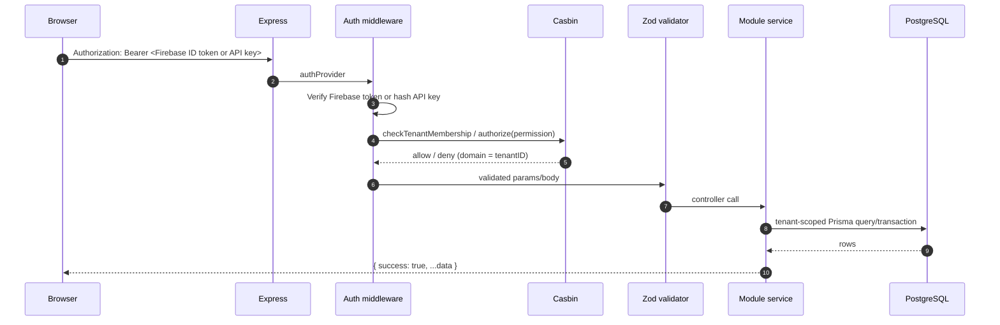
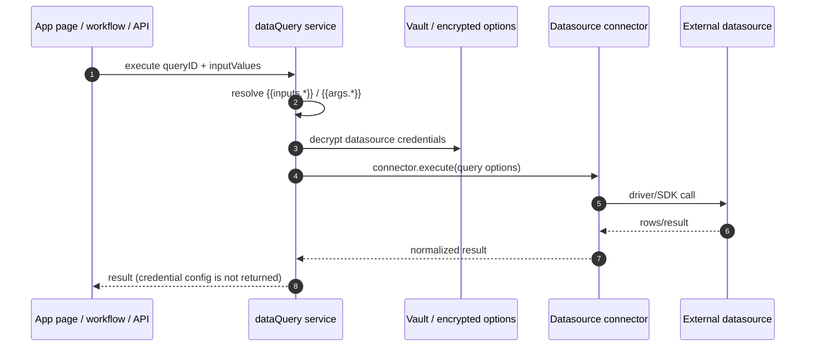
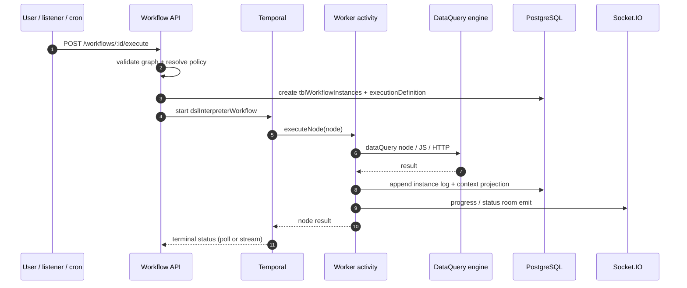
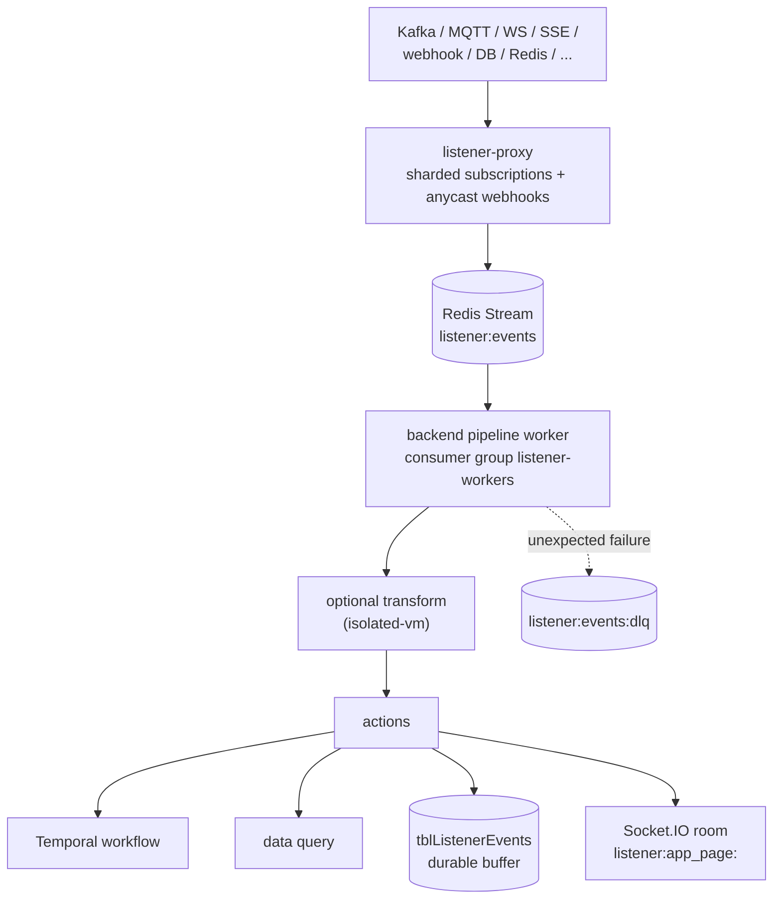
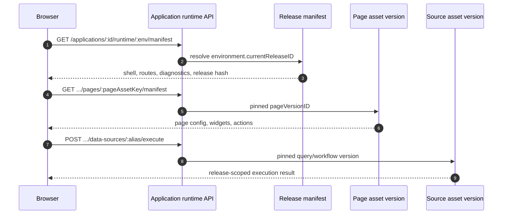
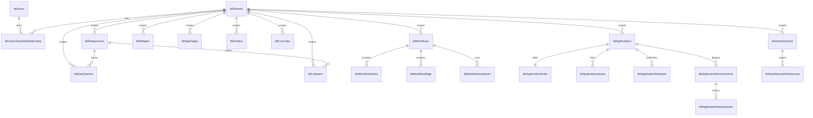
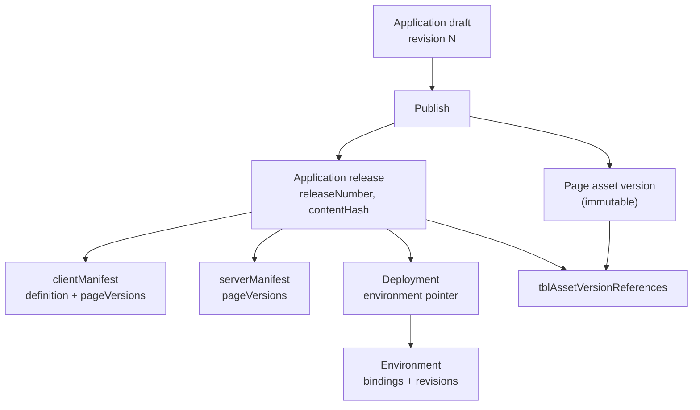

# Platform Architecture

Jet Admin is a self-hostable internal-tools and analytics platform. The
repository is an npm-workspaces monorepo (Node 20) containing a React SPA, an
Express API, a standalone listener ingress service, an MCP bridge, shared
TypeScript/JavaScript packages, and this Docusaurus site. The current platform
version is `2.1.0-preview.1` (`package.json`).

## System at a glance

### Service inventory

| Service | Entry point | Default port | State | Responsibility |
|---|---|---|---|---|
| `frontend` | `apps/frontend` (`Dockerfile.frontend`, nginx) | `80` | Static assets + browser state | SPA, page editor, application studio/runtime, Socket.IO client |
| `backend` | `apps/backend/index.js` (`Dockerfile.backend`) | `8090` local; `3000` in compose behind container nginx; Node on `3001` | Mostly stateless | REST API, Casbin authorization, query execution, workflow orchestration, listener fan-out, static file proxy |
| `listener-proxy` | `apps/listener-proxy/index.js` | `8095` | Stateless ingress; shard ownership in Redis | Datasource subscriptions, webhook ingress, raw event publication to Redis Streams |
| `temporal-worker` | `apps/backend/modules/workflow/temporal/worker.js` | - | Worker | Dedicated worker process (optional deployment; the backend also starts an embedded worker on boot). Temporal itself is the required workflow runner |
| `mcp-server` | `apps/mcp-server/index.js` | `5001` | Stateless | Streamable-HTTP MCP tools for the Jet Agent and external MCP clients |
| `postgres` | `postgres:15-alpine` | `5432` | Persistent | Application data, Casbin rules, workflow projections, releases |
| `redis` | `redis:7-alpine` | `6379` | Persistent AOF | Listener Streams/DLQ, socket adapter, proxy registry, cron locks |
| `temporal` | `temporalio/auto-setup:1.23` | `7233` (UI `8088`) | Persistent (separate Postgres) | Workflow execution authority |
| `rustfs` / S3 | optional `--profile storage` | `9000` (console `9001`) | Persistent | Uploads: widget files, datasource files, tenant logos |

`docker-compose-sample.yml` is the configurable self-host stack.
`docker-compose.yml` is the same topology with demo-local defaults. The docs
site deploys independently through GitHub Pages workflows; there is no
application CI/CD pipeline in `.github/workflows`.

## Request and runtime flows

### 1. Authenticated REST request

Conventions that apply to every module:

- Tenant routes are mounted under `/api/v1/tenants/:tenantID/...`.
- `authMiddleware.authorize(P.<resource>.<action>)` checks a Casbin permission
  in the tenant domain. Cross-resource checks pass extracted IDs via `reqKey`
  and `skipIfMissing`.
- Responses use `expressUtils.sendResponse`, which spreads `data` into the
  top-level JSON object (`{ success, ...data }`).
- Services filter by `tenantID`; creator access is granted after create.
- Zod schemas validate requests; Prisma is the only database access layer.

### 2. Data query execution

Queries are synchronous HTTP calls with a 60 s default execution timeout
(overridable per query or workflow node). There is no platform-level row cap or
read-only enforcement; those boundaries come from the datasource credential and
connector. Long-running queries hold the request until the connector returns or
the timeout aborts the connector call.

### 3. Workflow execution

Temporal is the only workflow execution engine in the current code
(`apps/backend/modules/workflow/temporal/config.js` explicitly says
"native engine removed"). The backend starts an embedded Temporal worker during
startup; a dedicated `temporal-worker` container can also consume the same task
queue.

Defaults from `temporal/policyDefaults.json`: workflow run timeout 7 days,
workflow task timeout 30 s, human-in-loop timeout 24 h, default node timeout
120 s, no retries after the first attempt unless configured. Per-node values
override workflow defaults, which override platform defaults.

### 4. Listener event pipeline

Only the listener-proxy subscribes to stateful sources. Every proxy serves all
stateless webhook routes; stateful subscriptions are consistent-hash sharded
across live proxies. A backend replica never subscribes, so a broadcast source
is not double-consumed.

### 5. Application runtime (pinned release)

The deployed client never receives a live query/workflow ID for execution.
The release manifest resolves aliases to pinned versions; direct
`TRIGGER_QUERY` / `TRIGGER_WORKFLOW` actions are removed at publish time. See
[Asset Versioning](./asset-versioning.md) for the pinning and compilation
contract.

## Frontend / backend split

| Layer | Location | Owns | Does not own |
|---|---|---|---|
| Presentation | `apps/frontend/src/presentation` | Pages, layouts, Craft.js canvas, application studio/runtime UI, widget slots | Business rules, credential handling |
| Client state/logic | `apps/frontend/src/logic` | Page runtime reducer, expression evaluation, application state persistence, Socket.IO subscriptions, query coordination | Durable authorization |
| Data access | `apps/frontend/src/data/apis` | One Axios module per backend area | Database access |
| HTTP API | `apps/backend/modules/*` | Validation, Casbin authorization, services, transactions | Rendering |
| Execution | `apps/backend/modules/workflow/temporal`, `dataQuery`, `listener` | Temporal workflows/activities, connector dispatch, event actions | Browser UI |
| Shared contracts | `packages/*` | Widget descriptors, datasource form schemas, expression engine, application schema, MCP tools | Deployment-specific state |

The browser is trusted for UX, not for authorization. Every backend route
re-checks identity, tenant membership, and resource permission.

## Data model

Domain tables use the `tbl*` prefix and UUID primary keys generated by
`gen_random_uuid()` (Prisma `schema.prisma`); a few join/draft tables use
composite or shared primary keys (`tblUsersTenantsRelationship`,
`tblApplicationDrafts`). The core graph:

Key facts:

| Concern | Implementation |
|---|---|
| Tenant assets | `tenantID` column on datasources, queries, workflows, widgets, app pages, listeners, cron jobs, folders, applications, asset versions |
| Application composition | `tblApplicationAssets` has nullable typed targets plus composite FKs `(tenantID, targetID)` to prevent cross-tenant links |
| Immutable definitions | `tblAssetVersions` stores a `payload` JSON snapshot, `contentHash`, monotonic per-asset `versionNumber`, and `schemaVersion` |
| Dependency edges | `tblAssetVersionReferences` links parent asset versions to child versions and releases to pinned page versions |
| Releases | `tblApplicationReleases.clientManifest` / `serverManifest`; environments hold `currentReleaseID`; deployments are an append-only pointer history |
| Execution | `tblWorkflowInstances` stores `executionDefinition`; `tblWorkflowInstanceLogs` is append-only (auto-increment `eventSequence`) |
| Event buffer | `tblListenerEvents` with `(listenerID, bufferName, seqNo)` for durable listener observation |
| Global registries | `tblWidgetLibrary`, `tblMarketplaceItem`, `tblMarketplaceTemplate*`, `tblOperators` are deployment-scoped, not tenant-scoped |

Workflow nodes and edges cascade-delete with their workflow. Query and listener
rows cascade from their datasource in several relations; tenant deletion is a
service-level transaction that explicitly removes dependent rows. There is no
PostgreSQL row-level security (RLS); tenant isolation is enforced in the
application layer and, for application assets, by composite foreign keys.

### Release object chain

A release is thin: it stores the application definition plus exact page version
IDs. Page and widget payloads are resolved from `tblAssetVersions` at runtime,
not duplicated into the manifest. The stored `clientManifest` intentionally
drops full `pages` and `widgets` maps after compilation.

## Multi-tenancy

Tenancy is a first-class boundary, not a UI filter.

1. **Identity** — Firebase users (or tenant API keys) authenticate. Users have a
   global `tblUsers` row and a membership row per tenant.
2. **Tenant context** — the tenant is taken from the URL
   (`/api/v1/tenants/:tenantID`) and validated against membership.
3. **Authorization** — Casbin model `sub, dom, obj, act` evaluates
   `role:...`/`user:...` against a resource object (`dataquery` or
   `dataquery:<id>`) with an action such as `list`, in domain `tenantID`.
4. **Data access** — services add `tenantID` to every `where`. Cross-tenant IDs
   are rejected by scoped lookups and, for application assets, by composite
   foreign keys.
5. **Global exceptions** — operator sessions, the widget library, the
   marketplace, and app templates are deployment-global by design. Operator
   routes intentionally do not use Casbin; operator status is the grant.
6. **Secret isolation** — datasource credentials are encrypted at rest and are
   never exported in bundles or returned in API responses.

There is no database-level RLS. A code path that forgets `tenantID` is a tenant
isolation bug; review new Prisma queries accordingly. Operator endpoints and
the MCP server are the only intentional cross-tenant surfaces.

## Release model

"Release" is overloaded; these are different units:

| Unit | Scope | Mutability | Created by |
|---|---|---|---|
| Platform version | Repository | Immutable per build | npm/Docker build; no app release pipeline in repo |
| Application release | One application | Immutable | `POST .../applications/:id/releases` |
| Environment deployment | One application + environment | Pointer moves | `POST .../deployments` |
| Asset version | One asset (7 types) | Immutable | Asset-version API, page/application publish |
| Bundle | Portable JSON | Immutable file; import creates new rows | Export endpoints |
| Widget library entry | Deployment | Bundle snapshot, not semver | Publish to library |
| Marketplace item/template | Deployment | Operator-managed | Seed/operator scripts |

Application releases are compiled from a draft revision plus exact page
versions. Deploying or rolling back only moves `environment.currentReleaseID`;
it does not rebuild or mutate a release. External side effects of a previous
release are not reversed by a rollback.

## Scaling and failure behavior

| Concern | Behavior | Operational implication |
|---|---|---|
| API replicas | Stateless per request except in-memory audit buffer, cron timers, and the legacy widget-workflow map | Scale behind a load balancer; sticky sessions are not required for REST |
| Socket.IO | Redis adapter when `REDIS_URL` is set | Cross-replica room emits work; without Redis, only same-replica emits reach clients |
| Listener ingress | listener-proxy shards stateful subscriptions; webhooks are anycast | Scale proxies horizontally; membership changes trigger rebalance |
| Listener consumption | Redis Streams consumer group with pending reclaim and DLQ | At-least-once delivery; actions must tolerate duplicates |
| Cron | `node-cron` in API processes; Redis lock + per-occurrence CAS when Redis exists | Without Redis, cross-replica duplicate scheduling is not prevented |
| Workflow execution | Temporal; embedded and/or dedicated workers | Temporal outage leaves API up but workflow starts fail; worker retries in background |
| Query execution | Synchronous in API process | Slow queries consume HTTP capacity; no queue/backpressure |
| Database | Single primary; Prisma connection pool | Primary bottleneck for all modules; no read-replica routing |
| Redis outage | Listener pipeline halts; cron locks fail closed by default; socket fan-out degrades | `CRON_LOCK_FAIL_OPEN=true` explicitly opts into duplicate risk |
| S3 outage | Uploads and file serving fail; core CRUD continues | Public file URLs may break |
| Audit logs | Buffered (50 entries / 5 s), flushed asynchronously; failed flush drops that batch | Audit is best-effort, not a transactional ledger |

The proxy registry uses Redis TTL heartbeats (10 s interval, 30 s TTL) and a
consistent-hash ring. A backend sweeper reconciles placements every 30 s. If a
proxy cannot fetch its shard, it subscribes to nothing (default-deny) rather
than claiming all listeners.

## Security boundaries

| Boundary | Control | Residual risk |
|---|---|---|
| Browser → API | Firebase ID token or tenant API key; CORS allowlist | Browser code is untrusted; all checks are server-side |
| Socket.IO | Firebase token at handshake; room joins authorized per resource | Long-lived sockets need token-expiry handling |
| Tenant isolation | Membership + Casbin domain + tenant-scoped queries | No RLS; a missed `tenantID` predicate is a bug |
| Operator plane | Separate `tblOperators` realm, PBKDF2 passwords, opaque sessions; no Casbin | Operator compromise is deployment-wide |
| Webhooks | Listener auth types: none, basic, bearer, custom header, query param | No HMAC signature verification for provider-specific signatures |
| HTML widget | Sandboxed `srcDoc` iframe, `allow-same-origin` always forbidden; postMessage source check | Scripts can still run if enabled; not a content trust boundary |
| IFrame widget | URL scheme allowlist; sandbox flags configurable | `allow-same-origin` + `allow-scripts` can escape isolation if enabled |
| Application runtime | Runtime widget allowlist and local-action allowlist; pinned versions only | Top-level allowlist does not recursively re-check composite inline children |
| Script execution | Workflow/listener/query transforms use `isolated-vm`; expressions use `new Function` | `isolated-vm` fails back to Node `vm` if native binding missing; frontend JS expressions are explicitly not a hard boundary |
| Datasource egress | Connectors run server-side with tenant credentials | SSRF/network egress depends on deployment network policy |
| File storage | S3-compatible bucket; optional storage-init makes buckets public | Uploaded files are public if the bucket policy is public |
| MCP | Per-request Firebase token forwarded to tool calls | Stdio mode uses one API key for one tenant |

High-risk deployments should restrict datasource network egress, disable
untrusted HTML/IFrame widgets, avoid `allow-same-origin`, and treat page/query
authors as trusted operators. See [Limitations](./limitations.md) for the
detailed list.

## Source map

| Path | What lives there |
|---|---|
| `apps/backend/index.js` | HTTP server, route mounting, Socket.IO handlers, startup/shutdown |
| `apps/backend/modules/<name>/` | Controller, service, validator, routes, middleware per feature |
| `apps/backend/modules/tenant/tenant.v1.routes.js` | Nests all tenant-scoped routers |
| `apps/backend/config/` | Express, Prisma, Casbin, Firebase, Redis, Socket.IO, modules, permissions |
| `apps/backend/prisma/schema.prisma` | All models and relations |
| `apps/backend/prisma/migrations/` | Prisma migrations plus manual SQL migrations |
| `apps/backend/modules/workflow/temporal/` | Temporal client, worker, DSL workflow, activities, policy |
| `apps/backend/modules/listener/listenerEngine/` | Ingestion engine, pipeline worker, transform VM |
| `apps/backend/modules/assetVersion/` | Version capture, hashing, diff, restore, impact |
| `apps/backend/modules/application/` | Application drafts, compiler, releases, runtime, listener runtime |
| `apps/frontend/src/data/apis/` | Axios API modules |
| `apps/frontend/src/logic/appPageRuntime/` | Page state tree, reducer, actions, data-source execution |
| `apps/frontend/src/logic/applicationRuntime/` | Application store, routing, state persistence, release services |
| `apps/frontend/src/presentation/pages/` | Route-level screens |
| `apps/frontend/src/presentation/components/` | Feature UI, including `appPageComponents`, `applicationComponents`, `assetVersionComponents` |
| `apps/listener-proxy/` | Standalone ingress, proxy registry wiring, webhook mounting |
| `apps/mcp-server/` | Streamable-HTTP MCP wrapper with per-request Firebase auth |
| `apps/admin/` | Legacy Vite admin app, superseded by `apps/frontend`; do not extend |
| `packages/*` | Shared contracts, connectors, widgets, workflow nodes, expression engine, UI |
| `docs/docs/` | This documentation site |
| `marketplace/` | Template packages and generation/validation scripts |
| `bundles/` | Sample/exported bundle files |
| `Dockerfile.*`, `docker-compose*.yml` | Service images and self-host topology |
| `scripts/` | Local start/build helpers |
| `temporal/` | Temporal dynamic config |

## Module gating and runtime configuration

`ENABLED_MODULES` gates route imports in `config/module.config.js`. The code
default in `environment.js` is only `auth,tenant` when the variable is absent;
Compose enables the full set. `isModuleEnabled` also disables a module when any
declared dependency is missing. A module that is disabled does not mount its
router, so the API returns 404 for that area.

`WORKFLOW_ENGINE_DRIVER` is still read into `environment.js` but has no consumer
in the workflow code path; do not use it to select a native engine. Temporal
connection variables (`TEMPORAL_ADDRESS`, `TEMPORAL_NAMESPACE`,
`TEMPORAL_TASK_QUEUE`, TLS settings) are the effective controls. See
[Configuration Reference](../operations/configuration-reference.md) and
[Deployment](../operations/deployment.md).

## Architectural invariants

1. A tenant-scoped query always includes `tenantID`.
2. Datasource credential material never appears in exports, logs, or asset
   configuration responses. Query result rows are caller-controlled data and
   are not value-scanned for secrets.
3. Published application releases and asset versions are immutable.
4. Runtime execution resolves pinned versions, not live asset IDs.
5. The listener-proxy is the only subscriber; backend replicas compete on one
   Redis Stream.
6. Temporal is the source of truth for workflow execution state; database rows
   are projections and logs.
7. Folder scope is `(tenantID, entityType)`, never cross-entity.
8. Widget types are validated against `@jet-admin/widget-types` descriptors at
   authoring time.

Continue with [Core Concepts](./concepts.md) and [Modules](./modules.md) for the
vocabulary and ownership map.
