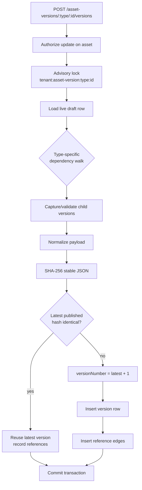
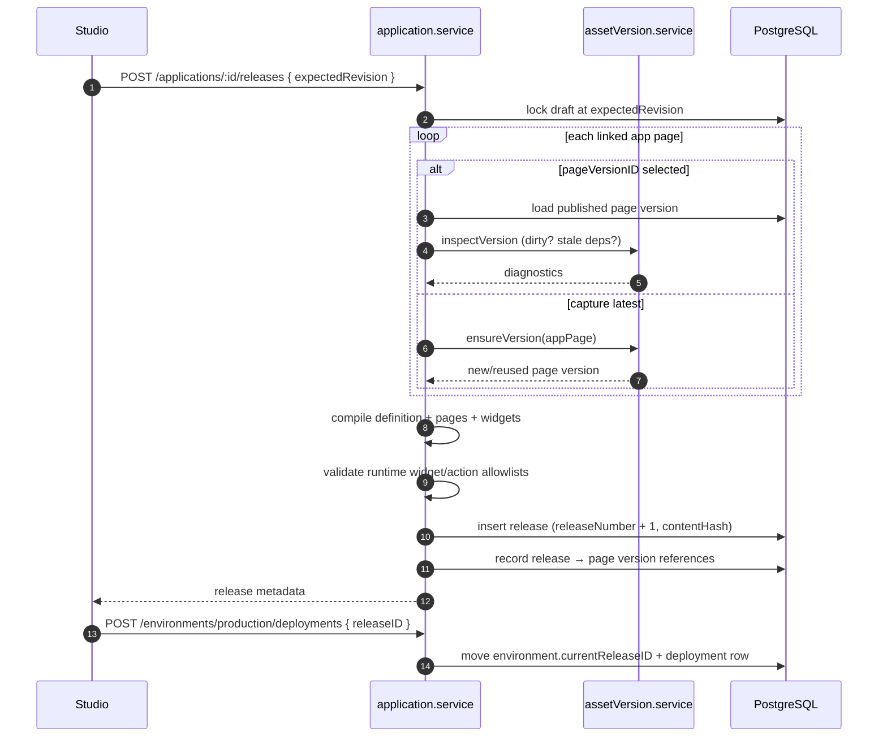
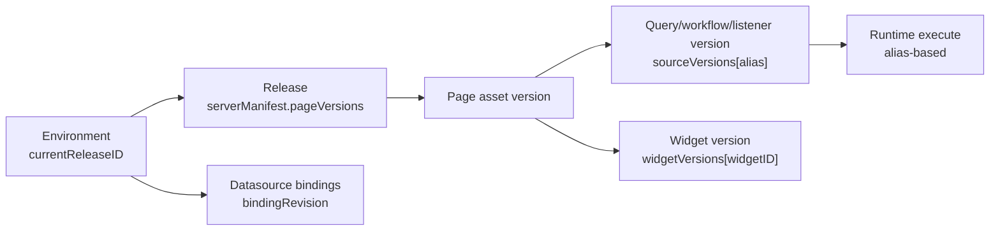

# Asset Versioning & Releases

Jet Admin separates **editable drafts** from **immutable versions** and
**deployable releases**. This is what makes an application release reproducible:
a deployed page points at a captured page version, which points at captured
query/workflow/widget versions, not at whatever the live editor contains today.

Implementation: `apps/backend/modules/assetVersion/`,
`apps/backend/modules/application/`, and `tblAssetVersions` /
`tblAssetVersionReferences` in `apps/backend/prisma/schema.prisma`.

## What is immutable

An **asset version** is a row in `tblAssetVersions`. Once created it has no
update or delete API. Its identity is the tuple:

```text
(tenantID, assetType, assetID, versionNumber)
```

| Field | Meaning |
|---|---|
| `assetVersionID` | UUID primary key |
| `assetType` | One of the seven supported types |
| `assetID` | The live asset's UUID (not a foreign key) |
| `versionNumber` | Monotonic **per asset**, starting at 1 |
| `schemaVersion` | Payload schema version, currently `1` |
| `contentHash` | SHA-256 of the canonical payload |
| `payload` | Full executable definition snapshot |
| `status` | `published` for all versions created by the service |
| `changeNote` | Optional note, max 2,000 characters |
| `createdByUserID` / `createdByApiKeyID` | Actor attribution |
| `createdAt` | Capture time |

The live asset table remains the editable draft. Editing a query, page, or
workflow does **not** modify existing versions. Capturing again creates a new
version (or reuses the latest if the content hash is identical).

## Supported asset types and payloads

| Type | Captured payload | Dependencies captured |
|---|---|---|
| `datasource` | Title, description, type, tags | None; connection options and credentials are intentionally excluded |
| `query` | Title, description, datasource ID/type, `dataQueryOptions`, `runOnLoad`, result schema, input definitions | Datasource version |
| `workflow` | Title, `workflowOptions`, nodes, edges | Query versions for `dataQuery` nodes; child workflow versions for `subWorkflow` nodes |
| `listener` | Title, description, type, config, endpoint path, definition hash, enabled actions | Datasource version; query/workflow versions for actions |
| `widget` | Title, type, `widgetConfig` | Query/workflow versions declared in widget data sources |
| `appPage` | Title, description, `appPageConfig` | Query/workflow/listener versions for page data sources; widget versions for every placed widget; trigger bindings |
| `cronjob` | Title, description, schedule, workflow ID/config, timeout/retry | Workflow version |

Notes:

- A datasource version is **metadata only**. Rotating a password or changing a
  host must not create a new version; use environment bindings for deployment
  targets.
- A page's `sourceVersions` map is keyed by page data-source alias. A page's
  `widgetVersions` map is keyed by widget ID.
- Listener versions store the definition hash used by application runtime to
  detect drift (`APPLICATION_LISTENER_CHANGED`).
- Unsupported asset types are rejected by the validator, not silently ignored.

## Capture flow



The transaction is not trivial: capturing an app page walks its data sources and
every widget's query/workflow dependencies. The service uses:

```js
const CAPTURE_TRANSACTION_OPTIONS = Object.freeze({
  timeout: 180000, // 180 s
  maxWait: 20000,  // 20 s
});
const CAPTURE_TRANSACTION_ATTEMPTS = 3;
```

Prisma `P2028` (transaction timeout) and `P2034` (write conflict) are retried
up to three times with a short backoff. A PostgreSQL advisory lock serializes
version-number allocation per `(tenant, type, asset)`.

If a dependency is missing, belongs to another tenant, is disabled, or forms a
cycle, capture fails with a domain error rather than creating a partial version.

## Content hashes

`stableHash` recursively sorts object keys, preserves array order, serializes
with `JSON.stringify`, and hashes with SHA-256:

```js
const stableValue = value => {
  if (Array.isArray(value)) return value.map(stableValue);
  if (value && typeof value === "object") {
    return Object.keys(value).sort().reduce((result, key) => {
      result[key] = stableValue(value[key]);
      return result;
    }, {});
  }
  return value;
};
const stableHash = value =>
  createHash("sha256").update(JSON.stringify(stableValue(value))).digest("hex");
```

Consequences:

- `{ "a": 1, "b": 2 }` and `{ "b": 2, "a": 1 }` hash identically.
- Array order matters; reordering widgets/columns creates a new version.
- Ephemeral fields excluded from the payload do not affect the hash.
- A hash is an integrity identifier, **not** a signature. Anyone who can write
  the version row can write a matching payload and hash.
- Identical content reuses the latest published version instead of creating a
  new number. The `createVersion` response includes `reused: true` when that
  happens.

The **application release** hash is different: it is SHA-256 over the compiled
`definition`, `pages`, `widgets`, `serverManifest`, and `diagnostics`:

```js
const contentHash = createHash("sha256")
  .update(JSON.stringify({ definition, pages, widgets, serverManifest, diagnostics }))
  .digest("hex");
```

It identifies a compiled release, not an individual asset version.

## Version pinning

Assets that reference other assets can choose how their dependency version is
selected:

| Mode | Behavior |
|---|---|
| `latest-at-capture` | Capture the current latest version of the dependency at the moment the parent is captured |
| `specific` | Use the explicitly supplied `*VersionID`; it must be a published version of the same tenant/type/asset |

Pin fields by type:

| Parent | Dependency | Pin field |
|---|---|---|
| Query | Datasource | `dataQueryOptions.datasourceVersionID` |
| Widget data source | Query | `queryVersionID` |
| Widget data source | Workflow | `workflowVersionID` |
| Workflow `dataQuery` node | Query | `nodeConfig.queryVersionID` |
| Workflow `subWorkflow` node | Workflow | `nodeConfig.childWorkflowVersionID` |
| App page data source | Query/workflow/listener | `queryVersionID` / `workflowVersionID` / `listenerVersionID` |
| App page widget selection | Widget | `widgetVersionSelections[widgetID].widgetVersionID` |
| Listener action | Query/workflow | `actionConfig.queryVersionID` / `workflowVersionID` |
| Cron job | Workflow | `workflowConfig.workflowVersionID` |

Example page data source:

```jsonc
{
  "alias": "orders",
  "type": "query",
  "queryID": "11111111-1111-4111-8111-111111111111",
  "versionMode": "specific",
  "queryVersionID": "22222222-2222-4222-8222-222222222222",
  "triggerMode": "auto"
}
```

If `versionMode` is `specific` but the ID is missing, capture fails with
`APP_PAGE_SOURCE_VERSION_REQUIRED`. If the version does not belong to the asset,
it fails with `APP_PAGE_SOURCE_VERSION_NOT_FOUND`. Invalid modes fail with
`APP_PAGE_SOURCE_VERSION_MODE_INVALID`.

## API

Mounted at `/api/v1/tenants/:tenantID/asset-versions`:

| Method | Path | Purpose |
|---|---|---|
| `GET` | `/:assetType/:assetID/versions` | Paginated list (newest first) |
| `GET` | `/:assetType/:assetID/versions/:versionID` | Full payload |
| `POST` | `/:assetType/:assetID/versions` | Capture a new version (or reuse) |
| `GET` | `/:assetType/:assetID/versions/:versionID/diff` | Diff vs draft or `?againstVersionID=` |
| `GET` | `/:assetType/:assetID/versions/:versionID/impact` | Parent versions/releases/environments |
| `POST` | `/:assetType/:assetID/versions/:versionID/restore` | Restore payload into the live draft |

Permissions are inherited from the asset: read for list/get/diff/impact; update
for create/restore. The service checks a Casbin resource string such as
`dataquery:<uuid>` in the tenant domain.

```bash
curl -X POST \
  "$JET_ADMIN_URL/api/v1/tenants/$TENANT_ID/asset-versions/query/$QUERY_ID/versions" \
  -H "Authorization: Bearer $TOKEN" \
  -H "Content-Type: application/json" \
  -d '{"changeNote":"Capture before pricing change"}'
```

## Diff, inspect, and restore

### Diff

`GET .../versions/:versionID/diff` compares the selected version against
either:

- the **live draft** (default), or
- another version (`?againstVersionID=<uuid>`).

Response shape (abridged):

```jsonc
{
  "version": { "versionNumber": 4, "contentHash": "…" },
  "against": { "kind": "draft", "versionNumber": null },
  "changes": [
    { "path": "appPageConfig.dataSources[0].inputValues.start", "change": "changed", "before": "2026-01-01", "after": "2026-02-01" }
  ],
  "dependencyChanges": [],
  "truncated": false
}
```

- The diff is structural, array-by-index, and capped at **500 changes**.
- `truncated: true` means the list is incomplete.
- `dependencyChanges` is populated only when comparing two versions; a
  draft comparison reports payload differences only.
- `inspectVersion` answers a different question: "is the live draft dirty
  relative to this version, and are any pinned dependencies stale?" That drives
  publish warnings.

### Restore

Restore writes the version payload back into the live asset. It is a **draft
operation**, not a deployment:

- It checks `expectedUpdatedAt` when supplied; if the asset changed after the
  preview, it returns `ASSET_VERSION_RESTORE_CONFLICT` (409).
- It updates only the definition fields captured in the payload. It does not
  restore child assets, datasource credentials, environment bindings, or
  releases.
- App-page restore writes title, description, and `appPageConfig`. Legacy
  editor history restore additionally snapshots the current state first.
- Workflow restore validates node UUIDs and replaces nodes/edges in a
  transaction; invalid IDs fail with `ASSET_VERSION_INVALID`.
- Listener restore replaces actions and re-enables captured actions.
- Newer versions remain; restore creates a new draft state, not a new version
  automatically.

## Release compilation

An **application release** pins page versions. Publishing is a separate action
from deploying.



Publish-time behavior:

- If a linked page has an explicit `pageVersionID`, that exact version is used.
  If it is missing/unpublished, publish fails with
  `APPLICATION_PAGE_VERSION_NOT_FOUND`.
- If the link has no page version, the latest page state is captured.
- `inspectVersion` can add warnings:
  `APPLICATION_PAGE_VERSION_STALE` (live page changed) and
  `APPLICATION_PAGE_DEPENDENCY_STALE` (a captured query/workflow/widget changed).
  These are **warnings**, not automatic re-pins.
- The compiler rejects unsupported top-level widget types, missing page
  configs, duplicate data-source aliases, unsupported data-source types, and
  listener sources without a buffer.
- Direct `TRIGGER_QUERY` / `TRIGGER_WORKFLOW` actions are removed with
  `ACTION_TARGET_NOT_ALIASED` diagnostics; bind them as page data sources
  before publishing.
- The assembled manifest must be ≤ **4 MiB**; otherwise publish fails with
  `APPLICATION_RELEASE_LIMIT`.
- Release numbers are per application and monotonic.

The stored `serverManifest` is intentionally thin:

```jsonc
{
  "schemaVersion": 1,
  "applicationID": "…",
  "tenantID": "…",
  "pageVersions": {
    "ordersPage": "33333333-3333-4333-8333-333333333333",
    "homePage": "44444444-4444-4444-8444-444444444444"
  }
}
```

The `clientManifest` keeps the definition and page-version map but drops full
`pages` and `widgets` maps. The runtime page manifest endpoint rehydrates one
page at a time from the pinned page version and applies environment bindings.

## Runtime resolution



At runtime:

- `GET .../runtime/:environment/manifest` returns the shell/routes and release
  metadata. It contains no live query/workflow IDs.
- `GET .../runtime/:environment/pages/:pageAssetKey/manifest` resolves the
  page version and returns the client page + server source descriptors.
- `POST .../data-sources/:alias/execute` resolves the pinned source version,
  applies the environment's datasource binding, and executes.
- Workflow starts record provenance (application, environment, release, page,
  alias, route, caller). Status/cancel/observe checks that provenance.
- A page manifest cache key includes tenant, release, page version, binding
  revision, consumer-policy revision/enabled flag, and route ID.

If a referenced version row is missing, runtime returns a 409
(`ASSET_VERSION_NOT_FOUND` / `APPLICATION_DEPENDENCY_NOT_CAPTURED`), not a live
fallback. That is intentional: a release should fail closed rather than silently
run different code.

## Rollback

Rollback is **deploying an older release**:

```text
POST /applications/:id/environments/production/deployments
{ "releaseID": "<older release uuid>" }
```

This moves `tblApplicationEnvironments.currentReleaseID` and appends a
deployment row. It does not:

- rebuild the release,
- mutate the older release,
- restore database rows or external side effects,
- reset application state automatically.

Application state reset is controlled by the definition's
`state.persistence.resetOnRelease` flag, not by rollback. If that flag is false,
browser state survives the release change; if true, the storage key changes and
the runtime starts from defaults.

Asset-version **restore** is not release rollback. Restore edits the live draft;
release rollback changes what an environment serves.

## Impact analysis

`GET .../versions/:versionID/impact` walks `tblAssetVersionReferences` upward:

- parent asset versions that pin this version,
- application releases whose manifests pin it,
- environments where those releases are current.

The walk is bounded to **20 levels** and filters release visibility through
application read permission. It is an impact **report**, not a deletion guard:
there is no hard block on deleting an asset that has versions.

## Limits and failure modes

| Limit / failure | Behavior |
|---|---|
| Capture transaction | 180 s timeout, 20 s max wait, 3 retries |
| Version number race | PostgreSQL advisory lock serializes allocation |
| Dependency cycle | `ASSET_VERSION_CYCLE` (400) |
| Missing asset | `ASSET_NOT_FOUND` (409) |
| Disabled query/workflow | `ASSET_DISABLED` (409) |
| Specific pin missing | `APP_PAGE_SOURCE_VERSION_NOT_FOUND` (409) |
| Wrong tenant/asset version | Not found |
| Diff size | 500 changes, then `truncated: true` |
| Impact depth | 20 levels |
| Release manifest | 4 MiB max |
| Version retention | No automatic pruning; manual deletion only |
| Hash collision handling | Practical SHA-256 assumption; no explicit collision check |
| Asset deletion | Versions have no FK to live assets; versions can outlive assets, runtime fails closed if referenced payload is missing |
| Datasource credentials | Never versioned; environment bindings/credentials are external |
| Version signatures | None |

## Operational practices

1. **Capture before risky edits.** A version is cheap; an unreproducible release
   is not.
2. **Pin specific dependencies for regulated flows.** Use `specific` when a
   workflow must not silently adopt a query change.
3. **Use `latest-at-capture` for internal iteration.** It keeps parent/child
   versions coherent at capture time without manual bookkeeping.
4. **Read publish diagnostics.** Stale page/dependency warnings mean the live
   assets differ from the release; decide whether to re-capture.
5. **Treat hashes as integrity, not provenance.** Add external artifact signing
   if you need tamper evidence.
6. **Plan retention.** Versions and releases are retained indefinitely; archive
   old applications/assets deliberately.
7. **Do not version secrets.** Keep credentials in the vault/encrypted options;
   use bindings to point a release at an environment datasource.

For the surrounding application model, see [Core Concepts](./concepts.md). For
API routes, see [Modules](./modules.md). For the operational ceilings, see
[Limitations](./limitations.md).
