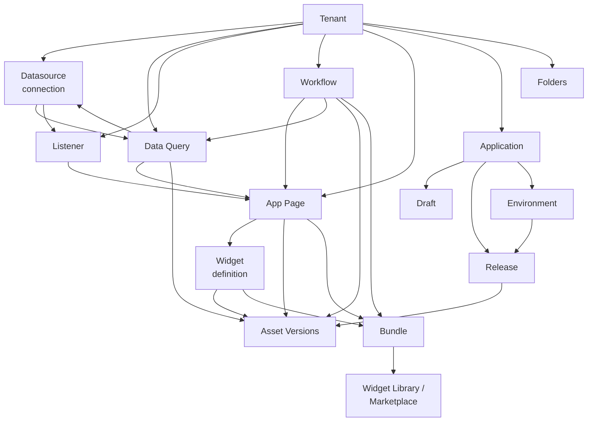
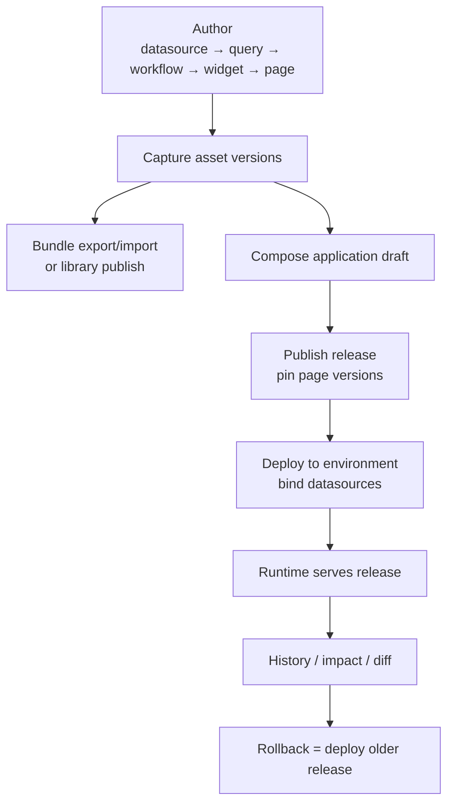

# Core Concepts

Jet Admin uses a small set of composable concepts. Most confusion comes from
three overloaded words: **datasource** (connection vs page binding),
**release** (platform build vs application release vs deployment), and
**runtime** (browser runtime vs Temporal worker vs an application
environment). This page defines each term and how the pieces fit.



## Tenant

A **tenant** is the isolation boundary for data, configuration, and
authorization. Each tenant has its own datasources, queries, workflows,
widgets, app pages, listeners, cron jobs, folders, applications, asset
versions, members, roles, API keys, and audit log stream.

- Every tenant-scoped API path starts with `/api/v1/tenants/:tenantID`.
- Membership is stored in `tblUsersTenantsRelationship`; users are global and
  can belong to multiple tenants.
- Permissions are evaluated by Casbin in the tenant domain (`r.dom = tenantID`).
- The **operator** realm is separate: platform operators manage deployment-wide
  registries and are not tenant members by virtue of being operators.
- The shared widget library, marketplace, and app-template catalog are
  deployment-global, even though their APIs are mounted under a tenant path for
  Casbin context.

See [Tenants](../tenants/tenants.md) and
[Identity & Access Management](../identity-access-management/identity-access-management.md).

## Datasource

A **datasource** is a stored connection definition: a type (`postgresql`,
`kafka`, `restapi`, `webhook`, …) plus encrypted connection options and
credential references. It is owned by one tenant.

- 45 connector types are registered in `@jet-admin/datasource-types` and
  implemented in `@jet-admin/datasources-logic`.
- 13 of them expose listener/subscription forms: PostgreSQL, Firestore,
  MongoDB, GraphQL, RabbitMQ, Kafka, Redis, Webhook, MQTT, WebSocket, SSE,
  Syslog, and NATS.
- Datasource credentials are encrypted at rest and stripped from exports. A
  datasource bundle carries a structural template with
  `requiresReconnect: true`, not secrets.
- A datasource is not the same as a page data source **binding**. The binding
  is a page-level alias pointing at a query, workflow, or listener.
- Connection options are environment state, not part of an asset version's
  definition hash. Rotating credentials does not create a new version.

## Data query

A **data query** is a reusable, parameterized command executed against one
datasource. The shape of `dataQueryOptions` is connector-specific: SQL text and
args, a REST method/URL/body, a GraphQL document, a Kafka topic/message, and so
on.

- Queries support `{{inputs.*}}` templates, resolved server-side before the
  connector is called.
- `runOnLoad` is a hint for consumers; execution is driven by the page,
  workflow, listener, cron job, or API caller.
- Queries are tenant-owned and can be cloned, folded, exported, and versioned.
- Execution is synchronous HTTP. There is no universal row limit, read-only
  mode, or cancellation token; use the datasource credential and connector
  limits as the safety boundary.
- Deleting a datasource cascades to dependent queries/listeners in the schema;
  version history is retained separately.

See [Data Query](../data-query/data-query.md).

## Listener

A **listener** is a durable subscription or webhook endpoint attached to one
datasource. Unlike a query, it is long-lived and reacts to inbound events.

- `listenerType` identifies the source (Kafka, MQTT, webhook, PostgreSQL
  notifications, etc.); `listenerConfig` holds source-specific settings.
- A listener is hard-bound to `datasourceID` (NOT NULL).
- `status` is `active` or `inactive`; activation registers the subscription in
  the listener-proxy.
- Webhook listeners get an `endpointPath` and can be called at
  `/webhooks/v1/inbound/:tenantID/:pathSuffix` or
  `/webhooks/v1/inbound/:listenerID`.
- **Actions** run in order: `transform`, `trigger_workflow`, `trigger_query`,
  `save_to_buffer`, and `push_to_app_page`.
- `save_to_buffer` writes to `tblListenerEvents` with a buffer name and
  sequence number; this is the durable event history used by application
  runtime observation.
- `push_to_app_page` emits a Socket.IO event to a page room; it is transient.

Listeners are not workflows: they are ingress adapters. The action chain decides
whether to run a query, start a workflow, store the event, or notify a page.

See [Listeners](../listeners/listeners.md).

## Workflow

A **workflow** is a directed acyclic graph of nodes and edges, executed by
Temporal. Nodes are metadata plus configuration; execution happens in Temporal
activities.

Registered node types (`packages/workflow-nodes/src/nodes`):

| Node | Purpose |
|---|---|
| `start` | Entry point and input contract |
| `dataQuery` | Execute a saved query, optionally with a pinned query version |
| `javascript` | Run user JavaScript in an `isolated-vm` sandbox |
| `condition` | Boolean branch with operators or a JS expression |
| `switch` | Multi-case branch |
| `loop` | Iterate an array with max-iteration and per-item error policy |
| `delay` | Temporal timer |
| `fanout` | Start parallel branches |
| `join` | Join branches by all/any |
| `subWorkflow` | Invoke a child workflow, optionally pinned |
| `approval` | Human approval with timeout and approve/reject outcomes |
| `dataCollection` | Form/API-style human input; currently UI form mode |
| `end` | Return a context value as workflow output |

A **workflow run** is one `tblWorkflowInstances` row. It stores status,
`executionDefinition` (the graph + args snapshot), context projections, and an
append-only log. `executionKey` provides idempotent starts for the same logical
trigger. Test runs are marked `isTest` and can be deleted separately.

The **workflow context** is the data passed between nodes (`ctx` in templates).
Standard node templates use safe-path mode; JavaScript nodes get the whole
context object in a sandbox.

See [Workflows](../workflows/workflows.md) and
[Asset Versioning](./asset-versioning.md).

## App page

An **app page** is a saved canvas: a layout tree, widget placements, page data
sources, and page variables. It is a reusable UI asset, not a route by itself.

```jsonc
{
  "layoutVersion": 2,
  "layout": { "type": "column", "children": [] },
  "widgets": ["widget_<widgetID>_<suffix>"],
  "dataSources": [
    {
      "alias": "orders",
      "type": "query",
      "queryID": "<uuid>",
      "triggerMode": "auto",
      "inputValues": {}
    }
  ],
  "variables": [
    { "key": "selectedID", "type": "string", "default": "" }
  ]
}
```

- Layout node types accepted by the backend: `column`, `row`, `widget`,
  `container`, `stack`, `z-stack`.
- A **widget instance key** (`widget_<widgetID>_<suffix>`) identifies one
  placement of a reusable widget definition on one page.
- **Page variables** are in-memory state for the open page. They reset on
  reload unless an application explicitly exposes equivalent application
  state.
- Page versions are editor-history snapshots (max 50 per page). Separately,
  immutable **asset versions** are captured for publishing.

## Widget

A **widget** is a reusable UI definition: `widgetType` plus `widgetConfig`.
The definition is stored once and can be placed on many pages and applications.

- 35 normal renderers are registered in `widgets-ui` (`WIDGETS_MAP`); 36 widget
  descriptors exist, including the internal `layout-snippet` saved-section
  type.
- Descriptors in `@jet-admin/widget-types` define defaults, aliases, template
  props, state shape, supported events/methods, and examples.
- A widget emits **events** (`onClick`, `onRowSelect`, `onSubmit`, …). An event
  handler is an ordered action chain (`SET_VARIABLE`, `EXECUTE_QUERY`,
  `TRIGGER_WORKFLOW`, `SHOW_TOAST`, `NAVIGATE`, `CALL_WIDGET_METHOD`, …).
- A widget can expose **methods** (`refresh`, `setSelectedRow`, `clearSelection`,
  `resize`, `click`) that another widget can call. Method coverage varies by
  type.
- Widget-level data sources are authoring conveniences. In an application
  release, page-level data sources are the execution boundary; standalone
  widget data sources are not sent to the deployed client.

See [App Pages & Widgets](../app-pages-widgets/app-pages-widgets.md) and
[Widget Library](./widget-library.md).

### Composite widget

A **composite widget** is a saved section: a captured layout tree with inline
widget definitions, declared inputs/outputs, and values. It renders its
children inside one widget slot.

- Inputs resolve from `composite.values` and defaults; children read them via
  `state.composite.inputs.<key>`.
- Composite child definitions are inlined at capture time, so later edits to
  the original widget do not propagate.
- Nested composite capture is explicitly rejected
  (`Nested composite widgets are not supported yet`).
- Application compiler support exists, but it does not recursively re-validate
  inline child widget types against the runtime allowlist.

## Application

An **application** is a composed, routable workspace built from app pages and
other assets. It adds a shell, routes, application state, environment
deployments, and immutable releases.

| Part | Meaning |
|---|---|
| **Draft** | Editable definition at a monotonic `revision`; optimistic concurrency via `expectedRevision` |
| **Asset link** | Tenant asset attached under an `assetKey`; app pages can be `referenced` or `managed` (owned copy) |
| **Shell** | Sidebar/topbar/bottom-bar/hamburger, navigation, branding, appearance |
| **Route** | A path mapped to a page asset key, with params, query, guard, and keep-alive |
| **Application state** | Declared variables shared across routes; persistence is opt-in per browser |
| **Environment** | Named deployment target (for example `production`) with datasource bindings and revisions |
| **Release** | Immutable compiled snapshot of the draft + exact page versions |
| **Consumer policy** | Per-user/role/API-key route/action allow/deny rules for the deployed runtime |
| **Runtime manifest** | Client-safe definition served for a deployed release |

Applications are currently a **foundation preview** (see the repository README
and the specs under `docs/specs/`). The API and Studio cover the core lifecycle;
some operational paths (notably live Temporal/Redis/listener-proxy
verification) remain incomplete.

See [Applications](#application) below and
[Feature List](./feature-list.md).

## Route

Two different things are called a route:

1. **HTTP route** — an Express mount such as
   `/api/v1/tenants/:tenantID/queries/:dataQueryID`.
2. **Application route** — an object in an application definition:

```jsonc
{
  "id": "orders",
  "path": "/orders/:orderID",
  "pageAssetKey": "ordersPage",
  "params": { "orderID": "uuid" },
  "query": { "tab": { "type": "string", "default": "summary" } },
  "keepAlive": false,
  "guard": { "expression": "{{ state.application.variables.canViewOrders }}", "redirectRouteID": "home" }
}
```

Route IDs are stable keys; paths can contain `:param` segments. Declared route
query values are typed/coerced (`string`, `number`, `integer`, `boolean`,
`uuid`); undeclared query params pass through as strings. Guards fail closed:
only a literal `true` admits the route; otherwise the guard's redirect route is
used. `notFoundRouteID` and shell `homeRouteID` are also route IDs.

## Release

Depending on context, **release** means:

| Term | Definition |
|---|---|
| **Platform release** | A build of the monorepo/images (current version `2.1.0-preview.1`) |
| **Application release** | Immutable compiled snapshot of one application at `releaseNumber`, with `contentHash`, `clientManifest`, `serverManifest`, and exact page version IDs |
| **Deployment** | Moving an environment's `currentReleaseID` to a release; deployments are append-only history |
| **Rollback** | Deploying an older retained release; no new build and no reversal of external side effects |

An application release is created by `POST /applications/:id/releases` with the
draft's `expectedRevision`. Publishing either uses the page version selected on
the asset link or captures the latest page state. The release is thin: page and
widget payloads live in asset versions, not duplicated in the release.

## Asset version

An **asset version** is an immutable snapshot of an asset's executable
definition, stored in `tblAssetVersions`. Supported asset types:

`datasource`, `query`, `workflow`, `listener`, `widget`, `appPage`, `cronjob`.

Each version has a per-asset monotonic `versionNumber`, `schemaVersion`,
SHA-256 `contentHash`, `payload`, `status`, `changeNote`, and creator
attribution. Versions are content-addressed: re-capturing identical content
returns the latest version instead of creating a duplicate. Versions are
captured explicitly (asset version API) or implicitly by application publish.

An asset version is **not**:

- a page editor-history snapshot (`tblAppPageEditorHistory`, max 50/page);
- a database backup;
- a bundle (portable JSON with new IDs on import);
- a release (which pins page versions and adds routes/environments).

See [Asset Versioning](./asset-versioning.md).

## Bundle

A **bundle** is a self-describing JSON export of one root asset plus its
dependency closure. Current format: `bundleVersion: 1`.

```jsonc
{
  "bundleVersion": 1,
  "generator": "jet-admin",
  "exportedAt": "2026-11-27T10:00:00.000Z",
  "sourceTenant": "<uuid>",
  "items": [
    {
      "type": "widget",
      "id": "<source uuid>",
      "payload": { "widgetTitle": "Orders", "widgetType": "table", "widgetConfig": {} },
      "dependencies": [
        { "type": "dataQuery", "id": "<uuid>", "name": "Orders", "bundled": true }
      ]
    }
  ]
}
```

Import always creates fresh UUIDs and rewrites known internal references.
Credentials are stripped; datasources require reconnection. A bundle is not a
live link: installed copies are independent, and later changes to the source do
not propagate.

See [Export & Import Bundles](./export-import-bundles.md).

## Library

The **shared widget library** is a deployment-scoped registry of published
widget bundles. It is a lightweight distribution mechanism, not a package
manager.

- An entry stores one bundle containing exactly one root widget item plus its
  dependency closure.
- Any tenant can install an entry; install runs the normal bundle import
  pipeline and creates independent copies.
- There is no semantic versioning, dependency resolution, ratings, or update
  channel. Unpublishing deletes the registry entry but does not affect already
  installed copies.
- The newer **marketplace** generalizes the idea to datasource/widget/workflow
  items and app templates. Do not confuse the two registries.

See [Shared Widget Library](./widget-library.md).

## Folder

A **folder** is a node in a per-entity-type tree. Scope is
`(tenantID, entityType)`, so workflow folders never appear in the widget
drawer.

- Organizable entity types: `widget`, `workflow`, `dataQuery`, `cronJob`,
  `appPage`, `listener`, `datasource`.
- Entities carry a nullable `folderID`; deleting a folder promotes child
  folders to the grandparent and un-files its items.
- Server list filters by one exact `folderID`; omitting it returns all items.
- Folders do not grant access; item and folder permissions are checked
  separately.

See [Folders](./folders.md).

## State and events

Jet Admin has several distinct state domains:

| State | Lifetime | Scope | Persistence |
|---|---|---|---|
| **Page state tree** | Open page runtime | One page instance | Memory only |
| **Page variables** | Open page runtime | One page instance | Memory only; reset on reload |
| **Widget state** | Open widget instance | One placement | Memory only (some widgets keep local UI state) |
| **Application state** | Browser tab/profile | One application, one principal | Optional `none` / `session` / `local`, keyed by tenant + application + principal + release |
| **Workflow context** | Workflow run | One `tblWorkflowInstances` row | Persisted projections/logs in PostgreSQL; Temporal is execution authority |
| **Listener buffer** | Configured retention | One listener + buffer name | `tblListenerEvents` |
| **Audit log** | Retained indefinitely | Tenant | `tblAuditLogs` (buffered writes; no delete API) |

**Events** are notifications, not durable messages, unless explicitly buffered:

- Widget events (`onClick`, `onRowSelect`, `onSubmit`, …) run an action chain
  immediately. They are not replayed after a reload.
- Application events (`EMIT_APPLICATION_EVENT`) are an in-memory bus for the
  current runtime tree. They do not cross browser tabs or users.
- Workflow progress is emitted over Socket.IO and written to instance logs;
  reconnecting clients can re-read logs but in-flight socket events can be
  missed.
- Listener `push_to_app_page` is transient; `save_to_buffer` is the durable
  path used by application runtime listener observation.

## Runtime environment

The phrase **runtime environment** has three meanings:

1. **Application environment** — a named deployment target such as
   `production`, stored in `tblApplicationEnvironments`. It has a
   `currentReleaseID`, `bindingRevision`, datasource bindings, and deployment
   history. Environment names are lowercase letters/numbers/hyphens, max 40
   characters.
2. **Process environment** — Node/Docker configuration (`DATABASE_URL`,
   `REDIS_URL`, `TEMPORAL_ADDRESS`, `VAULT_ENCRYPTION_KEY`, …). See
   [Configuration Reference](../operations/configuration-reference.md).
3. **Browser runtime** — the mounted page/application runtime that holds the
   state tree, subscriptions, and event handlers.

**Environment bindings** map datasource IDs captured in a release to concrete
tenant datasource IDs in that environment. Bindings are revisioned separately
from releases, so the same release can run against different datasource
connections without recompiling. Binding targets must have the same datasource
type as the release source.

## How the pieces relate

| Relationship | Cardinality | Notes |
|---|---|---|
| Tenant → assets | 1:N | Every asset carries `tenantID` |
| Datasource → queries/listeners | 1:N | Query/listener execution needs a tenant-scoped datasource |
| Query/listener/widget/workflow → asset versions | 1:N | Versions are content-addressed per asset |
| Workflow → nodes/edges | 1:N | Cascades on workflow delete |
| Workflow → runs | 1:N | Runs retain `executionDefinition` |
| App page → widgets | N:M through instance keys | One widget definition can appear many times |
| Application → app pages | N:M through `tblApplicationAssets` | `assetKey` is application-local |
| Application → releases | 1:N | Release numbers are per application |
| Release → page versions | N:M through manifests/references | Exact version IDs, not live page IDs |
| Environment → release | N:1 | `currentReleaseID` is the deploy pointer |
| Bundle → imported assets | 1:N | Fresh IDs; secrets stripped |
| Folder → entities | 1:N per entity type | Nullable `folderID` |
| Widget library entry → bundle | 1:1 | Bundle snapshot, no version chain |

## Lifecycle summary



Continue with [Modules](./modules.md), [Feature List](./feature-list.md), and
[Limitations](./limitations.md).
