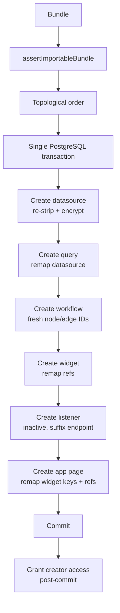

# Export & Import Bundles

A **bundle** is a portable, self-describing JSON snapshot of one root asset plus
its transitive dependency closure. It is the transport used by ordinary
export/import, the shared widget library, and marketplace item installs.

Implementation: `apps/backend/modules/bundle/`,
`apps/backend/modules/widgetLibrary/`, and
`apps/backend/modules/marketplace/`.

:::info
Bundles carry **live editable definitions**, not immutable asset versions and
not application releases. A bundle import creates new draft rows with fresh
UUIDs. To move a pinned version, export after capturing or use the application
release flow.
:::

## Bundle format (v1)

```jsonc
{
  "bundleVersion": 1,
  "generator": "jet-admin",
  "exportedAt": "2026-11-27T10:00:00.000Z",
  "sourceTenant": "<source tenant UUID>",
  "items": [
    {
      "type": "appPage",
      "id": "<source UUID; reference key only>",
      "payload": {
        "appPageTitle": "Ops dashboard",
        "appPageDescription": null,
        "appPageConfig": {
          "layoutVersion": 2,
          "widgets": ["widget_<widgetID>_<suffix>"],
          "dataSources": []
        }
      },
      "dependencies": [
        {
          "type": "widget",
          "id": "<widget UUID>",
          "name": "Orders table",
          "bundled": true
        }
      ]
    }
  ]
}
```

Supported item types:

`appPage`, `widget`, `workflow`, `dataQuery`, `datasource`, `listener`.

Not supported as bundle items: cron jobs, applications, folders, roles, API
keys, asset versions, releases, marketplace entries.

## Export roots and dependency closure

Every export endpoint walks the graph from one root and emits a closed set of
items. References are collected by scanning payload keys (for example
`queryID`, `dataQueryID`, `workflowID`, `childWorkflowID`, `listenerID`,
`datasourceID`, `appPageID`) and by page widget instance keys
(`widget_<widgetID>_<suffix>`).

| Export root | What is added |
|---|---|
| App page | Page widgets → each widget's query/workflow dependencies → their datasources; page query/workflow/listener sources → their dependencies |
| Widget | Query/workflow data sources in `widgetConfig` → their datasources |
| Workflow | `dataQuery` nodes → queries → datasources; `subWorkflow` nodes → child workflows → their dependencies |
| Data query | Its datasource |
| Listener | Its datasource; action queries/workflows → their dependencies |
| Datasource | No dependencies; payload is a sanitized connection template |

Rules:

- Items are emitted **dependencies-first** with a stable topological sort.
  The importer also re-derives order, so a hand-edited file can still import.
- Duplicate references are deduplicated by `(type, id)`.
- A reference that cannot be loaded is still recorded in the parent's
  `dependencies` with `bundled: false` (and usually no `name`). It cannot be
  remapped on import.
- Cycles between the six bundle entity types are not expected. If the
  topological sort cannot order the graph, it falls back to the original item
  order.
- `id` is a reference key only. It is never reused as a new primary key.

## Sanitization

Exports are built from explicit field lists, not raw rows. The following never
leave the tenant:

- `tenantID`, creator IDs, creator API key IDs;
- `createdAt`, `updatedAt`, `disabledAt`, connection status, run counters;
- datasource credentials, tokens, secrets, vault credential IDs, webhook
  tokens/secrets;
- listener runtime state (`status`, `lastError`, `lastEventAt`, `eventCount`);
- workflow/query runtime state and execution results.

### Datasource payloads

1. Options are decrypted server-side.
2. `stripSensitiveDeep` removes any key matching `SENSITIVE_KEY_PATTERNS` plus
   `vaultCredentialID`, `webhookToken`, and `webhookSecret`.
3. The payload is marked `requiresReconnect: true`.
4. Import strips sensitive keys **again** and encrypts the remaining options.

Datasource bundles are structural templates. A target tenant must re-enter
credentials and verify connectivity.

### Listener payloads

- `status` is forced to `inactive`.
- Actions are exported (type, config, enabled, order) but runtime event buffers
  and counters are not.
- `endpointPath` is exported so preview can detect collisions; import
  auto-suffixes collisions.
- Sensitive listener config keys are stripped.

### What is not sanitized

Titles, descriptions, query text, workflow graph definitions, widget configs,
page layouts, and non-secret connection structure are exported as-is. Treat a
bundle as potentially sensitive source code.

## Endpoints

Export endpoints live on the owning entity routers:

| Root | Endpoint | Permission |
|---|---|---|
| App page | `GET /api/v1/tenants/:tenantID/app-pages/:appPageID/export` | `appPage.export` |
| Widget | `GET /api/v1/tenants/:tenantID/widgets/:widgetID/export` | `widget.export` |
| Workflow | `GET /api/v1/tenants/:tenantID/workflows/:workflowID/export` | `workflow.export` |
| Data query | `GET /api/v1/tenants/:tenantID/queries/:dataQueryID/export` | `dataquery.export` |
| Listener | `GET /api/v1/tenants/:tenantID/listeners/:listenerID/export` | `listener.export` |
| Datasource | `GET /api/v1/tenants/:tenantID/datasources/:datasourceID/export` | `datasource.export` |

Import is a separate router at `/api/v1/tenants/:tenantID/import`:

| Method | Path | Permission | Purpose |
|---|---|---|---|
| `POST` | `/preview` | `bundle.preview` | Dry run; returns plan/warnings |
| `POST` | `/execute` | `bundle.execute` | Create items in one transaction |

There is no `GET /import` route and no import-history route.

```bash
# import-request.json contains: { "bundle": <the exported bundle object> }
curl -X POST \
  "$JET_ADMIN_URL/api/v1/tenants/$TENANT_ID/import/preview" \
  -H "Authorization: Bearer $TOKEN" \
  -H "Content-Type: application/json" \
  --data-binary @import-request.json
```

The request body must be `{ "bundle": { ... } }`; the exported file is the
bundle object shown above, so wrap it before posting.

## Structural validation

`assertImportableBundle` runs for preview and execute:

1. `bundleVersion` must be exactly `1`.
2. `items` must be a non-empty array.
3. No duplicate `(type, id)` keys.
4. Each item must have an object `payload`.
5. Each item's type must have a required title field
   (`appPageTitle`, `widgetTitle`, `title`, `dataQueryTitle`, `datasourceTitle`,
   `listenerTitle`).
6. Workflow edges must reference nodes inside the same workflow item.
7. Every listener item must carry a datasource entry in `dependencies`.

Validation errors abort before any database write. Warnings do not.

## Preview response

```jsonc
{
  "success": true,
  "valid": true,
  "summary": {
    "createCount": 4,
    "warningCount": 2,
    "missingDependencyCount": 1
  },
  "items": [
    {
      "type": "appPage",
      "id": "…",
      "title": "Ops dashboard",
      "action": "create",
      "warnings": [
        "A appPage named \"Ops dashboard\" already exists in this tenant."
      ],
      "missingDependencies": [
        { "type": "listener", "id": "…" }
      ]
    }
  ]
}
```

Preview checks:

- references outside the bundle (cannot be remapped);
- title collisions in the target tenant (warning only);
- datasource `requiresReconnect` (warning);
- listener endpoint-path collisions (warning; import suffixes);
- listener without a datasource dependency (structural error) or with an
  unbundled datasource (warning/skip).

`action` is always `"create"` in v1. There is no update/merge plan.

## Execute semantics



Details:

- **Fresh UUIDs.** Every created row gets a new ID. `idMap` maps
  `"<type>:<oldID>"` to the new UUID.
- **Reference remapping.** Values under known reference keys are rewritten
  recursively. Unknown IDs are left untouched (preview warned about them).
  Widget instance keys are rewritten in `widgets[]`, `widgetKey`, and the v1
  grid-layout `i` field.
- **Workflow nodes/edges.** New node UUIDs are generated; edges are remapped to
  those IDs. Node defaults are `timeoutSeconds: 300`, `retryLimit: 3` when the
  payload omits them (this can differ from platform policy defaults).
- **Listeners.** Created `inactive`. If the datasource dependency cannot be
  resolved, the listener is **skipped** with a reason; the rest of the bundle
  still imports. `endpointPath` collisions get `-2`, `-3`, ….
- **Datasources.** Imported with `connectionStatus` default/inactive and
  `requiresReconnect` not persisted. Options are re-encrypted.
- **Queries.** If an external datasource is missing, the query is created
  without `datasourceID` and a warning is returned; it will not execute until
  reselected.
- **App pages.** Widget refs/keys are remapped; `appPageConfig` is deep-copied
  and reference keys rewritten.
- **Duplicate titles** are allowed; only warnings.
- **Creator access** is granted after commit for every created resource.
- **Transaction.** One Prisma transaction with a 120 s timeout. A failure rolls
  back all created rows; post-commit grant failures do not roll back data.
- **No import history.** There is no record of which file created which rows.

## Selection and dependencies

`selectBundleItems(bundle, selectedItemKeys)` exists as a helper. It:

- returns the selected subset plus `dependsOn`, `requiredBy`, and
  `missingDependencies` metadata;
- does **not** silently add dependencies;
- rejects an empty selection.

This helper is used by the marketplace preview/install routes. The plain
`POST /import/execute` route has no selection field; it imports every item in
the bundle. The widget-library install route also imports the full stored
bundle.

## Limits

| Limit | Value / behavior |
|---|---|
| Bundle version | `1` only |
| Minimum items | 1 |
| Maximum items | No explicit cap; subject to the 5 MB API body limit and DB transaction |
| Request body | 5 MB default Express JSON limit |
| Import transaction | 120 s |
| Title lengths | Import writes directly via Prisma and bypasses route schemas; database varchar limits apply |
| Secret transfer | Never; reconnect required |
| Listener event buffer | Not exported |
| Asset versions / releases | Not exported |
| Update/merge | Not supported |
| Import rollback | Not supported (transaction rolls back only on failure) |
| Bundle signing | Not supported |
| Selective install via route | Not supported (helper only) |
| Application export/import | Not supported |

A bundle that imports successfully can still be **operationally incomplete**:
missing external listeners, queries without datasources, reconnecting
datasources, and inactive listeners are expected outcomes, not bugs.

## Library and marketplace reuse

- **Widget library:** publish stores the exported bundle; install calls
  `executeImport` with fresh IDs. Publish requires exactly one root widget item.
- **Marketplace item:** `payload` is a bundle; preview/install reuse the same
  pipeline.
- **App templates:** compile a bundle for pages/queries/widgets/workflows, then
  layer schema/seed SQL, roles, demo users, and cron jobs outside bundle v1.

Because all three paths share bundle semantics, they also share its limits:
no merge, no live links, no secret transfer, no application/release coverage.

## Troubleshooting

| Symptom | Likely cause |
|---|---|
| `Unsupported bundleVersion` | File is not v1 |
| `Bundle item … is missing required field` | Payload title field absent/renamed |
| `Workflow … edge referencing an unknown node` | Hand-edited graph |
| `Listener … missing its datasource dependency entry` | Dependencies array stripped |
| `Referenced … will be missing after import` | External dependency not bundled; reselect it manually |
| Listener missing after import | Datasource was not bundled/resolvable; check `skipped` |
| Query imports but cannot run | Missing datasource; reselect it |
| Datasource test fails | Credentials were stripped; reconnect |
| App page renders blank slots | Widget IDs were not remapped (hand-edited file) or widget creation failed |

For the immutable alternative, see [Asset Versioning](./asset-versioning.md).
For install registries, see [Widget Library](./widget-library.md).
