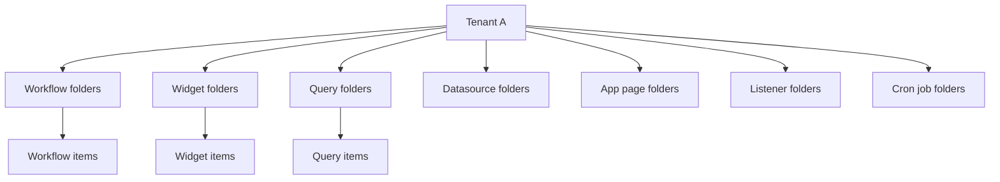

# Folders

Folders organize assets inside each entity drawer. They are **not** a global
file system: every folder tree is scoped to one tenant and one entity type.
A workflow folder never appears in the widget drawer, and a widget cannot be
moved into a query folder.

Implementation: `apps/backend/modules/folder/`, table `tblFolders`, shared UI in
`apps/frontend/src/presentation/components/folderComponents/entityFolderTree.jsx`.

## Scope model



A folder is uniquely positioned by:

```text
(tenantID, entityType, folderID)
```

`entityType` is validated against a fixed enum. Moving an entity into a folder
of another type is rejected.

## Data model

```text
tblFolders
├── folderID        UUID PK
├── folderTitle     VARCHAR(255)
├── tenantID        UUID  (FK → tblTenants, CASCADE)
├── entityType      VARCHAR(50)
├── parentFolderID  UUID? (self-FK)
├── creatorID       UUID?
├── createdAt       TIMESTAMPTZ
└── updatedAt       TIMESTAMPTZ
```

Each organizable table has a nullable `folderID`:

| Entity | Table | Folder FK |
|---|---|---|
| Widget | `tblWidgets` | `folderID` |
| Workflow | `tblWorkflows` | `folderID` |
| Data query | `tblDataQueries` | `folderID` |
| Cron job | `tblCronJobs` | `folderID` |
| App page | `tblAppPages` | `folderID` |
| Listener | `tblListeners` | `folderID` |
| Datasource | `tblDatasources` | `folderID` |

Indexes: `(tenantID, entityType)` for tree listing and `parentFolderID` for
children. The `folderID` foreign keys are nullable; deleting a folder un-files
its items rather than deleting them.

Migration: `apps/backend/prisma/migrations/manual/002-add-folders.sql` (the
datasource folder column is part of the current schema/migrations).

## API

Mounted at `/api/v1/tenants/:tenantID/folders`:

| Method | Path | Permission | Body / query | Notes |
|---|---|---|---|---|
| `GET` | `/` | `folder.list` | `?entityType=widget` | Flat list; client builds the tree |
| `POST` | `/` | `folder.create` | `{ entityType, folderTitle, parentFolderID? }` | Parent must exist in the same tenant/type |
| `PATCH` | `/:folderID` | `folder.update` | `{ folderTitle?, parentFolderID? }` | Rename and/or reparent; cycle-checked |
| `DELETE` | `/:folderID` | `folder.delete` | — | Children promoted to grandparent; items un-filed |
| `POST` | `/move` | `folder.update` + entity `update` per item | `{ entityType, entityIDs[], folderID }` | `folderID: null` un-files to root |

`GET` response shape:

```jsonc
{
  "success": true,
  "folders": [
    {
      "folderID": "…",
      "tenantID": "…",
      "entityType": "widget",
      "folderTitle": "Sales",
      "parentFolderID": null,
      "creatorID": "…"
    }
  ]
}
```

`POST /move` response:

```jsonc
{ "success": true, "moved": 3 }
```

### Authorization details

- Folder CRUD uses `folder.*` permissions.
- `POST /move` additionally requires `update` on every moved entity. The route
  middleware exposes the body's `entityIDs` as `req.<entityType>IDs` so the
  Casbin check can evaluate each ID with `skipIfMissing` semantics.
- A user who can create a folder may not automatically move another user's
  items; the per-entity check is the gate.
- Deleting a folder requires `folder.delete`, not delete permission on the
  items (items are un-filed, not deleted).

## Tree semantics

### Create

- `folderTitle` is required, 1–255 characters.
- `parentFolderID` is optional; omitting it creates a root folder.
- If a parent is supplied, it must exist in the same tenant and have the same
  `entityType`. Otherwise the service throws
  `Parent folder not found for this entity type.`
- Creator access is granted after creation.
- Duplicate titles are allowed.

### Rename and reparent

`PATCH` supports either field independently:

```jsonc
{ "folderTitle": "Sales ops" }
{ "parentFolderID": "…" }
{ "parentFolderID": null }
```

Reparenting is rejected if the target is the folder itself or one of its
descendants:

```text
Cannot move a folder into itself or one of its descendants.
```

The service walks the parent chain with a visited set, so corrupt/cyclic stored
data cannot loop forever.

### Delete

Deletion is non-recursive for items:

1. Child folders are reparented to the deleted folder's parent (or root).
2. The folder row is deleted.
3. Items that pointed at it become unfiled (`folderID = NULL`).

No entity is deleted. If you need recursive deletion, delete items first, then
folders bottom-up.

### Bulk move

```bash
curl -X POST \
  "$JET_ADMIN_URL/api/v1/tenants/$TENANT_ID/folders/move" \
  -H "Authorization: Bearer $TOKEN" \
  -H "Content-Type: application/json" \
  -d '{
    "entityType": "workflow",
    "entityIDs": ["<uuid>", "<uuid>"],
    "folderID": "<folder-uuid>"
  }'
```

- `entityIDs` must contain at least one UUID.
- `folderID: null` un-files the entities.
- The service runs one `updateMany` scoped by `tenantID` and the entity's ID
  field; it returns the number moved.
- If any ID is from another tenant, it is simply not matched (and not moved).
- There is no partial-success error; check `moved` against the requested count.
- Moving to a folder of the wrong `entityType` fails before the update.

## Filtering entity lists

Each entity list endpoint accepts an optional exact `folderID`:

```text
GET /api/v1/tenants/:tenantID/workflows?folderID=<uuid>
GET /api/v1/tenants/:tenantID/queries?folderID=<uuid>
GET /api/v1/tenants/:tenantID/widgets?folderID=<uuid>
GET /api/v1/tenants/:tenantID/listeners?folderID=<uuid>
GET /api/v1/tenants/:tenantID/cronjobs?folderID=<uuid>
GET /api/v1/tenants/:tenantID/app-pages?folderID=<uuid>
GET /api/v1/tenants/:tenantID/datasources?folderID=<uuid>
```

Important: the server filter is **exact**, not recursive. A parent folder query
does not automatically include items in child folders. Omitting `folderID`
returns all items ("All items" root view). The explorer UI builds the hierarchy
from all rows and renders children under their folders.

## Frontend

One shared component serves every drawer:

- `presentation/components/folderComponents/entityFolderTree.jsx`
  (`EntityFolderTree`) renders the tree, inline create/rename/delete, and
  native HTML5 drag and drop:
  - drag an item onto a folder to move it;
  - drag an item onto "All items" to un-file it;
  - drag a folder onto another folder to reparent it;
  - drag a folder onto "All items" to promote it to root.
- `logic/hooks/useEntityItems.js` fetches items with their `folderID`. While
  searching, drawers fall back to a flat server-filtered result list.
- Each drawer supplies a `renderItemRow` callback so row visuals remain
  entity-specific without forking the tree component.

Consumers: workflow, query, widget, listener, cron job, app page, and
datasource drawers.

## Limits and edge cases

| Constraint | Behavior |
|---|---|
| Title length | 255 characters |
| Duplicate names | Allowed |
| Maximum depth | None enforced |
| Maximum folder count | None enforced |
| Maximum bulk move | No explicit cap; request body limit applies |
| Cross-entity move | Rejected |
| Cross-tenant parent | Rejected by tenant-scoped lookup |
| Recursive delete | Not supported; children promoted, items un-filed |
| Recursive filter | Not supported; exact `folderID` only |
| Folder-level ACL | Not supported; folder permission + item permissions |
| Folder archive/color/order | Not supported |
| Deep tree listing | Flat query returns all folders; large trees increase payload |

If you need a "team folder" permission model, enforce it through roles on the
folder plus item permissions; do not assume a folder grants access to its
contents.

## Related pages

- [Modules](./modules.md)
- [Feature Inventory](./feature-list.md)
- [Limitations](./limitations.md)
