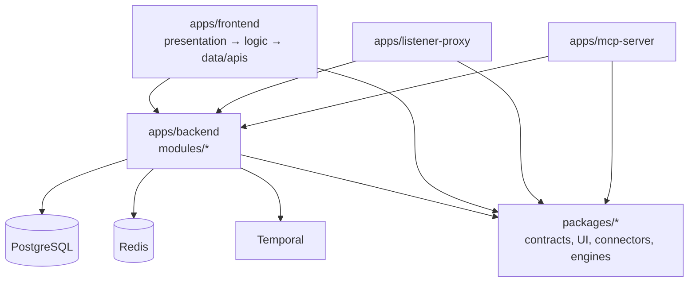
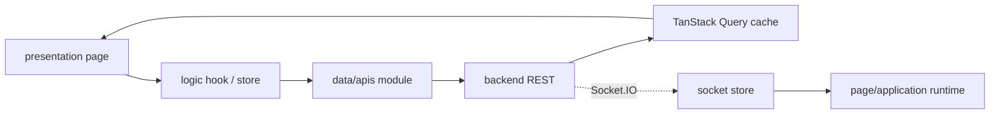

# Modules & Package Map

This page maps the repository by ownership. Use it when deciding where a change
belongs, which API surface to call, and which package must be rebuilt.

## Backend module pattern

Every feature in `apps/backend/modules/<name>/` follows the same shape:

| File | Responsibility |
|---|---|
| `<name>.v1.routes.js` | Express route table and middleware order |
| `<name>.controller.js` | Request/response translation; calls one service method |
| `<name>.service.js` | Business logic, Prisma queries, transactions, policy grants |
| `<name>.validator.js` | Zod request schemas |
| `<name>.middleware.js` | Request enrichment for cross-resource authorization |
| `<name>.errors.js` | Optional domain errors (used by `application`) |

Shared rules:

- Routes mount under `/api/v1/tenants/:tenantID/...` unless explicitly global.
- `authMiddleware.authProvider` runs once on the tenant router; individual
  routes call `authorize(P.<resource>.<action>)`.
- Cross-resource permissions use `{ ...P.x.y, reqKey: "xIDs", skipIfMissing:
  true }`.
- Services receive `tenantID`, `userID`, and `authContext`; they call
  `grantCreatorAccess` after create.
- All responses use `sendResponse`; errors are normalized by the global
  handler in `index.js`.

## Backend modules

| Module | Mount | Responsibility | Key APIs / entry points | Depends on |
|---|---|---|---|---|
| `auth` | `/api/v1/auth` | Firebase/API-key authentication, current user, per-tenant user config, socket auth | `GET /`, `GET/POST /config/:tenantID` | Firebase, users, notifications |
| `tenant` | `/api/v1/tenants` | Tenant list/create/read/update/delete, logo upload, AI config, mounts all nested routers | `GET /`, `POST /`, `GET/PATCH/DELETE /:tenantID`, `POST /upload-logo`, `GET/POST /:tenantID/ai-config` | auth, every tenant service for cascade |
| `userManagement` | `/:tenantID/users` | Membership list, add/remove users, assign roles, addition limits | `GET /`, `POST /`, `GET/DELETE /:tenantUserID`, `PATCH /:tenantUserID/roles` | auth, tenant, roles, notifications |
| `tenantRole` | `/:tenantID/roles` | Custom roles, permission registry, Casbin policy sync | `GET/POST /`, `GET /permissions`, `GET/PATCH/DELETE /:roleID`, `POST /sync-policies` | auth, tenant, Casbin |
| `apiKey` | `/:tenantID/apikeys` | Tenant API keys, prefix/hash storage, clone, disable | `GET/POST /`, `GET/PATCH/DELETE /:apiKeyID`, `POST /:apiKeyID/clone` | auth, tenant |
| `datasource` | `/:tenantID/datasources` | Connection CRUD, form schemas, test connection, saved health, upload, OAuth helper proxy, clone/export | `GET /schemas`, `GET/POST /`, `POST /test`, `POST /:id/test`, `GET /:id/health`, `POST /upload`, `POST /:id/proxy`, `GET /:id/export` | auth, tenant, vault/encryption, datasource packages |
| `dataQuery` | `/:tenantID/queries` | Query CRUD, schema discovery, test/run with inputs, clone/export, folders | `GET /schemas`, `GET/POST /`, `PATCH /queryTest`, `POST /:id/queryTest`, `POST /:id/run`, `GET /:id/export` | datasource, expression engine, connectors |
| `workflow` | `/:tenantID/workflows` | Workflow graph CRUD, validation, execute/test/cancel, run history, data collection, export | `GET /schemas`, `GET/POST /`, `GET/PATCH/DELETE /:id`, `POST /:id/execute`, `POST /test`, `GET /instances`, `GET /instances/:id`, `POST /instances/:id/cancel`, `GET /:id/export` | dataQuery, Temporal, workflow packages |
| `listener` | `/:tenantID/listeners` | Listener CRUD, activate/deactivate, actions, connection status, export/clone | `GET /schemas`, `GET/POST /`, `PUT/DELETE /:id`, `POST /:id/activate`, `POST /:id/deactivate`, `POST/PUT/DELETE /:id/actions`, `GET /status/connections` | datasource, workflow/query actions, Redis, listener-proxy |
| `cronJob` | `/:tenantID/cronjobs` | Cron CRUD, scheduling, run history, clone | `GET/POST /`, `GET/PATCH/DELETE /:id`, `GET /:id/history`, `POST /:id/clone`, `GET /status/connections` | workflow, dataQuery, Redis lock |
| `widget` | `/:tenantID/widgets` | Widget CRUD, schema/descriptor validation, file upload/serve, clone/export, workflow bridge | `GET /schemas`, `GET/POST /`, `GET/PATCH/DELETE /:id`, `POST /upload`, `GET /files`, `GET /:id/export`, `POST /:id/clone` | widget packages, dataQuery, Socket.IO |
| `appPage` | `/:tenantID/app-pages` | Canvas CRUD, layout validation, reference authorization, editor history (50 versions), clone/export | `GET /schemas`, `GET/POST /`, `GET/PATCH/DELETE /:id`, `GET /:id/versions`, `POST /:id/versions/:versionID/restore`, `GET /:id/export` | widget, dataQuery, workflow, listener |
| `application` | `/:tenantID/applications` | Draft, shell/routes/state, asset links, page versions, compile/publish, environments/bindings, consumer policy, runtime manifests, listener observation | `GET/POST /`, `GET /:id`, `GET/PATCH /:id/draft`, `POST /:id/assets/pages`, `PATCH /:id/assets/:assetKey/version`, `POST /:id/validate`, `POST /:id/releases`, `GET /:id/releases`, `PUT /:id/environments/:env/bindings`, `POST /:id/environments/:env/deployments`, `GET /:id/runtime/:env/manifest` | appPage, assetVersion, dataQuery, workflow, listener, application-contracts |
| `assetVersion` | `/:tenantID/asset-versions` | Immutable version capture, list/get, diff, impact, restore for 7 asset types | `GET /:assetType/:assetID/versions`, `GET .../:versionID`, `GET .../diff`, `GET .../impact`, `POST .../versions`, `POST .../:versionID/restore` | every asset table, Casbin, diff/reference helpers |
| `bundle` | `/:tenantID/import` | Bundle preview/execute; dependency closure export is invoked by entity modules | `POST /preview`, `POST /execute`; export controllers in `appPage`, `widget`, `workflow`, `dataQuery`, `listener`, `datasource` | all six bundle entity types, Casbin, encryption |
| `folder` | `/:tenantID/folders` | Per-entity folder tree, rename/reparent, bulk move, exact-folder filtering | `GET /?entityType=`, `POST /`, `PATCH /:folderID`, `DELETE /:folderID`, `POST /move` | entity tables, Casbin |
| `widgetLibrary` | `/:tenantID/widget-library`; operator mount | Deployment registry of widget bundles; tenant list/publish/unpublish/preview/install | `GET/POST /`, `DELETE /:id`, `POST /:id/preview`, `POST /:id/install` | bundle, Casbin, operatorAuth |
| `marketplace` | `/:tenantID/marketplace`, `/:tenantID/templates` | Integration store (datasource/widget/workflow items) and app-template catalog/install/uninstall/assets | marketplace: `GET /`, `GET /:id`, `POST /:id/preview`, `POST /:id/install`; templates: `GET /`, `GET /:slug`, `POST /:slug/install`, `DELETE /:slug`, `GET /:slug/assets/*` | bundle, tenantRole, query/seed execution, filesystem packages |
| `audit` | `/:tenantID/audit` | Paginated audit log list and CSV export | `GET /`, `GET /export` | auth, tenant, audit middleware/buffer |
| `notification` | — (service only) | User notifications; currently tenant-addition notification and user notification list | `sendUserTenantAdditionNotification`, `getAllUserNotifications` | users, tenants |
| `oauth` | `/api/v1/oauth` | Google OAuth authorization URL and public callback; stores credentials in vault | `GET /google/auth/:tenantID`, `GET /:tenantID/google/url`, `GET /google/callback` | datasource update permission, vault, Google |
| `vault` | — (service only) | AES-256-GCM credential storage/retrieval by tenant/provider | `storeCredential`, `getCredential`, provider lookups | `VAULT_ENCRYPTION_KEY`, Prisma |
| `ai` | `/api/v1/tenants/:tenantID/ai` | Jet Agent chat stream using MCP tools; tenant/workspace model config | `POST /chat/stream`, `DELETE /session` | auth, MCP server, vault, LLM provider |
| `operatorAuth` | `/api/v1/operator/auth` | Separate platform-operator identity realm (PBKDF2 + opaque sessions) | `POST /login`, `POST /logout`, `GET /me` | operators, sessions |
| `operatorAdmin` | `/api/v1/operator` | Global roles/permissions, widget-library registry, marketplace verification/removal | `GET/POST /roles`, `PATCH/DELETE /roles/:roleID`, `GET/POST /permissions`, `GET/POST /widget-library`, `DELETE /widget-library/:id`, `GET /marketplace`, `PATCH/DELETE /marketplace/:itemID` | operatorAuth, tenantRole validators, widgetLibrary, marketplace |
| `proxyRegistry` | — (internal) | Redis-backed proxy membership, consistent-hash shard assignment, rebalance, placement status | `registerProxy`, `heartbeat`, `getShard`, `reconcileAndAnnounce` | Redis |

### Module notes

**`tenant` is a router aggregator.** `tenant.v1.routes.js` mounts users, roles,
API keys, cron jobs, datasources, listeners, queries, workflows, widgets, app
pages, asset versions, bundles, folders, widget library, marketplace,
templates, applications, and audit. Adding a tenant module means adding it
there and to `config/module.config.js` dependencies if other modules depend on
it.

**`application` is the most coupled module.** It compiles releases from app
pages and their dependency graph. It reads asset versions, page configs,
queries, workflows, and listeners; it does not execute live query IDs at
runtime. Its compiler (`application.compiler.js`) is pure and separately
testable.

**`assetVersion` is shared infrastructure.** It is mounted independently of the
entity routers because it serves seven asset types with one permission model
(`<resource>:<assetID>`). See [Asset Versioning](./asset-versioning.md).

**`bundle` owns import, not export routing.** Export endpoints live on the
owning entity routers (`/queries/:id/export`, `/widgets/:id/export`, …) and call
`bundleController.export*`. `POST /import/preview` and `/execute` are the only
routes under `/import`.

**`listener` and `listener-proxy` are one logical system.** The backend owns
CRUD, validation, action dispatch, and Redis consumption. The proxy owns
subscriptions and webhook HTTP ingress. Do not add subscription code to the
backend; it would double-consume broadcast sources.

**`marketplace` app templates are not just bundles.** They can run schema and
seed SQL, create roles/demo users, create cron jobs, and on uninstall drop
prefixed tables with `CASCADE`. Treat template packages as trusted code.

## Cross-cutting backend config

| File | Responsibility |
|---|---|
| `config/express-app.config.js` | CORS, body limits, compression, static/public, request logging |
| `config/http-server.config.js` | HTTP server instance |
| `config/prisma.config.js` | Singleton Prisma client |
| `config/casbin.config.js` | Casbin enforcer, Prisma policy adapter, creator grants |
| `config/permissions.json` / `permissions.js` | Single source of resource/action permissions (`P`) |
| `config/module.config.js` | `ENABLED_MODULES` + dependency gating |
| `config/firebase.config.js` | Firebase Admin initialization |
| `config/redis.config.js` | Named Redis clients (`bus`, `consumer`, `registry`, `socket-*`, `cron-lock`) |
| `config/listenerBus.config.js` | Stream names, consumer group, DLQ helpers |
| `config/queue.config.js` | Listener Streams consumer loop, pending reclaim, DLQ routing |
| `config/socket.io.js` | Socket.IO server + optional Redis adapter |
| `config/startup.js` | Queue/Temporal worker/pipeline/reconciler startup |
| `utils/sensitive.js` | Sensitive-key patterns and redaction |
| `utils/encryption.util.js` | AES-256-GCM for vault/datasource options |
| `utils/datasourceOptions.util.js` | Encrypt/decrypt datasource options |
| `utils/authorizedProxy.js` | Delegated execution with caller identity/origin |
| `utils/executionContext.js` | Execution context (`user`, `apiKey`, `system`, origin) |
| `utils/tenantReference.util.js` | Cross-entity tenant reference assertions |

## Frontend major areas

### Routes

`apps/frontend/src/presentation/components/routes/rootRouter.jsx` defines:

| Area | Path pattern |
|---|---|
| Auth | `/sign-in/*`, `/sign-up/*` |
| Home / account | `/`, `/account` |
| Tenant | `/tenants/:tenantID`, `/tenants/add`, `/tenants/:tenantID/settings` |
| Datasources | `/tenants/:tenantID/datasources`, `/add`, `/:datasourceID` |
| Queries | `/tenants/:tenantID/queries`, `/add`, `/:dataQueryID` |
| Engines | `/tenants/:tenantID/engines` |
| Widgets | `/tenants/:tenantID/widgets`, `/add`, `/:widgetID` |
| App pages | `/tenants/:tenantID/app-pages`, `/add`, `/:appPageID` |
| Applications | `/tenants/:tenantID/applications`, `/:applicationID`, `/:applicationID/preview/*`, `/:applicationID/run/:environment/*` |
| Workflows | `/tenants/:tenantID/workflows`, `/add`, `/:workflowID`, `/:workflowID/editor`, `/:workflowID/history`, `/history`, `/runs/:runID` |
| Listeners | `/tenants/:tenantID/listeners`, `/add`, `/:listenerID` |
| Cron jobs | `/tenants/:tenantID/cronjobs`, `/add`, `/:cronJobID`, `/:cronJobID/history` |
| API keys | `/tenants/:tenantID/apikeys`, `/add`, `/:apiKeyID` |
| Users / roles | `/tenants/:tenantID/users`, `/:tenantUserID`; `/tenants/:tenantID/roles`, `/add`, `/:roleID` |
| Audit / marketplace | `/tenants/:tenantID/audit`, `/tenants/:tenantID/marketplace` |

### Frontend folders

| Area | Responsibility |
|---|---|
| `src/presentation/pages` | Route-level screens (43 page modules) |
| `src/presentation/components/appPageComponents` | Craft.js editor, layout renderer, widget slots, page settings, data/variables panels |
| `src/presentation/components/applicationComponents` | Application shell, studio panels, preview/runtime, route/state/bindings/policy dialogs |
| `src/presentation/components/assetVersionComponents` | Version history/diff/impact UI |
| `src/presentation/components/widgetComponents` | Widget IDE/config surfaces |
| `src/presentation/components/drawerList` | Explorer-style entity lists with folder trees |
| `src/presentation/components/bundleComponents` | Export button and import preview/confirm dialog |
| `src/presentation/components/widgetLibraryComponents` | Library browse/install/publish |
| `src/presentation/components/marketplaceComponents` | Store and app-template gallery |
| `src/presentation/components/workflowComponents` | React Flow editor, nodes, run history |
| `src/presentation/components/listenerComponents` | Listener forms, actions, guidance |
| `src/presentation/layouts` | Protected shell and per-area sidebars |
| `src/logic/appPageRuntime` | Page state tree, reducer, actions, query coordinator, workflow streaming, listener socket subscriptions, widget methods |
| `src/logic/applicationRuntime` | Application store, route ordering/navigation, guards, state persistence, release runtime services, listener observation |
| `src/logic/assetVersion` | Version readiness helpers |
| `src/logic/hooks` | Shared query/mutation hooks (for example `useEntityItems`) |
| `src/logic/stores` | Client stores (auth, socket, notifications) |
| `src/data/apis` | 22 Axios API modules, one per backend area |
| `src/config` | Firebase and runtime config |
| `src/shared`, `src/lib`, `src/utils` | Shared UI/helpers, Craft utilities, notifications |

### Frontend data flow

The API layer is deliberately thin: auth headers are attached centrally, base
URL comes from `/config.js` or `VITE_SERVER_HOST`, and each module mirrors the
backend route ownership. Business transformations belong in `logic/`, not in
components.

## Shared packages

| Package | Responsibility | Consumed by |
|---|---|---|
| `@jet-admin/application-contracts` | Zod application schema, 100-route/100-variable/256 KiB limits, route query coercion, safe JSON/key validation | backend compiler, frontend studio/runtime |
| `@jet-admin/datasource-types` | 45 datasource descriptors, connection/query/listener JSON forms, guidance, icons | frontend datasource UI, backend schema endpoints, MCP |
| `@jet-admin/datasources-logic` | 45 connector implementations, webhook router, listener transforms, manifests | backend query engine/listener engine, MCP |
| `@jet-admin/datasources-ui` | Datasource form components and runtime helpers | frontend datasource pages/editors |
| `@jet-admin/expression-engine` | `safe-path` and `js-template` evaluation, parsers, intellisense, dependency extraction, validation | backend input resolver, frontend page/widget runtime, MCP validation |
| `@jet-admin/json-forms-renderers` | JSON Forms renderers used by workflow/app config forms | frontend editors |
| `@jet-admin/mcp-server` | MCP tool registry, resources, stdio entrypoint, API client | `apps/mcp-server`, backend Jet Agent |
| `@jet-admin/ui` | Shared design system (Radix + Tailwind): buttons, inputs, dialogs, tables, code editor, layout primitives | frontend, widgets-ui, workflow-nodes |
| `@jet-admin/widget-types` | 36 widget descriptors, defaults, normalization, validation, event/method catalogs | backend widget validator, frontend/MCP authoring |
| `@jet-admin/widgets-logic` | Widget data resolution and builders | frontend widget runtime, composite renderer |
| `@jet-admin/widgets-ui` | 35 widget renderers, config editors, `WIDGETS_MAP` | frontend page/application runtime |
| `@jet-admin/workflow-edges` | Workflow edge UI | workflow editor |
| `@jet-admin/workflow-nodes` | Workflow node UI, configurators, JSON Forms schemas | workflow editor |
| `@jet-admin/workflow-nodes-logic` | Node handlers, VM sandbox, runtime contract validation, dependency extraction | Temporal activities, asset version validation |

Packages are npm workspaces and are built with `npm run build:packages`
(`scripts/build-packages.js`). Several packages are dual ESM/CJS with `dist/`
outputs; backend requires the CJS build, frontend uses the ESM build. Rebuild a
package after changing its source before testing the apps.

## MCP tool surface

`packages/mcp-server/src/tools` groups tools by domain:

| Family | Examples |
|---|---|
| Introspection | List widget schemas, datasource schemas, workflow nodes |
| Catalog | Search datasource types, widget types, templates |
| Validation | Validate widget config, workflow graph, application definition |
| Datasource | List/create/test/clone datasource |
| Query | List/create/run/test/export query |
| Listener | List/create/activate/actions |
| Workflow | List/create/validate/execute/history |
| Widget | List/create/update/export |
| App page | List/create/config/versions |
| IAM | Read-only users/roles/permissions |
| Admin | Folders, cron, audit, keys, users, roles, library, import |
| Lifecycle | Clone/export, run history, generic proxy helpers |

`apps/mcp-server` exposes the same registry over Streamable HTTP. Each request
must carry a Firebase bearer token; the token is forwarded to backend REST
calls, so tool execution uses the caller's Casbin permissions. The stdio
entrypoint in `packages/mcp-server` uses one API key + tenant from environment
variables and is intended for local MCP clients.

## Dependency rules

1. `packages/*` must not import `apps/*`.
2. `apps/backend` may import packages, never frontend code.
3. `apps/frontend` may import packages, never backend code.
4. Shared contracts belong in packages, not duplicated in both apps.
5. `dataQuery` may depend on `datasource`; `workflow` may depend on
   `dataQuery`; `appPage` may depend on all three.
6. `assetVersion` and `bundle` are cross-cutting and may read every asset
   table, but must not own feature-specific business rules.
7. Listener subscriptions live only in `apps/listener-proxy`; backend listener
   code consumes events and dispatches actions.

## Related pages

- [Platform Architecture](./architecture.md)
- [Core Concepts](./concepts.md)
- [Feature List](./feature-list.md)
- [Asset Versioning](./asset-versioning.md)
- [API Reference](../developers/api-reference.md)
