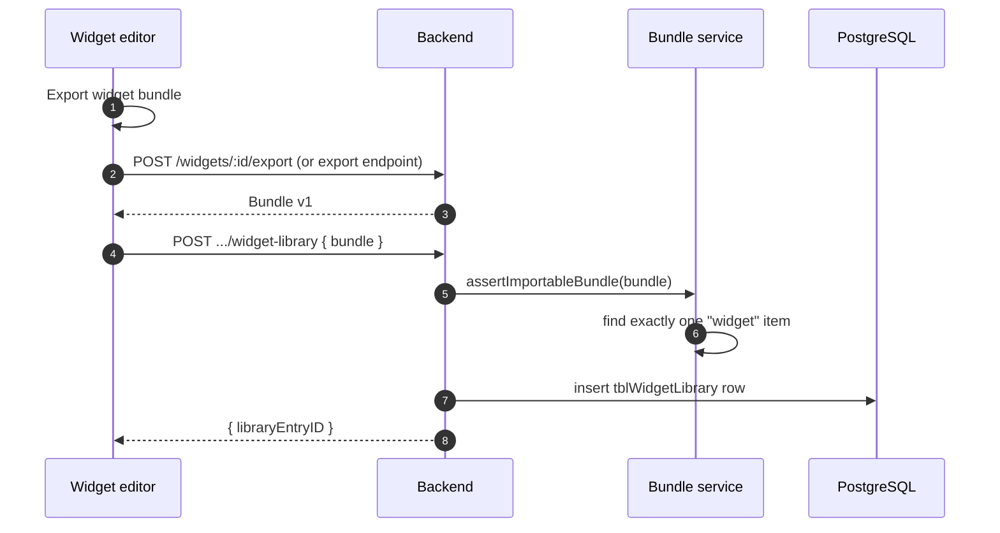
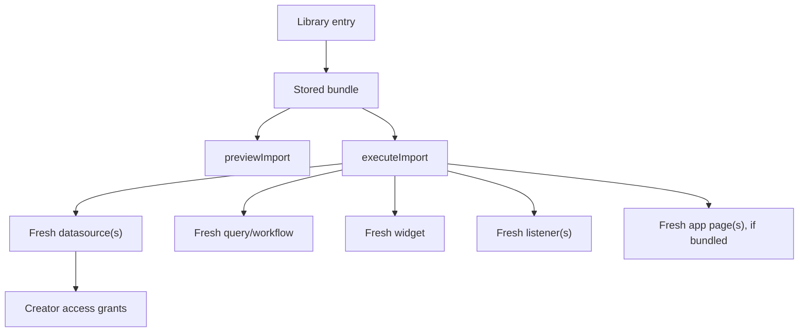

# Shared Widget Library

The **shared widget library** is a lightweight distribution mechanism for
widgets: a deployment-scoped registry of bundle snapshots. Any tenant with
install permission can clone a published widget (and its dependencies) into its
own tenant.

Implementation: `apps/backend/modules/widgetLibrary/`, table
`tblWidgetLibrary`, and the standard bundle import pipeline.

:::info Not a package manager

There is no semantic versioning, no dependency resolution across entries, no
update channel, and no signature verification. An entry is a snapshot; installed
copies are independent.
:::

## Data model

```text
tblWidgetLibrary (no tenant FK — deployment-wide)
├── libraryEntryID    UUID PK
├── widgetTitle       VARCHAR
├── widgetType        VARCHAR
├── widgetDescription VARCHAR?
├── bundle            JSONB   — full Bundle v1 (widget + dependency closure)
├── sourceTenantID    UUID?   — optional provenance
├── publishedByUserID UUID?   — tenant user who published, if any
├── createdAt         TIMESTAMPTZ
└── updatedAt         TIMESTAMPTZ
```

The stored `bundle` is exactly the export bundle described in
[Export & Import Bundles](./export-import-bundles.md). Install does not
reinterpret the widget; it runs the standard import pipeline.

:::warning Provenance quirk

`publishWidget` reads `bundle.sourceTenantID`, while exported bundles carry
`sourceTenant`. Unless the caller injects `sourceTenantID`, the column is
usually `null`. Do not rely on it for provenance.
:::

## Two API surfaces

### Tenant surface

Mounted under `/api/v1/tenants/:tenantID/widget-library` because Casbin needs a
tenant domain:

| Method | Path | Permission | Purpose |
|---|---|---|---|
| `GET` | `/` | `widgetLibrary.list` | List/search published entries |
| `POST` | `/` | `widgetLibrary.publish` | Publish a bundle |
| `DELETE` | `/:libraryEntryID` | `widgetLibrary.unpublish` | Remove an entry |
| `POST` | `/:libraryEntryID/preview` | `widgetLibrary.install` | Dry-run install into this tenant |
| `POST` | `/:libraryEntryID/install` | `widgetLibrary.install` | Clone the bundle into this tenant |

List query supports `search` (title/description/type, case-insensitive) and
`page` / `pageSize`. Response includes `entries`, `totalCount`, `page`,
`pageSize`, and `totalPages`.

### Operator surface

Mounted under `/api/v1/operator/widget-library`, guarded by
`operatorAuthMiddleware.requireOperator` — **no Casbin, no tenant scope**:

| Method | Path | Purpose |
|---|---|---|
| `GET` | `/` | List/search entries |
| `POST` | `/` | Publish a bundle |
| `DELETE` | `/:libraryEntryID` | Unpublish |

Operator publish does not set `publishedByUserID` (it has no tenant user ID).
The route exists for deployment administrators who curate a global catalog.

## Publish flow



Requirements:

- `bundleVersion: 1`.
- At least one item.
- **Exactly one** item of type `widget`. The root widget can have query,
  workflow, datasource, page, or listener dependencies, but only one widget
  item is allowed.
- The widget payload must have `widgetTitle`, `widgetType`, and
  `widgetConfig` as produced by the export.
- Sensitive dependency payloads are already stripped by export.
- Duplicate titles are allowed. There is no uniqueness constraint.

Publish does not validate that the bundle still executes against the target
tenant; that is install's job.

## Browse and preview

Tenant list shows only metadata (no bundle payload):

```jsonc
{
  "success": true,
  "entries": [
    {
      "libraryEntryID": "…",
      "widgetTitle": "Orders table",
      "widgetType": "table",
      "widgetDescription": "Filterable order list",
      "sourceTenantID": null,
      "createdAt": "2026-11-27T10:00:00.000Z"
    }
  ],
  "totalCount": 1,
  "page": 1,
  "pageSize": 20,
  "totalPages": 1
}
```

`POST /:libraryEntryID/preview` runs the standard bundle preview against the
target tenant. It returns the same shape as `/import/preview`: create plan,
title collisions, missing dependencies, `requiresReconnect` warnings, and
listener endpoint warnings.

## Install flow



Install semantics are exactly bundle import:

- fresh UUIDs and reference remapping;
- one transaction (120 s) for created rows;
- datasources sanitized and requiring reconnect;
- listeners imported inactive, skipped if their datasource is not resolvable;
- listener endpoint paths auto-suffixed on collision;
- creator access granted post-commit;
- installed copies are independent of the registry entry.

The install route has no selection body (`installWidgetSchema` is an empty
passthrough). It installs the entire stored bundle. Marketplace installs, by
contrast, support `selectedItemKeys`.

## Unpublish

`DELETE /:libraryEntryID` deletes the registry row. It does **not**:

- delete installed copies;
- invalidate caches in tenants;
- prevent future installs from a cached page;
- preserve a tombstone or audit entry.

The service returns an error if the entry does not exist. There is no soft
delete, archive, or expiry.

## UI

| Component | Purpose |
|---|---|
| `publishToLibraryButton.jsx` | Widget editor header action: confirm → export bundle → publish |
| `widgetLibraryBrowserDialog.jsx` | Widget drawer library icon: browse/search → install → preview → confirm → invalidate queries |

The browser dialog shows the preview plan before install. It does not offer
dependency selection; the full bundle is installed.

## Limits and risks

| Concern | Reality |
|---|---|
| Versioning | None; each entry is a snapshot. Republishing creates a new row. |
| Updates | Installed copies never update. There is no "upgrade" action. |
| Dependency resolution | The bundle contains a fixed closure; no resolver. |
| Ratings/reviews | None. |
| Verification/signing | None. Treat entries as untrusted input. |
| Tenant isolation | Registry is deployment-wide; any tenant with list/install can see/install. |
| Publish rights | Tenant route is permission-gated; do not grant `widgetLibrary.publish` to untrusted tenants without review. |
| Unpublish | Permanent delete of the registry row. |
| Install selection | Not supported on this route. |
| Bundle size | Subject to API body (5 MB) and import transaction (120 s). |
| Duplicate titles | Allowed; multiple entries can share a title. |
| Provenance | `sourceTenantID` is usually null because of the `sourceTenant` key mismatch. |
| Cross-tenant secrets | Export strips credentials; install requires reconnect. |
| Malicious content | HTML/IFrame/custom-code widgets can be published. Review bundles before installing; application runtime may exclude some types, standalone pages do not. |

## Operational guidance

1. Treat the library as a curated catalog, not a public app store.
2. Review widget type and config before install; HTML/IFrame widgets carry the
   same sandbox caveats as any page widget.
3. Because there is no version chain, keep an external record (bundle file or
   release tag) if you need reproducibility.
4. Install into a test tenant first; preview warnings are not blockers.
5. Rotate/reconnect datasource credentials after install.
6. If you need per-item selection or update semantics, use the marketplace
   install path or a bundle file, not the library.

## Related pages

- [Export & Import Bundles](./export-import-bundles.md)
- [Core Concepts](./concepts.md)
- [Feature Inventory](./feature-list.md)
- [Limitations](./limitations.md)
