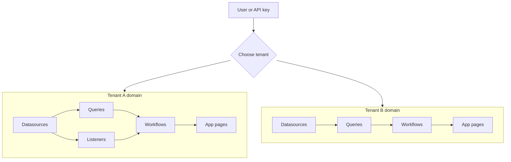
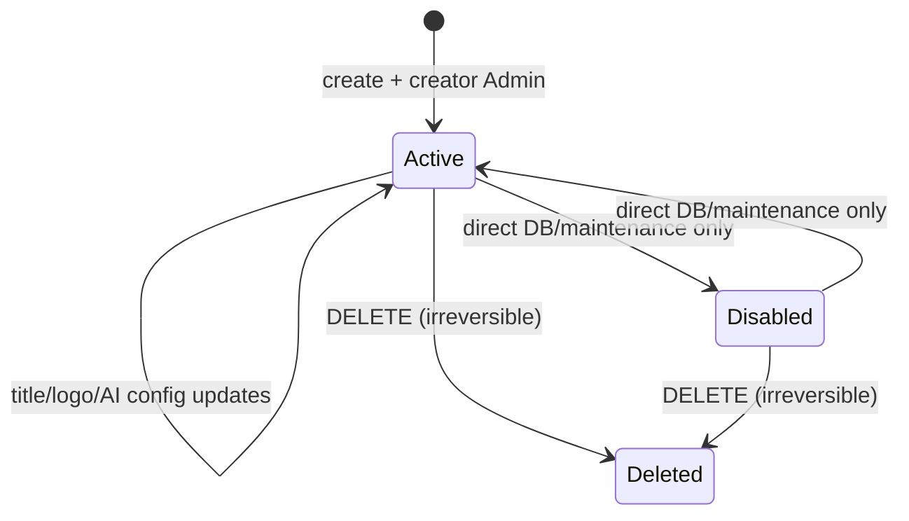

# Tenants

A **tenant** is the isolation boundary for everything you build in Jet Admin. Datasources, queries, workflows, listeners, widgets, app pages, cron jobs, API keys, folders, roles, and run history all belong to exactly one tenant.

Every tenant-scoped API route includes the tenant in the URL:

```text
/api/v1/tenants/:tenantID/<module>/...
```

The backend applies the tenant filter itself (every query includes `tenantID`) and Casbin evaluates permissions inside the tenant's **domain**. A resource ID from another tenant resolves to "not found" in the current tenant; it does not fall back to a global lookup.



## Core concepts

| Concept | Meaning |
|---|---|
| Tenant | A named workspace with its own assets, members, roles, and API keys. The database key is `tenantID` (UUID). |
| Membership tier | The coarse role stored on the membership: `ADMIN` or `MEMBER`. Admins receive a Casbin wildcard (`*`, `*`) in that tenant domain. |
| Custom role | A tenant-owned bundle of general and asset permissions. Roles are assigned to members and API keys. See [Identity & Access Management](../identity-access-management/identity-access-management.md). |
| Tenant domain | The Casbin domain (`r.dom == :tenantID`) in which every authorization check runs. |
| Creator access | Creating a resource grants the creator a wildcard policy on that specific resource (`<resource>:<id>`, `*`). |
| Disabled tenant | A tenant with `isDisabled = true`; it is hidden from the tenant switcher and excluded from `GET /api/v1/tenants`. The column exists, but the current tenant/operator APIs do not expose a disable or re-enable action; treat this as schema/maintenance-level state. |

## Create a tenant

1. Open the tenant switcher and choose **Create tenant** (the UI label may be **New project**).
2. Upload a logo (optional). The logo is uploaded first through `POST /api/v1/tenants/upload-logo`.
3. Enter the tenant name.
4. Save.

The creation action is authenticated but has no tenant-level permission check because the tenant does not exist yet. The current build applies a creation-limit middleware, but the configured sample plan sets the limit to `Infinity`; do not assume a plan cap is enforced unless your deployment changes `SAMPLE_PLAN`.

```http
POST /api/v1/tenants HTTP/1.1
Authorization: api_key <raw-api-key>
Content-Type: application/json

{
  "tenantTitle": "Acme Operations",
  "tenantLogoURL": "https://cdn.example.com/logos/acme.png"
}
```

Example response (abridged):

```json
{
  "success": true,
  "tenant": {
    "tenantID": "6a6f2f7e-6f5d-4f0e-9f1a-0f1f2f3f4f5f",
    "tenantTitle": "Acme Operations",
    "tenantLogoURL": "https://cdn.example.com/logos/acme.png",
    "creatorID": "2f0e6a6f-7e6f-5d4f-0e9f-1a0f1f2f3f4f",
    "isDisabled": false,
    "createdAt": "2026-11-27T10:00:00.000Z"
  }
}
```

On success, the service:

1. Creates the `tblTenants` row.
2. Creates an empty `tblUserTenantConfigMap` row for the creator.
3. Adds the creator to `tblUsersTenantsRelationship` with `role: "ADMIN"`.
4. Adds a Casbin policy `(<userID>, <tenantID>, "*", "*", "allow")`.
5. Copies global role policies into the new tenant domain so seeded roles work immediately.

:::note
`tenantDescription` is accepted by the request validator but is not persisted by the current tenant service. Treat the tenant title and logo as the supported metadata.
:::

## Tenant fields

| Field | Type | Required | Notes |
|---|---|---|---|
| `tenantTitle` | String, 1–255 chars | Yes on create | Not required to be unique. |
| `tenantLogoURL` | String (URL) | No | Any URL accepted by the API; the UI normally supplies the object-storage URL returned by the logo upload endpoint. |
| `isDisabled` | Boolean | Schema/maintenance | Default `false`. Disabled tenants are excluded from the caller's tenant list, but no API currently sets this flag. |
| `disableReason` | String | Schema/maintenance | Optional explanation column; not written by any current tenant route. |
| `creatorID` | UUID | Set by service | User who created the tenant. |
| `createdByApiKeyID` | UUID | Set by service | Present when an API key created the tenant. |

Logo upload limits: `multipart/form-data` field `file`, 10 MB maximum, stored in the `tenant-assets` bucket under `logos/`. The endpoint requires authentication but does not require `tenant:update`; only use trusted clients.

## What belongs to a tenant

| Area | Main tables | Deletion behaviour |
|---|---|---|
| Membership | `tblUsersTenantsRelationship`, `tblUserTenantRoleMappings` | Removed explicitly during tenant deletion. |
| Roles & permissions | `tblRoles`, `tblPermissions`, `tblRolePermissionMappings`, `tblAPIKeyRoleMappings` | Tenant roles are removed; shared global roles are retained. |
| API keys | `tblAPIKeys` | Removed after dependent rows. Raw keys are never stored. |
| Datasources | `tblDatasources` | Removed; their queries/listeners are removed first. |
| Queries | `tblDataQueries` | Removed. |
| Listeners | `tblListeners`, `tblListenerActions`, `tblListenerEvents` | Removed explicitly, actions/events cascading. |
| Workflows | `tblWorkflows`, `tblWorkflowNodes`, `tblWorkflowEdge`, `tblWorkflowInstances`, `tblWorkflowInstanceLogs`, `tblWorkflowDataCollectionRequests` | Removed; run history is deleted with the workflow instance rows. |
| App pages & widgets | `tblAppPages`, `tblAppPageEditorHistory`, `tblWidgets` | Removed. |
| Cron jobs | `tblCronJobs`, `tblCronJobHistory` | Removed. |
| Folders | `tblFolders` | Removed last, after assets that reference them. |
| Audit | `tblAuditLogs` | Audit rows are not part of the tenant delete transaction; export logs before deletion if they are needed. |
| AI config | `tblVaultCredentials` (`provider = ai_config`) | Removed with tenant vault credentials. |
| Shared widget library | `tblWidgetLibrary` | Published entries are deployment-wide and intentionally retained; `sourceTenantID` is advisory. |

## Tenant scoping in practice

### URL scoping

There is no "current tenant" stored on the session. The tenant is chosen per request:

```http
GET /api/v1/tenants/6a6f2f7e-6f5d-4f0e-9f1a-0f1f2f3f4f5f/queries HTTP/1.1
Authorization: Bearer <firebase-id-token>
```

The same user can call another tenant by changing the path, but only succeeds if they have a membership and a matching policy in that domain.

### Cross-tenant lookup example

A query ID from Tenant A is not globally addressable. These two calls use the same query UUID under different tenant paths:

```http
GET /api/v1/tenants/tenant-a/queries/0e8f5f4a-3d1f-4f4b-9c3e-7a2d1c0b9a8e HTTP/1.1
Authorization: Bearer <firebase-id-token>
```

```http
GET /api/v1/tenants/tenant-b/queries/0e8f5f4a-3d1f-4f4b-9c3e-7a2d1c0b9a8e HTTP/1.1
Authorization: Bearer <firebase-id-token>
```

The first call resolves the row when the caller is a member of Tenant A. The second call fails with "Query ... not found" (or a permission error if the caller has no Tenant B policy), because the lookup includes `tenantID`.

### Data scoping

Service queries always include the tenant. For example, a saved query is loaded by `{ tenantID, dataQueryID }`, not by `dataQueryID` alone. Referencing a query/workflow/listener from JSON configuration is validated at save time by `assertTenantReferences`, which rejects IDs that do not exist in the current tenant.

:::warning
Tenant IDs are not secrets. Do not rely on an unguessable tenant ID for security; rely on membership plus Casbin. A user who is not a member gets a permission error even with a valid tenant UUID.
:::

### Cross-tenant operations

The supported ways to move assets between tenants are:

- **Export/import bundles** — sanitized JSON with dependency closure. See [Export & Import Bundles](../platform/export-import-bundles.md).
- **Shared widget library** — install a published widget into a tenant with fresh IDs. See [Shared Widget Library](../platform/widget-library.md).
- **Marketplace/app templates** — install a template that creates tenant-scoped copies.

Direct database copies are not supported and can leave Casbin policies pointing at the wrong domain.

## Tenant settings

### Update title or logo

`PATCH /api/v1/tenants/:tenantID` with `tenantTitle` and/or `tenantLogoURL`. Requires `tenant:update`.

```http
PATCH /api/v1/tenants/6a6f2f7e-6f5d-4f0e-9f1a-0f1f2f3f4f5f HTTP/1.1
Authorization: Bearer <firebase-id-token>
Content-Type: application/json

{
  "tenantTitle": "Acme Operations EU"
}
```

### AI configuration

Tenant-level AI credentials are stored in the vault under `provider = "ai_config"`.

| Method | Path | Permission |
|---|---|---|
| `GET` | `/:tenantID/ai-config` | `tenant:read` |
| `POST` | `/:tenantID/ai-config` | `tenant:update` |

The response includes `apiKey`, `baseURL`, `provider`, and `model`. Only grant `tenant:read` to users who should see the tenant's AI configuration.

### Tenant details and counts

`GET /api/v1/tenants/:tenantID` returns the tenant record, the caller's membership, all member relationships, and counts for roles, app pages, queries, cron jobs, API keys, widgets, datasources, workflows, and listeners. It requires `tenant:read`. The per-area count calls are best-effort; a failed count is reported as `0`, not as a tenant failure.

## Tenant lifecycle



| State | Visible in tenant switcher | API access | How it changes |
|---|---|---|---|
| Active | Yes | Allowed by policy | Default after creation. |
| Disabled | No | Direct routes still need a valid policy | Schema flag only in the current build; no tenant or operator endpoint sets it. |
| Deleted | No | All rows and Casbin domain rules are gone | `DELETE /:tenantID`. |

## Delete a tenant

`DELETE /api/v1/tenants/:tenantID` requires `tenant:delete`. This is a hard delete inside a transaction with a 60-second timeout. It removes tenant-owned rows in dependency order and executes:

```sql
DELETE FROM casbin_rule WHERE v1 = $1; -- $1 = tenantID
```

:::danger
Tenant deletion is irreversible from the application UI. It removes run history, credentials, assets, memberships, and API keys. Export anything you need first. There is no soft-delete or restore path in the tenant API.
:::

If the transaction fails, the error is returned and the transaction is rolled back; investigate foreign-key rows that are still referenced before retrying.

## Membership and permissions

Tenant creation makes the creator an `ADMIN`. Additional members are added by email from the tenant's member screen; the email must already belong to a platform user. See [Identity & Access Management](../identity-access-management/identity-access-management.md) for the full role and permission model.

Quick rules:

- `ADMIN` gets a tenant-wide Casbin wildcard and does not need custom roles.
- `MEMBER` capabilities come from custom roles and asset permissions.
- The creator of an individual asset gets a wildcard policy on that asset, even if their role would not otherwise allow the action.
- API keys are authorized as their own subject and can be assigned roles; they are not automatically equivalent to their creator.

## Use cases

| Scenario | Tenant pattern |
|---|---|
| Separate clients or business units | One tenant per client; never share datasources or API keys across tenants. |
| Production vs staging | Separate tenants, with environment-specific datasource credentials. |
| Departmental self-service | One tenant per department, with a small Admin group and job-function roles. |
| Regulated data | Dedicated tenant plus least-privilege datasource credentials and audit export. |

## Limitations and failure modes

| Situation | Behaviour |
|---|---|
| User is not a member | Tenant-scoped calls return `403 PERMISSION_DENIED`; `GET /tenants` simply omits the tenant. |
| Disabled tenant | Hidden from `GET /tenants` if the flag is set manually. No API currently changes `isDisabled`; direct access still depends on membership and policy. |
| Tenant creation limit | A middleware exists, but the shipped `SAMPLE_PLAN` limit is `Infinity`. A custom deployment can change it. |
| Duplicate tenant title | Allowed. Use the tenant ID, not the title, for automation. |
| Deleting a tenant while a background run is active | The transaction deletes workflow/listener rows; in-flight external work may still be running. Disable listeners/cron jobs first when possible. |
| Audit rows after deletion | `tblAuditLogs` is not deleted by the tenant transaction. Export or purge it according to your retention policy. |
| Logo URL broken | The frontend shows a broken-image fallback. Upload a new logo and save the new URL. |

## Troubleshooting

| Symptom | Check |
|---|---|
| `403 PERMISSION_DENIED` on every route | Membership row exists, the user is using the correct tenant UUID, and their role/Casbin policy is synced. An Admin can run `POST /:tenantID/roles/sync-policies` to rebuild policy rules from the database. |
| New tenant has no roles | Global roles are synced at tenant creation. If the process partially failed, run the role sync endpoint as an Admin. |
| API key works in one tenant but not another | API keys have a single `tenantID`; create a separate key in each tenant. |
| Cannot remove the last Admin | The member-removal path blocks removing the only Admin. Promote another member first. Note that the **demotion** path does not currently enforce this check, so avoid demoting the last Admin. |
| Tenant list is empty after sign-in | The user has no membership rows, or all their tenants are disabled. |
| Logo upload fails | File must be present and at most 10 MB; verify object-storage configuration in [Configuration Reference](../operations/configuration-reference.md). |

## Related pages

- [Identity & Access Management](../identity-access-management/identity-access-management.md) — roles, permissions, API keys, delegated execution.
- [Data Source](../data-source/data-source.md) — connections are tenant-scoped.
- [Data Query](../data-query/data-query.md) — queries cannot cross tenant boundaries.
- [Listeners](../listeners/listeners.md) — ingress URLs contain the tenant ID for custom webhook paths.
- [Workflows](../workflows/workflows.md) — workflow runs and run history are tenant-scoped.
- [Export & Import Bundles](../platform/export-import-bundles.md) — supported cross-tenant movement.
- [Security](../operations/security.md) — encryption, secrets, and audit guidance.
