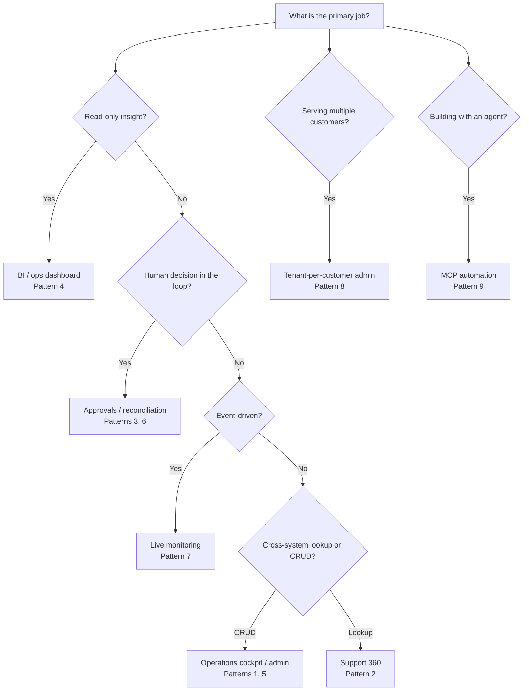
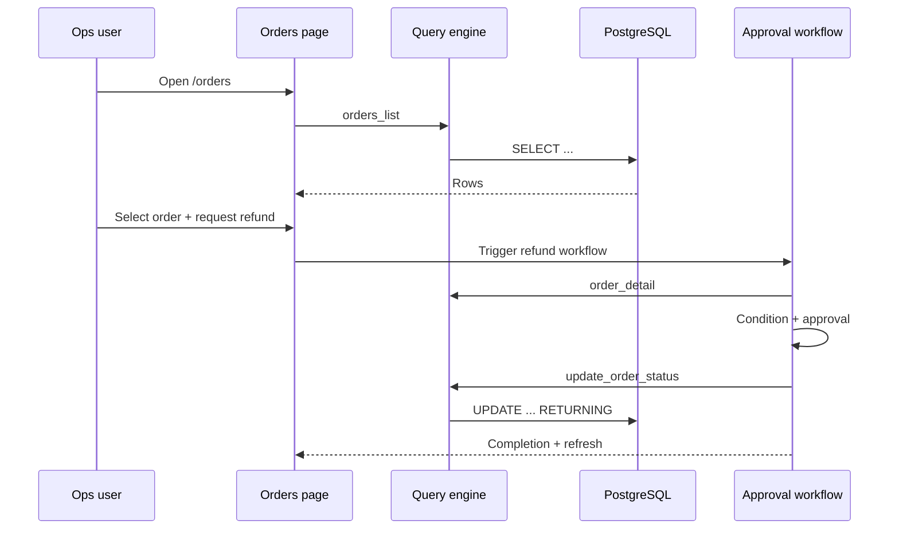
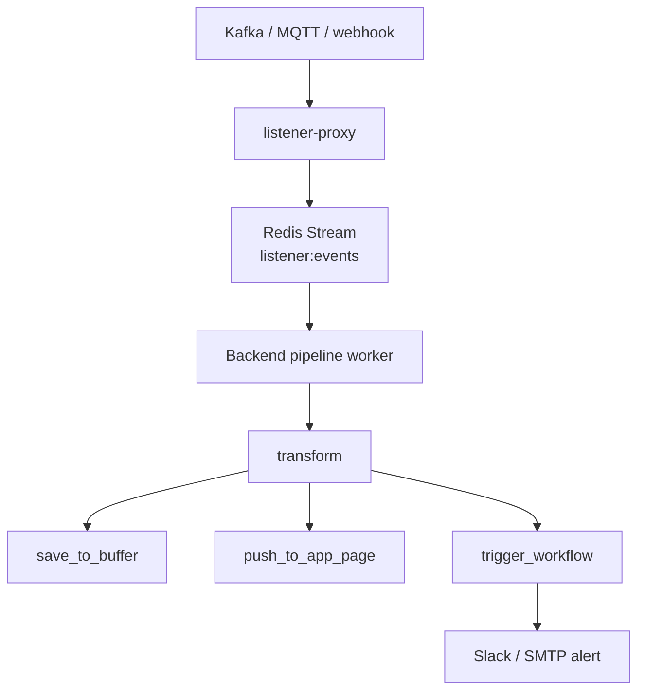

# Use Cases

Jet Admin is broad enough that "what should I build first?" is a real question. The
patterns below are grounded in modules that exist in this repository: datasources,
queries, listeners, workflows, widgets, app pages, applications, IAM, folders, bundles,
the widget library, and MCP.

Each pattern includes the problem, a build plan, the modules involved, an example flow,
and the limits you should design around.

:::warning Patterns, not turnkey templates
These are architecture recipes. They assume you have validated the specific
connector, database permissions, and failure behavior for your environment. None of
them implies row-level security, exactly-once execution, or anonymous external users.
:::

## Pattern map

| # | Pattern | Primary user | Core modules | Best fit |
|---|---|---|---|---|
| 1 | Order operations cockpit | Support / operations | Query + table + workflow + application | SQL-backed operational CRUD |
| 2 | Support 360 | Support | REST/GraphQL + SaaS connectors + page variables | Cross-system lookup |
| 3 | Finance reconciliation | Finance ops | Query + workflow + approval + audit | Controlled month-end work |
| 4 | Data / BI operations dashboard | Analyst / leadership | Warehouse connector + Vega widgets | Read-only metrics |
| 5 | Internal CRUD admin | Operations | Table editing + mutation queries | Safe writes without a new app |
| 6 | Procurement approvals | Operations / finance | Workflow + data collection + approval | Human-in-the-loop |
| 7 | Live monitoring and alerting | SRE / ops | Listener + workflow + app-page push | Event-driven visibility |
| 8 | Multi-tenant SaaS admin | Platform team | Tenants + IAM + bundles + applications | Customer workspaces |
| 9 | AI / MCP automation | Automation engineer | MCP + Jet Agent + scoped API keys | Agent-assisted building |

## 1. Order operations cockpit

**Problem.** Support and operations staff need to find orders, inspect line items,
change status, and escalate refunds — without direct production database access and
without waiting for engineering to ship a new admin screen.

**Build.**

1. Connect a PostgreSQL datasource using a **least-privilege database role**. Prefer a
   read replica for list/detail queries and a narrow write role for mutations.
2. Create three saved queries:
   - `orders_list` — paginated list with status/date filters;
   - `order_detail` — accepts an `order_id` input;
   - `update_order_status` — `UPDATE ... RETURNING` with an explicit `WHERE` clause.
3. Build an App Page with:
   - a page variable `selected_order_id`;
   - a Data Table bound to `state.queries.orders.data`;
   - `onRowSelect` → **Set Page Variable** `selected_order_id`;
   - a detail panel bound to a `reactive` `order_detail` data source;
   - a status form or button that triggers `update_order_status`, then re-executes the
     list query.
4. For refunds above a threshold, add a workflow: fetch order → condition on amount →
   approval node → update query → notify via a Slack/SMTP query. Route failures to an
   explicit error path.
5. Compose the page into an Application with a route such as `/orders`. Publish a
   release and use environment bindings if staging and production use different
   datasource IDs.

**Modules used.** Data source · Data query · Data Table · Form/Button · Page variables
· Workflow (condition, approval, data query) · Application · Audit.

**Example flow.**

**Limitations.** There is no built-in row-level security. Use separate queries or
database views/roles to scope what each user can see. Application consumer policy can
restrict routes and aliases, not individual rows. A refund is an external side effect;
make the update idempotent and do not assume the workflow guarantees exactly-once
execution. Inline editing and bulk edits can conflict; use explicit version columns or
`WHERE` guards in the mutation.

## 2. Support 360

**Problem.** A support agent needs one screen with the customer's profile, plan,
recent orders, open Jira issues, and payment status. The data lives in a CRM, Stripe,
Jira, and an internal PostgreSQL database.

**Build.**

1. Add connectors: PostgreSQL (internal customers/orders), Stripe (payments), Jira
   (issues), and REST/GraphQL for the CRM.
2. Create a search input or URL query parameter `email`.
3. On submit, set a page variable `lookup_email`.
4. Add `reactive` data sources for each system, all using
   `{{ state.variables.lookup_email }}` as an input.
5. Compose the page with a profile header (Text/Stat), an orders table, a Jira list,
   and a payment-status badge. Use an HTML widget only if you need a layout the
   built-in widgets cannot express.
6. Add actions: "Open in Jira" (IFrame or link), "Create escalation ticket" (query or
   workflow), and "Notify #support" (REST query to Slack).
7. Put the page behind an Application route and restrict the route to the support role
   with application consumer policy.

**Modules used.** Multiple datasources · REST/GraphQL · Stripe/Jira/Slack connectors ·
Search input · Page variables · Tables/timeline/badge · Application consumer policy.

**Example flow.** Search by email → four parallel lookups → normalize the customer ID
in a page expression → render. If the CRM uses a different key than the warehouse, do
the mapping in a JavaScript workflow or a small normalization query rather than
hardcoding it into every widget.

**Limitations.** Jet Admin does not perform cross-source joins for you; each data
source executes independently and you combine results in expressions or a workflow.
SaaS connectors inherit the provider's rate limits, pagination rules, and auth model.
PII is now visible in one screen; scope the datasource credentials and application
policy tightly, and review audit logs. A failed SaaS call leaves that section in an
error state without failing the whole page.

## 3. Finance reconciliation and approvals

**Problem.** Chasing unmatched payments, producing a month-end exception list, and
recording approvals is a repetitive process that currently lives in spreadsheets and
email.

**Build.**

1. Connect a warehouse (BigQuery, PostgreSQL, or ClickHouse) with read credentials.
2. Create queries for:
   - unmatched payments;
   - duplicate invoices;
   - month-to-date totals;
   - a controlled adjustment query with explicit input definitions.
3. Build a reconciliation page with a date-range picker, a table of exceptions, and
   totals. Bind table row selection to a detail query.
4. Create a workflow:
   - query exceptions;
   - loop over each exception;
   - approval node with a mandatory comment;
   - on approval, run the adjustment query;
   - on rejection, record the decision in an audit table;
   - on expiry, route to an `expired` path.
5. Schedule the workflow with a Scheduled Job if the platform's workflow-based cron
   model fits your process. Otherwise trigger it from the page or an external
   scheduler through the API.
6. Grant finance users a role with read access plus execute permission on the specific
   workflow. Do not grant blanket update access to the warehouse.

**Modules used.** Warehouse datasource · Queries · Date range picker · Table · Workflow
(loop, approval, condition, data query) · Scheduled Job (workflow-based) · Audit.

**Limitations.** Approvers must be authenticated tenant members; this is not an
anonymous email-approval product. Approval and data-collection requests appear through
the platform's runtime, and the workflow stays `RUNNING` while waiting. Expiry behavior
must be designed explicitly. Scheduled jobs are not a general-purpose scheduler with
backfill guarantees; confirm the current cron implementation before relying on
catch-up behavior. Record an idempotency key for each adjustment so retries do not
double-post.

## 4. Data and BI operations dashboard

**Problem.** Leadership needs a daily view of revenue, funnel conversion, and
operational SLAs, with filters for date range and segment, without giving everyone a
warehouse login.

**Build.**

1. Connect BigQuery, ClickHouse, PostgreSQL, or another analytics store.
2. Create queries that aggregate in the warehouse, not in the browser: daily revenue,
   conversion by channel, SLA breaches, and a comparison period.
3. Build a page with:
   - a Date Range Picker and a Select for segment;
   - `reactive` data sources keyed to those variables;
   - Stat/KPI widgets for headline numbers;
   - Vega-Lite widgets for trends and breakdowns;
   - a table for the underlying rows.
4. Use the expression engine for formatting and derived values
   (`{{ Math.round(...) }}`, ternary fallbacks), but keep heavy aggregation in SQL.
5. Compose the page into an application with a home route and (optionally) a detail
   route.

**Modules used.** Warehouse datasource · Parameterized queries · Date range picker ·
Select · Stat · Vega-Lite · Table · Page variables · Application.

**Limitations.** Jet Admin is not a governed BI platform: there is no semantic layer,
no scheduled dashboard subscriptions, and no built-in row-level security. Warehouse
costs and access control remain your responsibility. Vega-Lite is expressive, but
complex multi-view dashboards may be easier in Superset or Metabase. Cache/polling
settings should respect warehouse cost; avoid aggressive refetch intervals on large
queries.

## 5. Internal CRUD admin

**Problem.** A back-office team needs to correct customer records, update fulfillment
status, and bulk-edit a small set of fields — with an audit trail and without building
a bespoke CRUD service.

**Build.**

1. Connect a database with a role that can only touch the intended tables.
2. Create list and detail queries with explicit pagination and `ORDER BY`.
3. Create mutation queries:
   - `update_customer` with `RETURNING`;
   - `bulk_update_status` using a constrained `WHERE ... IN (...)`.
4. Use a Data Table with:
   - inline row editing or Excel-style bulk edit (not both);
   - multi-row selection and a custom bulk action;
   - `onRowSave` / `onBulkEdit` actions that call the mutation query;
   - a follow-up list refresh so the table reflects the database, not optimistic UI.
5. Add a Form widget for create flows. Use required fields and a workflow if creation
   needs validation across systems.
6. Add audit review and role-based access. Use folders to separate "Customers",
   "Orders", and "Admin" assets.

**Modules used.** Datasource · Queries · Data Table (inline/bulk edit) · Form · Page
variables · Folders · IAM · Audit.

**Limitations.** There is no automatic optimistic concurrency or record-level locking.
Two users editing the same row can overwrite each other; add a `version` or
`updated_at` check in the `WHERE` clause. Table editing is intentionally limited to
configured columns. Bulk operations are only as safe as the SQL you write. The
platform does not generate a REST API for every table; use data queries and API keys
for external access.

## 6. Procurement approvals

**Problem.** Purchase requests need a multi-step review: manager approval, finance
approval above a threshold, and a recorded decision with comments.

**Build.**

1. Store requests in PostgreSQL (or create them through a Form widget).
2. Create a workflow:
   - `dataQuery` fetch request;
   - `condition` on amount/type;
   - `approval` node for manager;
   - `condition` for finance threshold;
   - second `approval` node;
   - `dataQuery` update status;
   - `end` nodes for approved, rejected, expired, and error.
3. Use a `dataCollection` node when you need structured input beyond approve/reject
   (for example, a PO number or cost center).
4. Notify approvers through a query to Slack, SMTP, or your notification service. Use a
   `delay` node for reminders, but respect the maximum delay and expiry settings.
5. Expose a request list page and a detail page. Link the workflow run and audit trail
   for traceability.

**Modules used.** Workflow (condition, approval, data collection, delay, loop) · Query
· Form · Page · Audit · IAM.

**Limitations.** The workflow engine suspends while waiting for a human; it does not
provide a separate email inbox or anonymous approval links. The last admin rule and
tenant membership apply to approvers. Approval routing is explicit in the graph; there
is no built-in org-chart or dynamic approver directory. Expired requests remain a
process problem unless you build monitoring around them.

## 7. Live monitoring and alerting

**Problem.** An operations team needs a live view of orders, sensor readings, or
application events, plus an alert when a threshold is crossed.

**Build.**

1. Connect a supported listener source: PostgreSQL `LISTEN`, Kafka, RabbitMQ, NATS,
   MQTT, Redis, WebSocket, SSE, webhook, GraphQL subscription, MongoDB change stream,
   Firestore, or syslog.
2. Create a listener and activate it. For webhooks, use the generated ingress URL and
   treat the path suffix as a secret.
3. Add pipeline actions:
   - `transform` to normalize/dedupe the payload;
   - `save_to_buffer` if an Application will observe the event buffer;
   - `push_to_app_page` for live UI updates;
   - `trigger_query` to persist the event;
   - `trigger_workflow` for threshold logic and notifications.
4. Build a page with a listener data source (alias, channel, and optional buffer name)
   and bind a table/chart/stat to `state.listeners.<alias>.data`.
5. For alerts, use a workflow with a condition and a Slack/SMTP/REST query. Add a
   cooldown or dedupe key so one incident does not produce hundreds of messages.

**Modules used.** Listener · Listener pipeline actions · Redis Streams · Workflow ·
Query · App page listener data source · Application (buffered observation).

**Example flow.**

**Limitations.** Listener runtime requires Redis and the standalone listener proxy; it
is not embedded in the backend. Event delivery is not a transactional exactly-once
guarantee — dedupe in the transform or workflow. Application observation requires an
enabled `save_to_buffer` action and the correct buffer name; changing the listener
definition requires republishing the application. Webhook ingress is open by design
and the path suffix is the only secret, so use a high-entropy suffix and rotate it if
leaked.

## 8. Multi-tenant SaaS admin

**Problem.** A SaaS company wants each customer to have an isolated workspace with its
own users, roles, integrations, and internal tools, while the platform team reuses the
same app templates.

**Build.**

1. Create one tenant per customer. Use a naming convention and folders to keep assets
   organized.
2. Invite customer users (they must have signed in at least once) and assign roles.
   Keep the customer Admin count intentional; the platform refuses to remove the last
   Admin.
3. Create API keys per customer/integration, scoped to the minimum permissions. Do not
   reuse one global key.
4. Build a template tenant with the standard datasources, queries, widgets, pages, and
   workflows. Export reusable assets as bundles; an operator can also publish widgets
   to the shared widget library for deployment-wide reuse.
5. Import bundles into new tenants, reconnect datasources (credentials are stripped),
   and adjust environment bindings.
6. Compose each customer's application from its pages; publish releases per tenant.

**Modules used.** Tenants · IAM · API keys · Folders · Bundles · Widget library ·
Applications · Audit.

**Limitations.** Jet Admin is not a billing, metering, or customer-provisioning
system. Tenant creation limits are code-level constants (`SAMPLE_PLAN` currently uses
`Infinity`), not a subscription plan. There is no built-in customer provisioning or
billing portal beyond Firebase sign-up and tenant creation. Deleting a tenant cascades
and is irreversible. Tenant isolation is application-enforced, not a
database-per-tenant guarantee.

## 9. AI and MCP automation

**Problem.** An engineering or operations team wants an agent to inspect the platform,
generate a query, assemble a page, or run a workflow — without giving the model broad
human credentials.

**Build.**

1. Create a dedicated API key with the narrowest roles that cover the intended tools.
2. Choose the MCP transport:
   - **stdio** via `packages/mcp-server` for a desktop/client integration;
   - **Streamable HTTP** via `apps/mcp-server` for a remote MCP client, with
     per-request Firebase authentication.
3. Point the client at the backend with `JET_ADMIN_BACKEND_URL`, and for stdio set
   `JET_ADMIN_API_KEY` and `JET_ADMIN_TENANT_ID`.
4. Use the canonical build flow:
   `get_tenant_resource_summary` → inspect schema/sample data → test inline query →
   create query → create widget → create/validate page.
5. For workflows: `describe_node_type` → `validate_workflow` → `create_workflow` →
   `execute_workflow` → poll/observe.
6. Keep humans in the loop for `delete_*`, permission changes, production execution,
   and any tool that mutates data. Treat tool descriptions as guidance, not an
   enforcement boundary.

**Modules used.** MCP server · Jet Agent (OpenRouter-compatible) · API keys · Queries ·
Widgets · App pages · Workflows · Audit.

**Limitations.** The MCP server is a thin bridge; authorization is whatever the API key
and tenant allow. The package README warns that datasource tool output may include
connection options/credentials, so scope keys and review logs. Some tools are
destructive and some updates are full replacements; read current state before
updating. Agent output can be wrong — validate generated SQL, workflow graphs, and
page configs before promotion. Do not assume a model-side "please confirm" instruction
is a security control.

## Choosing a first project

| If your first project is… | Start with | Avoid on day one |
|---|---|---|
| A read-only dashboard | Pattern 4 | Complex write workflows and row-level policy |
| A CRUD admin | Pattern 5 | Bulk destructive actions without idempotency |
| A cross-system support view | Pattern 2 | Tight polling across rate-limited APIs |
| An approval process | Pattern 6 | Anonymous approvers or email-only decisions |
| A real-time monitor | Pattern 7 | Listener features without Redis/proxy |
| A customer-facing workspace | Pattern 8 | Billing/metering assumptions |
| An agent demo | Pattern 9 | Broad API keys or unattended deletes |

## Related reading

- [Data Source](../data-source/data-source.md)
- [Data Query](../data-query/data-query.md)
- [Listeners](../listeners/listeners.md)
- [Workflows](../workflows/workflows.md)
- [App Pages & Widgets](../app-pages-widgets/app-pages-widgets.md)
- [Identity & Access Management](../identity-access-management/identity-access-management.md)
- [Export & Import Bundles](../platform/export-import-bundles.md)
- [Shared Widget Library](../platform/widget-library.md)
