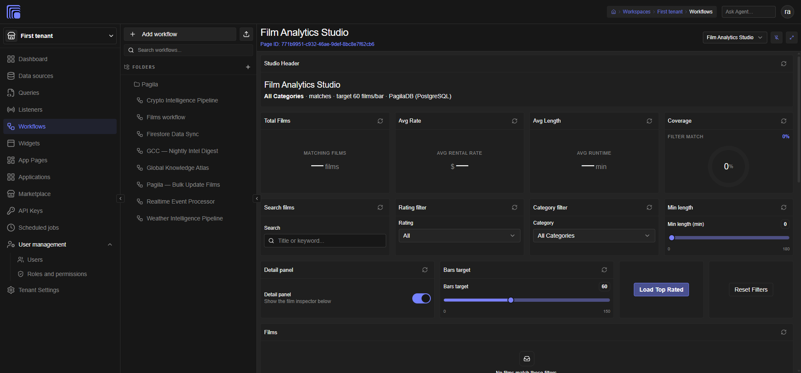
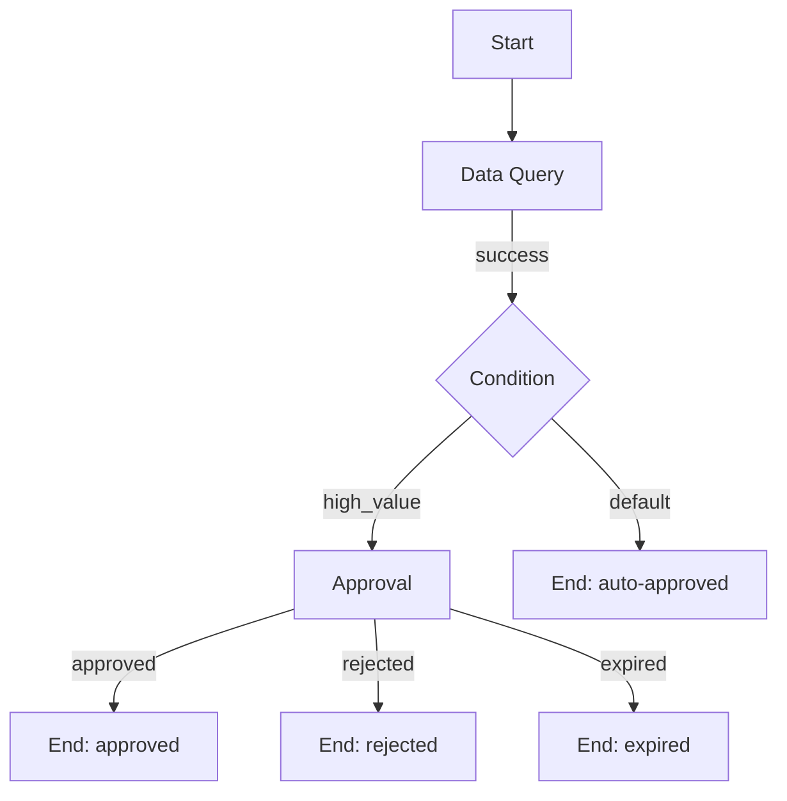

# Workflows

A **workflow** is a saved graph of nodes that runs on the Temporal-backed workflow engine. It can query data, run sandboxed JavaScript, branch, loop, wait, call another workflow, collect human input, and require an approval decision.



## Core concepts

| Concept | Meaning |
|---|---|
| Workflow definition | `tblWorkflows` plus `tblWorkflowNodes` and `tblWorkflowEdge`. Node positions and configuration live in `nodeConfig`. |
| Instance | One run, stored in `tblWorkflowInstances`; logs are in `tblWorkflowInstanceLogs`. The Temporal workflow ID is the instance ID. |
| `ctx` | The run's mutable data context. Inputs are `ctx.input`; node outputs are stored under each node's `outputVariable`. |
| Template expression | `{{ctx.path}}` in node configuration. Resolved at node execution time in safe-path mode; JavaScript expressions are only allowed in the condition's JS-expression operator and in JavaScript nodes. |
| Output variable | A JavaScript identifier (letters/digits/underscore, starting with a letter/underscore) used as the context key for a node result. |
| Edge handle | The named output port on a node (`success`, `error`, a branch id, `approved`, `loop`, `completed`, …). Routing follows the handle. |
| Execution policy | Timeout/retry defaults resolved as **node data → workflow options (`nodeDefaults` or workflow defaults) → platform default**. |
| Test run | A persisted `isTest` instance that executes the unsaved graph through Temporal. It is cleaned up by the test-stop endpoint. |
| Human-in-the-loop | `dataCollection` and `approval` suspend the run until a user submits a form/decision or the request expires. |



## Supported node types

The executable runtime supports 13 node types. `connectorPull` and `connectorPush` appear in the frontend constants but have no runtime handler and are not valid in a saved workflow.

| Node | Purpose | Output handles |
|---|---|---|
| `start` | Mandatory single entry point. | `output` |
| `dataQuery` | Execute a saved [data query](../data-query/data-query.md). | `success`, `error` |
| `javascript` | Run sandboxed JS and return a value. | `success`, `error` |
| `condition` | Ordered structured branches; first match wins. | branch id, `default`, `error` |
| `switch` | Route on one value across named cases. | case id, `default`, `error` |
| `loop` | Iterate an array; execute the body per item. | `loop`, `completed`, `error` |
| `delay` | Durable sleep (fixed/dynamic/until). | `output`, `error` |
| `dataCollection` | Suspend for a human form. | `output`, `error` (timeout fails unless a `timeoutHandle` is configured) |
| `approval` | Approve/reject decision with comment. | `approved`, `rejected`, `expired`, `error` |
| `subWorkflow` | Run a saved child workflow synchronously. | `success`, `error` |
| `fanout` | Take every named branch. | branch id, `error` |
| `join` | Barrier + merge of upstream outputs. | `output`, `error` |
| `end` | Terminate with success/failure/cancelled status. | none |

:::note
`condition.evaluationMode: "all_matches"` is accepted by the editor schema but the runtime implements **first-match only**. Use `first_match` (the default) or build separate branches.
:::

## Node configuration reference

Every non-terminal node supports:

| Field | Description |
|---|---|
| `title` / `description` | Canvas labels/documentation. Node descriptions are persisted; a workflow-level description is accepted by the API but is not persisted by the current service. |
| `errorHandling` | `fail_workflow`, `continue`, `retry_then_continue`, `retry_then_fail`; the validator also accepts `skip_item` (loop bodies) and `continue_default` (condition). |
| `isDisabled` | If true, the node is skipped and execution follows a default success/output path. |

### Start

The start node has only title/description. Input parameters are defined at workflow level in `workflowOptions.inputDefinitions`:

| Parameter field | Type | Notes |
|---|---|---|
| `key` | String | Context key under `ctx.input`. |
| `type` | `string`, `number`, `boolean`, `object`, `array` | Coerced at trigger time. |
| `required` | Boolean | Missing required inputs fail the run. |
| `defaultValue` | Matching type | Applied when the input is missing. |

### Data Query

| Field | Description |
|---|---|
| `dataQueryID` | UUID of a saved query in the same tenant. Required. |
| `inputValues` | Map of query argument key → template/literal, e.g. `{"status":"{{ctx.input.status}}"}`. |
| `outputVariable` | Default `queryResult`. |
| `timeoutSeconds` | 1–3600. Effective default is 120 s for this node type when the field is absent. |
| `retryLimit` | 0–10 retries after the first attempt. |
| `retryDelaySeconds` | 0–300 seconds between attempts. Delay is fixed, not exponential. |

The result is the connector's result (for SQL, usually an array of rows). Access it with `{{ctx.queryResult}}` or `{{ctx.queryResult[0].field}}`.

### JavaScript

| Field | Description |
|---|---|
| `code` | Code must use `return` to produce a value. |
| `outputVariable` | Default `jsResult`. |
| `timeoutSeconds` | 1–300; default 30 s. |
| `retryLimit` / `retryDelaySeconds` | Same semantics as data query. |

The sandbox exposes `ctx` and a limited set of globals (JSON, Math, Date, Array/Object/String/Number/Boolean, `parseInt`, `parseFloat`). It has no network, filesystem, `require`, or npm modules.

```js
const order = ctx.order[0];
return {
  requiresApproval: Number(order.total) > 5000,
  customerEmail: order.email
};
```

### Condition

| Field | Description |
|---|---|
| `branches[]` | Ordered branch objects. Each has `id` (the outgoing handle), `name`, `conditionLogic` (`AND`/`OR`), and `conditions[]`. |
| `conditions[].leftValue` | Template or value, e.g. `{{ctx.order[0].total}}`. |
| `conditions[].operator` | `equals`, `not_equals`, `contains`, `not_contains`, `starts_with`, `ends_with`, `greater_than`, `less_than`, `greater_or_equal`, `less_or_equal`, `is_empty`, `is_not_empty`, `matches_regex`, `expression`. |
| `conditions[].rightValue` | Comparison value/template; not used by unary operators. |
| `evaluationMode` | Use `first_match`; `all_matches` is not honored. |

The first matching branch wins. If none match, the `default` handle is taken. The JS-expression operator uses raw `ctx` (no `{{ }}`), for example `ctx.score > 80 && ctx.tier === 'gold'`.

### Switch

| Field | Description |
|---|---|
| `switchValue` | Template or literal, e.g. `{{ctx.input.kind}}`. |
| `cases[]` | `{ id, label, operator, matchValue }`; `id` is the outgoing handle. Operators: `equals`, `not_equals`, `contains`, `greater_than`, `less_than`, `expression`. |
| `default` handle | Used when no case matches. |

### Loop

| Field | Description |
|---|---|
| `sourceVariable` | Template resolving to an array, e.g. `{{ctx.customers}}`. Required. |
| `itemVariable` / `indexVariable` | Context keys for the current item/index; defaults `item`/`index`. |
| `outputVariable` | Array of per-iteration results; default `loopResults`. |
| `maxIterations` | 1–100,000; default 1000. A larger source fails the node. |
| `delayBetweenItems` | Milliseconds (0–60,000) between iterations. |
| `errorHandling` | `fail_workflow`, `continue`, or `skip_item`. |

Execution:

- The engine copies the current context per iteration and sets `ctx.<itemVariable>` / `ctx.<indexVariable>` (also `item`/`index` aliases).
- It walks the body from the `loop` handle. A back-edge to the Loop node is accepted as the iteration boundary; the body can also end without one.
- The last node's output per iteration is appended to `loopResults`. If that output has one public key, its value is collected; if several, the object is collected.
- After all items, execution follows `completed`.

### Delay

| Field | Description |
|---|---|
| `delayType` | `fixed`, `dynamic`, `until`. |
| `delayMinutes` / `delaySeconds` / `delayMs` | Fixed delay components: 0–1440 / 0–59 / 0–999, additive. |
| `delayVariable` | Dynamic delay in **milliseconds**, resolved from context. |
| `untilTime` | ISO timestamp or template; past times proceed immediately. |

Maximum delay is **24 hours**. Delays are durable Temporal sleeps, not held threads.

### Data Collection

| Field | Description |
|---|---|
| `title` / `description` | Modal heading and instructions. |
| `collectionType` | `form`. |
| `formSchema` | Required JSON Schema (`type: object`) used by Ajv to validate the submission. |
| `formUischema` | Optional JSON Forms layout. |
| `fields` | Builder convenience list; the runtime contract is `formSchema`. |
| `outputVariable` | Default `collectedData`. |
| `expiryMinutes` | 0–10080; `0` means no deadline. |

On submit, the backend validates `submittedData` against `formSchema`, stores it, and signals the workflow. On expiry, the run **fails** unless a `timeoutHandle` is stored in node data (not exposed by the standard editor).

### Approval

| Field | Description |
|---|---|
| `title` / `description` | Modal text; supports templates. |
| `approvers` | Display-only hint. It does not restrict who can decide. |
| `requireComment` | Adds `comment` to the required schema fields. |
| `approveLabel` / `rejectLabel` / `cancelLabel` | Button labels. |
| `expiryMinutes` | 0–10080; `0` means no deadline. UI default 60. |
| `onTimeout` | `expired` (default; follow the `expired` handle) or `fail` (fail the run). |
| `outputVariable` | Default `approval`; stores `{ approved, decision, comment }`. |

Submitting stores:

```json
{
  "approved": true,
  "decision": "approve",
  "comment": "Within budget"
}
```

Expiry routes with `{ "approved": false, "decision": "expired", "expired": true, "comment": "" }`. Cancel closes the modal without a decision and leaves the run paused.

### Sub-Workflow

| Field | Description |
|---|---|
| `childWorkflowID` | Saved workflow in the same tenant; self-reference is rejected. |
| `inputMapping` | Child input key → template resolved against the **parent** context. |
| `outputVariable` | Default `subResult`; receives the child's End outputs. |
| `mergeOutputs` | Spread the child's public top-level outputs into the parent context (child wins; `input` is not overwritten). |
| `maxDepth` | 1–10; default 5. |
| `timeoutSeconds` | Caps the total child wait; 1–3600. |
| `retryLimit` / `retryDelaySeconds` | Same as other nodes. |

The child sees only the mapped inputs as `ctx.input`; it never sees the parent context. The parent also receives `childInstanceID` and `childStatus`. A child that ends with `FAILED`/`CANCELLED` is treated as a failed node. Use `inputMapping`; `inputValues` on a sub-workflow node is ignored.

### Fan-out and Join

**Fan-out** fires every branch id unconditionally. The runtime executes branches sequentially in deterministic order (path parallelism, not threads). **Join** waits according to `joinMode` (`all` default or `any`), then merges the listed **bare** context keys into `outputVariable` (default `joined`).

| Join field | Description |
|---|---|
| `sourceVariables` | `["aResult","bResult"]` — bare names, not `{{ctx.*}}`. |
| `requireAll` | If true (default), a missing variable fails the node instead of merging `null`. |
| `joinMode` | `all` or `any`. Untaken exclusive paths are marked inactive so an `all` join is not permanently blocked by a branch that cannot run. |

### End

| Field | Description |
|---|---|
| `status` | `success`, `failure`, or `cancelled`. A failure/cancelled End marks the workflow run failed/cancelled. |
| `outputParameters[]` | `{ name, sourceVariable, description? }`. Source is a template; outputs become the instance's `workflowOutput`. |

Every workflow needs at least one End node; multiple End nodes are normal for terminal branches.

## Context and templates

- `ctx.input` holds trigger inputs.
- Each node writes its output under `outputVariable`; later writes to the same key win.
- `ctx.item` / `ctx.index` exist during loop body execution.
- Internal keys starting with `__` are not exposed in run-status context.
- Template resolution is safe-path: `{{ctx.a.b[0].c}}`. No function calls or operators. Use a JavaScript node for computation.
- Missing paths resolve to `undefined` (rendered as empty/null depending on the field); they do not throw by themselves.

## Build a workflow in the UI

1. Open **Workflows** and choose **Add workflow**.
2. Enter a title. The workflow is saved with an empty graph.
3. In the editor, drag nodes from the palette onto the canvas.
4. Connect handles: Start `output`, Data Query `success`/`error`, Condition branch ids, Approval decision handles, Loop `loop`/`completed`, etc.
5. Open a node to edit its JSON-Forms configuration; set output variables and advanced policy.
6. Define **Input Parameters** in the left panel (`workflowOptions.inputDefinitions`).
7. Use **Test Run** with sample inputs; inspect the Console and Context panels.
8. Save, then run from the list or execute through the API/widget/listener.

A graph is validated at save/test time:

- exactly one Start node and at least one End node;
- unique node IDs (UUIDs in the database), no self-loops, no invalid edge endpoints;
- valid branch/case handles for condition/switch/fan-out;
- referenced queries and child workflows belong to the same tenant;
- the **executable** check (test/start) additionally rejects cycles that do not contain a Loop node, invalid/unsupported handles, and nodes not reachable from Start.

## Execution policy

`tblWorkflows.workflowOptions` supports:

| Key | Meaning |
|---|---|
| `inputDefinitions` | Workflow input schema. |
| `workflowRunTimeout` | Temporal run timeout; default `7 days`. |
| `workflowTaskTimeout` | Temporal task timeout; default `30 seconds`. |
| `humanInLoopTimeout` | Default human wait; default `24 hours` (used when a node has no `expiryMinutes`/`timeout`). |
| `defaultNodeTimeoutSeconds` | 1–3600; default 120. |
| `defaultRetryLimit` | 0–10; default 0. |
| `defaultRetryDelaySeconds` | 0–300; default 5. |
| `nodeDefaults` | Per-node-type overrides, e.g. `{ "javascript": { "timeoutSeconds": 60 } }`. |

Precedence: **node data → `nodeDefaults[type]` → workflow default → platform default**.

:::warning
The node editor's initial values are not the platform defaults. For example, a newly added Data Query node starts with `timeoutSeconds: 300`, while the platform default for a Data Query whose timeout field is absent is 120 s. Set the value explicitly when it matters.
:::

### Retries and error handling

| `errorHandling` | Behaviour |
|---|---|
| `fail_workflow` | Stop the run on failure. |
| `continue` | Follow the `error` handle; the node output stores `success: false` and the error. |
| `retry_then_continue` | Retry up to `retryLimit`, then follow `error`. |
| `retry_then_fail` | Retry, then fail the run. |
| `skip_item` | Loop bodies only: skip the current iteration. |
| `continue_default` | Condition only: follow `default` when evaluation fails. |

Retry delay is **fixed** (`retryDelaySeconds`) between attempts. Deterministic user-code errors (syntax errors, undefined identifiers, non-retryable application failures) are not retried. `retryLimit` counts retries after the first attempt.

## Run status and monitoring

Instance statuses: `PENDING`, `RUNNING`, `COMPLETED`, `FAILED`, `CANCELLED`. A suspended human node is `RUNNING` at instance level with a `SUSPENDED` node log/request.

| Signal | Where |
|---|---|
| Node progress | Socket.IO room per instance; the editor Console shows RUNNING/SUCCESS/FAILED/SKIPPED/SUSPENDED. |
| Context | `GET /workflows/instances/:instanceID` returns assembled `contextData` (internal `__` keys stripped). |
| Pending forms | `pendingDataCollectionRequests` in run status; the modal also arrives via `workflow_data_collection_request` on the instance room. |
| History | `GET /workflows/instances?workflowID=&status=&isTest=&parentInstanceID=` |
| Sub-workflow linkage | `parentInstanceID` / `parentNodeID` on the child instance. |

Human-in-the-loop is **not** an assignment/notification system: `approvers` is a label. A user only sees the modal if they open/subscribe to the run and has `workflow:execute` on the parent workflow when submitting. Build an external notification step if reviewers must be alerted.

## Examples

### Condition + approval

```json
{
  "title": "Expense approval",
  "workflowOptions": {
    "inputDefinitions": [
      { "key": "orderId", "type": "string", "required": true }
    ]
  },
  "nodes": [
    {
      "id": "11111111-1111-4111-8111-111111111111",
      "type": "start",
      "data": { "title": "Start" }
    },
    {
      "id": "22222222-2222-4222-8222-222222222222",
      "type": "dataQuery",
      "data": {
        "title": "Load order",
        "dataQueryID": "aaaaaaaa-aaaa-4aaa-8aaa-aaaaaaaaaaaa",
        "inputValues": { "orderId": "{{ctx.input.orderId}}" },
        "outputVariable": "order",
        "timeoutSeconds": 60,
        "errorHandling": "fail_workflow"
      }
    },
    {
      "id": "33333333-3333-4333-8333-333333333333",
      "type": "condition",
      "data": {
        "title": "High value?",
        "branches": [
          {
            "id": "high_value",
            "name": "High value",
            "conditionLogic": "AND",
            "conditions": [
              {
                "leftValue": "{{ctx.order[0].total}}",
                "operator": "greater_than",
                "rightValue": "5000"
              }
            ]
          }
        ],
        "errorHandling": "fail_workflow"
      }
    },
    {
      "id": "44444444-4444-4444-8444-444444444444",
      "type": "approval",
      "data": {
        "title": "Manager approval",
        "description": "Order {{ctx.input.orderId}} requires approval",
        "approvers": "finance-managers",
        "requireComment": true,
        "expiryMinutes": 1440,
        "onTimeout": "expired",
        "outputVariable": "approval",
        "errorHandling": "fail_workflow"
      }
    },
    {
      "id": "55555555-5555-4555-8555-555555555555",
      "type": "end",
      "data": {
        "title": "Approved",
        "status": "success",
        "outputParameters": [
          { "name": "orderId", "sourceVariable": "{{ctx.input.orderId}}" },
          { "name": "approved", "sourceVariable": "{{ctx.approval.approved}}" }
        ]
      }
    },
    {
      "id": "66666666-6666-4666-8666-666666666666",
      "type": "end",
      "data": { "title": "Auto-approved", "status": "success" }
    },
    {
      "id": "77777777-7777-4777-8777-777777777777",
      "type": "end",
      "data": { "title": "Rejected", "status": "failure" }
    },
    {
      "id": "88888888-8888-4888-8888-888888888888",
      "type": "end",
      "data": { "title": "Expired", "status": "failure" }
    }
  ],
  "edges": [
    { "id": "e1111111-1111-4111-8111-111111111111", "source": "11111111-1111-4111-8111-111111111111", "target": "22222222-2222-4222-8222-222222222222", "sourceHandle": "output" },
    { "id": "e2222222-2222-4222-8222-222222222222", "source": "22222222-2222-4222-8222-222222222222", "target": "33333333-3333-4333-8333-333333333333", "sourceHandle": "success" },
    { "id": "e3333333-3333-4333-8333-333333333333", "source": "33333333-3333-4333-8333-333333333333", "target": "44444444-4444-4444-8444-444444444444", "sourceHandle": "high_value" },
    { "id": "e4444444-4444-4444-8444-444444444444", "source": "33333333-3333-4333-8333-333333333333", "target": "66666666-6666-4666-8666-666666666666", "sourceHandle": "default" },
    { "id": "e5555555-5555-4555-8555-555555555555", "source": "44444444-4444-4444-8444-444444444444", "target": "55555555-5555-4555-8555-555555555555", "sourceHandle": "approved" },
    { "id": "e6666666-6666-4666-8666-666666666666", "source": "44444444-4444-4444-8444-444444444444", "target": "77777777-7777-4777-8777-777777777777", "sourceHandle": "rejected" },
    { "id": "e7777777-7777-4777-8777-777777777777", "source": "44444444-4444-4444-8444-444444444444", "target": "88888888-8888-4888-8888-888888888888", "sourceHandle": "expired" }
  ]
}
```

### Loop

```json
{
  "title": "Notify every customer",
  "nodes": [
    { "id": "11111111-1111-4111-8111-111111111111", "type": "start", "data": { "title": "Start" } },
    {
      "id": "22222222-2222-4222-8222-222222222222",
      "type": "dataQuery",
      "data": {
        "dataQueryID": "bbbbbbbb-bbbb-4bbb-8bbb-bbbbbbbbbbbb",
        "outputVariable": "customers",
        "errorHandling": "fail_workflow"
      }
    },
    {
      "id": "33333333-3333-4333-8333-333333333333",
      "type": "loop",
      "data": {
        "sourceVariable": "{{ctx.customers}}",
        "itemVariable": "customer",
        "indexVariable": "index",
        "outputVariable": "notifications",
        "maxIterations": 500,
        "delayBetweenItems": 200,
        "errorHandling": "fail_workflow"
      }
    },
    {
      "id": "44444444-4444-4444-8444-444444444444",
      "type": "javascript",
      "data": {
        "code": "return { email: ctx.customer.email, sent: true };",
        "outputVariable": "notification",
        "errorHandling": "fail_workflow"
      }
    },
    { "id": "55555555-5555-4555-8555-555555555555", "type": "end", "data": { "title": "Done", "status": "success" } }
  ],
  "edges": [
    { "source": "11111111-1111-4111-8111-111111111111", "target": "22222222-2222-4222-8222-222222222222", "sourceHandle": "output" },
    { "source": "22222222-2222-4222-8222-222222222222", "target": "33333333-3333-4333-8333-333333333333", "sourceHandle": "success" },
    { "source": "33333333-3333-4333-8333-333333333333", "target": "44444444-4444-4444-8444-444444444444", "sourceHandle": "loop" },
    { "source": "44444444-4444-4444-8444-444444444444", "target": "33333333-3333-4333-8333-333333333333", "sourceHandle": "success" },
    { "source": "33333333-3333-4333-8333-333333333333", "target": "55555555-5555-4555-8555-555555555555", "sourceHandle": "completed" }
  ]
}
```

## API and permissions

Mounted at `/api/v1/tenants/:tenantID/workflows`. List/run-history routes are registered before `/:workflowID` so `instances` is not parsed as an ID.

| Method | Path | Permission | Notes |
|---|---|---|---|
| `GET` | `/schemas` | `workflow:list` | Node schemas, optionally `?nodeType=`. |
| `GET` | `/` | `workflow:list` | List with `search`, paging, `folderID`. |
| `GET` | `/instances` | `workflow:list` | Run history; filters `workflowID`, `status`, `isTest`, `parentInstanceID`. |
| `POST` | `/` | `workflow:create` + `dataquery:execute` + `workflow:execute` for children | Create; grants creator access. |
| `GET` | `/:workflowID` | `workflow:read` | Definition + nodes/edges. |
| `PATCH` | `/:workflowID` | `workflow:update` + referenced query/child execute | Partial metadata update; if `nodes`/`edges` are supplied, both must be supplied. |
| `DELETE` | `/:workflowID` | `workflow:delete` | Blocked if referenced; deletes run history. |
| `GET` | `/:workflowID/export` | `workflow:export` | Bundle export. |
| `POST` | `/:workflowID/clone` | `workflow:create` + `workflow:read` + referenced execute | Clone. |
| `POST` | `/:workflowID/execute` | `workflow:execute` | Start a run; returns `instanceID` immediately. |
| `POST` | `/test` | `workflow:test` + referenced execute | Test unsaved nodes/edges. |
| `GET` | `/instances/:instanceID` | `workflow:read` on the resolved workflow | Run status, logs, context. |
| `POST` | `/instances/:instanceID/cancel` | `workflow:execute` | Request Temporal cancellation. |
| `DELETE` | `/instances/:instanceID/stop` | `workflow:execute` | Test instances only; terminate and delete. |
| `POST` | `/instances/:instanceID/widget` | `workflow:read` | Run status for widget display. |
| `POST` | `/data-collection/:collectionRequestID/submit` | `workflow:execute` on the parent workflow | Submit form/approval data. |
| `GET` | `/data-collection/:collectionRequestID` | `workflow:read` | Recover a pending form after refresh. |

Execute:

```http
POST /api/v1/tenants/:tenantID/workflows/:workflowID/execute HTTP/1.1
Authorization: api_key <raw-api-key>
Content-Type: application/json

{ "inputValues": { "orderId": "ORD-1042" } }
```

```json
{
  "success": true,
  "instanceID": "d9f1c2b3-a4e5-4f60-8172-93a4b5c6d7e8",
  "temporalWorkflowId": "d9f1c2b3-a4e5-4f60-8172-93a4b5c6d7e8",
  "runId": "..."
}
```

## Triggers

| Trigger | How |
|---|---|
| Manual/test | Editor Test Run; needs `workflow:test`. |
| Manual/production | Run button or `POST /:workflowID/execute`. |
| API key / external system | Same execute endpoint with `Authorization: api_key <raw>`. API keys need `workflow:execute` via a role. |
| Listener | `trigger_workflow` pipeline action; system context, trusted. |
| Cron job | Scheduled workflow dispatch. |
| App page/widget | Widget `TRIGGER_WORKFLOW` action. |
| Sub-workflow | `subWorkflow` node; requires execute on the child. |

## Use cases

| Scenario | Shape |
|---|---|
| Approval workflow | Query → condition → approval → terminal ends. |
| Fan-out notifications | Fan-out → independent branches → join. |
| Batch processing | Query many rows → loop → per-item query/JS. |
| Human data entry | Data Collection form with JSON Schema validation. |
| Reusable playbooks | Parent workflow → sub-workflow with mapped inputs. |
| Long-running escalation | Delay 24 h → query state → condition → notify/approve. |

## Limitations and failure modes

| Failure | Cause / handling |
|---|---|
| `No start node` / `requires at least one end node` | Add the missing terminal structure. |
| `No handler found for node type` | Use a supported type; `connectorPull`/`connectorPush` are not executable. |
| `Invalid ... output handle` | An edge uses a handle the node does not expose. Check branch/case ids and approval handles. |
| `Graph deadlock` | A Join waits for an upstream path that can never become active. Use `joinMode: "any"`, connect all branches, or remove the join. |
| `Graph cycle must use an explicit loop boundary` | Add a Loop node or remove the back-edge. |
| `Loop has N items > maxIterations` | Raise `maxIterations` (max 100,000) or pre-filter the source. |
| `Max depth exceeded` | Sub-workflow recursion exceeds `maxDepth` (1–10). |
| `Approval expired` / data collection timeout | Expiry reached. Approval routes to `expired` unless `onTimeout: "fail"`; data collection fails unless a custom `timeoutHandle` exists. |
| `Workflow is no longer running` on form submit | The run was cancelled/terminated, or another submission won the race. |
| `Temporal not running at ...` | Start Temporal (local compose) and configure `TEMPORAL_ADDRESS`; workflows cannot execute without it. |
| Run history disappears | Deleting a workflow deletes its instances/logs. Test-instance stop also deletes that instance. |
| Start succeeds but nothing happens | Check the Temporal worker is running and polling `TEMPORAL_TASK_QUEUE`; start returns an instance ID before execution completes. |
| Sub-workflow input missing | Use `inputMapping` (not `inputValues`); the child only sees mapped inputs. |

## Security notes

- `workflow:execute` is the gate for starting a workflow and for submitting its human forms. `approvers` is not an authorization list; any user with execute can decide.
- Referenced queries and child workflows are checked at save and execute time for tenant ownership and execute permission.
- The JavaScript node runs in an isolate with no network/filesystem. Treat all `ctx` values as untrusted and validate before using them in downstream queries.
- Listener/cron-triggered workflows run with a system context and skip per-user query authorization inside the workflow; protect who can edit listeners/cron jobs.
- Workflow context and logs may contain PII. Run history is tenant-scoped but not field-encrypted; avoid storing secrets in `ctx`.

## Troubleshooting

1. **Validate the graph** by saving or starting a test run; handle errors point at the node/edge index.
2. **Open the run** and inspect node logs/context; a failed node usually has the underlying connector error.
3. **Check output variable names** — duplicate or invalid identifiers overwrite/route unexpectedly.
4. **Check branch handles** — edge `sourceHandle` must equal the branch/case id exactly.
5. **Check input mappings** — query/workflow inputs are keyed by the target's `inputDefinitions`.
6. **Check Temporal** — client connection, worker process, namespace, task queue, and run timeout.
7. **Check policy** — node timeout may be lower than the query's runtime; retries multiply total duration.

## Related pages

- [Data Query](../data-query/data-query.md) — Data Query node targets and input schemas.
- [Listeners](../listeners/listeners.md) — event-triggered workflows.
- [App Pages & Widgets](../app-pages-widgets/app-pages-widgets.md) — widget-triggered workflows and run display.
- [Identity & Access Management](../identity-access-management/identity-access-management.md) — workflow permissions and delegated execution.
- [Tenants](../tenants/tenants.md) — tenant-scoped run history and deletion cascades.
- [Observability](../operations/observability.md) — Temporal worker and run monitoring.
- [Configuration Reference](../operations/configuration-reference.md) — Temporal and timeout environment variables.
