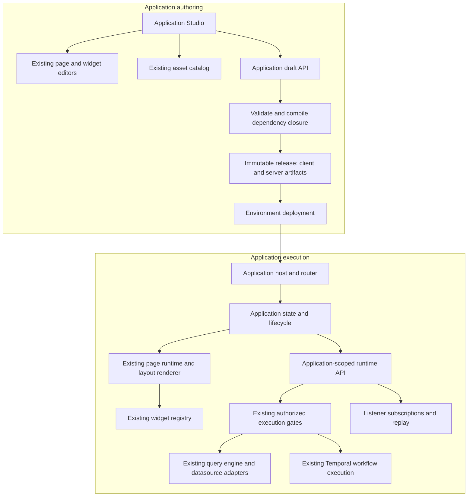

# Applications: architecture proposal

**Status:** Proposed architecture with an implemented foundation slice. Composition, immutable asset versions, per-editor version history and impact review, version diff/draft restore, exact page-version pinning, thin Application releases, release history/rollback, application-state writes and route navigation actions, typed route query declarations, opt-in route-query/page-variable binding, route titles/not-found/keep-alive/guards/nested declarations, environment connection binding revisions, consumer route/action policy, managed page adoption, workflow run history, and opt-in strict expression mode are implemented; see [implementation status](2026-11-22-applications-foundation-status.md), [asset versioning](2026-11-23-asset-versioning-plan.md), [the workflow/listener plan](2026-11-22-applications-workflow-listener-plan.md), and the [E2E matrix](2026-11-23-applications-e2e-matrix.md). Application-level effect declarations and separate read/write APIs were removed after review: source definitions determine operation behavior. Remaining work is infrastructure-dependent workflow/listener verification, background automation reconciliation, external consumer identities, and broader platform hardening.  
**Scope:** First-class, authenticated, multi-page business applications built from existing Jet Admin resources.  
**Basis:** Source inspection on 2026-11-22, including the current working tree. Marketplace code has ongoing changes; integration recommendations are proposals, not changes to that work.

## 1. Architectural decision

Introduce **Application as a composition, authorization, and release boundary**, not as a replacement for App Pages and not merely as a folder containing them.

An Application combines:

- An application shell, routes, navigation, theme, and localization settings.
- Existing App Pages and their widget placements.
- Application-scoped state, resources, actions, and lifecycle behavior.
- Explicit bindings to queries, workflows, listeners, datasources, and schedules.
- Consumer access policies separate from builder access policies.
- A mutable draft, immutable compiled releases, and environment deployments.

**Keep the modular monolith.** Add an `application` backend module and a frontend application runtime. Reuse the page layout engine, widget packages, query engine, listener infrastructure, Casbin, and Temporal workflow execution. There is no justification yet for a new microservice, another frontend framework, or another workflow engine.

The central model is:

```text
Tenant
  ├── Shared asset catalog: pages, widgets, queries, workflows, connections...
  └── Application
       ├── Draft: composition + registered asset references
       ├── Releases: immutable, complete executable definitions
       └── Environments: deployment pointer + server-side connection bindings
```

**Key principle:** Reuse asset implementations; do not let published applications depend on mutable asset definitions.

### Assumptions and boundaries

- Initial audience: authenticated tenant members building and using internal business applications.
- Responsive browser applications are the initial delivery target, not native binaries or generated source-code projects.
- Existing standalone pages, module landing pages, bundles, and asset APIs remain supported.
- Start with one draft per application and a `production` environment; the model supports additional environments without claiming current infrastructure already isolates them.
- Public/anonymous apps, customer identities outside tenant membership, custom domains, offline writes, collaborative CRDT editing, and arbitrary third-party executable plugins are separate later decisions.
- Application data remains in existing connected systems. Introducing Applications does not implicitly create an ORM, business-data database, or distributed transaction manager.

## 2. What exists today

The implementation is ahead of some existing architecture documents. In particular, the current package is `@jet-admin/expression-engine`, and the active layout implementation has a Craft.js adapter over a JSON layout tree. Do not design from the README alone.

| Existing capability | Source evidence | Decision |
| --- | --- | --- |
| Tenant-scoped pages and page history | `apps/backend/prisma/schema.prisma`: `tblAppPages`, `tblAppPageVersions`; `modules/appPage/appPage.service.js` | Keep as authoring assets; page history is not an application release. |
| Page reference checks and access checks | `appPage.references.js`, `appPage.middleware.js`, `appPage.v1.routes.js` | Extend into a shared dependency resolver; these checks already exist but do not define an application-wide dependency graph. |
| Isolated page state and URL variables | `apps/frontend/src/logic/appPageRuntime/AppPageRuntimeProvider.jsx` | Preserve per-page isolation; add an outer application session. |
| Request deduplication, abort, latest-result protection | `logic/appPageRuntime/queryCoordinator.js` | Preserve behavior for reads; add explicit read/write semantics before generalizing. |
| Query/workflow/listener lifecycle | `useAppPageDataSourceManager.js`, `executeWorkflowWithStreaming.js`, `observeWorkflowRun.js` | Extract transport and lifecycle adapters, not a competing execution system. |
| Sequential widget event actions | `useWidgetEventHandlers.js` | Evolve into a typed action executor with a legacy adapter. |
| Resource/placement/repeat identities | `widgetInstanceIdentity.js` | Preserve the distinction; add application/view scope rather than keying state by widget resource ID. |
| Shared page renderer | `presentation/components/appPageComponents/viewer/AppPageView.jsx` | Extend this rendering path; do not fork an Application-only renderer. |
| Layout tree, conditions, repetition, Craft conversion | `appPageComponents/layout/engine/*`, `layout/renderer/*`, `layout/editor/*` | Keep the JSON layout tree canonical and Craft.js editor-specific. |
| Versioned widget descriptors and normalization | `packages/widget-types/src/descriptors.js`, `normalize.js`, `validate.js` | Extend the existing contract, not a second UI-control registry. |
| Forms, dirty preservation, field validation | `packages/widgets-ui/src/form/formWidget.jsx`, `_shared/fieldContracts*` | Extract reusable validation rules and add application-level orchestration. |
| Common authorized query/workflow entry points | `apps/backend/utils/authorizedProxy.js`, `executionContext.js` | Extend these gates for release-scoped execution. Never bypass them from Applications. |
| Casbin domain/resource/action permissions | `apps/backend/config/casbin_model.conf`, `permissions*` | Reuse the model; introduce application, route, and action resources. |
| Authorized socket joins | `modules/auth/socketAuthorization.js` | Add application subscriptions; current page/workflow room checks alone are insufficient for application action and row policies. |
| Dependency-aware import/export | `modules/bundle/bundle.service.js` | Share graph extraction and reference rewriting; keep old Bundle v1 readers compatible. |
| Marketplace template installs and ledgers | `modules/marketplace/template.installer.js`; `tblMarketplaceTemplateInstalls` | Installed templates can create application drafts; install provenance is not runtime ownership or release management. |

### Gaps that matter

1. Pages are independent; there is no first-class application shell, route table, shared session, or coordinated deployment.
2. Widget slots fetch current definitions by resource ID. A page snapshot alone cannot freeze an application.
3. Data-source aliases and action configuration are page-oriented; the event switch has no general routing, policy-aware mutation, or validation pipeline.
4. Configuration is largely JSON. Applications need structural schemas, semantic validation, explicit references, compatibility checks, and diagnostics across that JSON.
5. Existing listener push delivery is page-addressed (`push_to_app_page` / `listener:app_page:<id>`), not release- and subscription-addressed.
6. `js-template` uses scoped `new Function()`. Its own implementation explicitly states that this is **not a hard security boundary**. Expanding to imported or less-trusted applications requires a stricter expression trust model.

These are design gaps, not a claim that every existing execution path has been security-audited.

## 3. Target architecture



There are three logical responsibilities, initially within the same deployment:

| Responsibility | Owns | Does not own |
| --- | --- | --- |
| Authoring/control | Drafts, asset registration, validation, release creation, deployment history | Browser session state or datasource execution |
| Runtime host | Route/view lifecycle, local state, bindings, form coordination, action execution | Secrets, trusted identity, authorization decisions |
| Runtime backend | Resolve approved release actions, authorize, validate inputs, execute pinned definitions, deliver filtered events | A second query engine or workflow scheduler |

## 4. Domain model and ownership

### 4.1 Entities

| Proposed entity | Important fields and responsibility |
| --- | --- |
| `tblApplications` | `applicationID`, `tenantID`, title, tenant-unique slug, lifecycle status, creator, timestamps. Stable identity; archive rather than cascading delete. |
| `tblApplicationDrafts` | One row per application: `schemaVersion`, integer `revision`, `definition` JSON. Shell, routes, state declarations, resource bindings, actions, theme. Optimistic concurrency. |
| `tblApplicationAssets` | Stable `assetKey`, owning application/tenant, exactly one typed FK to an existing asset, `managementMode`, provenance. Roots and registered dependencies, not copied business data. |
| `tblAssetVersions` | Shared immutable definitions: tenant, asset type/ID, monotonic version number, schema version, content hash, payload, status, change note, creator/time. Payloads reference exact dependency version IDs; datasource credentials are excluded. |
| `tblApplicationReleases` | `releaseID`, application/tenant, release number, source draft revision, schema/runtime compatibility, content hash, route/definition metadata and an exact map of App Page version IDs, creator/time. Definitions are not copied into the release. |
| `tblApplicationEnvironments` | application/tenant, name, current deployment pointer, non-secret configuration, configuration revision, disabled state. One `production` row initially. |
| `tblApplicationEnvironmentBindingRevisions` | environment, monotonic binding revision, datasource-ID mapping, change note, actor/time. The environment row keeps the active revision and mapping; no credential values are stored in definitions or releases. |
| `tblApplicationDeployments` | environment, release, binding/config revision, previous deployment, actor, status/error, activation time. Append-only deployment history. |
| `tblApplicationAutomationBindings` | environment + stable automation key, desired release definition, existing listener/cron identity, reconciliation generation/status. Needed when application-owned background automation is enabled. |

Use existing audit infrastructure for edits, publication, deployments, grants, executions, and archival. Do not add an audit replacement or persist every keystroke as an audit event.

### 4.2 Foreign keys, tenant isolation, and JSON

- Use a bounded typed association: `tblApplicationAssets` has nullable `appPageID`, `widgetID`, `dataQueryID`, `workflowID`, `listenerID`, `cronJobID`, and `datasourceID` FK columns.
- Add SQL `CHECK` constraints requiring exactly one target and agreement with `assetType`. Prisma alone does not express these invariants.
- Use composite tenant-aware FKs, adding `(tenantID, resourceID)` unique constraints to target tables where necessary. Likewise enforce application/release/environment tenant relationships in the database.
- Uniqueness: `(applicationID, assetKey)`; one registration per typed source in an application. Multiple route or layout uses reference that registration rather than duplicating it.
- Partial unique indexes permit at most one **managed** owner per typed source. Other applications can reference it only through an explicit sharing policy.
- This adds schema work but gives real referential integrity. Do not make a loose `(resourceType, resourceID)` pair the only ownership authority.
- Keep author-authored trees, action graphs, and route declarations as versioned JSON. Normalize identity, ownership, deployment, grants, and environment bindings into relational tables.
- The release lock records the complete transitive graph, including dependencies not individually selected by an author. Composition uses stable keys; compilation resolves all source identities and hashes server-side.

### 4.3 Managed versus referenced assets

**Managed:** The application controls the asset's authoring lifecycle. New in-app pages/widgets/queries are managed. Existing global editors may edit them only after checking application edit rights as well as applicable resource rights. Mutations invalidate draft validation and advance the owning draft revision transactionally.

**Referenced:** A tenant-shared resource remains independently managed. Application authors need explicit rights to use it. A source change produces an impact/staleness indication and enters the next compilation, never an already-published release.

**Adoption defaults:** A page link is explicitly `referenced` or `managed`. Managed adoption clones the App Page row while widgets and connection bindings stay shared; referenced pages are not cloned or mutated. Reuse datasource connections by environment binding; never clone credentials as part of page adoption. Unlinking an in-use page is rejected, an unreleased managed clone is removed with its link, and a versioned clone is retained for history.

**A dependency is not an ownership claim.** Using a shared workflow or datasource does not make it safe to delete when the application is archived or a marketplace template is uninstalled.

Destructive operations must consult both draft references and retained release/deployment dependencies. Default to archive/tombstone. Explicit administrative revocation may disable runtime access without rewriting immutable artifacts. Physical purge requires retention and dependency checks; business tables are never dropped merely because an application is removed.

## 5. Definition and release contract

Introduce `@jet-admin/application-contracts`: JSON Schema plus pure validation/reference utilities and optional generated TypeScript declarations. Existing JS consumers remain JS. One contract must serve backend, frontend, bundle tooling, marketplace, and later MCP tools.

Illustrative **authoring** shape; keys and action names below are proposed, not already supported:

```json
{
  "schemaVersion": 1,
  "shell": {
    "kind": "sidebar",
    "homeRouteID": "orders",
    "navigation": [{ "routeID": "orders", "label": "Orders" }]
  },
  "routes": [
    {
      "id": "orders",
      "path": "/orders",
      "pageAssetKey": "orders-page",
      "params": {},
      "query": {
        "page": { "type": "integer", "default": 1 },
        "tab": { "type": "string", "default": "all" }
      },
      "syncPageVariables": true
    },
    {
      "id": "order-detail",
      "path": "/orders/:orderID",
      "pageAssetKey": "order-detail-page",
      "params": { "orderID": "uuid" },
      "query": {}
    }
  ],
  "state": {
    "application": {
      "selectedWorkspaceID": { "type": ["string", "null"], "default": null }
    }
  },
  "resources": {
    "orders": {
      "assetKey": "list-orders",
      "kind": "query",
      "scope": "page",
      "connectionKey": "operations-db",
      "triggerMode": "auto"
    },
    "save-order": {
      "kind": "query",
      "assetKey": "update-order",
      "connectionKey": "operations-db",
      "triggerMode": "manual"
    }
  },
  "theme": { "density": "comfortable", "tokenOverrides": {} },
  "localization": { "defaultLocale": "en", "supportedLocales": ["en"] }
}
```

The asset registry maps `orders-page` and `list-orders` to existing source rows. App Page versions reference exact widget/source versions; the Application release references exact page versions.

### 5.1 Publish a thin release from immutable versions

1. Authorize publication and lock the expected draft revision.
2. For every linked App Page, ensure an immutable page version from the current page draft. Page versions capture exact widget version IDs and exact query/workflow/listener version IDs. Dependencies are versioned only when their content hashes changed.
3. Workflow versions capture exact query-node and child-workflow version IDs. Dynamic or cyclic targets fail version creation.
4. Validate routes, same-tenant references, ownership/use rights, widget capabilities, action allowlists, and definition compatibility at the publication boundary.
5. Persist a release containing the application definition, routes/shell, diagnostics, content hash, and exact page version IDs. Do not copy page/widget/query/workflow/listener payloads into the release.
6. Assemble the client/server manifest from version rows when the runtime requests it. The client receives no SQL, datasource identifiers/options, credentials, workflow internals, or source IDs.
7. Deploy separately after environment bindings and runtime compatibility checks pass. Publication itself does not start listeners, schedule jobs, execute queries, or seed data.

Shared source edits after version creation do not alter existing versions or releases. Draft editing remains mutable and prompt-free; an explicit version can also be created through the asset-version API. Existing `tblAppPageVersions` remains legacy page-save history and is not the Application release boundary.

### 5.2 Pinned execution must be real

A release that renders a page version but calls `runDataQueryByID` against the latest query row is **not immutable**.

- Resolve query/workflow/listener definitions through exact asset version IDs. Environment connection slots and credentials remain a separate binding revision.
- Reuse `createQueryEngine`'s fetcher seam. Namespace any retained cache by asset version/content hash, binding revision, and authorization context.
- Store workflow execution provenance with exact workflow/query/child-workflow version IDs. Existing runs continue to resolve their starting versions after deployment changes.
- The existing workflow instance `executionDefinition` is a useful seam; version provenance is what makes transitive dependencies reproducible.
- Environment credentials may rotate without a new application release. Technical connection changes advance binding revision and retire relevant connections/caches; they are audited operational changes, not silently claimed to be immutable business definitions.
- Runtime permissions, emergency revocation, connection availability, and underlying business data remain live. A release freezes code/configuration, not authorization grants or external database schema/data.

### 5.3 Runtime code and schema compatibility

Pinning configuration does not pin the platform code interpreting it. Record the runtime ABI, expression mode/version, layout schema, widget descriptor/implementation versions, and relevant plugin build identities in the lock.

Initially, platform upgrades must pass retained-release compatibility fixtures; incompatible definition migrations create a new release rather than modifying old artifacts. Reject deployment when required capabilities/ABI are unavailable. If exact historical rendering or execution is a product guarantee, retain content-addressed runtime/plugin builds and route releases to compatible worker versions. A `minimumRuntimeVersion` field alone cannot provide that guarantee.

Keep environment binding/configuration revisions inspectable. A session/deployment selects a validated mapping revision; connection-secret rotation remains late-bound and audited, with credential/connection-generation cache invalidation. Do not embed an old secret to make a release appear reproducible.

## 6. Runtime composition and lifetime

```text
Authenticated application route
  ApplicationHost
    ApplicationRuntimeProvider
      ApplicationShell
        Shell widgets / navigation
        ApplicationRouteOutlet
          AppPageRuntimeProvider
            Shared AppPageView content
              Existing LayoutRenderer
                Existing widget slots and renderers
        ApplicationOverlayHost
```

Refactor `AppPageView` into a public wrapper plus reusable inner content/runtime composition seam. Maintain one layout/widget rendering implementation. Shell and overlay views use that same view-runtime primitive with distinct scope IDs; they are not a second widget system.

### Lifetime rules

| Scope | Identity and lifetime |
| --- | --- |
| Application session | Key by verified principal/session generation, tenant, application, environment, and release. Survives page navigation; disposed on logout/identity/app/release/environment change. Never a process-global user-state singleton. |
| Shell | Lives for the application session. May host explicitly application-scoped reads and UI state. |
| Page/view | Key by route ID, page asset, and validated identity parameters. Recreated when record identity changes; filter query-string changes need not remount the view. |
| Overlay | Explicit instance ID; dispose on close unless a bounded retention policy is configured. |
| Widget | Preserve resource ID vs placement ID vs repeat instance ID, adding owning view scope. Do not rewrite existing placement IDs unnecessarily. |
| Query/subscription | Owned by declared scope and observer leases. Leaving one view must not cancel a read still observed elsewhere. |
| Workflow run | Server-side lifetime. Leaving a page stops observation, not the durable run, unless an explicit authorized cancellation command is issued. |

For editable/reorderable collections, add a stable `repeat.key` expression and duplicate-key checks; the current index-based repeat path is insufficient for preserving row-local form state after reordering. Preserve index behavior for old page schemas.

### State model

Expose a **read-only expression projection**, not the mutable internal store:

```text
state.application.variables.*       application-session state
state.application.queries.*         explicitly shared resource results
state.page.variables.*              active view variables
state.page.queries.*                active view resource results
state.widgets.<placement>.*         current view widget state
state.forms.<formID>.*              form state projection, not another draft copy
state.route.{id,params,query}        parsed/validated route state
state.session.{user,capabilities}    server-provided, non-secret projection
state.environment.*                allowlisted non-secret config
event.*                            current event payload only
steps.<stepID>.*                    current action-chain results only
```

- Keep legacy `state.variables`, `state.queries`, `state.workflows`, `state.listeners`, and legacy event spellings working through an adapter. Never silently flatten colliding application and page aliases; cross-scope references are explicit.
- Page variables do not survive navigation by accident. Persistent state requires a declaration: session memory, URL, user preference, or durable business data.
- Route query declarations are typed (`string`, `number`, `integer`, `boolean`, `uuid`) with optional defaults. Declared values are coerced/defaulted; undeclared values remain raw strings; invalid declared values invalidate the route. `NAVIGATE` validates against the target route's declarations.
- A route may opt into `syncPageVariables`: page variables whose keys match declared query parameters initialize from the typed route value, follow query-only navigation without remounting, and write non-default values back through router replacement. Only declared query keys are written; other page variables stay out of the URL. General page-variable URL sync remains a separate feature.
- URL serialization is typed and allowlisted. No sensitive form values, tokens, or PII in shared URLs. Define push/replace history behavior and back/forward hydration; adapt existing URL sync instead of creating competing effects.
- Only serializable data belongs in state. Widget method functions, AbortControllers, sockets, timers, and transport handles belong in lifecycle registries, not persisted/application expression state.
- Derived values are computed, not manually synchronized variables. Reject static cycles; dynamically indexed dependencies require declared dependencies and runtime cycle/iteration guards.

### Store choice

Do not introduce another state library. Use a per-application Zustand vanilla store with selector subscriptions for local application/view state; the dependency already exists. Keep the page reducer and hooks initially behind a compatibility adapter.

Use the existing **TanStack Query v5** infrastructure as the owner of remote read state. The query coordinator becomes an orchestration adapter over it; the reducer's existing query fields can temporarily be projections, not an independent authoritative cache. Do not expand the legacy `react-query` v3 footprint.

Before replacing page internals, lock current isolation, action ordering, request coordination, and repeat-identity behavior with contract tests. Selector-based subscriptions and batching should prevent a keystroke from re-evaluating every widget in a large app.

## 7. Visual building blocks, layout, and styling

### Extend the existing widget contract

Keep `widget-types`, `widgets-ui`, and `widgets-logic` as metadata, rendering, and data-transformation boundaries. Add backward-compatible descriptor fields for:

- Typed props, accepted bindings, named events with payload schemas, method input/output schemas.
- Default state, accessible label requirements, focus behavior, validation participation.
- Supported capabilities and actual implementation versions; publish must reject required unsupported behavior rather than merely advertising it.
- Lazy renderer loading and runtime feature compatibility.

A widget renderer receives a versioned host contract: resolved props, scoped state access, `emit`, method registration, validation registration, and capability requests. It must not import application API clients or know application route URLs.

Prioritize end-to-end operational controls: forms and fields, editable/paginated tables, record detail views, lists, buttons, tabs, modal/drawer hosts, notifications, file inputs, charts. Add missing behaviors to existing types before creating parallel “application widgets.” Layout containers remain layout nodes; reusable business components can later compose nodes/widgets with explicit inputs and outputs.

### Canonical layout

- Keep the existing JSON tree and V1-to-V2 migration path. Craft.js state is an editor representation, not the deployed artifact.
- Evolve the layout schema with breakpoint overrides, min/max constraints, overflow, alignment, and semantic landmarks. Prefer flow/grid/flex for responsive operation; use z-stack deliberately for overlays, not as the universal layout mechanism.
- Separate shell layout from page layout. Support route-specific shell selection for focused workflows without duplicating navigation across pages.
- Style through application-scoped CSS variables over `@jet-admin/ui` tokens: theme → reusable component variant → instance override. Scope overrides to the application root, including portals; never mutate the entire admin console's theme.
- Use structured, allowlisted styling. Arbitrary CSS/HTML/iframe configurations require explicit policy, URL sanitization, and isolation. Uploaded assets need tenant authorization, size/type validation, and controlled URLs.
- Accessibility is part of the host contract: keyboard navigation, focus restoration, labels/error associations, reduced motion, contrast, and live announcements. Preview and production must share those behaviors.

## 8. Events, actions, and validation

### 8.1 Action executor

Separate **pure state transitions**, **local UI commands**, **server commands**, and **durable workflows**. Do not force navigation or a field change through Temporal.

Evolve `useWidgetEventHandlers` into an executor with declarative, typed steps:

| Category | Initial actions |
| --- | --- |
| State | `SET_STATE`, `RESET_STATE` |
| Data | `RUN_RESOURCE`, `RUN_MUTATION`, `INVALIDATE_RESOURCE` |
| Workflow | `START_WORKFLOW`, `AWAIT_WORKFLOW`, explicit authorized cancel |
| Views | `NAVIGATE`, `OPEN_OVERLAY`, `CLOSE_OVERLAY`, `CALL_WIDGET_METHOD` |
| Forms | `VALIDATE_FORM`, `SUBMIT_FORM`, `RESET_FORM`, `SET_FIELD_ERRORS` |
| Feedback/control | `SHOW_TOAST`, `CONFIRM`, `IF`, bounded `PARALLEL`, `RETURN`, `FAIL` |

Translate existing `SET_VARIABLE`, `EXECUTE_QUERY`, `TRIGGER_QUERY`, `TRIGGER_WORKFLOW`, and method calls through a legacy adapter. Do not change old saved-page semantics implicitly; new application schemas opt into stricter semantics.

Each chain has an ID, immutable event input, live scoped state reads, named prior-step outputs, cancellation token, timeout, and trace ID. State writes commit synchronously to the runtime store so the next step sees them without waiting for a React render.

Define concurrency: `latest` for search/read effects, `serial` for ordered writes, `dropWhileRunning` for submit buttons, bounded `parallel` only when selected. Default stop-on-error; `onError` and `finally` are explicit. Return a discriminated result (`success`, `failed`, `cancelled`, `skipped`), not ambiguous `null`.

`START_WORKFLOW` returns a run handle after server acceptance. `AWAIT_WORKFLOW` waits for a terminal state. A success toast for submission must not imply a long-running business workflow has completed.

Example flow:

```text
orderForm.submit
  → VALIDATE_FORM(orderForm)
  → CONFIRM if the edit changes a financial field
  → EXECUTE_QUERY(save-order, declared source inputs)
  → INVALIDATE_RESOURCE(tags = [orders])
  → NAVIGATE(order-detail, orderID = steps.save.result.id)
  → SHOW_TOAST("Order saved")
  onError → map field errors / show conflict; retain draft
```

UI action chains are not database transactions. Multi-write business invariants belong in a server transaction or an existing durable workflow with explicit compensations.

### 8.2 Validation

Keep three distinct concerns:

1. **Definition validation:** Is the built application structurally valid and executable?
2. **Client validation:** Immediate field/form feedback, cross-field rules, async checks, touched/dirty state, and accessible errors.
3. **Server validation:** Authoritative action input schemas, current permissions, tenant/user context, business rules, and concurrency checks.

Extract reusable pure field/coercion rules from `_shared/fieldContracts` into a suitable browser/server-neutral contract module. Keep DOM/focus logic in UI packages. Coordinate existing FormWidget state via a form registry; do not create a second independent form draft store.

Async validation needs debounce, cancellation, and stale-response suppression. Server errors return stable codes plus field paths. Preserve dirty fields during refresh and retain the draft after failures or conflict responses.

**Important compatibility issue:** the current FormWidget can emit `onSubmit` with `isValid: false` on invalid submission. New application actions must gate mutation submission on validated inputs and adopt a clear invalid-submit event contract. Do not assume an event named `onSubmit` is proof of validity, or change standalone-page behavior without a migration.

## 9. Routing and view management

- Extend the existing React Router v6 host with `/tenants/:tenantID/applications/:applicationID/run/:environment/*` (proposed URL), separate from the Studio/editor routes.
- The backend resolves the current deployment; the session pins its returned release. Client-supplied release IDs alone never authorize access.
- Route definitions use stable IDs, nested paths, typed params/query schemas, shell selection, optional read loaders, and explicit required route permission. Navigation actions reference route IDs and typed params, not hardcoded admin-console URLs.
- Server policy applies to runtime manifests, loaders/actions, and event subscriptions; client guards are presentation only.
- Support deep links, refresh, back/forward, 403, 404, route loading errors, redirects with loop detection, and route-level error boundaries.
- Detail pages should load records from validated URL identity, not depend on having visited the list page first.
- Keep browser history, query variables, and dirty-form leave guards under one router adapter. Include `beforeunload` as a best-effort warning, not durable data protection.
- Overlays have a view contract and optional URL representation. Default unmounting on leave; any keep-alive cache is explicit, bounded, and purged on permission/session changes.
- Production server/NGINX fallback routing must serve the runtime host for deep links. Custom domains and embedding need later origin, authentication, and CSP design.

## 10. Network and data synchronization

### 10.1 Source-owned behavior and explicit scheduling

Existing page `dataSources` can point at saved queries, workflows, or listeners; “query” is not synonymous with read-only. The configured source determines what executes. Do not duplicate that definition with page-level `effect`/`readOnly` declarations or application-specific read/write endpoints. Applications authorize source aliases and pin their executable definitions. Actual restrictions belong to datasource credentials, connector capabilities, source contracts, and business validation, not an author-supplied application label.

| Concern | Responsibility |
| --- | --- |
| Query operation | Execute configured, pinned query options through the existing authorized engine; do not infer behavior from a name, SQL prefix, or trigger mode. |
| Scheduling | Preserve configured mount/reactive/manual triggers, dependencies, polling, and widget events. Selecting automatic execution is an author choice, not a read-only guarantee. |
| Execution reliability | Reuse existing runtime behavior initially. Source/provider retry and idempotency guarantees, form validation, and duplicate-submit handling require independent contracts; an application label cannot supply them. |
| Workflow command | Use pinned workflow definitions and the existing execution lifecycle; observation/reconnection must not restart a run. Run provenance and child human-input requests are bound to the starting application/release and caller. |
| Subscription (future) | Authorized scope, sequence/cursor, bounded retention, reconnect/catch-up, and overflow handling. |

Deployed workflows use captured graphs and static dependencies; dynamic targets and cycles fail publication. Deployed listeners observe persisted buffers with bounded, scoped cursors and fail closed when the current listener definition differs from the release. No automatic mutation classification or forced-manual rewrite is performed.

### 10.2 Cache and consistency contract

Read keys include principal/authorization scope, tenant, application, environment, release, binding/config revision, resource key, normalized inputs, and locale where relevant. View/record-specific private resources also include their owning scope. Do not reuse the current widget metadata key `[tenant, resourceID]` for release-pinned definitions.

- Client query state has one owner. Project data/status/errors into expression state instead of independently caching the same result in multiple stores.
- Server cache keys need the same isolation guarantees. Current query-engine keys include tenant/query revision/inputs; that is a useful base but not enough for application release/environment or identity-dependent results.
- After writes, use declared resource tags to invalidate related reads. Begin with pessimistic updates; optimistic edits require explicit rollback/reconciliation and entity-version rules.
- Include `expectedVersion`/ETag where the business datasource supports it. Return `409` with a reconciliation path rather than silently overwriting another user's edit. Connector-specific conflict strategies must be declared; not every datasource supports OCC.
- Poll only sources deliberately configured for repeated execution, with bounds, jitter/backoff, and pause-on-hidden/offline where appropriate. Any future read-only caching optimization needs a source/connector contract, not an application effect label.
- A canceled browser request does not prove that a server mutation was canceled. Distinguish pending, accepted, succeeded, failed, and unknown outcome.

Applications do not add a receipt ledger or mandatory idempotency key. If a configured operation supports provider/business idempotency, pass its key as a declared source input. A failed HTTP request or timeout does not prove a business mutation failed; do not promise safe retries or exactly-once execution without that source-level contract. Any future shared reliability layer must treat uncertain outcomes explicitly and must not depend on a page effect declaration.

### 10.3 Listener and workflow synchronization

- Keep upstream datasource listeners in the backend. Browser subscriptions observe them; they do not start/stop shared integrations on mount/unmount.
- Add authenticated subscriptions keyed by application/environment/release/resource. Resolve approved listener/channel IDs from the server artifact, never arbitrary client room strings.
- Default payload is an **invalidation event**, followed by an authorized read. Broadcasting raw business rows to every application viewer would bypass per-user filters.
- If direct row payloads are enabled, authorize/filter per recipient and project an approved event schema. Apply equivalent projection to workflow progress and human-input views; do not expose the entire workflow context automatically.
- Reuse persisted listener `seqNo`/buffer infrastructure where applicable. Cursor tokens should bind tenant/subscription scope and serialize sequence values safely. Persist/replay a stream before promising resume semantics.
- Handle duplicate events, gaps, reconnect, expired cursor, and out-of-order updates. A detected gap triggers authoritative refetch; use bounded buffers and coalesce high-volume invalidations.
- Existing page-specific push channels remain supported. Add an application delivery adapter and deployment reconciliation; do not repurpose page broadcasts into unrestricted application rooms.
- Recheck subscription permissions on reconnect and revocation, with bounded session expiry/lease renewal. A successful join is not permanent authorization.

Offline v1 is explicit: show stale/read-only state and connection status, retain local in-memory drafts, and do not queue mutations. Durable offline writes require a separate conflict, identity, storage-encryption, and replay design.

## 11. Security and permission model

### Separate authoring from using

Proposed permissions, using existing tenant-scoped Casbin conventions:

| Resource | Actions |
| --- | --- |
| `application:<id>` | `read`, `update`, `publish`, `deploy`, `execute`, `archive`, plus collection-level `create`/`list` |
| `applicationRoute:<appID>:<routeID>` | `read` |
| `applicationAction:<appID>:<actionKey>` | `execute` |
| Source asset | Existing read/update/execute, plus explicit authority to delegate use through an application where needed |

A viewer gets permission to run the application and selected route/action capabilities. This does **not** grant query editing, datasource reading, asset listing, or a wildcard execute policy.

Recommended runtime decision:

```text
verified active identity and tenant membership
AND enabled application + environment
AND release is admitted by deployment/session policy
AND application.execute
AND route/action permission
AND action/resource is present in the server release allowlist
AND approved dependency/delegation edges
AND validated input, resource revocation, and business-data policy
```

Underlying resources can be delegated intentionally, but the publisher needs authority to delegate them. Having an unrelated application's execute permission must never authorize arbitrary query/workflow IDs.

### Extend the execution gate, not just the routes

- Add application/release/environment/action context to `executionContext.js`, created only by the backend after validation. Preserve the true caller through workflow/query children.
- The existing proxy can allow execution via `originatingResource` permission. Applications must also verify the target's membership in the compiled graph and the specific delegation edge. A generic “origin is allowed” fallback is insufficient.
- Route/action IDs, record IDs, release IDs, roles, and `currentUser` supplied by a browser are untrusted. Derive principal/tenant/reserved authorization inputs server-side.
- Consumer APIs resolve action keys to pinned server definitions. They never accept arbitrary SQL, source resource overrides, datasource IDs, or client-created system contexts.
- Background jobs use bounded server-owned automation grants tied to application/environment/release. Do not turn application requests into trusted `system` callers to avoid authorization checks. Review the existing system-caller bypass before routing application-owned automation through it.
- Enforce data authorization on the server and connected system: parameterized predicates, datasource least privilege/RLS where available, output field projection, safe filters/sorts/pagination, and maximum result/timeout limits. Hiding a widget is not row-level security.
- Redact manifests, logs, error payloads, query results, and workflow projections appropriately. Server artifacts can themselves contain sensitive author configuration and need controlled storage/access.

### Expression and imported-content trust

Do not market scoped `new Function()` as safe isolation for untrusted application authors.

- New Applications use a side-effect-free, AST-interpreted expression subset: state paths, operators, and explicit pure helpers. Bound depth, steps, collection sizes, and output size; ban mutation, dynamic code generation, ambient I/O, and prototype access.
- Preserve current JS templates only in an explicitly trusted legacy mode. Compilation reports unsupported expressions with source paths and migration guidance; do not silently rewrite arbitrary JavaScript.
- If unrestricted scripting becomes a requirement, evaluate it in a genuinely isolated execution environment with time/memory limits and capability RPC. A Worker improves responsiveness and termination, but alone is not a security boundary.
- Untrusted HTML/JS needs a separate-origin sandbox without same-origin authority or a documented sanitization restriction; review iframe permissions and `postMessage` origin checks. Marketplace packages are untrusted input even when labeled verified.
- Use a CSP compatible with the selected trust tier; do not weaken the whole admin console with `unsafe-eval` just to run imported apps.

## 12. Runtime API and module boundaries

Proposed control-plane base: `/api/v1/tenants/:tenantID/applications`.

| Endpoint | Purpose |
| --- | --- |
| `GET /`, `POST /`, `GET /:applicationID` | List/create/read application metadata. |
| `GET/PATCH /:applicationID/draft` | Read/save definition with required expected revision / `If-Match`; conflict returns `409`. |
| `POST /:applicationID/assets/adopt-preview`, `/assets/adopt` | Preview then clone/register existing assets with an explicit ownership plan. |
| `POST /:applicationID/validate` | Read-only semantic validation; diagnostics include JSON path, asset key, severity, code, suggestion. |
| `POST /:applicationID/releases`, `GET /:applicationID/releases` | Create an immutable release of exact page version IDs from the expected draft revision; list history. |
| `GET /asset-versions/:assetType/:assetID/versions`, `GET .../:versionID`, `POST .../versions` | List/read/create immutable asset definitions without mutating published versions. |
| `GET/PUT /:applicationID/environments/:environment/bindings` | Read redacted bindings / update validated connection mapping with OCC. |
| `POST /:applicationID/environments/:environment/deployments` | Deploy or roll back by selecting a compatible release; not by mutating a release. |
| `POST /:applicationID/archive` | Disable launches and reconcile owned automation; no automatic business-data deletion. |

Runtime base: `/:applicationID/runtime/:environment` under the same tenant path.

| Endpoint/transport | Purpose |
| --- | --- |
| `POST /sessions` | Resolve deployment and create bounded, server-verifiable release session; not a substitute for authentication. |
| `GET /manifest` | Return an authorized client manifest and ETag for that session. |
| `POST /pages/:pageAssetKey/data-sources/:alias/execute` | Execute an admitted pinned query or start an admitted pinned workflow with validated inputs through the existing authorized proxy. Query/workflow definitions determine behavior; no application read/write split. |
| `GET /pages/:pageAssetKey/data-sources/:alias/runs/:runID` | Read only a workflow run admitted by application/release/caller policy, with projected declared outputs and input requests. |
| `POST /pages/:pageAssetKey/data-sources/:alias/runs/:runID/cancel` | Request cancellation within the same run authorization. Does not delete history or reverse side effects. |
| `POST /pages/:pageAssetKey/data-sources/:alias/runs/:runID/requests/:collectionRequestID/submit` | Submit existing human-input data only for a request belonging to that run family. |
| `GET /pages/:pageAssetKey/data-sources/:alias/events` | Observe an admitted active listener's persisted buffer with a release/principal-scoped cursor. |
| Socket subscription request | Subscribe to an approved resource and cursor using the release session; acknowledge authorization/errors. |

Preview compiles a short-lived immutable preview artifact from the draft and uses the same runtime, with builder permission and explicit preview environment. It must never silently bind to production or run automatic writes. Changes require a new preview artifact. No client-side bypass of consumer authorization.

Adapt the existing response envelope; define consistent `code`, `message`, `fieldErrors`, `retryable`, and `traceID`. Enforce payload/result limits, timeouts, quotas, and principal-aware rate limiting. Session tokens are short-lived, bound to identity/application/environment/release, and do not authorize unpublished or arbitrary releases. Reject stale/revoked sessions according to deployment policy.

Permission-filtered manifests must use private, principal/policy-version-aware caching; never serve one user's filtered artifact from a shared CDN key. Navigation metadata may be filtered, but enforce authorization again for route chunks and every runtime operation. Use existing verified authentication on HTTP and sockets; protect cookie-authenticated commands against CSRF and do not place runtime credentials in URLs.

### Code organization

```text
apps/backend/modules/application/
  application.v1.routes.js
  application.controller.js
  application.service.js
  application.validator.js
  application.assets.js
  application.compiler.js
  application.release.service.js
  application.deployment.service.js
  runtime/
    applicationRuntime.controller.js
    applicationRuntime.service.js
    applicationRuntime.authorization.js
    applicationRuntime.subscriptions.js

apps/frontend/src/data/{apis,models}/application.*
apps/frontend/src/logic/applicationRuntime/
  ApplicationRuntimeProvider.jsx
  applicationStore.js
  actionExecutor.js
  resourceManager.js
  routerAdapter.js
  runtimeTransport.js
  legacyPageAdapter.js
apps/frontend/src/presentation/components/applicationComponents/
  studio/
  runtime/

packages/application-contracts/
  schemas/ validators/ references/ migrations/
```

These are responsibility boundaries, not a mandate to create every file immediately. Keep runtime implementation local initially. Extract `application-runtime`/`application-runtime-react` packages only when a second host actually needs them.

Existing feature modules remain owners of their assets and engines. The application module calls public module facades/adapters; it does not duplicate datasource logic, reach into controller internals, or patch global singleton fetchers. Share pure dependency extraction/remapping with bundles incrementally; import sanitization and runtime release compilation remain different policies.

### Targeted changes to existing architecture

| Existing integration point | Required change | Compatibility boundary |
| --- | --- | --- |
| `apps/frontend/src/presentation/components/appPageComponents/viewer/AppPageView.jsx` | Expose the inner view/runtime seam for a parent application host; accept scope/definition/transport services. | Standalone callers keep the current wrapper and defaults. |
| `apps/frontend/src/presentation/components/appPageComponents/editor/appPageWidgetSlot.jsx` | Resolve widget definitions through an injected resolver: compiled definition map in Applications, current API in standalone authoring. | Preserve widget props, placement identity, repeats, and method/event contracts. |
| `apps/frontend/src/logic/appPageRuntime/AppPageRuntimeProvider.jsx` | Add explicit view identity and parent application projection/adapter; make cleanup scope-aware. | Keep standalone reducer initialization, URL behavior, and public hooks. |
| `apps/frontend/src/logic/appPageRuntime/useWidgetEventHandlers.js` | Delegate to action executor/transport services instead of directly importing asset execution APIs for Applications. | Translate legacy action names; no silent saved-page semantic rewrite. |
| `apps/frontend/src/logic/appPageRuntime/useAppPageDataSourceManager.js`, `queryCoordinator.js` | Inject pinned execution/subscription adapters without page-level effect classification. Any future cache/retry policy must use source-owned contracts. | Retain current standalone scheduling and tested latest-request behavior; do not represent it as a universal mutation guarantee. |
| `apps/frontend/src/logic/evaluationEngine.js`, `packages/expression-engine` | Select expression mode from the validated definition contract; `safe-path` resolves state paths only and fails closed. | Existing trusted JS-template mode remains explicit and the default. |
| `apps/backend/utils/authorizedProxy.js`, `executionContext.js` | Add validated application context, dependency-edge authorization, pinned fetchers, and identity-aware cache context. | All old callers still pass through the same gates; no bypass via a new raw executor. |
| `apps/backend/modules/appPage`, `widget`, `dataQuery`, `workflow`, `listener`, `cronJob` | Application asset links and managed page ownership are guarded at the application boundary; source mutations remain governed by existing asset APIs and exact version pinning. | Existing APIs remain available subject to existing resource permissions. |
| `apps/backend/modules/auth/socketAuthorization.js` and listener delivery adapter | Validate application sessions/subscription keys, filter/project delivery, support revocation and bounded catch-up. | Keep existing standalone page/workflow rooms. |
| `apps/backend/modules/bundle/bundle.service.js` and marketplace installer | Share typed reference utilities; return provenance/ID maps for application registration; add dependency-aware uninstall checks. | Preserve Bundle v1 and current template installation workflows. |

The ownership guards and transport/definition seams are prerequisites, not cleanup to defer until after the first application is live.

## 13. Publishing, deployment, and background automation

### Lifecycle

```text
Draft edits → Validation → Immutable Release → Deployment preparation
  → Atomic environment pointer activation → Automation reconciliation
```

- Drafts are mutable; releases are immutable; deployments associate a release with environment configuration.
- A stable production session remains on its admitted release until expiry/refresh or a forced cutover. Graceful retention is permitted only for UI/read sessions; mutation/workflow commands from superseded releases are rejected by default unless explicitly declared safe.
- Page navigation cannot mix release R1 widgets with R2 query definitions. Include release/session context in every read, command, and subscription.
- Rollback changes the deployment pointer to a retained compatible release and reconciles background automation. It does not reverse external side effects or undo data/schema migrations.
- External schema changes require expand/contract migration discipline and separate backup/rollback planning. Marketplace SQL/seed installation remains an explicit operation outside ordinary app publication.
- Authorization revocations and emergency app/resource disables take effect on new operations and active subscriptions without waiting for republishing.

In-flight workflow runs keep their starting release/dependency context even after deployment changes. Observation, approved human-input submissions, and cancellation use current authorization against that run's recorded application/action provenance; they must not require restarting the run or temporarily granting access to all historical releases. Retain the necessary artifacts until durable runs and retention obligations finish.

### Automation reconciliation

Existing crons/listeners run independently of browser pages. Make ownership and activation explicit:

1. Referenced shared automation is observed/reused, not restarted, disabled, or taken over by application deployment.
2. Application-owned automation is declared by stable key and materialized through existing cron/listener services per environment.
3. Write desired generation and a durable outbox record in the deployment transaction. A retryable reconciler applies configuration idempotently, preventing duplicate schedules/consumers.
4. UI and external integration activation cannot be one atomic distributed transaction. Expose `PREPARING`, `ACTIVATING`, `ACTIVE`, `DEGRADED`, and `FAILED`, with a documented readiness policy.
5. Use generation fencing for effects controlled by Jet Admin. Old workers and listeners cannot dispatch new application commands once their generation is retired; in-flight external effects may still need reconciliation.
6. Rollback/archive reconciles only owned automation. Never enable a second consumer or delete a shared listener as an incidental consequence of switching a release pointer.

Phase one may defer owned background automation entirely while retaining workflow commands and approved observation of existing listeners. Do not advertise fully managed background integration deployment until reconciliation is implemented.

## 14. Builder experience and ecosystem integration

Application Studio is an **Operate** surface: reuse current editor conventions and shared UI rather than inventing a new visual identity.

- Application overview: purpose, environment, deployed release, draft changes, dependency health.
- Pages & Routes: route tree, shell/nav, deep-link parameters, permission requirements.
- Existing page canvas: widgets/layout/settings, now within application context.
- Data: application/page bindings, connection slots, read/write classification, invalidation tags.
- State: explicit scopes, types, defaults, computed values, URL persistence.
- Actions: typed chain editor, validation steps, concurrency and failure paths.
- Theme & Localization: scoped tokens, responsive preview, translation keys, format settings.
- Access: authoring roles, consumer route/action matrix, approved delegation and preview as role.
- Releases: validation diagnostics, dependency diff, environment binding readiness, deploy/rollback.
- Debugger: binding values/errors, action trace, resource requests, subscription status, layout/widget source path. Keep sensitive data redacted.

**Marketplace:** Installing an app template creates resources through the existing bundle/template installer, then registers an Application draft from the returned ID map. Reconnect connections, review roles and automation, validate, and explicitly publish/deploy. The template install ledger remains provenance; the application graph becomes runtime ownership/dependency authority. Uninstall previews must check later application references and never blindly remove resources adopted/shared after installation.

**Bundles:** Keep Bundle v1 asset export/import working. Introduce an application envelope or a negotiated new version containing definition, asset graph, stable-key remapping, schema versions, and required connection slots. Reject missing mandatory refs instead of leaving old tenant IDs in executable application definitions. Export strips secrets; import sanitizes again.

**MCP:** After contracts stabilize, expose create/adopt/validate/compile/deploy operations with the same permissions and validator. AI authoring is not a bypass around the compiler or permission model.

## 15. Observability, performance, and quality gates

Correlate request/session (non-secret ID), application, tenant, environment, release, route, action chain, resource, and workflow run through trace IDs. Redact inputs/outputs by schema; logs must not casually capture form values, tokens, connection options, or complete workflow context.

Track manifest load, first usable view, widget render/binding errors, action latency/failures, resource latency/cache hits, subscription lag/gaps, active scopes/leaks, automation health, and deployment reconciliation failures. Reuse current logging/audit infrastructure and add metrics/traces at boundaries.

Provisional performance targets, to validate on an agreed dataset/device rather than promise without measurement:

- No per-widget definition HTTP fetches for a compiled view; send a widget definition map with the view artifact.
- Large application manifests split by authorized route/view; shell and active route load first.
- Profile a 100-widget, 10-resource view: a field keystroke should not re-evaluate unrelated widgets. Virtualize large tables/repeated collections.
- Bound page keep-alive, query caches, event buffers, action parallelism, expression evaluation, and result sizes. Set concrete limits after baseline measurement.

### Required tests

| Layer | Evidence required |
| --- | --- |
| Contracts/compiler | Deterministic output, complete graph closure, missing/cross-tenant/cyclic refs, static/dynamic binding diagnostics, schema upgrades, unsupported capability rejection, secret exclusion. |
| Release execution | Editing/deleting/revoking source resources cannot silently switch a release to latest definitions; child workflow/query definitions stay pinned. Credential rotation follows binding revision rules. |
| Authorization | Denied app/route/action, arbitrary ID substitution, forged session/environment, omitted tenant, cross-tenant adoption, undeclared delegation, wildcard escalation, revoked socket access, redacted workflow output. Test direct API calls, not only UI. |
| State/lifecycle | Two users/tabs/apps cannot share local state; route/record changes reset correct scope; shell survives navigation; repeat reordering preserves keyed field identity; unmount retires leases. |
| Events/forms | Next action sees prior state; named step outputs; cancellation and failure semantics; invalid submit cannot mutate; dirty draft survives refetch, conflict, and server failure. |
| Data | Unified configured operation execution, explicit triggers, cache isolation, source/provider idempotency where supported, unknown outcomes, and external conflicts. No application metadata is treated as a read-only or exactly-once guarantee. |
| Realtime | Duplicate/out-of-order/gapped events, catch-up expiry, permission revocation, bounded buffering, reconnect without restarting workflows or shared listeners. |
| Deployment | OCC publish/deploy races, R1/R2 session pinning, incompatible rollback rejection, owned automation fencing, partial reconciliation failure, archive/uninstall impact checks. |
| Browser | Deep-link refresh/back/forward, CRUD flow, role matrix, route error/empty/loading/offline states, mobile layout, keyboard-only access, focus and error announcements. |
| Compatibility | Existing standalone pages, module landing pages, page versions, Bundle v1, widget previews, and current marketplace installation remain functional. |

## 16. Incremental implementation plan

Each phase is independently reviewable. The first usable slice must prove a complete business flow, not just application CRUD screens.

| Phase | Deliverables | Exit gate |
| --- | --- | --- |
| 0. Contracts and safety seams | Finalize ADRs; shared reference resolver; application schema; legacy adapters; inject widget-definition and execution transports into current page runtime; baseline contract tests. | Same existing page renders/executes through the adapter without behavior regression. |
| 1. Application composition | Core application/draft/assets schema, adoption with ID map, Studio shell, route table, application/page state scopes, navigation, scoped theme. | Two existing pages adopted into one draft; direct detail deep link works; shared app state survives navigation while page state resets. Preview only. |
| 2. Safe vertical slice | Release compiler/artifacts; environment connection binding; runtime sessions; unified pinned operation execution through existing proxies; pinned widgets; form validation/error mapping; source-owned OCC/idempotency and refresh bindings. | Authorized user lists, opens, edits, and saves a record; configured consumer permissions deny unauthorized operations; cross-tenant and undeclared targets denied; editing source assets does not alter a deployed release. |
| 3. Full operational runtime | Workflow starts/await/observations, human-input projection, application listener subscriptions, replay/gap recovery, route leave guards, diagnostics, component capability expansion, responsive/accessibility hardening. | Long-running workflow survives navigation; reconnect does not restart it; listeners synchronize approved data without leaking roles' data or losing bounded lifecycle control. |
| 4. Managed delivery/ecosystem | Deployment reconciliation/outbox and owned automation; rollback/retention controls; marketplace-created drafts, application import/export, staged environment tooling. | Repeated deploy/retry creates no duplicate owned automations; rollback and partial-failure recovery are proven; uninstall preserves shared/adopted resources. |

Do not promote phase-one preview to “production Applications” before the phase-two security, pinning, and mutation gates pass. Phase three is required for the complete runtime requested here; phase four is required before claiming managed application-owned automation and lifecycle integration.

### First reference application

Use a small Orders/Approvals application with a real test datasource:

1. List/search/paginate orders; navigate via `/orders/:orderID`.
2. Edit an order with required and cross-field validation; preserve dirty fields.
3. Save using source-supported record-version/idempotency inputs where available; refresh list/detail through configured actions.
4. Trigger approval workflow, navigate away, reopen its projected status/human-input view.
5. Receive an order invalidation via listener and refresh through authorized reads.
6. Publish R1, edit source widgets/query into R2, prove R1 remains pinned; deploy/roll back with binding compatibility checks.
7. Exercise viewer, operator, and builder roles with direct API negative tests.

This proves rendering, layout, state, routing, actions, validation, synchronization, authorization, and delivery as one system.

## 17. Decisions and alternatives

| Decision | Why | Rejected alternative |
| --- | --- | --- |
| Application is a composition/release boundary | Adds the missing lifecycle without destroying reusable assets. | Rename folders or replace App Pages. |
| Retain modular monolith and existing engines | Fits current code and deployment; avoids duplicate correctness/security machinery. | Application microservice and a new workflow engine immediately. |
| Typed asset relations + versioned JSON definitions | Referential integrity where it matters, authoring flexibility for trees/graphs. | Unchecked polymorphic IDs or fully relationalizing every widget property. |
| Materialized dependency-closed releases | Reproducible behavior despite mutable existing assets. | Snapshot only page IDs/config; fetch latest widgets/queries at runtime. |
| Same renderer and transport/definition adapters | Prevents standalone, preview, and production behavior divergence. | Fork a second builder/runtime UI. |
| TanStack Query for reads; scoped local store | Clear ownership and efficient subscriptions using existing dependencies. | Three caches or one enormous broadcast React context. |
| Server-resolved action keys and bounded delegation | Consumer least privilege without exposing authoring capabilities. | Grant broad underlying asset access or trust browser origins. |
| Strict expressions for new applications | Supports untrusted inputs and CSP without pretending `new Function` is secure. | Treat shadowed globals as a sandbox. |
| Pessimistic writes and explicit offline limits first | Honest correctness across heterogeneous connectors. | Automatic write replay, optimistic everything, or exactly-once promises. |

### Decisions requiring product confirmation before implementation

1. Are initial consumers only tenant members, or must external/customer identities or anonymous access ship immediately? The latter changes the identity and data-policy boundary.
2. Must referenced assets remain shared, or is clone-on-adopt the expected author experience? This proposal defaults to managed clones for editable page assets and shared connection bindings.
3. Are separately isolated staging/production databases and integrations available? Environment labels alone do not isolate business data or external side effects.
4. Is unrestricted custom JavaScript essential? This proposal defaults to strict expressions for new apps and an explicit trusted legacy tier.
5. Is application-owned background automation required in the first production release? If yes, bring reconciliation from phase four into the first delivery milestone rather than simplifying away its failure modes.

**Bottom line:** Build Applications by composing the existing platform under a new, explicit runtime and release contract. Preserve the working page/widget/data foundations; change the boundaries around state, dependencies, execution authority, and deployment.
