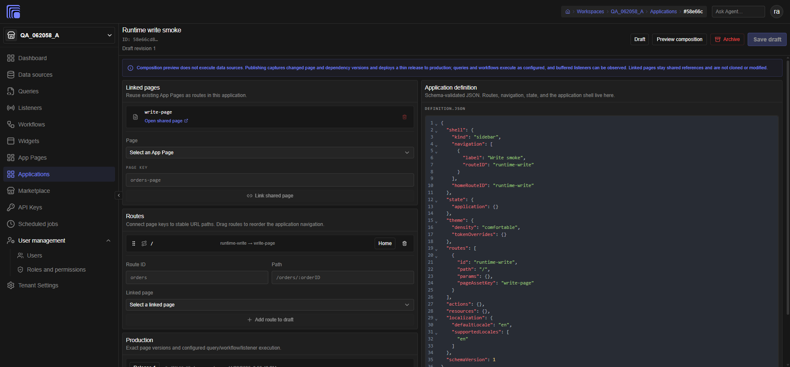
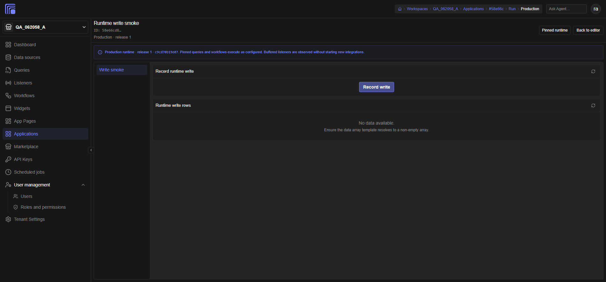
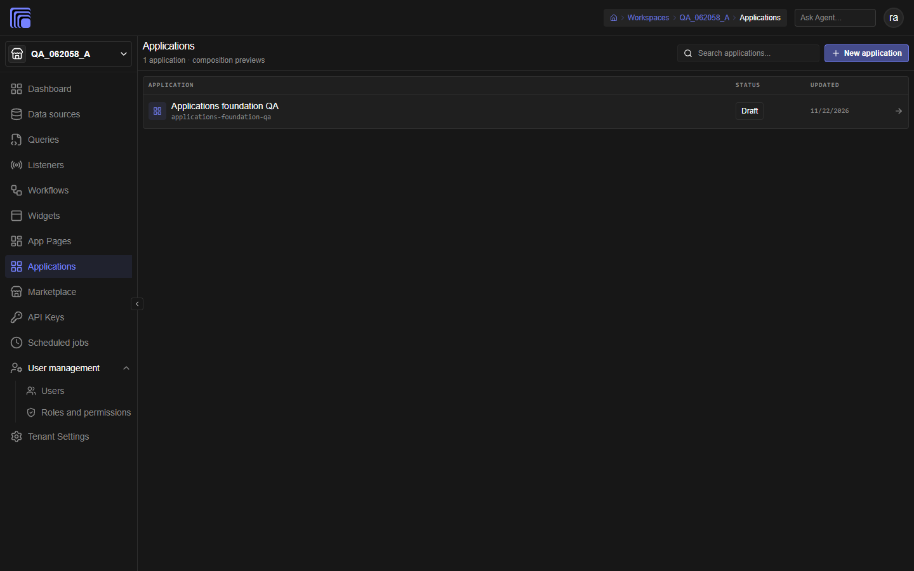
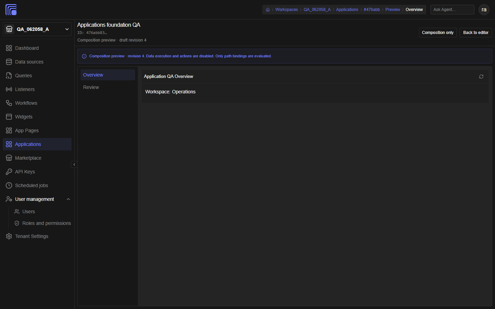
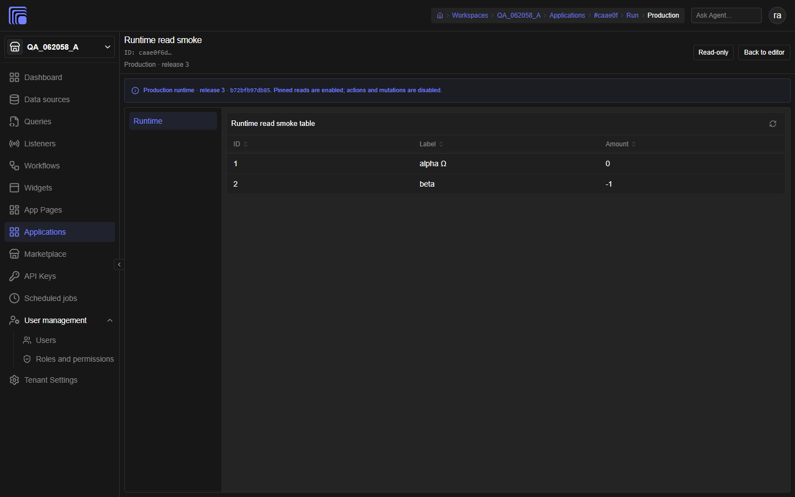

# Applications foundation — implementation status

**Date:** 2026-11-23  
**Status:** Composition, immutable asset versions, per-editor history/impact review, version diff and draft restore, exact page-version pinning, thin Application releases, release history/rollback, application state/navigation, typed route queries, opt-in page-variable sync, route lifecycle (titles, 404, keep-alive, guards, nested declarations), environment connection binding revisions, consumer route/action policy, managed page adoption, workflow run history, and opt-in strict expression mode are implemented. This is not a claim of production readiness, and live Temporal/Redis/listener-proxy verification remains blocked. See the [E2E matrix and evidence](2026-11-23-applications-e2e-matrix.md).  
**Architecture:** [Applications architecture](2026-11-22-applications-architecture.md)  
**Implementation plans:** [Asset versioning](2026-11-23-asset-versioning-plan.md) · [Workflow/listener](2026-11-22-applications-workflow-listener-plan.md)

## Execution model — revised after review

Whether an operation reads, writes, or causes an external side effect belongs to the configured query, workflow, or listener. Applications compose, authorize, and reference exact immutable asset versions; they do not copy page-owned definitions into each release and do not introduce a second read/write declaration.

- Removed page-source `effect`/`readOnly` controls and classification requirements, write-only action catalogs, read/write badges, forced-manual normalization, and separate read/write transports.
- A single `POST /runtime/:environment/pages/:pageAssetKey/data-sources/:alias/execute` resolves an admitted pinned query. It requires `application:execute`, bounded input JSON, and existing proxy input/delegation authorization. It does not accept caller-supplied query definitions or IDs.
- Both SELECT and mutation queries use the same execution path. The connector executes the pinned query options. No read-only guarantee is inferred from the trigger mode or the operation's name.
- Trigger mode, reactive dependencies, polling, and widget event bindings remain author-configured. Existing scheduling/coordinator behavior remains; this change does not promise exactly-once execution, universal retry safety, or duplicate-submit prevention.
- Query, workflow, and buffered listener sources share the same release/authorization model. Workflows start through the existing authorized proxy and Temporal service with their captured version graph and release provenance. Deployed listeners observe an existing saved buffer; they do not start, duplicate, mutate, or stop upstream integrations.
- Asset definitions are immutable `tblAssetVersions` snapshots. App Pages reference exact widget/query/workflow/listener version IDs; workflow versions reference exact query/child-workflow version IDs. Application releases store exact page version IDs plus routes/shell, not page/widget/query/workflow/listener payloads.
- `tblAssetVersionReferences` records exact dependency edges from asset versions and Application releases. The impact API walks these edges transitively and hides application releases the caller cannot read.
- Publishing auto-versions changed page dependencies and reuses existing versions when content hashes are unchanged. A linked page can pin an exact immutable page version; the release then uses that version even when the page draft has changed.
- Every publish remains an immutable Application release. Studio lists retained releases with page-version counts, warnings, draft revision, hash, timestamp, and deploy/rollback controls. Rollback moves only the production pointer.
- Application state declarations are editable in Studio and initialized per deployed runtime session. Widget events can update them with `SET_APPLICATION_VARIABLE`; page expressions read them as `state.application.variables`.
- Widget events can navigate with `NAVIGATE`, targeting a route ID with validated path params, query params, and push/replace history semantics. Navigation actions are runtime-only and rejected by composition preview.

## Routing and page lifecycle

- Routes support stable IDs, nested path declarations via `parentRouteID`, optional titles, typed path params, typed query declarations, and per-route `keepAlive` and `syncAllPageVariables` flags. Child paths must be nested under their parent. v1 renders the leaf page without a shared parent layout.
- Route guards accept an expression and a redirect route. Guards fail closed: only a literal boolean `true` admits. Redirect targets must exist, must not require path parameters, and must not themselves be guarded.
- The shell supports `homeRouteID` and `notFoundRouteID`. Unknown paths render the not-found route without changing the URL; root handling still redirects to home.
- The browser document title uses the route title, then the page title, then the route ID.
- Keep-alive is an explicit, bounded per-runtime cache of reducer snapshots. It is keyed by route, path params, and page asset; query-only changes do not remount, while path-param or release changes reset the page. Typed route query defaults still re-apply when returning to a route.
- `syncAllPageVariables` extends typed route-query binding to matching page variables that are not declared as query parameters. Only allowlisted keys are written; undeclared query parameters are preserved.
- Guard, title, hierarchy, retention, and URL-sync settings are editable from the Studio route settings dialog; shell home/not-found/expression mode are editable in Studio.

## Versions, diff, and restore

- Asset version history is immutable. A version payload contains exact dependency version IDs and excludes credentials.
- Version diff compares an immutable version against the current mutable draft (or another version) with bounded structural changes (500-entry cap), comparable-field filtering, and secret-safe payloads.
- Restore writes only the mutable draft/source row. Immutable version rows and published releases are never modified. Restore requires `expectedUpdatedAt` when supplied and returns `ASSET_VERSION_RESTORE_CONFLICT` on stale preview.
- Listener restore preserves its datasource binding. Versions/releases have no delete route; attempts return 404 and history is retained.
- Studio’s shared asset Versions dialog can create a version with a change note, inspect impact, compare against the current draft, and restore with confirmation.

## Environment connection bindings

- Each environment stores a monotonic `bindingRevision` and a datasource ID mapping. Every update appends a `tblApplicationEnvironmentBindingRevisions` row with actor and change note.
- Bindings map datasource IDs captured by a release to tenant datasources of the same type. Credentials and connection options stay live and are never embedded in releases.
- Runtime query execution, workflow activities, and listener reads remap datasource IDs through the selected environment’s current binding revision. The runtime manifest reports the active binding revision.
- Studio shows the active revision, mapping count, JSON editor, change note, and recent history. Stale revisions and type mismatches return 409.

## Consumer route/action policy

- Consumer policy is application-scoped and evaluated live, not snapshotted into releases.
- When enabled, access is default-deny. Explicit grants may target a user, role, or API key, optionally scoped by route and/or data-source alias; deny entries take precedence.
- The runtime manifest filters routes, pages, and widgets using the caller’s current user/role/API-key membership. Runtime query execution, workflow observation/cancel/input, and listener reads enforce the same route/action gates with explicit denial diagnostics.
- Studio can enable/disable enforcement, edit entries, validate UUIDs, inspect the revision, and save with optimistic concurrency.

## Managed page adoption

- Linking a page supports `referenced` (shared) or `managed` (cloned) ownership. Managed adoption creates a new App Page row with the same title suffix, description, and page configuration; widgets and connection bindings stay shared.
- The DB check constraint now allows both modes (`20261124_application_managed_pages.sql`). Duplicate asset keys are rejected without leaving a partial clone.
- Unlinking an in-use page is rejected. Managed copies that have no immutable versions and no other links are deleted with their asset link; copies with version history are retained so history and published references stay inspectable. Referenced pages are never deleted.

## Observability and strict expressions

- Application Studio exposes a read-only workflow run-history dialog sourced from workflow instance provenance. It lists status, run/workflow ID, route/page/alias, release, caller type, and start time, and shows an explicit empty state.
- `definition.expressionMode` supports `trusted-js` (default) and `safe-path`. Safe-path resolves path-only state values, rejects JavaScript execution, and fails closed for non-boolean visibility conditions. Existing trusted pages keep current behavior.
- Composition preview continues to use a path-only resolver regardless of deployed expression mode.

## Delivered

| Area | Implemented | Deliberately not enabled |
| --- | --- | --- |
| Domain model | Applications, drafts, linked assets, releases, environments, deployment history, environment binding revisions, consumer config/policy rows, and managed page ownership; tenant-aware composite FKs and CHECKs. | Application-owned background automation and release-owned reconciliation. |
| Composition API | List/create/read, revision-checked saves, shared/managed page linking and unlinking, validation, archive, composition preview. | Destructive adoption, automated source-asset migration. |
| Release execution | Immutable releases contain page version pointers, routes, definition, and diagnostics. Runtime manifests assemble exact page/widget/query/workflow/listener versions. Dynamic query/child-workflow targets are rejected at version creation. Dependency edges support impact/retention. Release history, deploy, and pointer rollback are available. | Release sessions, version GC, release deletion. |
| Authorization | Existing Casbin and tenant/API-key checks; per-application collection filtering; per-asset version checks; runtime `application:execute`; workflow/listener provenance and scope-bound cursors; live application consumer route/action policy with deny precedence. | External/anonymous consumer identities, delegated consumer OAuth. |
| Client runtime | Shared `ApplicationRouteSession`/`AppPageView`, release-derived resolution, application/page state, typed params/queries, opt-in URL sync, keep-alive, route titles/404, guards, nested declarations, and retained workflow runs. | Strict mode enabled by default, parent layout/outlet rendering. |
| Application state & navigation | Typed defaults with Studio editor, `SET_APPLICATION_VARIABLE`, `NAVIGATE` with validated params/query and push/replace, per-route typed queries, opt-in page-variable binding, and action-chain termination. | State persistence across reload, canonical URL rewriting. |
| Version workflow | Immutable versions with content-hash reuse; per-editor create/history/impact; Application version readiness and exact pinning; diff against draft/version; draft-only restore with conflict checks. | Version deletion/GC. |
| Environment bindings | Revisioned datasource remapping with Studio history, runtime enforcement, type/existence validation, and stale revision conflicts. | Secret rotation UI, staging/production data isolation. |
| Consumer policy | Application-scoped route/action grants/denials, manifest filtering, execute/workflow/listener gates, Studio revisioned editor. | Row-level data policy beyond existing datasource permissions. |
| Managed adoption | Clone App Page rows, keep widgets/bindings shared, ownership labels, duplicate/unlink guards, unreleased clone cleanup, versioned clone retention. | Full dependency-clone previews for non-page assets. |
| Workflow runtime | Version-scoped start/status/cancel/human-input; run provenance and history UI. Query/child workflows resolve exact versions; mutable context cannot replace caller provenance. | Provider exactly-once guarantees; live Temporal verification. |
| Listener runtime | Authorized buffered observation with bounded ordered replay, HMAC cursors, retention-gap errors, definition checks. | Direct socket delivery, upstream integration ownership, non-buffered listeners. |
| Widget events | Allowlisted `SET_VARIABLE`, `SHOW_TOAST`, `CALL_WIDGET_METHOD`, alias-based `EXECUTE_QUERY`, application state/navigation actions; unsupported actions omitted with diagnostics. | Arbitrary direct query/workflow/listener execution from releases. |
| Preview | Composition-only snapshot; no sources/events; unsupported executable widgets replaced; path-only expressions. | Business-data execution from preview. |
| UI | Studio index/runtime, drag/keyboard route ordering, version readiness/pinning, asset Versions dialog with diff/restore, release history deploy/rollback, route settings, shell settings, bindings, consumer policy, managed ownership, workflow run history, and application-state editor. | Full workflow debugger and listener buffer inspector. |

## Files and migration

- Backend: `apps/backend/modules/application/`, `apps/backend/modules/assetVersion/`, `apps/backend/scripts/migrate-applications.js`, `apps/backend/scripts/backfill-asset-version-references.js`, and manual migrations under `apps/backend/prisma/migrations/manual/`.
- New in this slice: `20261124_application_environment_bindings.sql`, `20261124_application_consumer_policies.sql`, and `20261124_application_managed_pages.sql`.
- Contracts: `packages/application-contracts/` (route guards, nested routes, not-found, keep-alive, URL sync, expression mode).
- Frontend: `src/data/apis/application.js`, `src/data/apis/assetVersion.js`, `src/logic/applicationRuntime/`, `src/logic/appPageRuntime/`, shared asset-version components, and Application Studio/runtime pages/components.

```powershell
cd apps/backend
node scripts/migrate-applications.js           # check only
node scripts/migrate-applications.js --apply   # additive installation
node scripts/backfill-asset-version-references.js           # dry run
node scripts/backfill-asset-version-references.js --apply   # insert missing edges
cd ../..
npm run build --workspace @jet-admin/application-contracts
```

The installer grants no application permissions to existing roles. Creator access uses the existing Casbin path. It does not modify existing business data, source assets, marketplace installations, or role grants.

## Verification

- Frontend full Jest suite: **198 passing across 31 suites**, including routing contracts/runtime, strict expressions, route queries, page-state cache, version readiness, application state/navigation, and async runtime.
- Backend application/appPage/asset-version/integration batch: **122 passed across 13 suites**; 1 PostgreSQL opt-in suite skipped (2 tests). Coverage includes immutable hashes, cycles, secret exclusion, direct/transitive/release impact, thin releases, exact pins, release history/rollback, version diff/restore conflicts, listener datasource restore, binding revisions, consumer filtering, managed clone/unlink, run history, and versioned runtime resolution.
- Frontend production build, changed-source ESLint, Prisma validate, and backend `/health` pass. Full-repository ESLint still reports the pre-existing unrelated backlog; changed files are clean.
- Live QA on the QA application: saved draft revisions 10–13, published/deployed releases 7 and 8, reused identical page versions, rolled back to 7 and re-deployed 8, verified guard redirect/admission, verified not-found rendering at an unknown URL, verified titles, and verified keep-alive widget/query retention.
- Live QA on versions: UI diff showed a changed `appPageTitle`; UI restore reverted it; version metadata was unchanged; stale restore returned 409; version and release DELETE attempts returned 404.
- Live QA on bindings/policy: binding revision 2 served runtime queries; type mismatch and stale revision returned 409; consumer revision 1 denied `sla` with manifest/nav filtering, revision 2 disabled enforcement and rendered SLA, revision 3 re-enabled it.
- Live QA on adoption: managed copy created with identical widgets and a distinct page ID; duplicate key returned 409; unlink removed the unreleased clone and link while leaving the source page intact.
- Live QA on observability: run-history dialog opened and showed the empty production state. Temporal/Redis/listener-proxy verification remains unavailable; see the blockers below.
- Detailed normal/edge/complex cases and exact evidence are recorded in the [E2E matrix](2026-11-23-applications-e2e-matrix.md).




## Workflow/listener operational notes

- Workflow starts require a reachable Temporal service and worker. A definitively rejected start returns a start-failure response; an unconfirmed RPC response returns the admitted instance ID so the client observes instead of starting a duplicate. Run observation polls the starting release, not the current deployment, and survives route navigation through the client run cache.
- Workflow status exposes only `output` plus output variables declared on the captured graph. Raw logs, inputs, internal context, query SQL, and the dependency graph are excluded. Child input requests are discoverable and submittable through the root run family.
- Listener observation requires an enabled `save_to_buffer` action, an active saved listener, the backend listener pipeline, and a shared cursor secret (`APPLICATION_CURSOR_SECRET` or `VAULT_ENCRYPTION_KEY`). The initial snapshot is bounded to the latest 100 verified events; later reads advance strictly by cursor in bounded ordered pages. Events are observable only when ingress and processing agree on the captured definition hash; changing the listener requires republishing.
- Listener processing actions such as `trigger_workflow`, `trigger_query`, and `push_to_app_page` remain listener-owned live behavior. Applications observe the saved buffer; they do not pin or own those integration side effects.
- Existing drafts that reference a listener need a matching runtime buffer before publication; the listener itself must have an enabled `save_to_buffer` action with that buffer name. Workflow sources with templated/dynamic query or child-workflow IDs fail publication until they use concrete saved IDs.

## Remaining limitations

1. **Infrastructure verification blocked:** Temporal, Redis, and the listener proxy were not available. Redis connection errors were continuous; no real workflow run or listener buffer existed for live reconnect/replay testing. Do not treat contract tests as a live infrastructure acceptance result.
2. **No pinned workflow source in the QA composition:** The QA pages’ workflow-trigger buttons are omitted from the deployed release, so the runtime sends no workflow start request. A real workflow failure/success path still needs an application with a pinned workflow alias.
3. **Consumer scope:** Policy covers application routes and data-source aliases; row-level business authorization remains owned by existing datasource/proxy permissions. External/anonymous identities are not supported.
4. **Strict mode:** Safe-path mode is opt-in and unit-tested; the QA pages remain on `trusted-js` because they use JavaScript expressions. A dedicated strict-mode application has not been published.
5. **Keep-alive:** Widget/reducer state and cached query results survive route navigation within one runtime; typed route defaults still re-apply. A browser reload or release change rebuilds the runtime cache.
6. **Version retention:** Versions and releases are immutable and have no delete route or GC. Managed copies with immutable versions are retained on unlink for history; only unreleased clones are deleted.
7. **Environment isolation:** Environment bindings remap connections; separate staging/production databases and external side-effect isolation still depend on infrastructure configuration.
8. **Execution semantics:** Form validity, in-flight submission identity, source/provider idempotency, uncertain connector outcomes, and record OCC remain source/business concerns. Removing `effect` does not make arbitrary operations retry-safe.
9. **Background automation:** Application-owned automation reconciliation and generation fencing are not implemented. Deploy/rollback only moves the release pointer.
10. **Existing unrelated issues:** The repository-wide ESLint backlog, marketplace/widget-socket test failures, and the standalone dynamic-import warning in `dataSourceLifecycle.integration.test.js` are unchanged and unrelated to Applications.

## Historical browser evidence

The following checks and screenshots predate removal of the read/write split. They establish composition, pinning, state, and routing behavior, not current read-only or idempotency guarantees.

- Read fixture `caae0f6d-1468-44a4-8613-a8c8a336fdee`: SQLite rows rendered; a source-widget rename did not change the deployed widget.
- Mutation fixture `58e66cd8-5c7b-4e7b-ac44-ce349b8ce715`: a button inserted a row and chained a query refresh. Editing the source INSERT after publication did not change the deployed operation; the source query was restored afterward.
- Earlier browser batches verified root-route navigation, drag reordering, deep links, typed route errors, state reset, execution-disabled preview submission, application state through release 4, typed `sla` query through release 5, page-variable sync through release 6, release history/rollback, and exact page-version pinning.




