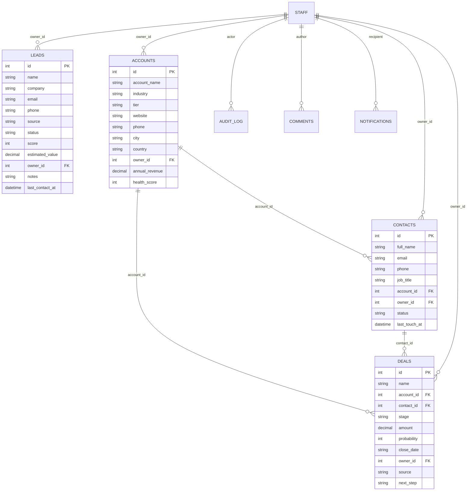

# CRM & Sales Pipeline

Run leads, accounts, deals and forecasting from one audited workspace.

A complete revenue workspace: lead intake and scoring, account and contact management, a stage-based deal pipeline, activity tracking, quota attainment and forecast reporting. Includes a sales admin area for users, roles, audit, imports and data quality.

**Category:** Sales & CRM  
**Version:** 1.0.0  
**Template slug:** `crm-sales-pipeline`  
**Minimum platform:** 2.1.0-preview.1

## What it does

The CRM template is designed for a B2B sales team that needs a working pipeline on day one without building a data model. Seeded accounts, contacts, leads and deals reflect realistic relationships; queries are parameterized and tenant-scoped; workflows cover intake triage, round-robin assignment, approval, SLA-style sweeps, digests, document generation and recovery paths. Sales operations can review forecast coverage, quota attainment and data quality, with every write captured in the audit trigger.

The package is data-only: schema, deterministic seed, parameterized queries, widgets, pages, workflows, listeners, cron jobs and roles. Installing it creates tenant-isolated physical tables named `tpl_crm_<tenantShort>_*` and bundles every UI resource through the existing Bundle v1 importer.

## Page map

| Page slug | Title | Access tags |
| --- | --- | --- |
| `crm-deals-list` | Deals · list | core, staff, manager, admin |
| `crm-deals-detail` | Deals · detail | core, staff, manager, admin |
| `crm-deals-create` | Create Deal | core, staff, manager, admin |
| `crm-leads-list` | Leads · list | core, staff, manager, admin |
| `crm-leads-detail` | Leads · detail | core, staff, manager, admin |
| `crm-leads-create` | Create Lead | core, staff, manager, admin |
| `crm-accounts-list` | Accounts · list | core, staff, manager, admin |
| `crm-accounts-detail` | Accounts · detail | core, staff, manager, admin |
| `crm-accounts-create` | Create Account | core, staff, manager, admin |
| `crm-contacts-list` | Contacts · list | core, staff, manager, admin |
| `crm-contacts-detail` | Contacts · detail | core, staff, manager, admin |
| `crm-contacts-create` | Create Contact | core, staff, manager, admin |
| `crm-dashboard` | Dashboard | core, shared, staff, manager, admin, viewer |
| `crm-reports-operations` | Reports · operations | report, manager, admin |
| `crm-profile` | My profile | shared, staff, manager, admin, viewer, portal |
| `crm-notifications` | Notifications | shared, staff, manager, admin, viewer, portal |
| `crm-settings` | Settings | shared, manager, admin |
| `crm-portal` | Client portal | portal, client, admin, manager |
| `crm-admin-roles` | Admin · roles and permissions | admin |

## Data model

The package ships 4 domain tables plus 10 support tables (staff, lookups, audit, comments, attachments, notifications, settings, imports, operations, role matrix).

## Workflows

| Workflow | Purpose | Nodes |
| --- | --- | --- |
| `crm.intake-triage` | Deals · intake triage | 8 |
| `crm.approval-chain` | Deals · approval chain | 8 |
| `crm.daily-digest` | Deals · daily digest | 5 |
| `crm.data-collection` | Deals · supplier/customer follow-up | 4 |
| `crm.error-recovery` | CRM & Sales Pipeline · expected failure and recovery | 5 |

### Deals · intake triage

flowchart TD
  n0["start <small>start</small>"]
  n1["loadRecord <small>dataQuery</small>"]
  n2["scoreRecord <small>javascript</small>"]
  n3["highValue <small>condition</small>"]
  n4["setReview <small>dataQuery</small>"]
  n5["setStandard <small>dataQuery</small>"]
  n6["notifyReview <small>dataQuery</small>"]
  n7["done <small>end</small>"]
  n0 -->|output| n1
  n1 -->|success| n2
  n2 -->|success| n3
  n3 -->|review| n4
  n3 -->|standard| n5
  n4 -->|success| n6
  n6 -->|success| n7
  n5 -->|success| n7

### Deals · approval chain

flowchart TD
  n0["start <small>start</small>"]
  n1["loadRecord <small>dataQuery</small>"]
  n2["Approve Deal #{{ ctx.recordID }} <small>approval</small>"]
  n3["setApproved <small>dataQuery</small>"]
  n4["setRejected <small>dataQuery</small>"]
  n5["setExpired <small>dataQuery</small>"]
  n6["notifyDecision <small>dataQuery</small>"]
  n7["done <small>end</small>"]
  n0 -->|output| n1
  n1 -->|success| n2
  n2 -->|approved| n3
  n2 -->|rejected| n4
  n2 -->|expired| n5
  n3 -->|success| n6
  n4 -->|success| n6
  n5 -->|success| n6
  n6 -->|success| n7

### Deals · daily digest

flowchart TD
  n0["start <small>start</small>"]
  n1["loadStats <small>dataQuery</small>"]
  n2["composeDigest <small>javascript</small>"]
  n3["sendDigest <small>dataQuery</small>"]
  n4["done <small>end</small>"]
  n0 -->|output| n1
  n1 -->|success| n2
  n2 -->|success| n3
  n3 -->|success| n4

### Deals · supplier/customer follow-up

flowchart TD
  n0["start <small>start</small>"]
  n1["Follow up on Deal #{{ ctx.recordID }} <small>dataCollection</small>"]
  n2["recordFollowUp <small>dataQuery</small>"]
  n3["done <small>end</small>"]
  n0 -->|output| n1
  n1 -->|output| n2
  n2 -->|success| n3

### CRM & Sales Pipeline · expected failure and recovery

flowchart TD
  n0["start <small>start</small>"]
  n1["injectFailure <small>javascript</small>"]
  n2["compensate <small>javascript</small>"]
  n3["notifyRecovery <small>dataQuery</small>"]
  n4["done <small>end</small>"]
  n0 -->|output| n1
  n1 -->|error| n2
  n2 -->|success| n3
  n3 -->|success| n4

Failure behavior: every workflow declares per-node `errorHandling`; external sync and recovery workflows have explicit error edges. Human tasks (approval/dataCollection) suspend with an expiry and resume through the platform's data-collection endpoint. Cron jobs and listeners ship **inactive/disabled** until reviewed.

## Roles and permissions

- **CRM Administrator** (`admin`): Full access to every page, query and workflow plus the admin panel.
- **Sales Manager** (`manager`): Pipeline, forecast, team and approval access; no platform role administration.
- **Sales Representative** (`sales_rep`): Owns leads and deals; can comment, attach files and run sales workflows.
- **Revenue Analyst** (`analyst`): Read-only pipeline and report access with export rights.
- **Client Contact** (`client`): External portal access to owned records, profile and notifications only.

The installer creates tenant-scoped platform roles and grants asset-level Casbin permissions for the pages, queries and workflows in this package. Admin pages are tagged `admin`; the client portal is tagged `portal`. Widget visibility is enforced by page grouping and query execution permissions because the platform has no widget-level RBAC.

## Integrations

- **Inbound webhook** — required: endpoint path, signature header (optional). Mock: Send a JSON body with kind=webhook.received to the inactive listener.

## Install

1. Open **Marketplace → App templates**.
2. Select **CRM & Sales Pipeline** and choose install options (sample data is on by default).
3. Install. The installer creates the schema, seed, resources, roles and (optionally) cron jobs.
4. Reconnect the primary PostgreSQL datasource only if the platform database differs from the tenant's target database; the bundled install injects the platform connection server-side.
5. Review inactive listeners and disabled cron jobs before enabling automation.
6. Open **Dashboard** (or **Client portal** for external roles).

## Quality features

- Audit trigger on every domain and support write, with old/new JSON snapshots.
- Soft delete + restore on domain tables.
- CSV import with validation summary and stored error report.
- CSV export on every list, report and comment/attachment table.
- Saved filter views, bulk actions, comments, attachments, in-app notifications.
- Keyboard-accessible form widget with required/format/min/max validation.
- Empty, loading and error states on every operational page.

## Customization

- **Fields:** edit `schema/001-schema.sql` and the field arrays in the spec, then regenerate.
- **Seed:** edit `seed/001-seed.sql` or the generator spec; dates are relative to `now()`.
- **Queries:** `queries/*.json` are parameterized (`$1...$n`); keep the input definition order in sync with the numbers.
- **Pages/widgets:** `pages/*.json` and `widgets/*.json` use layout v2 and the `{{ state.* }}` binding syntax.
- **Workflows:** `workflows/*.json` use the platform node handlers; edges carry `sourceHandle` values.
- **Regenerate deterministically:** `node marketplace/scripts/generate-templates.js crm-sales-pipeline`.

## Known limitations

- Widget-level RBAC is not a platform primitive; use page tags and asset permissions.
- Modal/drawer widgets are not available; detail pages and tabs are used.
- DataCollection API/webhook delivery is not first-class; forms/approval plus webhook listeners are used.
- XLSX export is Excel-compatible CSV; there is no XLSX runtime.
