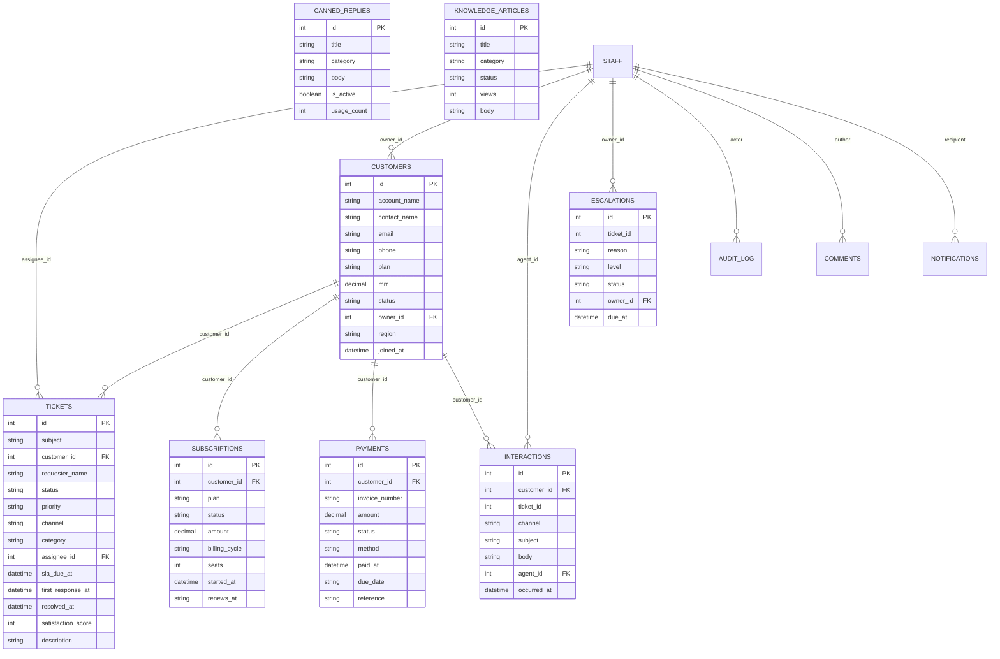

# Customer Support Console

Customer lookup, subscription context, tickets and escalation in one console.

A full support workspace: customer and subscription lookup, payment history, ticket intake, assignment, SLA tracking, escalation workflows, canned replies, CSAT and an admin panel for users, roles, audit, imports, integrations and data quality.

**Category:** Customer Support  
**Version:** 1.0.0  
**Template slug:** `customer-support-console`  
**Minimum platform:** 2.1.0-preview.1

## What it does

The Customer Support Console gives agents the context they need before replying: customer plan and MRR, subscription status, payment history and previous interactions alongside the ticket. Seeded tickets, customers and payments are linked; workflows cover triage, round-robin assignment, an approval/escalation chain, SLA sweeps, digests, follow-up data collection and recovery paths. Support leads get workload, SLA and CSAT reporting, while admins get audit, import/export, integration health and operational monitors.

The package is data-only: schema, deterministic seed, parameterized queries, widgets, pages, workflows, listeners, cron jobs and roles. Installing it creates tenant-isolated physical tables named `tpl_support_<tenantShort>_*` and bundles every UI resource through the existing Bundle v1 importer.

## Page map

| Page slug | Title | Access tags |
| --- | --- | --- |
| `support-tickets-list` | Tickets · list | core, staff, manager, admin |
| `support-tickets-detail` | Tickets · detail | core, staff, manager, admin |
| `support-tickets-create` | Create Ticket | core, staff, manager, admin |
| `support-customers-list` | Customers · list | core, staff, manager, admin |
| `support-customers-detail` | Customers · detail | core, staff, manager, admin |
| `support-customers-create` | Create Customer | core, staff, manager, admin |
| `support-subscriptions-list` | Subscriptions · list | core, staff, manager, admin |
| `support-subscriptions-detail` | Subscriptions · detail | core, staff, manager, admin |
| `support-subscriptions-create` | Create Subscription | core, staff, manager, admin |
| `support-payments-list` | Payments · list | core, staff, manager, admin |
| `support-payments-detail` | Payments · detail | core, staff, manager, admin |
| `support-payments-create` | Create Payment | core, staff, manager, admin |
| `support-dashboard` | Dashboard | core, shared, staff, manager, admin, viewer |
| `support-reports-operations` | Reports · operations | report, manager, admin |
| `support-reports-secondary` | Reports · secondary mix | report, manager, admin |
| `support-reports-quality` | Reports · data quality | report, manager, admin |
| `support-tickets-kanban` | Tickets · kanban | core, staff, manager, admin |
| `support-tickets-calendar` | Tickets · calendar | core, staff, manager, admin |
| `support-search` | Global search | shared, staff, manager, admin, viewer |
| `support-profile` | My profile | shared, staff, manager, admin, viewer, portal |
| `support-notifications` | Notifications | shared, staff, manager, admin, viewer, portal |
| `support-settings` | Settings | shared, manager, admin |
| `support-portal` | Client portal | portal, client, admin, manager |
| `support-admin-users` | Admin · users | admin, manager |
| `support-admin-roles` | Admin · roles and permissions | admin |
| `support-admin-audit` | Admin · audit log | admin, manager |
| `support-admin-settings` | Admin · system settings | admin |
| `support-admin-import` | Admin · import / export | admin, manager |
| `support-admin-integrations` | Admin · integration health | admin |
| `support-admin-jobs` | Admin · jobs and workflow runs | admin |
| `support-admin-quality` | Admin · data quality | admin, manager |

## Data model

The package ships 8 domain tables plus 10 support tables (staff, lookups, audit, comments, attachments, notifications, settings, imports, operations, role matrix).

## Workflows

| Workflow | Purpose | Nodes |
| --- | --- | --- |
| `support.intake-triage` | Tickets · intake triage | 8 |
| `support.round-robin-assignment` | Tickets · round-robin assignment | 6 |
| `support.approval-chain` | Tickets · approval chain | 8 |
| `support.threshold-sweep` | Tickets · threshold sweep | 6 |
| `support.daily-digest` | Tickets · daily digest | 5 |
| `support.escalation` | Tickets · escalation | 7 |
| `support.integration-sync` | Customer Support Console · integration sync | 6 |
| `support.document-generation` | Tickets · document generation | 6 |
| `support.data-collection` | Tickets · supplier/customer follow-up | 4 |
| `support.error-recovery` | Customer Support Console · expected failure and recovery | 5 |
| `support.notify-only` | Customer Support Console · notify only | 3 |

### Tickets · intake triage

flowchart TD
  n0["start <small>start</small>"]
  n1["loadRecord <small>dataQuery</small>"]
  n2["scoreRecord <small>javascript</small>"]
  n3["highValue <small>condition</small>"]
  n4["setReview <small>dataQuery</small>"]
  n5["setStandard <small>dataQuery</small>"]
  n6["notifyReview <small>dataQuery</small>"]
  n7["done <small>end</small>"]
  n0 -->|output| n1
  n1 -->|success| n2
  n2 -->|success| n3
  n3 -->|review| n4
  n3 -->|standard| n5
  n4 -->|success| n6
  n6 -->|success| n7
  n5 -->|success| n7

### Tickets · round-robin assignment

flowchart TD
  n0["start <small>start</small>"]
  n1["loadStaff <small>dataQuery</small>"]
  n2["pickAssignee <small>javascript</small>"]
  n3["assignOwner <small>dataQuery</small>"]
  n4["notifyOwner <small>dataQuery</small>"]
  n5["done <small>end</small>"]
  n0 -->|output| n1
  n1 -->|success| n2
  n2 -->|success| n3
  n3 -->|success| n4
  n4 -->|success| n5

### Tickets · approval chain

flowchart TD
  n0["start <small>start</small>"]
  n1["loadRecord <small>dataQuery</small>"]
  n2["Approve Ticket #{{ ctx.recordID }} <small>approval</small>"]
  n3["setApproved <small>dataQuery</small>"]
  n4["setRejected <small>dataQuery</small>"]
  n5["setExpired <small>dataQuery</small>"]
  n6["notifyDecision <small>dataQuery</small>"]
  n7["done <small>end</small>"]
  n0 -->|output| n1
  n1 -->|success| n2
  n2 -->|approved| n3
  n2 -->|rejected| n4
  n2 -->|expired| n5
  n3 -->|success| n6
  n4 -->|success| n6
  n5 -->|success| n6
  n6 -->|success| n7

### Tickets · threshold sweep

flowchart TD
  n0["start <small>start</small>"]
  n1["loadOverdue <small>dataQuery</small>"]
  n2["boundBatch <small>javascript</small>"]
  n3["loopOverdue <small>loop</small>"]
  n4["notifyOverdue <small>dataQuery</small>"]
  n5["done <small>end</small>"]
  n0 -->|output| n1
  n1 -->|success| n2
  n2 -->|success| n3
  n3 -->|loop| n4
  n3 -->|completed| n5

### Tickets · daily digest

flowchart TD
  n0["start <small>start</small>"]
  n1["loadStats <small>dataQuery</small>"]
  n2["composeDigest <small>javascript</small>"]
  n3["sendDigest <small>dataQuery</small>"]
  n4["done <small>end</small>"]
  n0 -->|output| n1
  n1 -->|success| n2
  n2 -->|success| n3
  n3 -->|success| n4

### Tickets · escalation

flowchart TD
  n0["start <small>start</small>"]
  n1["waitForResponse <small>delay</small>"]
  n2["loadRecord <small>dataQuery</small>"]
  n3["readPriority <small>javascript</small>"]
  n4["needsEscalation <small>condition</small>"]
  n5["notifyEscalation <small>dataQuery</small>"]
  n6["done <small>end</small>"]
  n0 -->|output| n1
  n1 -->|success| n2
  n2 -->|success| n3
  n3 -->|success| n4
  n4 -->|escalate| n5
  n4 -->|normal| n6
  n5 -->|success| n6

Failure behavior: every workflow declares per-node `errorHandling`; external sync and recovery workflows have explicit error edges. Human tasks (approval/dataCollection) suspend with an expiry and resume through the platform's data-collection endpoint. Cron jobs and listeners ship **inactive/disabled** until reviewed.

## Roles and permissions

- **Support Administrator** (`admin`): Full access to every page, query, workflow and admin panel.
- **Support Manager** (`manager`): Team queues, SLA, escalations, approvals, reports and admin monitoring.
- **Support Agent** (`agent`): Owns tickets, works the queue and runs support automations.
- **Support Analyst** (`analyst`): Read-only customer, SLA and CSAT reporting.
- **Read-only Viewer** (`readonly`): Read-only queue and customer context without workflow execution.

The installer creates tenant-scoped platform roles and grants asset-level Casbin permissions for the pages, queries and workflows in this package. Admin pages are tagged `admin`; the client portal is tagged `portal`. Widget visibility is enforced by page grouping and query execution permissions because the platform has no widget-level RBAC.

## Integrations

- **SendGrid email** — required: API key, from address. Mock: Connector ships disabled; use the notification center and packaged email HTML for demos.
- **Stripe billing** — required: secret key, webhook signing secret. Mock: Payment history is seeded locally; the packaged REST connector is a mock until reconnected.
- **Inbound support webhook** — required: endpoint path, optional signature header. Mock: POST { "kind": "webhook.received", "record_id": 1 } to the inactive listener.

## Install

1. Open **Marketplace → App templates**.
2. Select **Customer Support Console** and choose install options (sample data is on by default).
3. Install. The installer creates the schema, seed, resources, roles and (optionally) cron jobs.
4. Reconnect the primary PostgreSQL datasource only if the platform database differs from the tenant's target database; the bundled install injects the platform connection server-side.
5. Review inactive listeners and disabled cron jobs before enabling automation.
6. Open **Dashboard** (or **Client portal** for external roles).

## Quality features

- Audit trigger on every domain and support write, with old/new JSON snapshots.
- Soft delete + restore on domain tables.
- CSV import with validation summary and stored error report.
- CSV export on every list, report and comment/attachment table.
- Saved filter views, bulk actions, comments, attachments, in-app notifications.
- Keyboard-accessible form widget with required/format/min/max validation.
- Empty, loading and error states on every operational page.

## Customization

- **Fields:** edit `schema/001-schema.sql` and the field arrays in the spec, then regenerate.
- **Seed:** edit `seed/001-seed.sql` or the generator spec; dates are relative to `now()`.
- **Queries:** `queries/*.json` are parameterized (`$1...$n`); keep the input definition order in sync with the numbers.
- **Pages/widgets:** `pages/*.json` and `widgets/*.json` use layout v2 and the `{{ state.* }}` binding syntax.
- **Workflows:** `workflows/*.json` use the platform node handlers; edges carry `sourceHandle` values.
- **Regenerate deterministically:** `node marketplace/scripts/generate-templates.js customer-support-console`.

## Known limitations

- Widget-level RBAC is not a platform primitive; use page tags and asset permissions.
- Modal/drawer widgets are not available; detail pages and tabs are used.
- DataCollection API/webhook delivery is not first-class; forms/approval plus webhook listeners are used.
- XLSX export is Excel-compatible CSV; there is no XLSX runtime.
