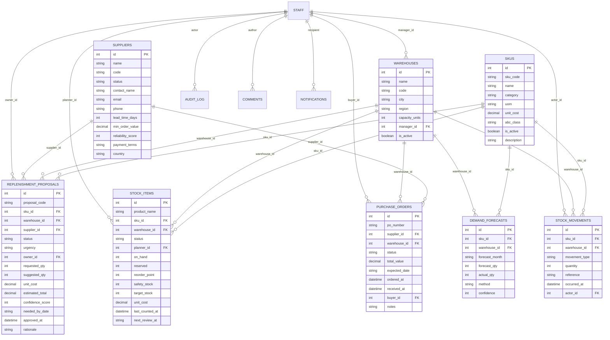

# Inventory Replenishment Planner

Low-stock queue, reorder suggestions, supplier lead times and purchase proposals.

A replenishment command center: stock health by SKU and warehouse, demand forecasts, supplier lead times, reorder rules, purchase proposals, approval routing and purchase orders with an admin panel for audit, imports, integrations and data quality.

**Category:** Inventory & Operations  
**Version:** 1.0.0  
**Template slug:** `inventory-replenishment-planner`  
**Minimum platform:** 2.1.0-preview.1

## What it does

The Inventory Replenishment Planner turns stock signals into approved purchasing decisions. Planners see a prioritized low-stock queue, suggested order quantities from demand forecasts and reorder rules, supplier lead-time and reliability context, and a proposal workspace with approval routing. Purchase orders track the supplier handoff while stock movements and receiving history close the loop. Managers get fill-rate, stockout and supplier performance reporting; admins get audit diffs, import/export, integration health, job monitoring, webhook logs and data-quality checks.

The package is data-only: schema, deterministic seed, parameterized queries, widgets, pages, workflows, listeners, cron jobs and roles. Installing it creates tenant-isolated physical tables named `tpl_inv_<tenantShort>_*` and bundles every UI resource through the existing Bundle v1 importer.

## Page map

| Page slug | Title | Access tags |
| --- | --- | --- |
| `inv-replenishment_proposals-list` | Replenishment Proposals · list | core, staff, manager, admin |
| `inv-replenishment_proposals-detail` | Replenishment Proposals · detail | core, staff, manager, admin |
| `inv-replenishment_proposals-create` | Create Proposal | core, staff, manager, admin |
| `inv-stock_items-list` | Stock Items · list | core, staff, manager, admin |
| `inv-stock_items-detail` | Stock Items · detail | core, staff, manager, admin |
| `inv-stock_items-create` | Create Stock item | core, staff, manager, admin |
| `inv-suppliers-list` | Suppliers · list | core, staff, manager, admin |
| `inv-suppliers-detail` | Suppliers · detail | core, staff, manager, admin |
| `inv-suppliers-create` | Create Supplier | core, staff, manager, admin |
| `inv-purchase_orders-list` | Purchase Orders · list | core, staff, manager, admin |
| `inv-purchase_orders-detail` | Purchase Orders · detail | core, staff, manager, admin |
| `inv-purchase_orders-create` | Create Purchase order | core, staff, manager, admin |
| `inv-dashboard` | Dashboard | core, shared, staff, manager, admin, viewer |
| `inv-reports-operations` | Reports · operations | report, manager, admin |
| `inv-reports-secondary` | Reports · secondary mix | report, manager, admin |
| `inv-reports-quality` | Reports · data quality | report, manager, admin |
| `inv-replenishment_proposals-kanban` | Replenishment Proposals · kanban | core, staff, manager, admin |
| `inv-replenishment_proposals-calendar` | Replenishment Proposals · calendar | core, staff, manager, admin |
| `inv-search` | Global search | shared, staff, manager, admin, viewer |
| `inv-profile` | My profile | shared, staff, manager, admin, viewer, portal |
| `inv-notifications` | Notifications | shared, staff, manager, admin, viewer, portal |
| `inv-settings` | Settings | shared, manager, admin |
| `inv-portal` | Client portal | portal, client, admin, manager |
| `inv-admin-users` | Admin · users | admin, manager |
| `inv-admin-roles` | Admin · roles and permissions | admin |
| `inv-admin-audit` | Admin · audit log | admin, manager |
| `inv-admin-settings` | Admin · system settings | admin |
| `inv-admin-import` | Admin · import / export | admin, manager |
| `inv-admin-integrations` | Admin · integration health | admin |
| `inv-admin-jobs` | Admin · jobs and workflow runs | admin |
| `inv-admin-quality` | Admin · data quality | admin, manager |

## Data model

The package ships 8 domain tables plus 10 support tables (staff, lookups, audit, comments, attachments, notifications, settings, imports, operations, role matrix).

## Workflows

| Workflow | Purpose | Nodes |
| --- | --- | --- |
| `inv.intake-triage` | Replenishment Proposals · intake triage | 8 |
| `inv.round-robin-assignment` | Replenishment Proposals · round-robin assignment | 6 |
| `inv.approval-chain` | Replenishment Proposals · approval chain | 8 |
| `inv.threshold-sweep` | Replenishment Proposals · threshold sweep | 6 |
| `inv.daily-digest` | Replenishment Proposals · daily digest | 5 |
| `inv.escalation` | Replenishment Proposals · escalation | 7 |
| `inv.integration-sync` | Inventory Replenishment Planner · integration sync | 6 |
| `inv.document-generation` | Replenishment Proposals · document generation | 6 |
| `inv.data-collection` | Replenishment Proposals · supplier/customer follow-up | 4 |
| `inv.error-recovery` | Inventory Replenishment Planner · expected failure and recovery | 5 |
| `inv.notify-only` | Inventory Replenishment Planner · notify only | 3 |

### Replenishment Proposals · intake triage

flowchart TD
  n0["start <small>start</small>"]
  n1["loadRecord <small>dataQuery</small>"]
  n2["scoreRecord <small>javascript</small>"]
  n3["highValue <small>condition</small>"]
  n4["setReview <small>dataQuery</small>"]
  n5["setStandard <small>dataQuery</small>"]
  n6["notifyReview <small>dataQuery</small>"]
  n7["done <small>end</small>"]
  n0 -->|output| n1
  n1 -->|success| n2
  n2 -->|success| n3
  n3 -->|review| n4
  n3 -->|standard| n5
  n4 -->|success| n6
  n6 -->|success| n7
  n5 -->|success| n7

### Replenishment Proposals · round-robin assignment

flowchart TD
  n0["start <small>start</small>"]
  n1["loadStaff <small>dataQuery</small>"]
  n2["pickAssignee <small>javascript</small>"]
  n3["assignOwner <small>dataQuery</small>"]
  n4["notifyOwner <small>dataQuery</small>"]
  n5["done <small>end</small>"]
  n0 -->|output| n1
  n1 -->|success| n2
  n2 -->|success| n3
  n3 -->|success| n4
  n4 -->|success| n5

### Replenishment Proposals · approval chain

flowchart TD
  n0["start <small>start</small>"]
  n1["loadRecord <small>dataQuery</small>"]
  n2["Approve Proposal #{{ ctx.recordID }} <small>approval</small>"]
  n3["setApproved <small>dataQuery</small>"]
  n4["setRejected <small>dataQuery</small>"]
  n5["setExpired <small>dataQuery</small>"]
  n6["notifyDecision <small>dataQuery</small>"]
  n7["done <small>end</small>"]
  n0 -->|output| n1
  n1 -->|success| n2
  n2 -->|approved| n3
  n2 -->|rejected| n4
  n2 -->|expired| n5
  n3 -->|success| n6
  n4 -->|success| n6
  n5 -->|success| n6
  n6 -->|success| n7

### Replenishment Proposals · threshold sweep

flowchart TD
  n0["start <small>start</small>"]
  n1["loadOverdue <small>dataQuery</small>"]
  n2["boundBatch <small>javascript</small>"]
  n3["loopOverdue <small>loop</small>"]
  n4["notifyOverdue <small>dataQuery</small>"]
  n5["done <small>end</small>"]
  n0 -->|output| n1
  n1 -->|success| n2
  n2 -->|success| n3
  n3 -->|loop| n4
  n3 -->|completed| n5

### Replenishment Proposals · daily digest

flowchart TD
  n0["start <small>start</small>"]
  n1["loadStats <small>dataQuery</small>"]
  n2["composeDigest <small>javascript</small>"]
  n3["sendDigest <small>dataQuery</small>"]
  n4["done <small>end</small>"]
  n0 -->|output| n1
  n1 -->|success| n2
  n2 -->|success| n3
  n3 -->|success| n4

### Replenishment Proposals · escalation

flowchart TD
  n0["start <small>start</small>"]
  n1["waitForResponse <small>delay</small>"]
  n2["loadRecord <small>dataQuery</small>"]
  n3["readPriority <small>javascript</small>"]
  n4["needsEscalation <small>condition</small>"]
  n5["notifyEscalation <small>dataQuery</small>"]
  n6["done <small>end</small>"]
  n0 -->|output| n1
  n1 -->|success| n2
  n2 -->|success| n3
  n3 -->|success| n4
  n4 -->|escalate| n5
  n4 -->|normal| n6
  n5 -->|success| n6

Failure behavior: every workflow declares per-node `errorHandling`; external sync and recovery workflows have explicit error edges. Human tasks (approval/dataCollection) suspend with an expiry and resume through the platform's data-collection endpoint. Cron jobs and listeners ship **inactive/disabled** until reviewed.

## Roles and permissions

- **Inventory Administrator** (`admin`): Full access to every page, query, workflow and admin panel.
- **Replenishment Manager** (`manager`): Owns replenishment policy, approvals, supplier performance and admin monitoring.
- **Inventory Planner** (`planner`): Works the low-stock queue, drafts proposals and runs replenishment automations.
- **Demand Analyst** (`analyst`): Read-only forecasting, stock-health and supplier reporting.
- **Read-only Viewer** (`readonly`): Read-only stock and proposal context without workflow execution.

The installer creates tenant-scoped platform roles and grants asset-level Casbin permissions for the pages, queries and workflows in this package. Admin pages are tagged `admin`; the client portal is tagged `portal`. Widget visibility is enforced by page grouping and query execution permissions because the platform has no widget-level RBAC.

## Integrations

- **ERP inventory REST** — required: base URL, API token. Mock: Connector ships disabled with no credentials; seeded stock and purchase orders are the demo source of truth.
- **Supplier ASN webhook** — required: endpoint path, optional signature header. Mock: POST { "kind": "webhook.received", "record_id": 1 } to the inactive listener to simulate an advance ship notice.
- **Slack replenishment alerts** — required: webhook URL, channel. Mock: Alerts are mirrored into the in-app notification center until a Slack webhook is connected.

## Install

1. Open **Marketplace → App templates**.
2. Select **Inventory Replenishment Planner** and choose install options (sample data is on by default).
3. Install. The installer creates the schema, seed, resources, roles and (optionally) cron jobs.
4. Reconnect the primary PostgreSQL datasource only if the platform database differs from the tenant's target database; the bundled install injects the platform connection server-side.
5. Review inactive listeners and disabled cron jobs before enabling automation.
6. Open **Dashboard** (or **Client portal** for external roles).

## Quality features

- Audit trigger on every domain and support write, with old/new JSON snapshots.
- Soft delete + restore on domain tables.
- CSV import with validation summary and stored error report.
- CSV export on every list, report and comment/attachment table.
- Saved filter views, bulk actions, comments, attachments, in-app notifications.
- Keyboard-accessible form widget with required/format/min/max validation.
- Empty, loading and error states on every operational page.

## Customization

- **Fields:** edit `schema/001-schema.sql` and the field arrays in the spec, then regenerate.
- **Seed:** edit `seed/001-seed.sql` or the generator spec; dates are relative to `now()`.
- **Queries:** `queries/*.json` are parameterized (`$1...$n`); keep the input definition order in sync with the numbers.
- **Pages/widgets:** `pages/*.json` and `widgets/*.json` use layout v2 and the `{{ state.* }}` binding syntax.
- **Workflows:** `workflows/*.json` use the platform node handlers; edges carry `sourceHandle` values.
- **Regenerate deterministically:** `node marketplace/scripts/generate-templates.js inventory-replenishment-planner`.

## Known limitations

- Widget-level RBAC is not a platform primitive; use page tags and asset permissions.
- Modal/drawer widgets are not available; detail pages and tabs are used.
- DataCollection API/webhook delivery is not first-class; forms/approval plus webhook listeners are used.
- XLSX export is Excel-compatible CSV; there is no XLSX runtime.
