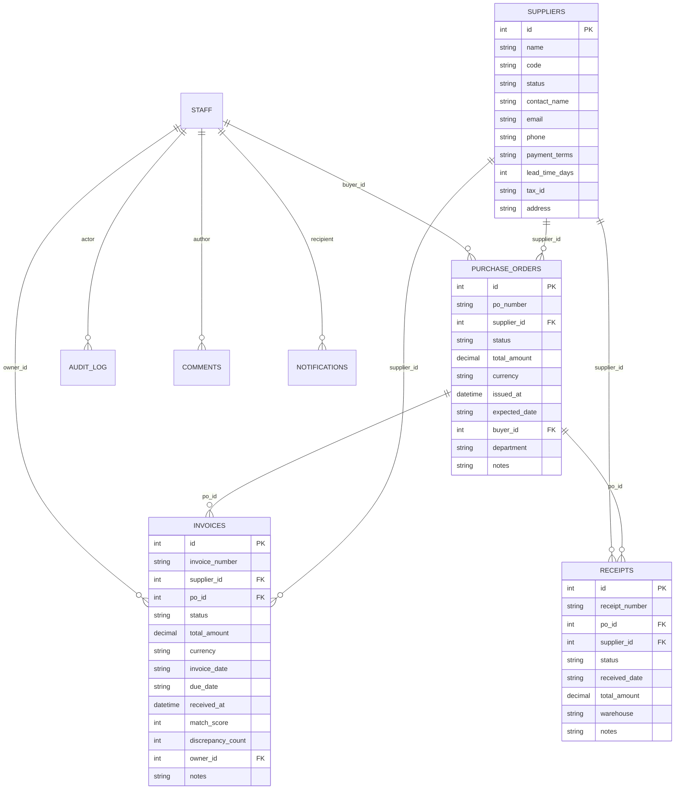

# Invoice Matching Desk

Compare invoices, purchase orders and receipts; route discrepancies for review.

An accounts-payable matching workspace: invoice intake, three-way match against purchase orders and receipts, variance detection, discrepancy triage, approval routing, supplier context and an admin panel for audit, imports, integrations and data quality.

**Category:** Finance & Accounting  
**Version:** 1.0.0  
**Template slug:** `invoice-matching-desk`  
**Minimum platform:** 2.1.0-preview.1

## What it does

The Invoice Matching Desk gives AP teams a single queue for invoice intake and exception handling. Each invoice carries supplier, purchase-order and receipt context, a match score and variance results. Discrepancies are categorized by price, quantity, tax, duplicate, missing document or supplier issue, assigned to an owner and routed through review and approval. Managers get match-rate, exception-age and supplier-quality reporting; admins get audit diffs, import/export, integration health, job monitoring, webhook logs and data-quality checks.

The package is data-only: schema, deterministic seed, parameterized queries, widgets, pages, workflows, listeners, cron jobs and roles. Installing it creates tenant-isolated physical tables named `tpl_ap_<tenantShort>_*` and bundles every UI resource through the existing Bundle v1 importer.

## Page map

| Page slug | Title | Access tags |
| --- | --- | --- |
| `ap-invoices-list` | Invoices · list | core, staff, manager, admin |
| `ap-invoices-detail` | Invoices · detail | core, staff, manager, admin |
| `ap-invoices-create` | Create Invoice | core, staff, manager, admin |
| `ap-purchase_orders-list` | Purchase Orders · list | core, staff, manager, admin |
| `ap-purchase_orders-detail` | Purchase Orders · detail | core, staff, manager, admin |
| `ap-purchase_orders-create` | Create Purchase order | core, staff, manager, admin |
| `ap-receipts-list` | Receipts · list | core, staff, manager, admin |
| `ap-receipts-detail` | Receipts · detail | core, staff, manager, admin |
| `ap-receipts-create` | Create Receipt | core, staff, manager, admin |
| `ap-suppliers-list` | Suppliers · list | core, staff, manager, admin |
| `ap-suppliers-detail` | Suppliers · detail | core, staff, manager, admin |
| `ap-suppliers-create` | Create Supplier | core, staff, manager, admin |
| `ap-dashboard` | Dashboard | core, shared, staff, manager, admin, viewer |
| `ap-reports-operations` | Reports · operations | report, manager, admin |
| `ap-profile` | My profile | shared, staff, manager, admin, viewer, portal |
| `ap-notifications` | Notifications | shared, staff, manager, admin, viewer, portal |
| `ap-settings` | Settings | shared, manager, admin |
| `ap-portal` | Client portal | portal, client, admin, manager |
| `ap-admin-roles` | Admin · roles and permissions | admin |

## Data model

The package ships 4 domain tables plus 10 support tables (staff, lookups, audit, comments, attachments, notifications, settings, imports, operations, role matrix).

## Workflows

| Workflow | Purpose | Nodes |
| --- | --- | --- |
| `ap.intake-triage` | Invoices · intake triage | 8 |
| `ap.approval-chain` | Invoices · approval chain | 8 |
| `ap.daily-digest` | Invoices · daily digest | 5 |
| `ap.data-collection` | Invoices · supplier/customer follow-up | 4 |
| `ap.error-recovery` | Invoice Matching Desk · expected failure and recovery | 5 |

### Invoices · intake triage

flowchart TD
  n0["start <small>start</small>"]
  n1["loadRecord <small>dataQuery</small>"]
  n2["scoreRecord <small>javascript</small>"]
  n3["highValue <small>condition</small>"]
  n4["setReview <small>dataQuery</small>"]
  n5["setStandard <small>dataQuery</small>"]
  n6["notifyReview <small>dataQuery</small>"]
  n7["done <small>end</small>"]
  n0 -->|output| n1
  n1 -->|success| n2
  n2 -->|success| n3
  n3 -->|review| n4
  n3 -->|standard| n5
  n4 -->|success| n6
  n6 -->|success| n7
  n5 -->|success| n7

### Invoices · approval chain

flowchart TD
  n0["start <small>start</small>"]
  n1["loadRecord <small>dataQuery</small>"]
  n2["Approve Invoice #{{ ctx.recordID }} <small>approval</small>"]
  n3["setApproved <small>dataQuery</small>"]
  n4["setRejected <small>dataQuery</small>"]
  n5["setExpired <small>dataQuery</small>"]
  n6["notifyDecision <small>dataQuery</small>"]
  n7["done <small>end</small>"]
  n0 -->|output| n1
  n1 -->|success| n2
  n2 -->|approved| n3
  n2 -->|rejected| n4
  n2 -->|expired| n5
  n3 -->|success| n6
  n4 -->|success| n6
  n5 -->|success| n6
  n6 -->|success| n7

### Invoices · daily digest

flowchart TD
  n0["start <small>start</small>"]
  n1["loadStats <small>dataQuery</small>"]
  n2["composeDigest <small>javascript</small>"]
  n3["sendDigest <small>dataQuery</small>"]
  n4["done <small>end</small>"]
  n0 -->|output| n1
  n1 -->|success| n2
  n2 -->|success| n3
  n3 -->|success| n4

### Invoices · supplier/customer follow-up

flowchart TD
  n0["start <small>start</small>"]
  n1["Follow up on Invoice #{{ ctx.recordID }} <small>dataCollection</small>"]
  n2["recordFollowUp <small>dataQuery</small>"]
  n3["done <small>end</small>"]
  n0 -->|output| n1
  n1 -->|output| n2
  n2 -->|success| n3

### Invoice Matching Desk · expected failure and recovery

flowchart TD
  n0["start <small>start</small>"]
  n1["injectFailure <small>javascript</small>"]
  n2["compensate <small>javascript</small>"]
  n3["notifyRecovery <small>dataQuery</small>"]
  n4["done <small>end</small>"]
  n0 -->|output| n1
  n1 -->|error| n2
  n2 -->|success| n3
  n3 -->|success| n4

Failure behavior: every workflow declares per-node `errorHandling`; external sync and recovery workflows have explicit error edges. Human tasks (approval/dataCollection) suspend with an expiry and resume through the platform's data-collection endpoint. Cron jobs and listeners ship **inactive/disabled** until reviewed.

## Roles and permissions

- **AP Administrator** (`admin`): Full access to every page, query, workflow and admin panel.
- **AP Manager** (`manager`): Owns matching policy, exceptions, approvals and AP reporting.
- **Invoice Matching Specialist** (`specialist`): Works the invoice queue, runs matches and investigates discrepancies.
- **AP Approver** (`approver`): Reviews approved matches and signs off exceptions and payment holds.
- **Read-only Viewer** (`readonly`): Read-only invoice, match and supplier context without workflow execution.

The installer creates tenant-scoped platform roles and grants asset-level Casbin permissions for the pages, queries and workflows in this package. Admin pages are tagged `admin`; the client portal is tagged `portal`. Widget visibility is enforced by page grouping and query execution permissions because the platform has no widget-level RBAC.

## Integrations

- **Inbound webhook** — required: endpoint path, signature header (optional). Mock: Send a JSON body with kind=webhook.received to the inactive listener.

## Install

1. Open **Marketplace → App templates**.
2. Select **Invoice Matching Desk** and choose install options (sample data is on by default).
3. Install. The installer creates the schema, seed, resources, roles and (optionally) cron jobs.
4. Reconnect the primary PostgreSQL datasource only if the platform database differs from the tenant's target database; the bundled install injects the platform connection server-side.
5. Review inactive listeners and disabled cron jobs before enabling automation.
6. Open **Dashboard** (or **Client portal** for external roles).

## Quality features

- Audit trigger on every domain and support write, with old/new JSON snapshots.
- Soft delete + restore on domain tables.
- CSV import with validation summary and stored error report.
- CSV export on every list, report and comment/attachment table.
- Saved filter views, bulk actions, comments, attachments, in-app notifications.
- Keyboard-accessible form widget with required/format/min/max validation.
- Empty, loading and error states on every operational page.

## Customization

- **Fields:** edit `schema/001-schema.sql` and the field arrays in the spec, then regenerate.
- **Seed:** edit `seed/001-seed.sql` or the generator spec; dates are relative to `now()`.
- **Queries:** `queries/*.json` are parameterized (`$1...$n`); keep the input definition order in sync with the numbers.
- **Pages/widgets:** `pages/*.json` and `widgets/*.json` use layout v2 and the `{{ state.* }}` binding syntax.
- **Workflows:** `workflows/*.json` use the platform node handlers; edges carry `sourceHandle` values.
- **Regenerate deterministically:** `node marketplace/scripts/generate-templates.js invoice-matching-desk`.

## Known limitations

- Widget-level RBAC is not a platform primitive; use page tags and asset permissions.
- Modal/drawer widgets are not available; detail pages and tabs are used.
- DataCollection API/webhook delivery is not first-class; forms/approval plus webhook listeners are used.
- XLSX export is Excel-compatible CSV; there is no XLSX runtime.
